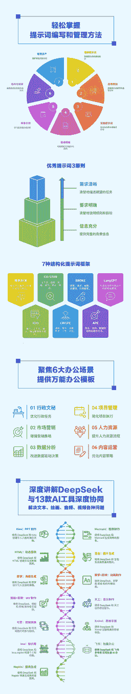

# AI 智能化办公

> 来源：[https://gotoaiworld.feishu.cn/docx/AQ2kdPUMOo3gkTxwASucam9Pnaf](https://gotoaiworld.feishu.cn/docx/AQ2kdPUMOo3gkTxwASucam9Pnaf)

###  AI幻灯片和演示

1.  [秘塔搜索](http://metaso.cn/)：能够深入理解您的问题的AI搜索引擎，没有广告，直达结果 秘塔搜索

1.  G[amma App：](https://gamma.app/)在线网页版创建演示文稿的，允许用户仅通过文本和想法提示，点击按钮便可以生成设计美观和具有吸引力的幻灯片 Gamma App

1.  T[ome：](https://tome.app/)借助OpenAI的GPT和DALL-E 2的AIGC技术，将文本和图像无缝结合，创造出动态的视觉故事。 Tome

1.  [美图AI PPT](https://design.meitu.com/ppt/?ref=ai-bot.cn)：只需要输入一句话就可以轻松打造精美PPT 美图AI PPT

1.  爱设计PPT：智能一键生成PPT[，灵活的编辑](https://ppt.isheji.com/?utm_type=AI%E5%B7%A5%E5%85%B7%E9%9B%86&utm_source=ai-bot&utm_page=aippt&utm_plan=ppt&utm_unit=ai-bot&utm_keyword=129323)能力，以及内置数百套模板库 爱设计PPT

1.  [ChatPPT](https://chat-ppt.com/)：国内首个中文AI生成PPT的办公产品 ChatPPT

1.  [Mindshow](https://www.mindshow.fun/?ref=ai-bot.cn#/home)：输入内容自动生成演示PPT Mindshow

### AI表格数据处理

1.  ChatExcel：北大团队开发的[通过聊天来操作Ex](https://chatexcel.com/)cel表格的AI工具 ChatExcel

1.  [ExcelFormulaBot](https://formulabot.com/)：AI将指令转换成Excel的函数公式 ExcelFormulaBot

### AI文档工具

1.  [WPS AI](http://www.wps.cn/)：智能文档写作、阅读理解和问答、具有智能人机交互 WPS AI

1.  [ChatDOC](https://chatdoc.com/)：基于ChatGPT的文档阅读、提取、总结、摘要的工具 ChatDOC

### AI思维导图

1.  Xmind Copilot：一句话生成思维导图，一键提供灵[感和思路，一键总结文章思路](https://xmind.ai/cn?ref=ai-bot.cn)，一键成文。 Xmind Copilot

1.  [ChatMind](https://www.chatmind.tech/?ref=ai-bot.cn)：与AI对话生成思维导图 ChatMind

1.  [印象图记](https://static.app.yinxiang.com/evermind/product/login)：输入想发散的内容主题即可将内容以思维导图的形式呈现。印象图记

1.  博思白板：一键生成PPT、用AI协助创作思维[导图、A](https://boardmix.cn/ai-whiteboard/?ref=ai-bot.cn)I绘画、AI写作，共享资源素材 博思白板

### AI会议工具

1.  [通义听悟](https://tingwu.aliyun.com/?utm_source=ai-bot.cn)：阿里推出的AI会议转录工具。  通义听悟

1.  [飞书妙记](https://www.feishu.cn/product/minutes)：飞书智能会议纪要和快捷语音识别转文字 飞书妙记

1.  讯飞听见：科大讯飞推出的AI智能会议系统[，实时字](https://meeting.iflyrec.com/)幕、实时翻译、自动生成会议记录。讯飞听见

### AI效率提升

1.  Monica：Chrome浏览器A[I助手插件，](https://monica.im/)可以随时调用ChatGPT Monica

# 一、AI智能化办公应用场景

> 输入 @ 插入相关文档，介绍项目成立的背景

