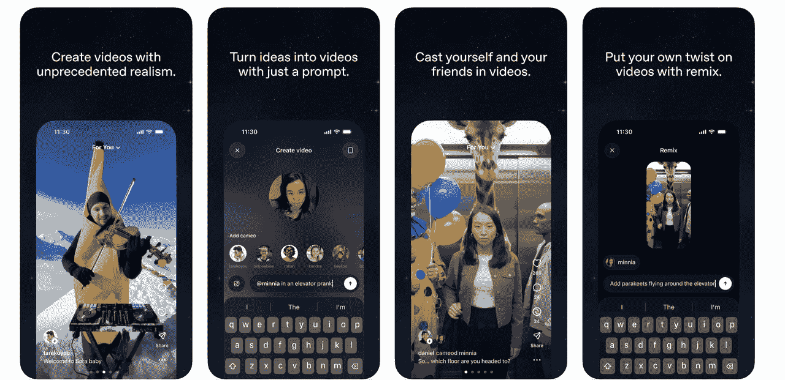
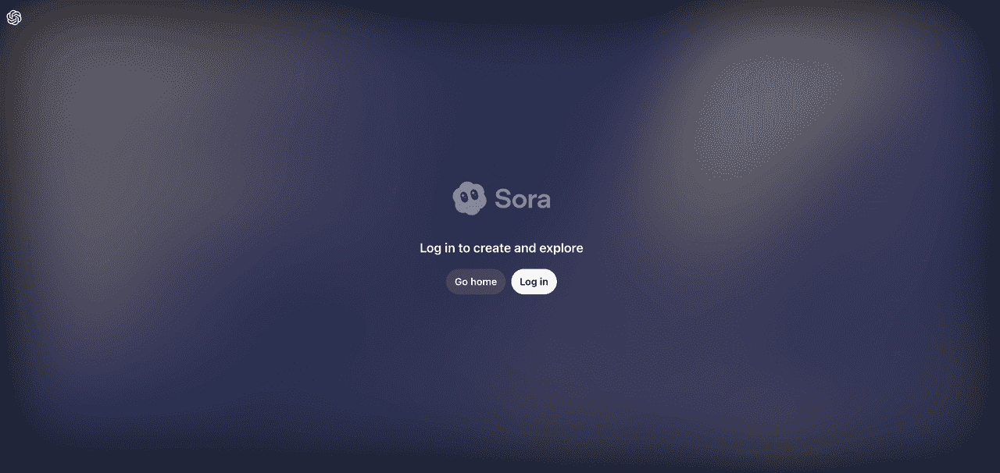
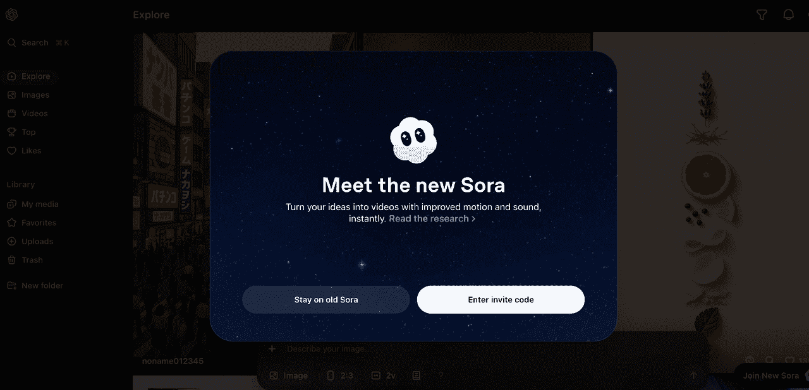
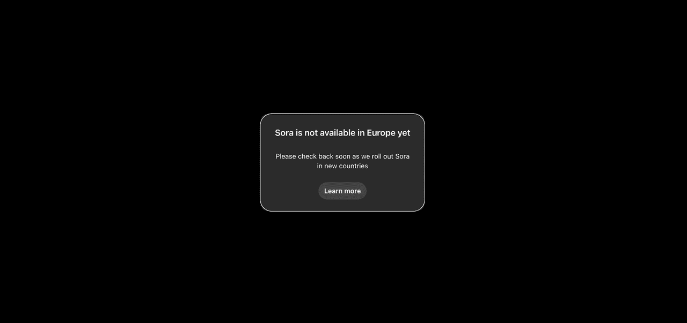
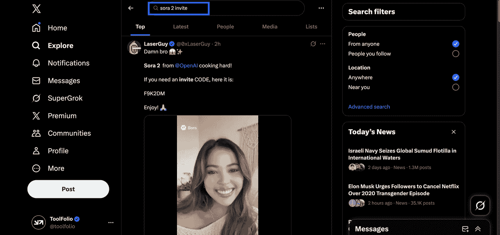

# How to Get Sora 2 Invite Codes for Free

> 来源：[https://gotoaiworld.feishu.cn/docx/KDJQdHMDsojNmoxOQjKcLJlynOh](https://gotoaiworld.feishu.cn/docx/KDJQdHMDsojNmoxOQjKcLJlynOh)

# How to Get Sora 2 Invite Codes for Free

How to Get a Sora 2 Invite Code (Guide)

Here are the simple steps to join Sora 2 early, claim invite codes fast, and start creating AI videos.

Oct 2, 2025

Last Updated Oct 2, 2025

Image Credit: Toolfolio

Sora 2 just launched, and many people are asking how to get an invite code. The app is new, invite-only, and not everyone can join right away. If you are here, you likely want to try it before others, see what it can do, and share videos with friends.

Sora 2 is OpenAI’s new video and audio tool. It is linked with a social app that looks like TikTok but with AI-made clips. Because access is limited, invite codes are the only way in right now.

This guide will explain how the invite system works, who can get a code, and the steps you can take to join Sora 2 as soon as possible.

What is Sora 2?

Sora 2 is the latest, highly advanced text-to-video and audio generation AI model developed by OpenAI.

It can create short, realistic video clips with sound, dialogue, and movement that follow the rules of physics. For example, a ball bounces off the backboard instead of teleporting into the hoop. This makes the results more natural than older AI video models.

The [**Sora app**](https://toolfolio.io/blog/create-hyperreal-videos-from-text-prompts-with-sora-a-creative-app-by-openai), whi**ch wor**ks like TikTok or Instagram Reels, is built around Sora 2. In the app, you can swipe through an endless feed of AI-made videos, create your own, and even appear in them using a feature called cameos.

Cameos let you upload a short video of yourself so the AI can generate clips with your likeness. You can also share your cameo with friends so they can add you into their videos.

Country Availability

Right now, Sora 2 is only available in the United States and Canada. The app is invite-only, which means you need a code to join.

OpenAI says this system helps manage high demand and lets the platform grow more safely before opening to everyone.

How to Get a Sora 2 Invite Code (Steps)

Getting into Sora 2 is not as easy as just downloading the app.

You need a valid invite code, and those codes run out fast. Below are the steps that will give you the best chance of joining.

Step 1: Log in to Sora with your ChatGPT account

Go to the [**Sora website**](https://sora.chatgpt.com/explore) or app and sign in with your ChatGPT account.

Once you are logged in, you will see the option that says “Enter invite code.” This is where you paste your code later.

If you get the message that Sora is not available in your country, you can use a VPN to connect to the United States or Canada, since those are the only regions where Sora 2 works for now.

Step 2: Join the official OpenAI Discord server

[The next step ](https://discord.com/invite/openai)is to join the OpenAI Discord. Log in with your Discord account, or create one if you do not already have it. Accept the invitation to the OpenAI server.

Once inside, you will be asked to answer three questions and agree to the rules. After that, click on the OpenAI logo in the left panel and select #openai-verification.

Here you must verify that you own an active OpenAI account. Just click on Verify with OpenAI.

If you are already signed in to ChatGPT, this step is fast.

Step 3: Look for codes in the “sora-2” channel

O**nce you**r account is verified, refresh the Discord page and go to the #sora-2 channel. This is where people share working invite codes.

Be quick, because once enough people use a code, it stops working. The faster you copy and paste a code into the Sora login page, the better your chances.

A useful trick is to keep Discord open next to the Sora site, so you can paste codes without wasting time typing them by hand.

Step 4: Try social media for fresh codes

If Discord feels too crowded or the codes get used up before you can claim one, another good place to check is Twitter (X).

Many users post fresh Sora 2 invite codes there. Search for “Sora 2 invite code” and look at the latest posts. Move quickly, because new codes usually disappear within minutes.

This is how many early users are getting in. Once you paste it into the Sora login page, the app will unlock, and you can start creating videos right away.

Sora 2 Invite Codes (Shared Online)

Sometimes users share working Sora 2 invite codes in forums, Discord chats, or social media. These codes only work a few times before they expire, so there is no guarantee they will still be active.

If the ones below do not work, follow the steps above to find fresh ones.

Here are some invite codes that were posted online:

**7ZDCNP**

F9K2DM (Working)

**B8D3TB**

**2J3MWH**

**CKRYDK**

**PHMM2K**

**C5R1Q3**

**DNA2BW**

**89VXBN**

**IDDQD**

**A85AN6**

**M02EGT**

**SK9H6P**

**CKRYDK**

**0B8Z7G**

**P6GZHV**

**C2Y15E**

**JGH5NC**

**TPV8C5**

**6YZ6YG**

**ASAJW4**

**62K5MR**

**6S9T2B**

**7519GB**

**VKAGK6**

**ALR9HA**

**H92713**

**Z3J7YW (new)**

**TRJ49W (new)**

**TEKQ0T (new)**

**Q63FBK (new)**

**MXHJV2 (new)**

**KL138J (new)**

**G81PQF (new)**

**9T2Y3N (new)**

**7M4P8T (new)**

**3K9X2J (new)**

**1R6W5F (new)**

If you try one and it does not work, it means the code has already reached its limit. That is normal. The best way is to join the OpenAI Discord or check Twitter for new codes in real time.

⚠️ **Important:** Do not pay money for codes. Stick to trusted sources like the official Discord or community posts.

Wrapping Up: How to Get Sora 2 Invite Codes

Getting a Sora 2 invite code takes patience and speed. The main ways are logging in wit**h your **ChatGPT account, verifying on the official OpenAI Discord, and grabbing fresh codes from the #sora-2 channel or Twitter. Remember, codes expire fast, so act quickly and never buy them from untrusted sources.

If you want to explore more guides, check out:

AI Tools for Project Management

CapCut Alternatives

Figma Alternatives

AI Presentation Makers in 2025

And if you’ve built[** a tool, **](https://toolfolio.io/)list it on Toolfolio. It’s the best online tools and inspiration resource for designers, startups, developers, and anyone who loves tools.

https://toolfolio.io/productive-value/how-to-get-a-sora-2-invite-code