# 从零微调一个专属领域大模型

> 来源：[https://gotoaiworld.feishu.cn/docx/Uwr3dl4bKoeQTmxtic6cT8QNnBc](https://gotoaiworld.feishu.cn/docx/Uwr3dl4bKoeQTmxtic6cT8QNnBc)

# 序言

第一期内容：LLaMA Factory 微调教程（一）：入门和基础使用

第二期内容：LLaMA Factory 微调教程（二）：构建高质量数据集

第三期内容：[**LLaMA Factory 微调**](https://mp.weixin.qq.com/s?__biz=Mzk0MDMwMzQyOA==&mid=2247504105&idx=1&sn=e8d949a979462916084ae77f99314d53&token=1820647549&lang=zh_CN&scene=21#wechat_redirect)教程（三）：微调参数设置，显存估算和优化

第四期内容：[**LLaMA Factory 微调**](https://mp.weixin.qq.com/s?__biz=Mzk0MDMwMzQyOA==&mid=2247504159&idx=1&sn=e9591e2849c4c4430989200cf978572e&token=348352515&lang=zh_CN&scene=21#wechat_redirect)教程（四）：微调过程观测，微调后模型部署

> 原创：code秘密花园

> https://mp.weixin.qq.com/s/YntCYouTa0gbUuXl1wYwWA

# 1.LLaMA Factory 介绍和基本使用

https://mp.weixin.qq.com/s/aQCY8873d09zFIhMhrx7Pg

之前 如何把你的 DeePseek-R1 微调为某个领域的专家？ 的微调教程发出后，很多小伙伴想在本地进行尝试微调，但是因为代码能力有限以及对微调过程中的各种知识了解不够深入，遇到了各种问题。因此很多小伙伴求助我能不能出一期零代码、纯本地微调的教程。所以今天这一期，我们来使用目前最热门的本地微调工具：LLaMA Factory 配合 Easy DataSet 一站式完成从数据集准备到模型微调的全流程。另外为了帮助大家更好的学习理解，在这个系列的课程中，我也会穿插讲解一些大模型的基础理论，所以这个教程比较长，我们将拆分成几个部分来讲解，课程大纲如下：

---

## 基础回顾

+   **为什么需要模型微调？**

+   通用大模型在特定领域或任务表现可能不佳，微调可实现领域专业化、适配不同任务、纠偏能力，还能保障数据安全，且成本效率高于从头训练，故需模型微调。相比长文本、知识库，微调能深度内化专业知识与任务逻辑，无需依赖实时检索或长文本处理，定制化强，显著提升特定场景性能，且数据安全可控，成本效率更高。

---

+   **模型任务有哪些常见分类？**

+   监督微调，含指令微调（明确任务指令，如翻译）、对话微调（多轮对话数据，如客服）、领域适配（特定领域术语，如医疗）、文本分类（结构化标签，如情感分析）、模型推理微调（思维链标注，如数学解题）；知识蒸馏，将复杂模型知识迁移至轻量模型，降低推理成本；强化学习，结合人类反馈优化生成质量，提升安全性与风格一致性；多模态微调，处理文本、图像、语音等跨模态数据，实现图文问答、视频分析等场景。

---

+   **微调的基本流程是怎样的？**

+   选定一款用于微调的预训练模型、准备好用于模型微调的数据集、准备一些问题，对微调前的模型进行测试（用于后续对比）、设定模型微调需要的超参数、执行模型微调训练、观测微调过程、对微调后的模型进行测试，并对比效果、如果效果不满意，继续调整前面的数据集以及各种超参数，直到达到满意效果、导出并部署微调好的模型。

---

+   **微调数据集有哪些常见格式？**

+   模型微调数据集无明确格式要求，一般在代码中抹除差异，将其转为格式化字符串数组。主流格式有 Alpaca 和 ShareGPT：前者结构简洁，适用于单轮任务、指令微调；后者支持多轮对话与工具调用。

---

+   **微调数据集有哪些常见用途？**

+   训练集、验证集、测试集构成学习闭环，分别如日常练习题、模拟考试卷、最终期末考试，缺一不可。训练集助模型学规律，验证集调策略防过拟合，测试集验真实水平且需隔离。完整集含三者，常按比例划分，数据不足可用交叉验证等，时间序列数据按时间划分。

---

+   **微调过程中有哪些关键参数？**

+   模型训练关键超参数有三：训练轮数：指遍历训练数据次数，少则不熟、多则过拟合；学习率决定参数调整幅度，大则进步快易走偏，小则稳定但慢；批量大小是每次更新用的样本数，大则快而粗、小则慢而细。实际需调参验证，小白用默认即可。

---

如果你对这些内容还不够了解，建议先学习这几期内容：

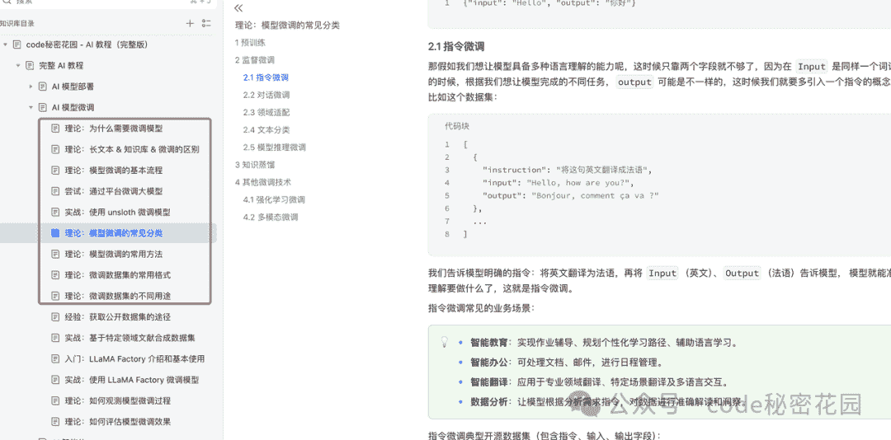

下面，我们来了解一下 LLaMa Factory 这个工具。

## LLaMA Factory 介绍和基本使用

LLaMA Factory 是一个简单易用且高效的大型语言模型训练与微调平台。通过它，用户可以在无需编写任何代码的前提下，在本地完成上百种预训练模型的微调。https://github.com/hiyouga/LLaMA-Factory

#### 全场景模型微调能力

+   多模型支持：高效适配超 100 个主流模型，涵盖 Qwen、DeepSeek、LLaMA、Gemma、LLaVA、Mistral、Mixtral-MoE、Yi、Baichuan、ChatGLM、Phi 等，满足 NLP、多模态等多领域需求。

+   多样化算法与精度：集成 LoRA、GaLore、DoRA 等微调技术，支持（增量）预训练、（多模态）指令监督微调、奖励模型训练、PPO/DPO/KTO/ORPO 等强化学习方法；提供 16 比特全参数微调、冻结微调、LoRA 微调，以及基于 AQLM/AWQ/GPTQ 等技术的 2/3/4/5/6/8 比特 QLoRA 低比特量化微调，灵活适配不同算力场景。

+   数据集灵活配置：支持用户自带数据集或自定义生成数据集，兼容 ModelScope、HuggingFace 等社区资源，自动下载缓存模型与数据集，适配多卡训练硬件环境。

+   多种加速技巧：支持 FlashAttention-2、Unsloth 等加速算子。

#### 极简操作与高效工具链

+   零代码交互界面：通过友好 Web UI 完成模型配置、数据集加载、参数调优全流程，实时监控训练进度、显存占用及日志输出，无需编程即可轻松定制与微调 LLM，大幅降低使用门槛。

+   实时监控与评估：无缝集成 Wandb、MLflow、SwanLab、TensorBoard 等工具，实现训练过程可视化与模型性能动态评估，为优化提供数据支撑。

#### 工程化部署与资源利用

+   模型部署：支持将 LoRA 适配器与基座模型一键合并为独立完整模型，便于本地化部署；

+   推理引擎：集成 Transformers 、提供基于 vLLM 的 OpenAI 风格 API；

+   资源利用：支持单机多卡训练与不同硬件环境适配，实现资源高效利用与流程无缝衔接。

---

### LLaMA Factory VS unsloth


Unsloth 是一个开源工具，专门用来加速大语言模型（LLMs）的微调过程。

+   高效微调：Unsloth 的微调速度比传统方法快 2-5 倍，内存占用减少 50%-80%。这意味着你可以用更少的资源完成微调任务。

+   低显存需求：即使是消费级 GPU（如 RTX 3090），也能轻松运行 Unsloth。例如，仅需 7GB 显存就可以训练 1.5B 参数的模型。

+   支持多种模型和量化：Unsloth 支持 Llama、Mistral、Phi、Gemma 等主流模型，并且通过动态 4-bit 量化技术，显著降低显存占用，同时几乎不损失模型精度。

+   开源与免费：Unsloth 提供免费的 Colab Notebook，用户只需添加数据集并运行代码即可完成微调。

从以上描述中我们可以看出，Unsloth 主要突出的是更快的速度和更小的内存占用，并且在 Github 上公开了很多整理好的 Colab 笔记本：

通过这些 Colab ，我们可以在只改动一些关键参数（如模型、数据集等），就可以跟随指引一步步完整微调和模型导出的整个过程，并且整个过程不需要消耗我们本地的资源、速度也很快，所以非常推荐初学者使用。

我们可以在 LLaMa Factory 文档(https://llamafactory.readthedocs.io/zh-cn/latest/advanced/acceleration.html)看到，unsloth 作为一种加速手段出现在了 LLaMa Factory 的介绍里。

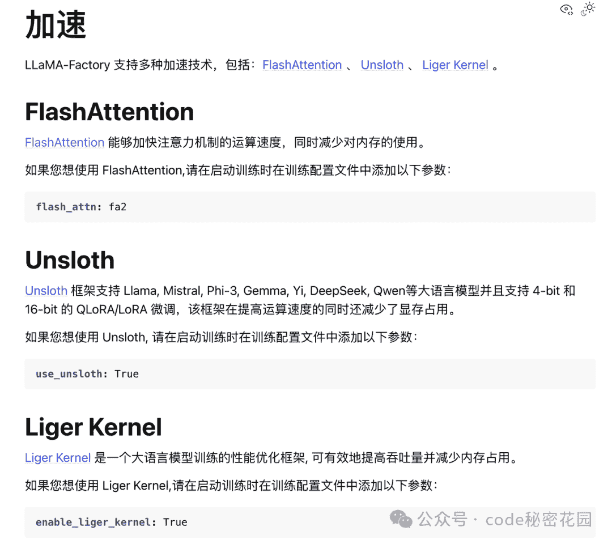

通过以上对 LLaMA Factory 的介绍，我们也可以看出 LLaMA Factory 是一个更全面、更完善的微调框架，通过配置模型量化、指定加速算子，也能够达成和 Unsloth 类似的加速效果，但是 LLaMA Factory 支持的模型种类、训练方法、优化方法、硬件适配等都要比 Unsloth 更丰富。另外，LLaMA Factory 支持基于 WebUI 零代码微调，而 Unsloth 仅能通过编码，因此：

+   **Unsloth 适合：**

+   资源受限场景：由于其出色的内存优化能力和快速的微调速度，非常适合在资源受限的环境中使用，如个人开发者使用消费级 GPU 进行大模型微调，或者企业在低成本硬件上进行模型实验和开发。

+   快速迭代场景：对于需要快速迭代模型的场景，如学术研究中的实验验证、企业的快速原型开发等，Unsloth 的高效微调能力可以帮助用户在更短的时间内获得微调后的模型，加快项目进度。

+   LLaMa Factory 适合：

+   通用场景：由于其支持多种模型和训练算法，适用于各种通用的大语言模型训练和微调场景，无论是文本生成、情感分析还是机器翻译等任务，都可以使用 LLaMa Factory 进行模型的定制化训练。

+   企业级应用：提供了API Server 和一站式 WebUI Board，方便企业进行模型的管理和部署。

+   零代码：适合不会写代码或代码基础比较弱的同学快速上手进行微调。

---

### LLaMA Factory 安装

我们在官网可以看到 LLaMa Factory 的安装方法：https://llamafactory.readthedocs.io/zh-cn/latest/getting_started/installation.html#llama-factory

但是这里我们不建议 Clone 仓库后直接安装依赖，因为 Python 本身的依赖管理做的比较混乱，你可能会遇到各种 Python 依赖冲突的问题，建议使用虚拟环境，这里我们使用 Conda：

Conda 是一个开源的跨平台、语言无关的软件包管理系统与环境管理系统。它能方便地安装、运行和更新软件包及其依赖项，还可创建、切换和删除隔离的软件环境，广泛应用于数据科学、机器学习等领域 。

你可以根据自己的需求选择合适的发行版，从官方网站（Anaconda 或 Miniconda）下载对应操作系统的安装程序，然后按照安装向导进行安装。

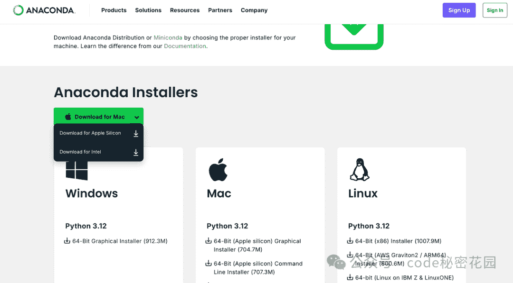

安装完成后，打开终端（Windows 用户可以使用 Anaconda Prompt 或 PowerShell），输入以下命令验证 conda 是否安装成功：

```
conda --version
```

如果安装成功，会显示 conda 的版本号。

然后使用 conda create 命令创建一个新的虚拟环境。例如，创建一个名为 lf （LLaMA Factory 简称）的虚拟环境，并指定 Python 版本为 3.10：

```
conda create -n lf python=3.10
```

其中，-n 或 --name 用于指定虚拟环境的名称，python=3.10 表示使用 Python 3.10 版本。

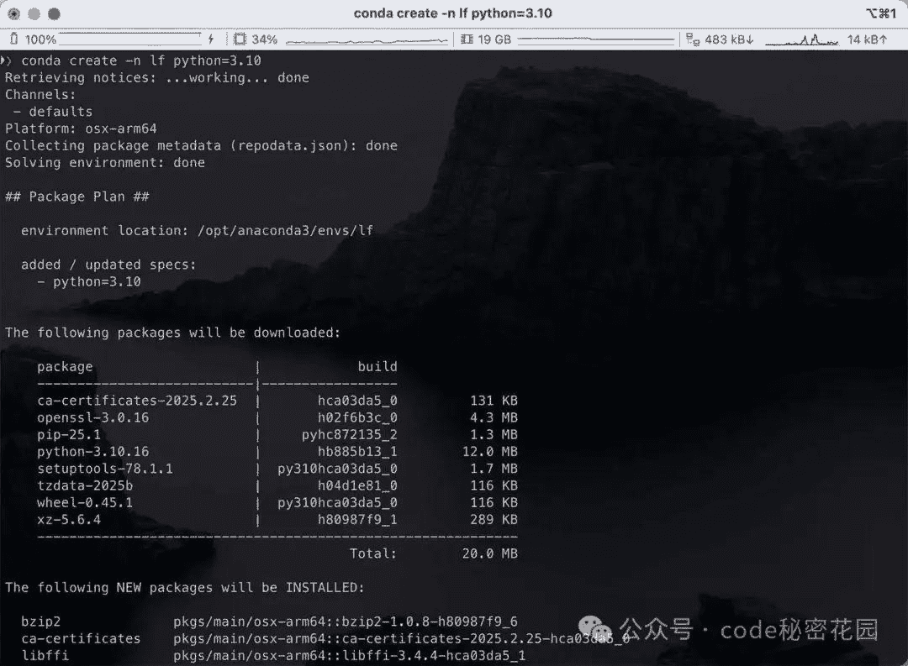

创建好虚拟环境后，需要激活它才能使用，

我们运行 在终端中运行以下命令激活 lf 环境：

```
conda activate lf
```

激活后，终端的命令提示符会显示当前所处的虚拟环境名称，然后我们可以使用 conda env list 命令查看所有已创建的虚拟环境：

```
conda env list
```

该命令会列出所有虚拟环境的名称和对应的路径（前面带 * 的为当前已激活的虚拟环境）：

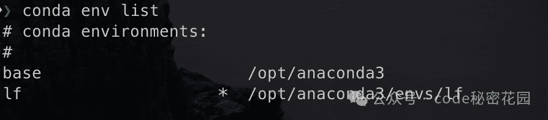

然后我们在此虚拟环境中执行：

```
pip install -e &quot;.[torch,metrics]&quot;
```

依赖安装完成后，我们执行 llamafactory-cli version 验证安装情况：

然后我们测试执行 which llamafactory-cli 可以发现，llamafactory 被安装在了 conda 创建的虚拟环境目录下：

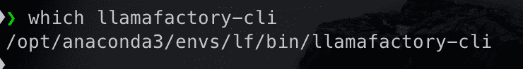

---

### LLaMA Factory WebUI

依赖安装完成后，我们执行：llamafactory-cli webui，可以启动 LLaMa Factory 的 webui：

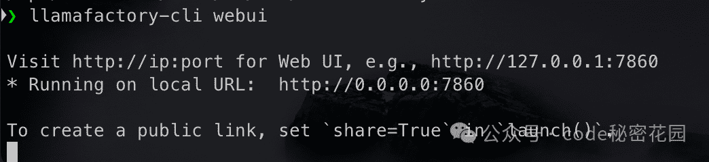

然后我们打开 http://127.0.0.1:7860 ，可以看到如下界面：


看起来配置非常多，但我们梳理一下可以分成通用设置、微调训练、模型评估、在线推理、模型导出五个部分，这里我们先做简单了解，后续我们会对关键配置进行具体讲解：

+   **通用设置：**可以设置 WebUI 展示的语言、需要微调的模型、微调的方法、是否量化、微调的加速方式等配置：


---

+   **微调训练**：包括以下几部分配置：

+   **微调训练的阶段**：预训练、指令微调、强化学习等等；

+   **微调使用的数据集**：数据集的格式、路径、验证集的比例等等；

+   **关键微调参数**：在我们之前教程中重点学习的：学习率、训练轮数、批量 大小等等；

+   **LoRA 参数：**当使用 Lora 微调时需要配置的一些特殊参数；

+   **RLHF 参数：**当训练阶段为强化学习时需要配置的一些特殊参数；

+   **特殊优化参数：**当选择使用 GaLore、APOLLO 和 BAdam 优化器时需要配置的一些参数；

+   **SwanLab 参数：**一款开源的模型训练跟踪与可视化工具；


---

+   **模型评估：**在完成模型训练后，可以通过此模块来评估模型效果，这里可配置模型评估所需的数据集等：

---

+   **在线推理**：可以选择使用 huggingface、vllm 等推理引擎和模型在线聊天，主要用来测试加载模型：

+   **模型导出**：可以指定模型、适配器、分块大小、导出量化等级及校准数据集、导出设备、导出目录等。

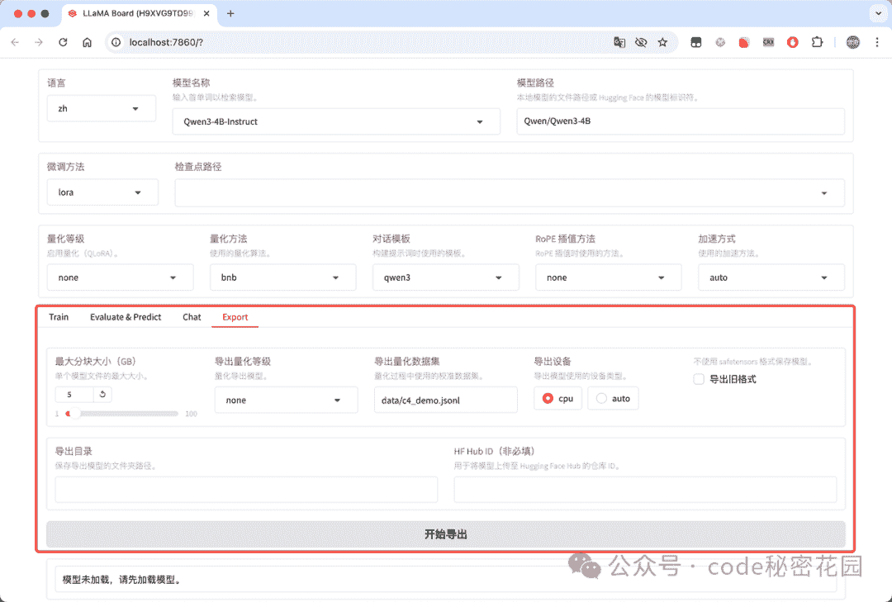

---

## LLaMA Factory 微调通用设置

了解完 LLaMA Factory 的基础使用，下面我们开始实际启动一个模型微调任务，并且在这个过程中具体介绍各项参数，首先我们来看通用配置。

### 选择模型

第一步，我们需要选择一个用来微调的基础模型，我们可以直接在模型名称这里输入我们需要微调的模型关键词（比如 DeepSeek、Qwen3），基本上市面上所有主流的开源模型都可以在这里获取到，可以发现，一个模型其实有非常多的变体：

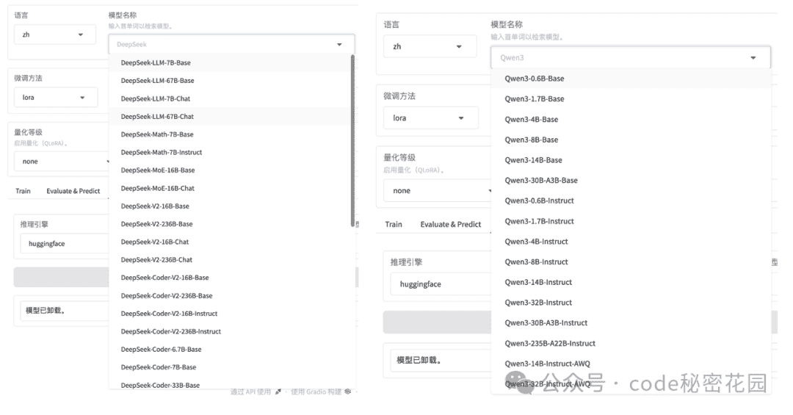

在之前 DeepSeek 的教程中，我们已经介绍了，在模型名称中，Distill 代表蒸馏过的模型，也了解了模型名称中的参数量表示：

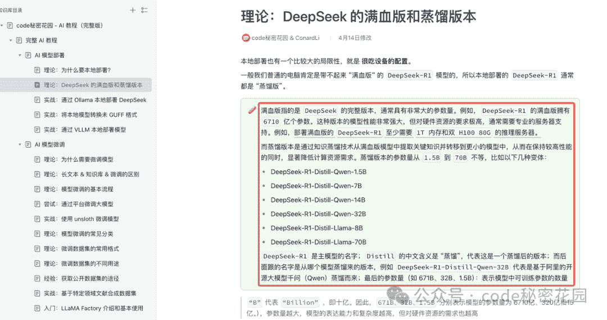

在微调前，选择一个合适的基座模型非常重要，下面我们再具体介绍一下模型名称中其他参数代表的含义：

如果我们需要进行的是监督指令微调，建议选择带 -Instruct 后缀的模型：


选取模型后，模型路径的位置会自动关联 Hugging Face 上的模型标识，如果你没有在本地下载过此模型，LLaMA Factory 将自动从 Hugging Face 上拉取此模型。

选择好模型后，我们点击下方 Chat Tab ，然后直接点击加载模型：

然后我们可以直接与模型进行对话，当模型能够正常输出，说明模型被正确加载：

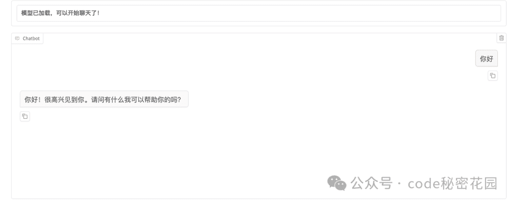

另外这里我们也可以直接执行一个本地的模型路径（注意重新加载模型前需要先卸载模型）：

---

### 微调方法

接下来，我们选择一个微调方法，可以看到这里支持 Full（全参）、Freeze（冻结）、Lora（低秩矩阵） 三种方法：

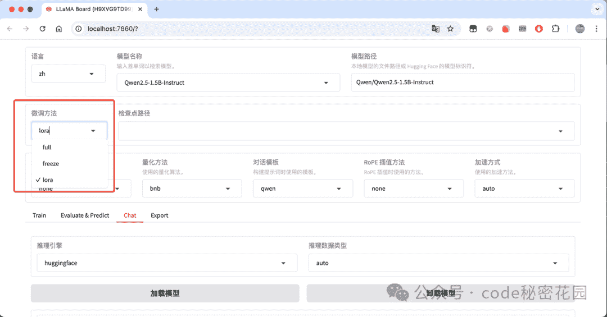

**全参数微调是最直接的迁移学习方法，通过在目标**任务数据上继续训练预训练模型的全部参数。

通俗理解：就好比把一栋房子彻底拆掉重建。预训练模型就像已经建好的房子，里面的每一块砖、每一根梁，在全参数微调时都要重新调整。例如，当我们想用一个原本用于识别普通图片的模型，改造为识别医学影像的模型时，就要把模型里所有参数都更新一遍。

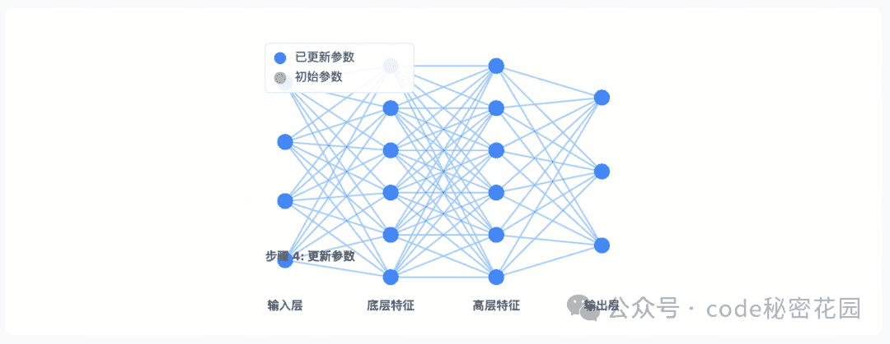

优点

+   最大化性能：通常能够在目标任务上达到最佳性能

+   完全适应性：允许模型充分适应新任务的特性

+   灵活性：可以用于各种不同的下游任务

+   实现简单：概念直接，实现相对简单

缺点

+   计算资源需求高：需要大量GPU内存和计算能力

+   存储成本高：每个任务都需要保存一个完整模型副本

+   灾难性遗忘：可能会丢失原始预训练中获得的知识

+   过拟合风险：在小数据集上容易过拟合

+   不适合低资源场景：在资源受限设备上难以部署

全参数微调适用场景：有充足的计算资源、需要最大化模型性能、目标任务与预训练任务有显著差异、 或有足够的任务数据可以有效训练所有参数。

---

**参数冻结微调通过选择性地冻结模型的某些部分，只更**新剩余参数，从而减少计算量并防止过拟合。

通俗理解：像是给房子做局部装修。我们保留房子的框架结构，只对部分区域进行改造。在模型中，就是保留预训练模型的底层结构，只调整顶层的部分参数。比如在训练一个糖尿病问答模型时，我们可以把语言模型的前 24 层参数冻结起来，只训练最后 3 层专门用于医学领域问答的分类器。

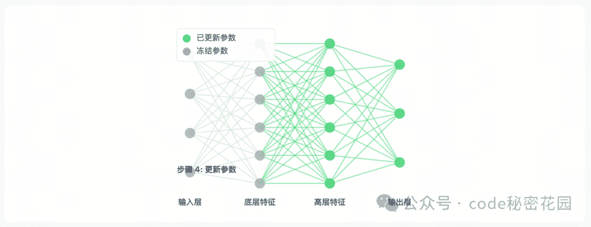

优点

+   计算效率：减少需要计算的参数数量，加快训练速度

+   内存效率：反向传播中不需要存储冻结参数的梯度

+   防止过拟合：特别适合小型数据集训练

+   保留通用特征：防止破坏预训练模型中有价值的通用特征

+   减少灾难性遗忘：保持模型的泛化能力

缺点

+   性能可能次优：在某些任务上可能无法达到全参数微调的性能

+   需要专业知识：选择哪些层冻结需要对模型架构有深入了解

+   灵活性降低：在任务与预训练差异大时效果可能不佳

+   调优困难：找到最佳的冻结点可能需要多次实验

参数冻结微调适用场景：计算资源受限的环境、训练数据集较小、目标任务与预训练任务相似、模型主要需要学习任务特定的表示、需要防止过拟合。

---

LoRA 通过向预训练模型中注入小型、可训练的低秩矩阵，在保持原始参数不变的情况下实现高效微调。

通俗理解：可以想象成给房子安装智能设备，不改变房子的原有结构，却能让房子变得更智能。在模型里，它不会直接修改原有的参数，而是在关键位置插入可训练的 “小模块”。

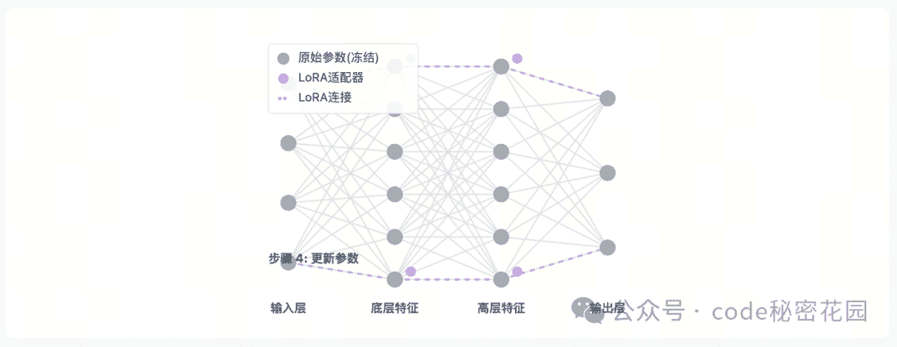

优点

+   极高的参数效率：训练参数数量减少99%以上

+   内存效率：大幅降低GPU内存需求

+   训练速度快：减少计算量，加快收敛

+   存储高效：每个任务只需保存小型适配器

+   可组合性：不同任务的适配器可以组合使用

+   避免灾难性遗忘：原始参数保持不变

缺点

+   性能上限：在某些复杂任务上可能弱于全参数微调

+   秩超参数选择：需要为不同模型和任务调整适当的秩

+   实现复杂性：比简单的微调方法实现更复杂

+   不是所有层都适合：某些特殊层可能不适合低秩适应

+   推理稍复杂：需要额外处理原始模型和适配器的组合

Lora 微调适用场景：计算资源有限、需快速适配新任务（如多任务切换）、追求轻量化模型部署与分享、目标任务和预训练任务存在中等差异、多模态任务场景、需频繁基于新数据迭代优化的场景。

---

LoRA 微调是目前最热门的微调方法，核心在于其高效性与适配性。训练过程中，LoRA 仅对少量低秩矩阵参数进行调整，相比全量参数微调，计算量和内存占用显著降低，训练速度大幅提升；同时，参数调整量少，极大降低了过拟合风险，使模型泛化能力更强。应用层面，它能灵活适配不同任务，为同一预训练模型构建多个 LoRA 模块，快速切换实现多任务学习；在部署阶段，其注入的线性层可与冻结参数无缝合并，不增加推理延迟。

---

### 模型量化

下面一个重要的配置是模型的量化，包括量化的等级和方法。

模型的**量化**还有**蒸馏**，其实都是属于模型压缩的常见方法。对于一些大参数模型，比如前段时间非常火的 DeepSeek-R1 满血版具有 6710 亿个参数、最新的 Qwen3 满血版有 2350 亿个参数，它们都是各自公司下的旗舰版模型，具备着最先进的能力。但是由于参数量巨大，普通的小公司或者个人想要在本地部署模型需要的成本是非常高的，所以我们一般会选择使用量化、蒸馏这些手段对模型进行压缩，从而在损失一定精度的情况下减小模型的部署成本。

模型量化是一种通过降低权重和激活值的精度来减小模型尺寸、加快推理速度，同时尽量保持模型准确率的技术。简单来说，就是用更少的数字位数来表示模型中的数据。

通俗理解：想象一下从无损音乐(FLAC)到压缩音乐(MP3)的转换。无损音乐就像 FP32 模型，保存了所有细节，但文件很大。MP3 就像量化后的INT8模型，牺牲了一些人耳难以察觉的细节，但大幅减小了文件体积。不同的比特率 (320kbps、128kbps等) 就像不同等级的量化 (INT8、INT4等) 。

大模型本质上是由很多参数构成的，比如 DeepSeek-R1 满血版具有 6710 亿个参数。大模型通常是基于深度学习的神经网络架构，由大量的神经元和连接组成。这些参数主要包括神经元之间的连接权重以及偏置项等。在模型的训练过程中，这些参数会通过反向传播算法等优化方法不断调整和更新，以最小化损失函数，从而使模型能够学习到数据中的规律和特征。而在计算机中，这些参数是以数字的形式存储和计算的，通常使用浮点数（如单精度浮点数 float32 或双精度浮点数 float64）来表示，以在精度和计算效率之间取得平衡。

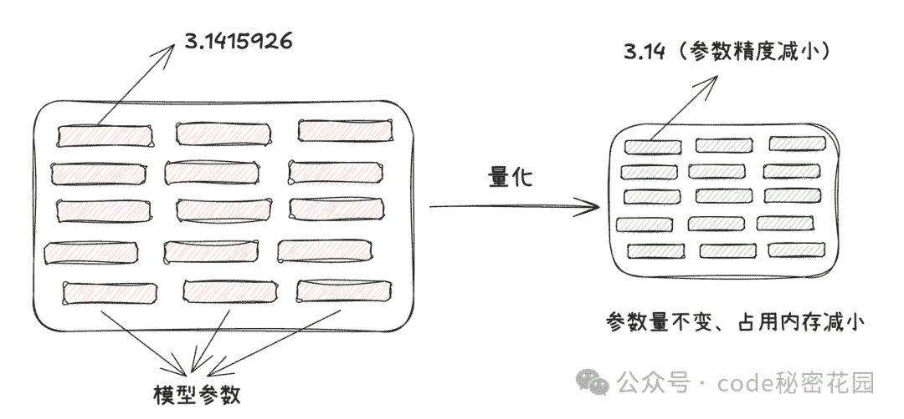

为了表示这些参数，我们需要在计算机上开辟一些内存空间，开辟多大的内存空间就取决于这些参数存储的精度。如果参数的精度越低，所需的内存空间就越小，反之参数精度越高，所需内存空间就越大。比如我们把原本存储了 7 位小数的一个参数：3.1415926，转换成一个精度更低的值：3.14 来进行存储，很明显我们丢掉的精度仅仅为 0.0015926 ，但是我们却大大节省了存储空间，模型量化的本质其实就是把模型的参数从高精度转换成低精度的过程。我们在 Hugging Face 上可以看到模型参数的存储精度，比如 Qwen3-235B 的参数使用的是 BF16：

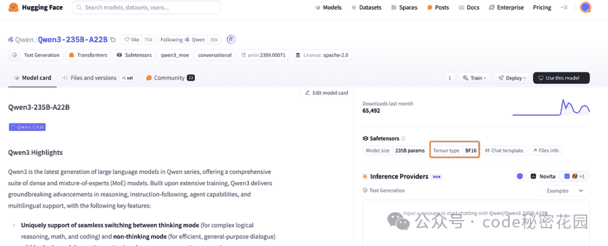

这里的 BF 是属于一种模型参数的精度单位，常用的精度单位有：

+   **FP**：**浮点（Floating P**o**int），如 FP**16、FP32，可以理解为科学计数法表示的数字，包含符号位、指数部分和尾数部分；优点：可表示范围广，精度高、缺点：占用空间较大。

计算机底层使用的是二进制存储（也就是只能存0 和 1）这里的 16、32 是二进制位数（bit），也就是计算机存储这个数时用了多少个 0 和 1。比如 FP32 就是用 32 个二进制位（4 字节，1 字节 = 8 位） 存一个浮点数。FP16 就是用 16 个二进制位（2 字节） 存一个浮点数。

+   **BF**：脑浮点（Brain Floating Point），如 BF16，专为深度学习设计的浮**点数格式，相比**传统浮点数，在保持数值范围的同时减少精度，平衡了精度和范围的需求，兼顾精度与效率。

+   **INT**：整数（Integer），如 INT8、INT4，用整数表示权重和激活值，压缩模型体积并加速推理。优点：结构简单，占用空间小、缺点：表示范围有限，精度丢失较多。

---

以下是一些常见的模型参数的精度：

+   FP32（单精度）：32 位 = 1 位符号 + 8 位指数 + 23 位尾数，能够表示的精度范围是：±3.4×10³⁸ ；


+   FP16（半精度）：16 位 = 1 位符号 + 5 位指数 + 10 位尾数，能够表示的精度范围是： ±65,504；


+   BF16（脑浮点）：；16 位 = 1 位符号 + 8 位指数 + 7 位尾数，范围与 FP32 相同（±3.4×10³⁸），但尾数更短。


+   INT8：8 位二进制，有符号范围 - 128~127，无符号 0~255。


+   INT4：4 位二进制，有符号范围 - 8~7，无符号 0~15。


---

这里可能大家会有一些疑问，INT 无法表示小数，这意味着要舍弃掉所有小数位吗？当然不是！

我们可以看到，上面的 INT8 存储的值是 11001000（转换为 10 进制为 200）， 这里就会用到一个量化的过程：

1.  **确定缩放系数**：假设我们的数据范围是[0, 4]，使用无符号 INT8（范围0~255），那么Scale = 4/255 ≈ 0.0157；

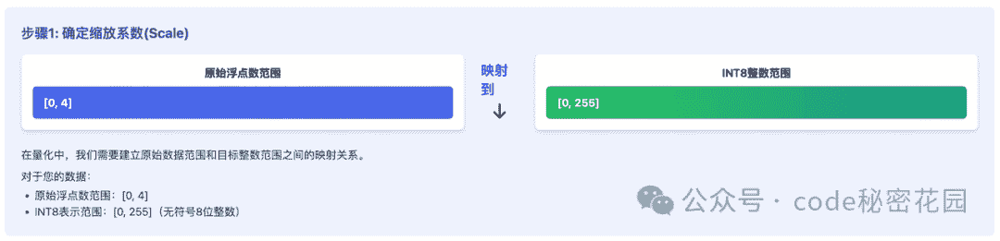

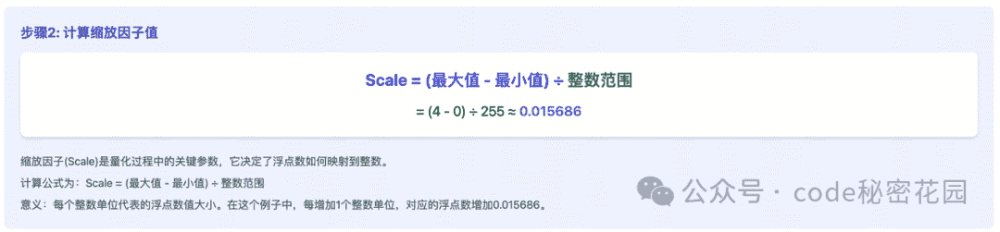

1.  **计算量化后的值**：3.1415926 ÷ 0.0157 ≈ 200；

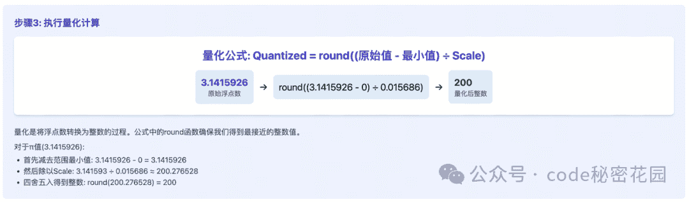

1.  **存储整数**：200 的二进制表示为 11001000；

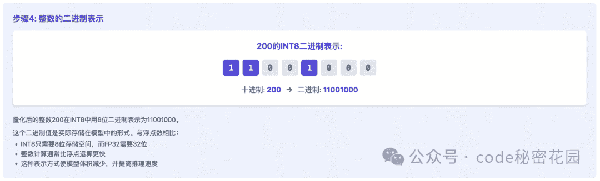

1.  **执行推理**：读取到参数的整数值为200，乘以 Scale(0.0157) 还原为 3.14；

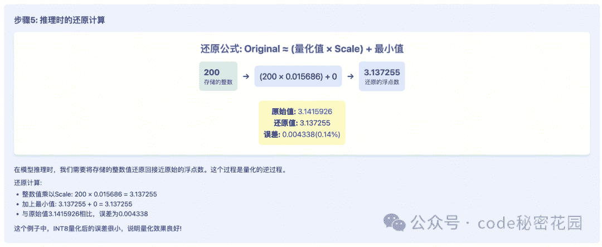

在模型微调中，量化也是一种很重要的加速手段。以 QLoRA 为例，它创新性地将4位量化与低秩适配器 LoRA 相结合，通过动态量化、双量化和训练时反量化机制，在大幅减少显存占用的同时，保障梯度更新的准确性。所以，在这里如果我们选择启动量化，并选择量化等级，默认使用的微调方法就是 QLoRA。

---

### 对话模版

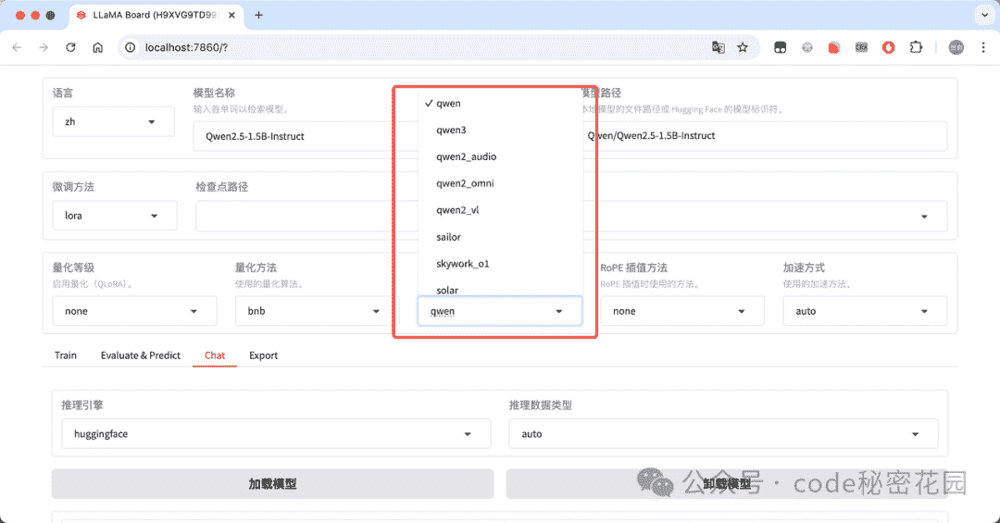

对话模版一般我们选择默认就可以了，不过这里我们也简单了解一下为什么会有对话模版这样一个概念。

对话模板实际上是大语言模型与用户交互的"翻译器"。每个大语言模型（LLM）都有自己特定的输入格式要求，例如：Llama2 需要使用 [INST] 和 [/INST] 标记，而 Qwen 系列使用 <|im_start|> 和 <|im_end|>。对话模板提供了一个统一的接口，让开发者可以用相同的方式与不同的模型交互，而不必担心底层格式差异。

+   模型训练与推理的一致性保证：大语言模型在训练时使用特定格式，在推理（使用）时也必须保持相同的格式，否则性能会严重下降。对话模板确保了这种一致性，让模型能够：正确识别用户和系统的输入、明确知道自己应该从什么位置开始生成内容、停止在适当的位置（通过stop_words）；

+   多轮对话的上下文管理：现代大语言模型都支持多轮对话，但需要正确地组织历史对话信息。对话模板可以：管理对话历史的格式、区分不同说话者（用户、助手、系统）、确保模型能正确理解对话流程；

+   特殊功能处理：除了基本的对话外，模板还处理许多高级功能：

+   系统提示（System Prompt）：设置模型的角色和行为指南；

+   工具调用（Tool Calling）：使模型能够调用外部工具和API；

+   思维链（Chain-of-Thought）：通过ReasoningTemplate支持模型的分步思考；

+   多模态输入：处理文本以外的输入，如图像、音频等；

---

假设我们使用 Qwen 模板：

```
register_template(
    name=&quot;qwen&quot;,
    format_user=StringFormatter(slots=[&quot;&lt;|im_start|&gt;user\n{{content}}&lt;|im_end|&gt;\n&lt;|im_start|&gt;assistant\n&quot;]),
    format_assistant=StringFormatter(slots=[&quot;{{content}}&lt;|im_end|&gt;\n&quot;]),
    format_system=StringFormatter(slots=[&quot;&lt;|im_start|&gt;system\n{{content}}&lt;|im_end|&gt;\n&quot;]),
    format_function=FunctionFormatter(slots=[&quot;{{content}}&lt;|im_end|&gt;\n&quot;], tool_format=&quot;qwen&quot;),
    format_observation=StringFormatter(
        slots=[&quot;&lt;|im_start|&gt;user\n&lt;tool_response&gt;\n{{content}}\n&lt;/tool_response&gt;&lt;|im_end|&gt;\n&lt;|im_start|&gt;assistant\n&quot;]
    ),
    format_tools=ToolFormatter(tool_format=&quot;qwen&quot;),
    default_system=&quot;You are Qwen, created by Alibaba Cloud. You are a helpful assistant.&quot;,
    stop_words=[&quot;&lt;|im_end|&gt;&quot;],
    replace_eos=True,
)
```

一个完整的工作流程是：

1.  输入处理阶段：

```
用户输入: &quot;帮我写一首关于春天的诗&quot;

转换后: 

&lt;|im_start|&gt;system
You are Qwen, created by Alibaba Cloud. You are a helpful assistant.
&lt;|im_end|&gt;

&lt;|im_start|&gt;user
帮我写一首关于春天的诗
&lt;|im_end|&gt;

&lt;|im_start|&gt;assistant
```

1.  模型处理：模型接收这个格式化的输入，并从 <|im_start|>assistant 后开始生成内容；

1.  输出处理阶段：模型会生成内容直到 <|im_end|> ，然后停止；

1.  下一轮对话：如果用户继续对话，新的用户输入会被添加到历史中，形成新的输入。

---

### 加速方式

这里目前我们可以看到共支持三种方法：

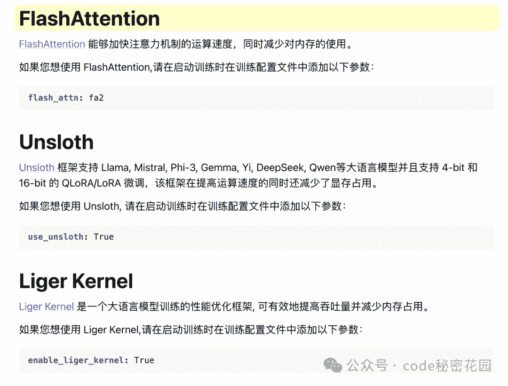

比较熟悉的加速方式是 Unsloth，它默认就会采用动态的 4 位量化，这也是它一个非常重要的加速手段；我们在 LLaMA Factory 中将量化等级选择为 4 bit，然后加速方法选择 Unsloth 时，模型微调的速度与内存占用和直接使用 Unsloth 是相似的。

另外两种加速方式，大家做简单了解即可，如果你对微调性能没有过多要求，可以选择默认（默认会使用 Flash Attention 加速），如果本地硬件条件非常受限，可以选择启用 Unsloth + 4 位量化。

今天这一期，我们就讲到这里，下一期，我会带大家一起学习 LLaMA Factory 的数据集要求，以及使用 Easy Dataset 完成数据集的构造并在  LLaMA Factory  中加载和验证数据集。

# 2.LLaMA Factory 微调教程：如何构建高质量数据集？

LLaMA Factory 微调教程：如何构建高质量数据集？

在开始学习之前，首先我们先补充演示一下，我们整体这次微调教程中，微调案例的一个最终效果。

在本教程中，我们微调的基础模型是 Qwen2.5-7B-Instruct ，目标是微调后让其在特定场景下具备一定的推理能力，并且在 Web 安全领域具备专家级水准。

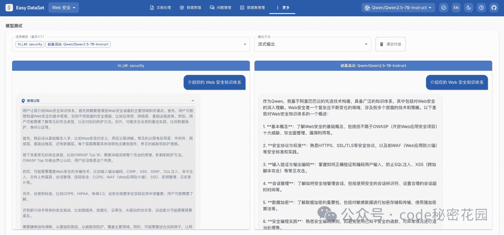

> 对于企业内部的代码、需求文档等一般都属于企业内部的机密数据，若直接使用外部模型可能存在隐私泄漏风险，因此此类任务一般需要私有部署的模型承担，而满血版模型的部署成本非常昂贵，所以我们选择使用对小参数模型进行微调。 希望微调后的模型可用于在企业内部私有部署，回答 Web 安全相关问题，对可能引发安全问题的业务场景以及代码进行预警，并且在 Web 安全领域的能力上可和满血版模型持平甚至超越满血版模型。

以下是在部分问题下，模型微调前后的效果对比：

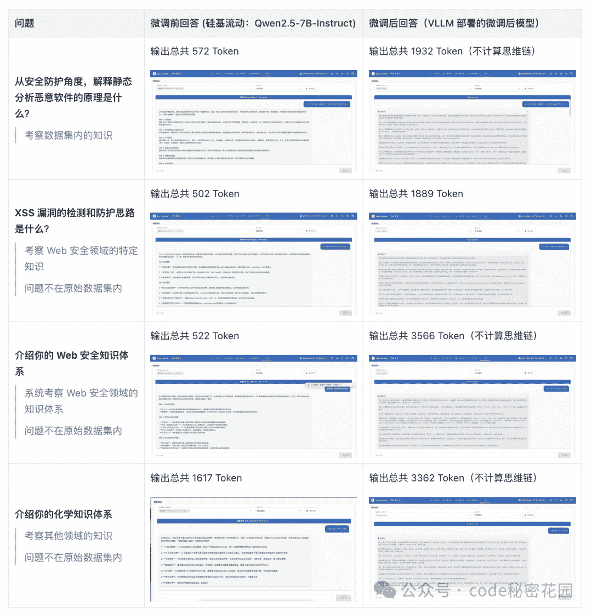

从对比可以得出结论，相比微调前的基础模型（Qwen2.5-7B-Instruct），模型微调后：

+   在数据集内部的特定问题上，具备推理能力，并且回答结果更丰富，说明学习到了数据集内部的知识；

+   在 Web 安全领域的特定问题上（不在数据集内），具备推理能力，并且回答结果更丰富，说明模型的泛化能力较好，没有过拟合；

+   在 Web 安全整体的知识体系上，具备推理能力，并且回答结果更丰富，说明模型能够系统性整合 Web 安全领域的知识框架，形成结构化的知识输出体系，同时具备跨知识点的关联推理能力，可基于底层逻辑对复杂知识体系进行演绎构建；

+   在非 Web 安全的某些其他领域上，具备推理能力，说明模型在聚焦 Web 安全领域专业能力强化的同时，未丧失基础模型的跨领域知识迁移能力，能够基于微调形成的推理框架对非专业领域问题进行逻辑拆解，保持了基础模型的知识泛化性与多领域适应性。

> 注意：在非 Web 安全领域下，模型并不一定能够稳定输出推理过程，因为我们仅针对 Web 安全领域的数据集进行了训练，这在一定程度上激发了模型的推理能力，想要让模型在更多领域稳定输出推理过程，需要更丰富的数据集

数据集在微调任务中起着至关重要的作用。毫不夸张的说，要想得到好的微调效果，数据集的质量要远大于其他参数的设置，如果数据集太小、多样性不足、数据噪声太大、样本偏差严重等问题都会导致微调任务失败。按照经验来讲，在一次微调任务中，大概 80% 的时间应该花在数据集的准备和处理上，因为微调的工具、流程和参数的调整都是有经验可循的，而数据集的构建却需要结合具体业务场景。从数据采集时需覆盖多维度场景，到清洗时剔除噪声与偏差样本，再到标注时确保一致性与准确性，每个环节都影响最终效果。此外，还需合理划分训练/验证/测试集，通过数据增强扩充样本多样性，让模型在微调中真正学习到关键特征。

## 数据集格式要求

在不同的微调阶段，使用的数据集的格式要求是不一样的，有关数据集的基础格式、以及不同微调阶段的数据集要求，大家可以看我之前的这期教程《想微调特定领域的模型，数据集究竟要怎么搞？》：

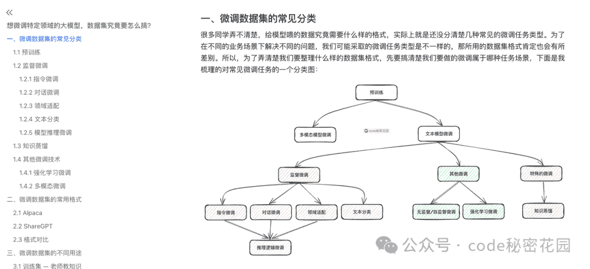

本次任务我们进行的是指令监督微调（SFT），在 LLaMA Factory 中主要支持 Alpaca 格式和 ShareGPT() 两种格式：

Alpaca 格式的指令微调数据集：

ShareGPT 格式的指令微调数据集：

## 数据集配置文件

我们看到 LLaMA Factory 提供了两个数据集相关的配置：数据路径和数据集（名称）：

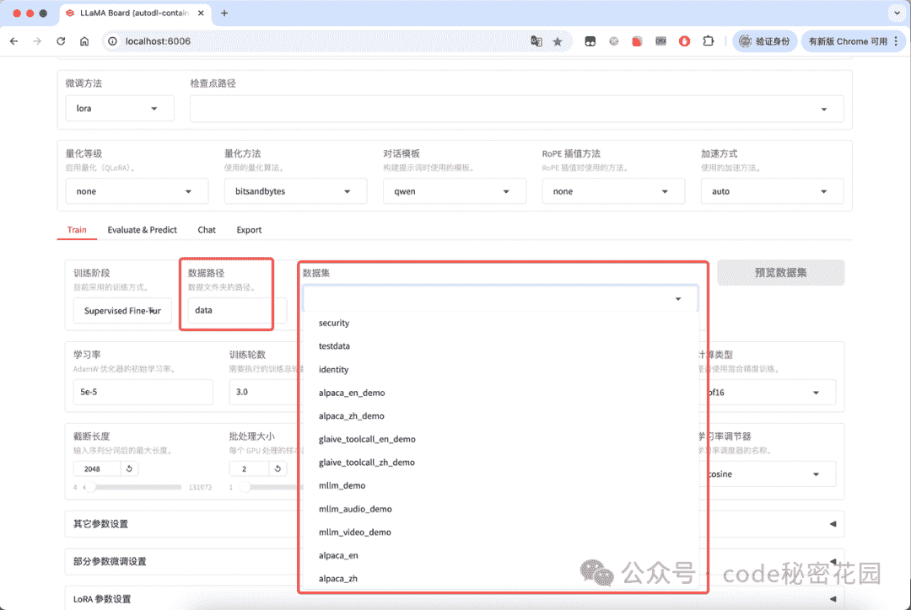

数据路径默认配置的是项目文件夹下的 data 目录，其中的 dataset_info.json 包含了所有预定义数据集的关键配置：

1.  基本结构：配置文件采用 JSON 格式，以数据集名称为顶层键名，值为对应数据集的配置对象：

```
{
  &quot;数据集名称&quot;: {
    &quot;配置项1&quot;: &quot;值1&quot;,
    &quot;配置项2&quot;: &quot;值2&quot;,
    ...
  }
}
```

1.  数据源定义方式：支持三种数据源加载方式，覆盖在线数据集、本地文件及自定义脚本生成数据：

+   在线数据集来源平台：Hugging Face Hub、ModelScope Hub、OpenMind Hub

+   配置示例：

```
&quot;alpaca_en&quot;: {
  &quot;hf_hub_url&quot;: &quot;llamafactory/alpaca_en&quot;,
  &quot;ms_hub_url&quot;: &quot;llamafactory/alpaca_en&quot;,
  &quot;om_hub_url&quot;: &quot;HaM/alpaca_en&quot;
}
```

+   本地文件配置方式：指定相对于 data 目录的相对路径，或本机绝对路径

+   配置示例：

```
&quot;alpaca_en_demo&quot;: {
  &quot;file_name&quot;: &quot;alpaca_en_demo.json&quot;
}
```

+   脚本生成数据集配置方式：指定自定义加载脚本名称

+   配置示例：

```
&quot;belle_multiturn&quot;: {
  &quot;script_url&quot;: &quot;belle_multiturn&quot;,
  &quot;formatting&quot;: &quot;sharegpt&quot;
}
```

1.  数据格式配置：通过多维度配置实现不同数据格式的兼容处理：

+   基本格式化类型（formatting 字段）：分别支持格式化为  alpaca、sharegpt格式

+   配置示例：

```
&quot;slimorca&quot;: {
  &quot;hf_hub_url&quot;: &quot;Open-Orca/SlimOrca&quot;,
  &quot;formatting&quot;: &quot;sharegpt&quot;
}
```

+   列映射配置（columns 字段）：将数据集字段映射到标准字段名（如 prompt、response、system）

+   配置示例：

```
&quot;openorca&quot;: {
  &quot;hf_hub_url&quot;: &quot;Open-Orca/OpenOrca&quot;,
  &quot;columns&quot;: {
    &quot;prompt&quot;: &quot;question&quot;,    
    &quot;response&quot;: &quot;response&quot;,    
    &quot;system&quot;: &quot;system_prompt&quot; 
  }
}
```

+   角色标签配置（针对 ShareGPT 格式，tags 字段）：自定义对话角色标签（如用户、助手）

+   配置示例：

```
&quot;mllm_demo&quot;: {
  &quot;formatting&quot;: &quot;sharegpt&quot;,
  &quot;tags&quot;: {
    &quot;role_tag&quot;: &quot;role&quot;,
    &quot;content_tag&quot;: &quot;content&quot;,
    &quot;user_tag&quot;: &quot;user&quot;,
    &quot;assistant_tag&quot;: &quot;assistant&quot;
  }
}
```

1.  多模态数据支持：通过字段映射处理图像、视频、音频等多模态数据：

```
&quot;mllm_demo&quot;: {
  &quot;file_name&quot;: &quot;mllm_demo.json&quot;,
  &quot;formatting&quot;: &quot;sharegpt&quot;,
  &quot;columns&quot;: {
    &quot;messages&quot;: &quot;messages&quot;,
    &quot;images&quot;: &quot;images&quot;  // 图像数据字段
  }
}
```

1.  特殊训练任务配置

+   排序/对比学习数据（RLHF/DPO 训练），ranking 字段：标记为排序数据集

+   配置示例：

```
&quot;webgpt&quot;: {
  &quot;hf_hub_url&quot;: &quot;openai/webgpt_comparisons&quot;,
  &quot;ranking&quot;: true,  
  &quot;columns&quot;: {
    &quot;prompt&quot;: &quot;question&quot;,
    &quot;chosen&quot;: &quot;answer_0&quot;,
    &quot;rejected&quot;: &quot;answer_1&quot;
  }
}
```

+   工具调用数据，tools 字段：指定工具定义字段

+   配置示例：

```
&quot;glaive_toolcall_en_demo&quot;: {
  &quot;file_name&quot;: &quot;glaive_toolcall_en_demo.json&quot;,
  &quot;formatting&quot;: &quot;sharegpt&quot;,
  &quot;columns&quot;: {
    &quot;messages&quot;: &quot;conversations&quot;,
    &quot;tools&quot;: &quot;tools&quot;  // 工具定义字段
  }
}
```

## 数据集处理过程

LLaMA Factory 基于 dataset_info.json 实现了对多种不同的数据集格式兼容，一般情况下大家只需要了解 dataset_info.json 是怎么配置的即可，但是为了加深大家对数据集的理解，下面我们用一个具体的例子告诉大家一个你自定义的数据集最终会被处理成什么样子。

假定我们的原始原始数据结构是这样的（Alpaca 格式）：

```
[
  {
    &quot;instruction&quot;: &quot;今天的天气怎么样？&quot;,
    &quot;input&quot;: &quot;&quot;,
    &quot;output&quot;: &quot;今天的天气不错，是晴天。&quot;,
    &quot;history&quot;: [
      [&quot;今天会下雨吗？&quot;, &quot;今天不会下雨，是个好天气。&quot;],
      [&quot;今天适合出去玩吗？&quot;, &quot;非常适合，空气质量很好。&quot;]
    ]
  }
]
```

在数据加载阶段，我们通过 dataset_info.json 配置数据集文件的路径：

```
&quot;my_dataset&quot;: {
  &quot;file_name&quot;: &quot;my_dataset.json&quot;,
  &quot;formatting&quot;: &quot;alpaca&quot;
}
```

在微调任务开始后， LLaMA Factory 首先会将我们的数据集转换诶标准格式：

```
{
    &quot;_prompt&quot;: [
        {&quot;role&quot;: &quot;user&quot;, &quot;content&quot;: &quot;今天会下雨吗？&quot;},
        {&quot;role&quot;: &quot;assistant&quot;, &quot;content&quot;: &quot;今天不会下雨...&quot;},
        {&quot;role&quot;: &quot;user&quot;, &quot;content&quot;: &quot;今天适合出去玩吗？&quot;},
        {&quot;role&quot;: &quot;assistant&quot;, &quot;content&quot;: &quot;非常适合...&quot;},
        {&quot;role&quot;: &quot;user&quot;, &quot;content&quot;: &quot;今天的天气怎么样？&quot;}
    ],
    &quot;_response&quot;: [{&quot;role&quot;: &quot;assistant&quot;, &quot;content&quot;: &quot;今天的天气不错...&quot;}]
}
```

然后根据上面我们选择的对话模版，将数据集按照模版进行格式化，比如本次我们选择的模版是 Qwen：

```
format_user = &quot;&lt;|im_start|&gt;user\n{{content}}&lt;|im_end|&gt;\n&lt;|im_start|&gt;assistant\n&quot;
format_assistant = &quot;{{content}}&lt;|im_end|&gt;\n&quot;
format_system = &quot;&lt;|im_start|&gt;system\n{{content}}&lt;|im_end|&gt;\n&quot;
```

格式化后数据集就是这样的：

```
&lt;|im_start|&gt;system
You are Qwen...&lt;|im_end|&gt;
&lt;|im_start|&gt;user
今天会下雨吗？&lt;|im_end|&gt;
&lt;|im_start|&gt;assistant
今天不会下雨...&lt;|im_end|&gt;
&lt;|im_start|&gt;user
今天适合出去玩吗？&lt;|im_end|&gt;
&lt;|im_start|&gt;assistant
非常适合...&lt;|im_end|&gt;
&lt;|im_start|&gt;user
今天的天气怎么样？&lt;|im_end|&gt;
&lt;|im_start|&gt;assistant
今天的天气不错...&lt;|im_end|&gt;
```

随后， LLaMA Factory 将会对数据进行分词处理，将文本转换为数字序列（token IDs）。这一步骤至关重要，因为模型仅能处理数字而非原始文本：

```
[151, 8243, 29973, 29901, 29871, 29896, 29889, 29877, 29889, 29889, 152, 151, 8251, 29901, 29871, 29896, 29889, 29877, 29889, 29889, 152]
```

随后，LLaMA Factory 会对数据集进行标签分配，标签分配是微调过程的核心环节，决定模型在哪些部分计算损失并学习生成内容。在对话模型训练中，模型需学会：理解用户输入（不生成用户输入）、生成助手回复，因此，需明确标记模型应生成的部分（助手回复）和仅需理解的部分（用户输入）。所以这一步就是把不参与损失计算（用户输入）的部分标记出来，LLaMA Factory 使用特殊值IGNORE_INDEX（值为-100）标记不参与损失计算的位置。以示例文本为例：

```
&lt;|im_start|&gt;user  
今天会下雨吗？  
&lt;|im_end|&gt;  
&lt;|im_start|&gt;assistant  
今天不会下雨，是个好天气。  
&lt;|im_end|&gt;
```

标签分配规则为： 用户部分（含特殊标记）：全部为-100 助手部分（含回复内容和结束标记）：实际 token ID 。

训练时，模型仅因未正确预测助手回复而计算损失，避免因未预测用户输入而受惩罚。

数据完成分词和标签分配后，组织为以下格式传递给训练循环：

```
{
    &quot;input_ids&quot;: [所有token IDs],
    &quot;attention_mask&quot;: [全部为1的序列，表示所有token都需要关注],
    &quot;labels&quot;: [混合了-100和实际token ID的序列]
}
```

1.  **前向传播**：模型接收完整input_ids输入，生成每个位置的预测。

1.  **损失计算**：仅在labels不为-100的位置计算损失。

1.  **反向传播**：基于损失更新模型参数。

## 数据集的构造思路

数据集的质量好坏直接决定着微调任务的成败，根据最近我收集的各种微调后效果不好的案例中，大部分也都是数据集质量的问题，我总结了以下几个可能会导致微调任务失败的问题：

+   **数据量太小：** 数据量不足时，模型无法学习到足够的特征规律，如果你调的训练轮数很大，非常容易出现过拟合（仅记住少量样本的噪声信息），导致泛化能力差，在新数据上表现不佳。当然不同的微调任务对数据量的要求不一样，如果是领域知识注入类任务，（7B模型）至少要 1000 条数据起步，数据集的数量的扩大也要随着模型参数的变大而增加。另外也别迷信 “数据越多越好”，若数据质量差，海量数据反而会放大噪声影响。优先保证单条数据的有效性，再考虑扩充数量。

+   **噪声数据多**：如文本数据中存在大量错别字、格式混乱，图像数据模糊、标注错误等，会误导模型学习错误的映射关系。所以数据集一定要进行清洗，文本数据重点筛除乱码、重复内容、与任务无关的段落（比如微调法律模型时混入娱乐新闻）；标注数据需检查标签 - 内容一致性（如情感分类中 “好评” 文本误标为 “差评”）。

+   **样本偏差严重：** 数据分布与实际应用场景差异大（如训练数据中 90% 是正面评论，而实际测试数据正负比例均衡），导致模型在真实场景下失效。

+   **任务相关性不够**：要模型学会一个领域的知识，不是说这个领域的所有数据都建议用于训练，比如你要微调一个金融问答模型时，就不要混入大量的财经新闻，因为新闻侧重事件描述，而问答侧重问题解答，数据形式需贴近实际应用场景（如 “问题 - 答案” 对）。

+   **数据多样性不足：** 样本覆盖的场景、特征维度单一（如文本数据仅包含短句子，缺乏长句或复杂句式；图像数据仅包含晴天场景，没有雨天、夜晚等），模型无法适应真实应用中的多样性需求。此外，若指令类型单一（如仅包含「解释型」指令），缺乏「推理型」「操作型」指令，会导致模型在实际应用中能力受限。

在本地微调任务中，我们将使用 Easy Dataset（简称 EDS）来构造数据集，以下是我们的构造思路：

+   为确保模型能学习到专业的 Web 安全知识，我们选择从 Web 安全领域的专业书籍《白帽子讲 Web 安全》来提取部分数据集；

+   为确保模型能学习到 Web 安全领域最前沿的知识，我们精选几篇 Web 安全相关的最新论文来提取部分数据集：

+   《The Hidden Risks of LLM-Generated Web Application Code: A Security-Centric Evaluation of Code Generation Capabilities in Large Language Models》

+   《WASP: Benchmarking Web Agent Security Against Prompt Injection Attacks》

+   《A Human Study of Cognitive Biases in Web Application Security》

+   为确保模型能够学习均衡，不遗漏 Web 安全领域的知识，弥补和满血版大模型的差距，我们选取更为强大的满血版大模型（DeepSeek R1 0528）作为教师模型来蒸馏部分数据集；同时我们讲提取教师模型的推理过程（COT）来作为数据集的一部分，用于训练基础模型的推理能力；

+   为确保数据集的多样性，在数据集构造过程中我们将使用 GA（Genre-Audience）的思路来对数据集进行增强；

+   在数据集构造完成后，邀请 Web 安全领域专家来对数据集进行 Review，确保数据集最终质量。

## 使用 EDS 构造数据集

Easy Dataset（简称 EDS） 是一个专为创建大型语言模型数据集而设计的应用程序。通过 Easy Dataset，你可以将领域知识转化为结构化数据集，兼容所有遵循 OpenAI 格式的 LLM API，使数据集构造过程变得简单高效：

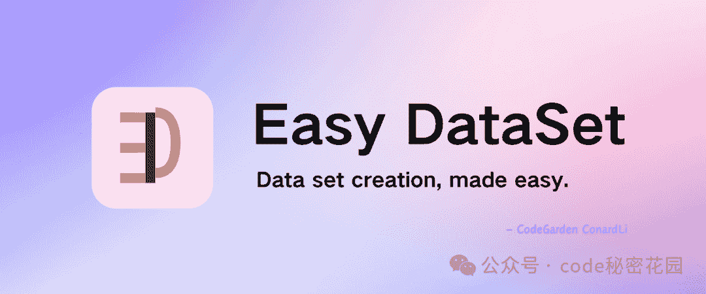

Github：https://github.com/ConardLi/easy-dataset

文档：https://docs.easy-dataset.com/

### 项目配置

跟随文档完成软件的部署或安装后，打开 Easy Dataset，首先我们创建一个项目：

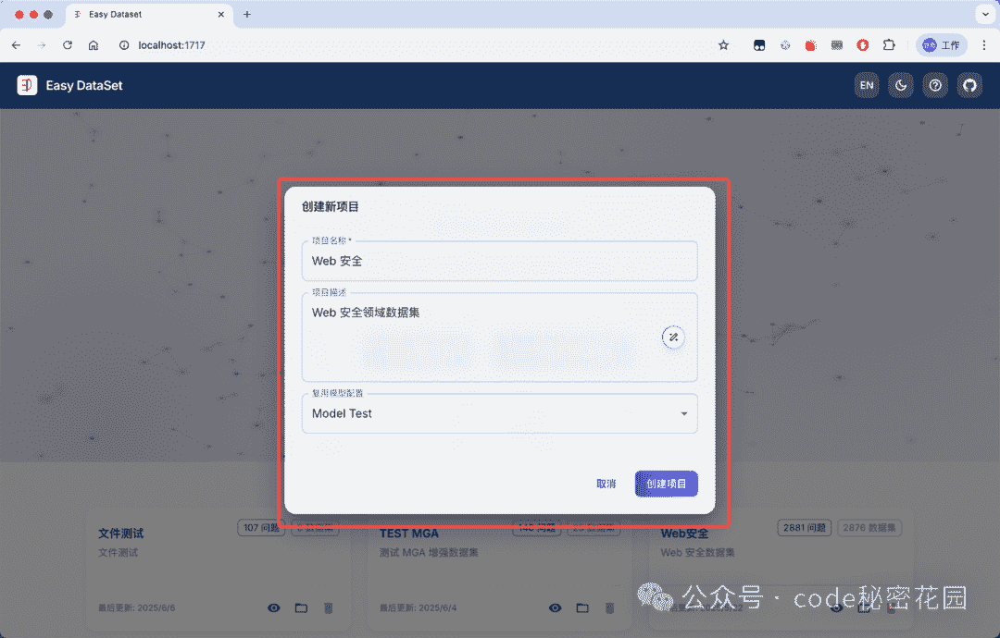

> 建议将项目命名为目标要微调的领域，在后续的数据蒸馏任务中，将默认使用项目名称作为顶级蒸馏主题。

进入【项目配置-模型配置】配置后续数据集提取任务所需模型，在本次任务中，我将使用如下模型：

+   Doubao-1.5-pro-256k：用于建立领域树、从文本块中提取问题（速度快、结构化输出更稳定）

+   DeepSeek-r1-250528：用户从文本块中为指定问题提取答案（推理模型，可获取思维链）

+   Doubao-1.5-vision-pro-32k：用于自定义视觉模型解析 PDF（比基础解析效果更好）

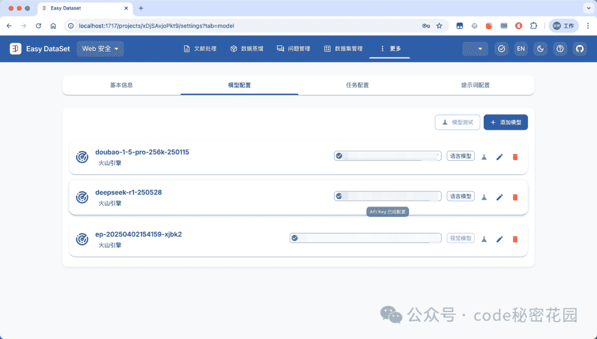

> 如果你处理的是中文文献，或者需要生成中文数据集，建议使用国产模型，对中文理解能力更好。

进入【项目配置-任务配置】，调整本次数据集提取任务相关配置：

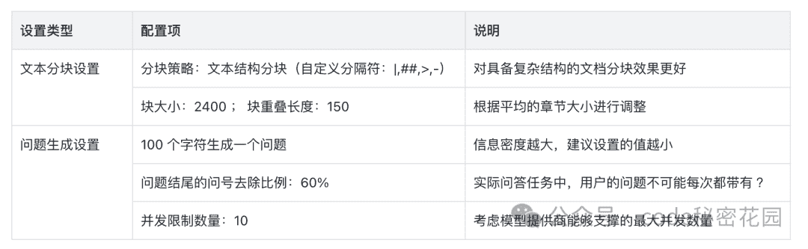

进入【项目配置-提示词配置】，配置部分提示词来干预后续数据集生成任务：


+   全局提示词：“语言：中文”（文献中含有部分英文论文，通过提示词控制永远生成中文提示词）。

+   生成问题提示词：“生成的问题要和 Web 安全领域相关，禁止生成和论文引用文献、论文作者、图片和表格数据描述相关问题”。

+   生成答案提示词：“生成的答案要和 Web 安全领域相关”。

> 注意：这一步一般情况下不用配置，当你尝试生成出的数据集不符合需求时，再来通过提示词进行干预和调整。

### 文献处理

进入【文献处理】，上传我们已经准备好的文献（1个书籍+3篇论文），选择 PDF 解析方式：

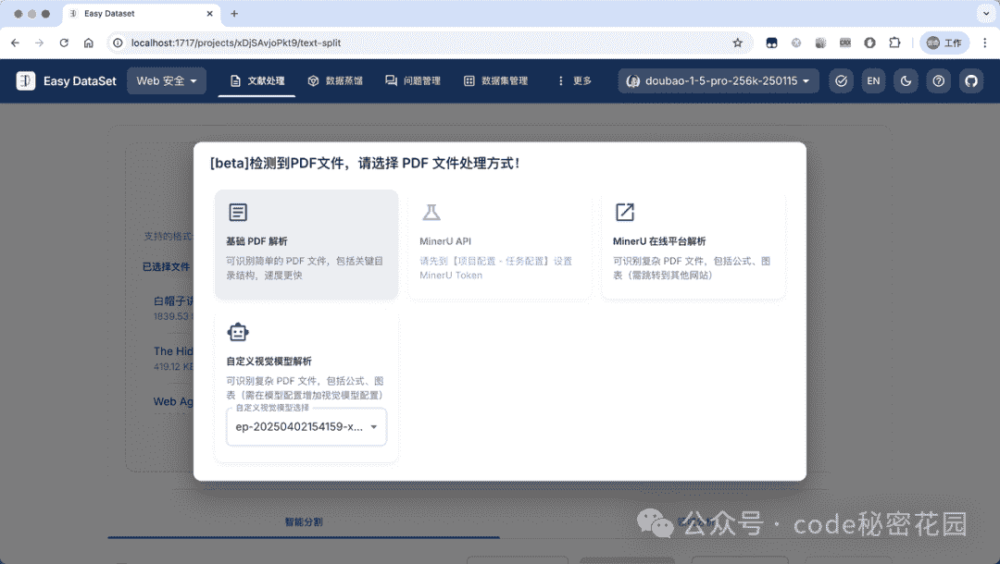

> 注意：选择自定义视觉模型解析将消耗自己的 Token，如果你想省钱，建议去申请免费的 MinerU API https://mineru.net/apiManage（有 14 期限，过期需要重新申请）

为了保障后续文本分段、数据集提取的质量，需要先将 PDF 转换为标准的 Markdown 格式，这个过程可能消耗比较长的时间，平台将在后台异步处理这些任务，并且详细展示任务进度：

文献处理完成后，为保证后续数据集生成的多样性，我们选择在部分文献上生成 GA（Genre-Audience）对：

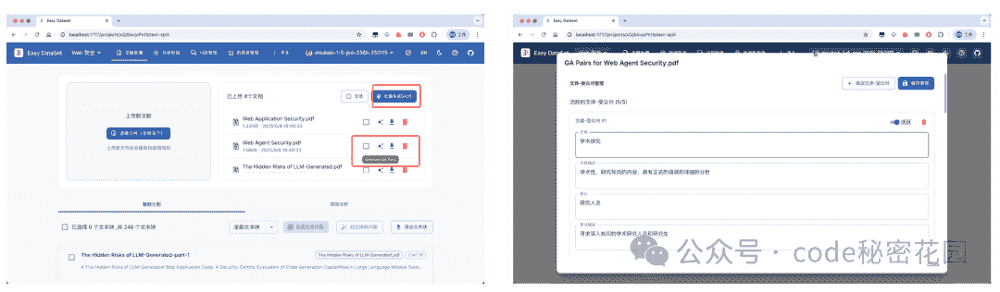

+   Genre（类型）： 指内容的“知识表达框架”，通过多个维度定义，包括：

+   沟通目的（如教育、分析、叙事）、内容结构（如分步教程、学术论文、对话体）

+   语言风格（如严谨学术风、通俗故事风）、知识深度（如初学者入门、专业研究者深度分析）。 例如，将同一篇科普文章重构为“学术论文”或“儿童故事”，会采用不同的结构和语言风格，但保留核心知识。

+   Audience（受众）： 指内容的目标读者群体，结合以下特征：

+   人口统计学因素（年龄、职业、教育背景，如“12-15岁中学生”“医学专业研究生”）；

+   知识背景与动机（如“对化学感兴趣的初学者”“需要教学素材的中学教师”）。 例如，针对“办公室工作人员”的急救指南会侧重实用性和通俗表达，而针对“医学生”的版本则会包含更多专业术语和深度理论。 通过“类型-受众”对驱动内容多样性：每个“类型-受众”组合定义了一种重构方向，使同一原始文本能以不同形式呈现（如将科学知识转化为面向儿童的故事、面向学者的分析报告等），从而避免数据重复，增强模型对不同场景的泛化能力。本质上是一种数据增强策略，通过系统化地生成海量“类型-受众”组合，将现有文本重构为多样化的变体，既保留核心信息，又覆盖不同表达形式和读者群体，对模型训练数据进行增强，从而提升模型性能。

具体可以看看这篇文章：新思路！如何在数据稀缺下构建高质量丰富数据集？

Review 领域树的准确性，若质量不佳，建议手动调整后再进行后续动作：

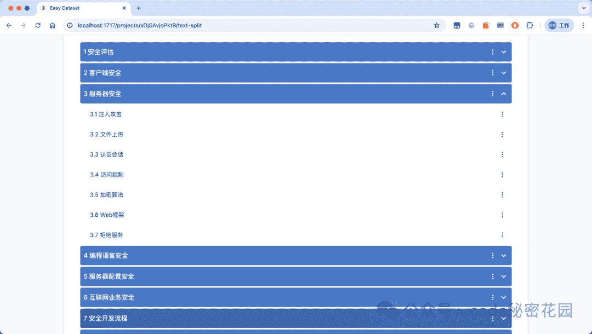

Review 文本分块的质量，若质量不佳，可点击文献，进行自定义分块

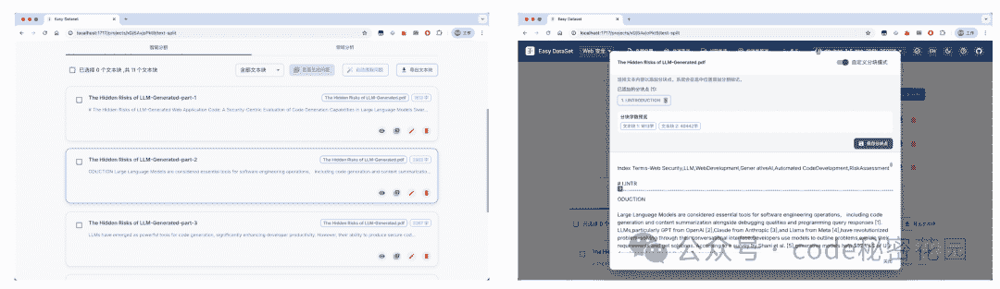

### 生成问题

选择指定文本块，或者批量、全选文本块，进行批量问题提取：

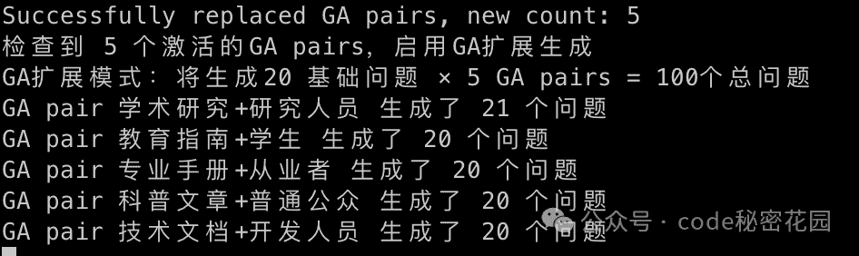

> 建议选择自动提取问题，将创建后台异步任务，可随时到【问题管理】 Review 已生成的问题：


建议对所有已生成的问题进行人工 Review，剔除和本次微调任务不相关、质量较差的问题，例如：

+   剔除理由：关注政策合规性，而非数据集中的技术要素（如漏洞样本、攻击日志、网页代码数据等）。

1.  问题：“文献中提到的用户隐私保护政策是否符合 GDPR 标准？”

+   剔除理由：询问硬件 / 软件环境，与数据集本身的构成（如数据格式、标注规则、样本量）无关。

1.  问题：“该研究的实验环境配置是什么？”

+   剔除理由：指向研究展望，不涉及当前文献已使用的数据集信息。

1.  问题：“作者在结论中提到的未来工作有哪些？”

+   剔除理由：表述过于笼统，未明确询问数据类型（如攻击样本、日志数据、漏洞报告）或特征，无法精准提取数据集信息。

1.  问题：“文献里的 Web 安全数据是什么？”

+   剔除理由：问题和文本内容具有强相关性，不具备微调价值

1.  问题：“数组变量$c['Servers']的key是什么”

### 生成答案

问题 Review 完成后，将模型切换为推理模型（DeepSeek R1），点击自动生成数据集：


点击后将自动创建后台异步提取任务。

### 数据蒸馏

为确保模型能够学习均衡，不遗漏 Web 安全领域的知识，弥补和满血版大模型的差距，我们选取更为强大的满血版大模型（DeepSeek R1 0528）作为教师模型来蒸馏部分数据集；进入【数据蒸馏】，选择【全自动蒸馏数据集】，配置要蒸馏的标签层级和单标签生产问题数量：


### 数据集确认

随后可到【数据集管理】Review 已生成的（从文献中提取的 + 从大模型蒸馏来的）数据集：

> 虽然工具在一定程度上加速了数据生产的过程，但最终结果也不能完全在不经过任何确认的情况下就直接使用！！！任何的数据合成工具都无法 100% 的保障能合成完美的数据，最终一定要经过人工确认、过滤和润色的环节，这往往决定了最终微调任务的成败。

以下是我在数据集 Review 环节总结的一些标准：

1.  答案与文献事实一致：无样本量、漏洞类型、数据来源等关键信息错误

1.  不超出文献范围：答案仅包含文献明确提及的内容，不添加未提及的数据集应用场景、评估指标等推断信息。

1.  答案直接回应问题：不堆砌无关信息（如问题问“数据集来源”，答案不可包含“模型训练效果”）。

1.  问题聚焦数据集属性：优先保留指向“数据构成、标注方式、样本特征”的问题，剔除与数据集无关的模型方法、政策合规等提问。

1.  无关键信息缺失：时间范围、数据格式字段、标注一致性指标等需明确（如“2023年数据”应补充“2023.1-2023.12”）。

1.  术语统一：相同概念表述一致（如“跨站脚本攻击”与“XSS”需统一为一种说法）。

1.  重复问题合并：同一数据集的同类问题（如“来源是哪里”与“采集渠道”）仅保留一个。

1.  模糊答案修正：“质量较高”“包含多种攻击”等表述需补充具体数据（如“标注Kappa系数0.85”“包含XSS/SQL注入/CSRF”）。

经过人工（Web 安全专家）Review， 最终我们得到 2876 条高质量 Web 安全数据集，用于本次微调任务：


## 加载和验证数据集

我们可以将整理好的数据集导出到本地（比如 security.json），然后在 dataset_info.json 中定义 security 数据集:


或者选择直接生成 LLaMA Factory 数据集配置：

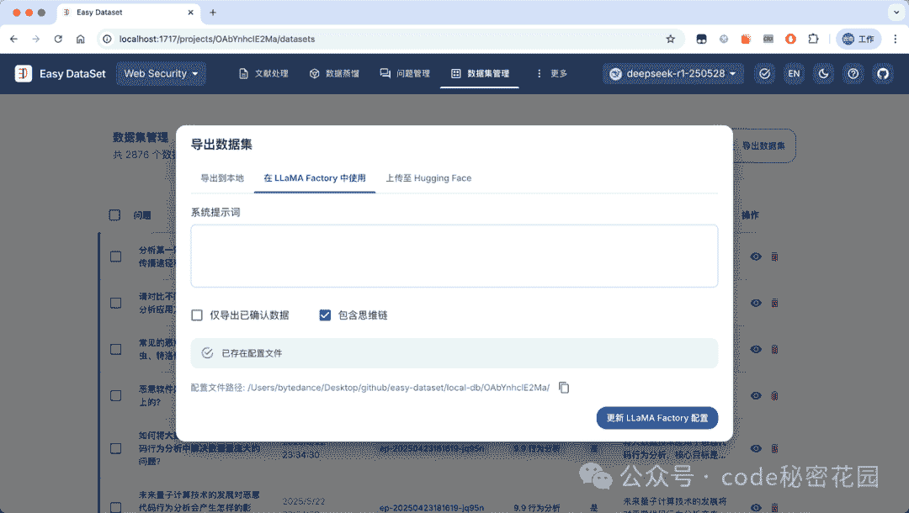

我们到 Easy Dataset 的项目数据目录，可以看到已经生成好的 dataset_info.json

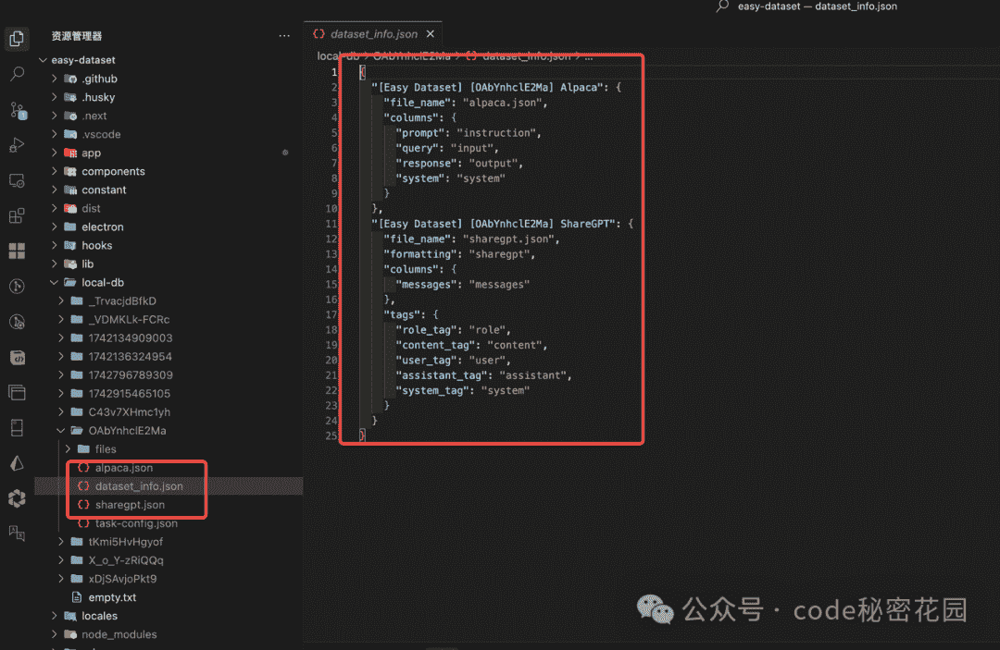

回到 LLaMA Factory ，在数据路径处粘贴以上在 Easy Dataset 中生成好的配置文件路径：

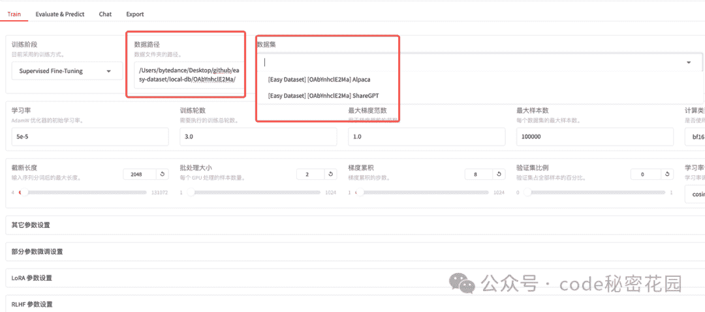

然后点击预览数据集，能够加载到数据，说明数据集配置成功：

今天这一期，我们就讲到这里，下一期，我会带大家一起学习微调过程中各种参数如何设置，以及如何估算微调过程中的显存消耗，以及一些显存优化的技巧。

# LlaMA Factory微调模型的各种参数设置,微调的显存消耗估算和优化

今天我们来到 LLaMA Factory 微调教程的第三期，一起来学习微调过程中的各种参数设置，以及显存消耗的估算和优化。

+   第一期内容：LLaMA Factory 微调教程（一）：入门和基础使用

+   第二期内容：LLaMA Factory 微调教程（一）：如何构建高质量数据集？

## 调整微调参数

在模型微调中，各类参数就像是你在给模型 “补课” 之前制定的教学计划和策略。它们决定了你如何教学、教学的强度以及教学的方向。如果你选择的教学计划不合适（比如补课时间太短、讲解速度太快或复习策略不合理），可能会导致学生学习效果不好。同样，如果你选择的超参数不合适，模型的性能也可能不理想。

过去经常收到很多同学的问题："在微调过程中这些参数到底要怎么设置效果才最好？" ，这肯定不是一个标准答案，参数的设置和你选择的模型、用于微调的数据集，以及你微调机器的硬件配置都有关系，并不存在 “最佳参数” 这个说法，下面我会结合我个人的经验，尽可能的告诉大家一些关键参数的作用和影响，以及在实际微调任务中调整的思路是什么。没有在下面讲到的参数，大家都直接保持默认值即可。

---

### 学习率（Learning Rate）


---

### 训练轮数（Number of Epochs）

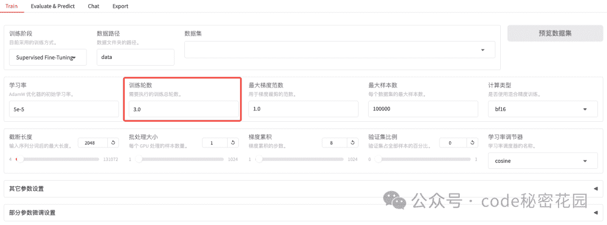

---

### 批量大小（Batch Size()）

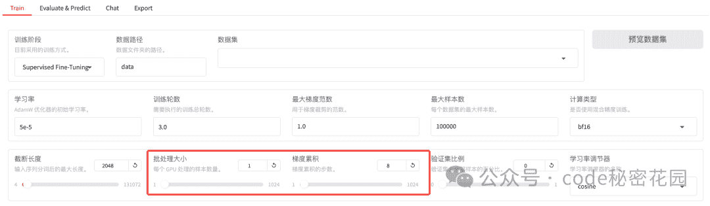

---

### 截断长度（Cutoff length）

目前市面上有比较多成熟的工具来计算文本的 Token数，比如 （https://tiktokenizer.vercel.app/）：

如果使用的是 Easy Dataset 构造的数据集，我们也可以看到每条数据集的 Token 数（默认以 GPT 4 计算）：

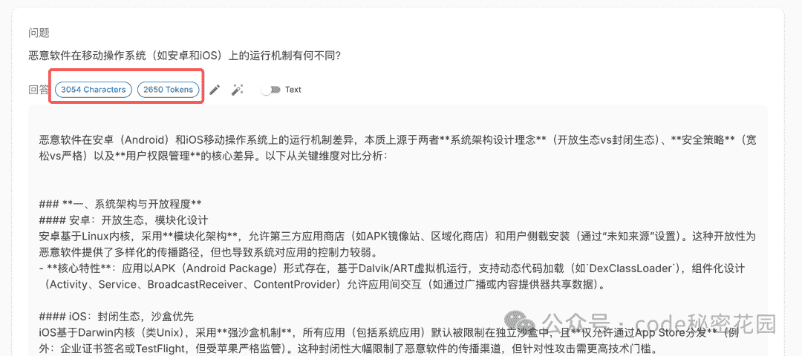

> 注意，不同模型在计算 Token 时的算法是不一样的，例如 Qwen、ChatGLM、Doubao 等，会针对中文语义特点优化分词逻辑，采用类似 BPE（字节对编码）的动态分词，但针对中文语境优化了 “语义块” 分割逻辑。例如，“人工智能” 会被识别为一个整体 Token（而非拆成 “人工”+“智能” 或单个字符），减少冗余 Token 数量。传统英文模型（如 GPT-3.5）：字符级或粗粒度分词，对中文缺乏优化，可能将汉字拆分为单个字符（如 “今”“天”“天”“气”...），所以在中文数据集的分词中，不同模型的差距还是挺大的。

在 LLaMA-Factory 中也提供了一个帮助批量计算数据集 Token 长度分布的脚本（scripts/stat_utils/length_cdf.py ），我们可以通过如下命令运行，注意把 model_name_or_path 、dataset 替换你自己的信息：

```
torchrun --nproc_per_node=1 
    scripts/stat_utils/length_cdf.py 
    --model_name_or_path /root/autodl-tmp/Qwen2.5-7B-Instruct 
    --dataset security 
    --dataset_dir data 
    --template qwen
```

对于本地微调的数据集运行结果如下，可以发现 99.83% 的数据都是 < 4000 Token 的，所以我们本次设定的截断长度为 4096 ，如果你的设备性能足够电话，也可以直接设置为 5000：

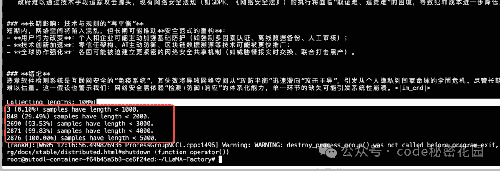

---

### LoRA 秩（LoRA rank）

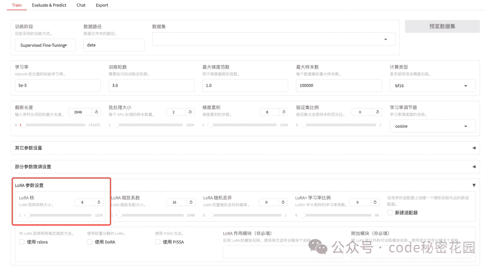

---

### 验证集比例（Val size）

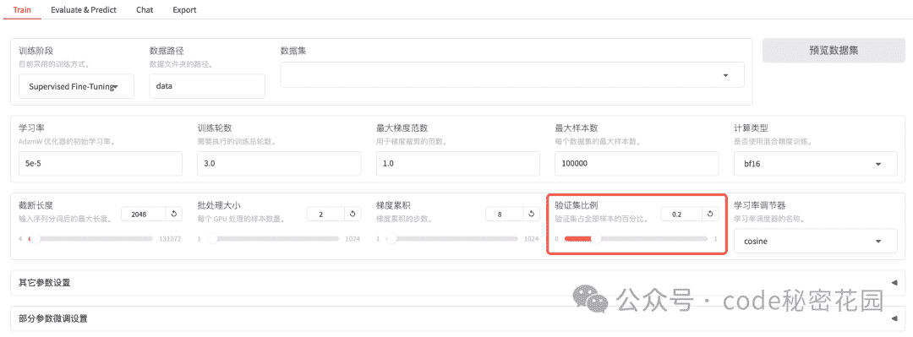

---

## 启动微调任务

### 预览命令

在以上配置完成后，我们配置一个最终微调后 Lora 适配器的输出目录，然后点击预览命令：

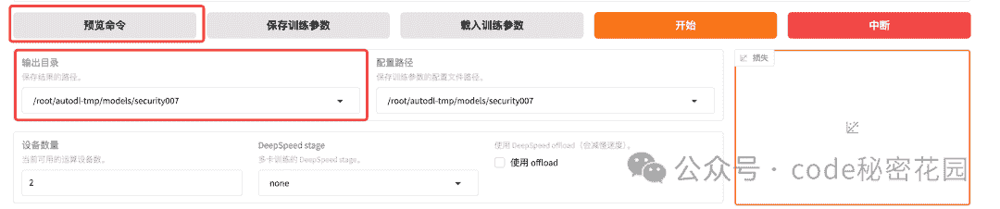

点击后可以输出拼接好的 llamafactory-cli train 的各项参数：

```
llamafactory-cli train \
    --stage sft \
    --do_train True \
    --model_name_or_path /root/autodl-tmp/Qwen/Qwen2.5-7B-Instruct \
    --preprocessing_num_workers 16 \
    --finetuning_type lora \
    --template qwen \
    --flash_attn auto \
    --dataset_dir data \
    --dataset security \
    --cutoff_len 4096 \
    --learning_rate 5e-05 \
    --num_train_epochs 3.0 \
    --max_samples 100000 \
    --per_device_train_batch_size 1 \
    --gradient_accumulation_steps 8 \
    --lr_scheduler_type cosine \
    --max_grad_norm 1.0 \
    --logging_steps 5 \
    --save_steps 100 \
    --warmup_steps 0 \
    --packing False \
    --report_to none \
    --use_swanlab True \
    --output_dir /root/autodl-tmp/models/security007 \
    --bf16 True \
    --plot_loss True \
    --trust_remote_code True \
    --ddp_timeout 180000000 \
    --include_num_input_tokens_seen True \
    --optim adamw_torch \
    --lora_rank 8 \
    --lora_alpha 16 \
    --lora_dropout 0 \
    --lora_target all \
    --swanlab_project security007 \
    --swanlab_mode cloud \
    --val_size 0.15 \
    --eval_strategy steps \
    --eval_steps 100 \
    --per_device_eval_batch_size 1
```

本次使用的微调参数的总结：

---

### 训练过程

然后我们点击开始训练：

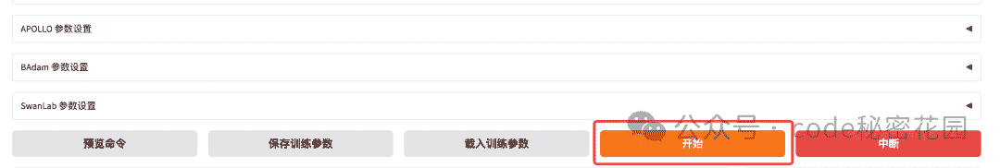

回到终端可以看到整个训练过程：

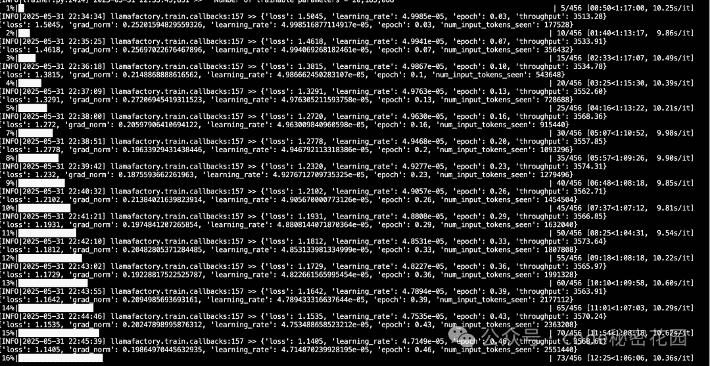

回到 LLaMA Board 页面，我们也可以看到具体的进度和 LOSS 曲线：

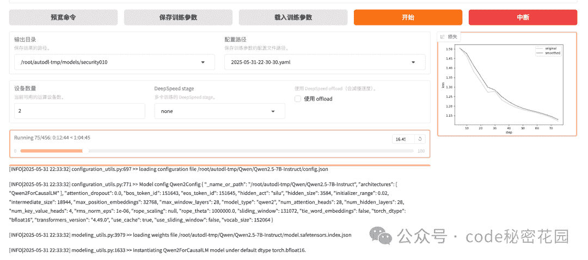

---

这里我们看到总的进度为 456 步，这个可以根据我们之前的微调参数计算出来：


> 总步数由“每轮处理次数”和“轮数”决定，而前者取决于“数据量”“批次大小”“梯度累积”的组合。 向下取整意味着最后一次若凑不满完整的更新批次，就跳过不处理。

---

### 显存消耗估算

本次微调使用的硬件配置如下：


在微调过程中，我们可以通过 nvidia-smi 命令查看 GPU 和显存的占用：

这里我用了两张 48G 显存的卡，我们看到在微调过程中，两张卡分别使用了 G 的显存。如果你不知道一个微调任务需要什么样的硬件配置，我们可以通过当前选择的微调参数来对可能的显存占用做个简单的估算（估算方法与实际严谨的计算方法可能存在偏差，但大体接近）。在模型微调（Lora）过程中，显存占用主要由基础模型权重、激活值、框架开销、LoRA 适配器等几部分构成：

---

基础模型权重（Base Model Weights）

预训练模型的参数矩阵，可以简单理解为就是选择的预训练模型占用的显存大小。

+   计算方法：显存占用 = 模型参数数量 × 单个参数的字节数

+   FP32：32 个二进制位（4 字节，1字节 = 8位）

+   FP16：16 个二进制位（2 字节）

+   BF16：16 个二进制位（2 字节，指数位同 FP32 ）

+   INT8：8 个二进制位（1 字节）

+   INT4：4 个二进制位（0.5 字节）

+   INT2：2 个二进制位（0.25 字节）

+   上面我们提到过常见的模型精度下，单个参数的显存占用：

+   在本次微调中，我们选择的模型是 Qwen2.5-7B-Instruct ，参数量为 70 亿，计算精度为 BF16 ，所以预估的显存占用为 70 亿 × 2byte ≈ 140 亿字节（14GB）。

---

框架开销（Framework Overhead）

LLaMA Factory 底层使用的深度学习框架（如 PyTorch）本身的显存占用，包括：张量缓存、线程资源、内核调度开销、自动微分图结构等等。

+   **计算方法：比较难精确计算；**

+   估算方法：一般占用不会太大，我们可以先默认估算消耗 1G

---

Lora 适配器（LoRA Adapters）

在 Lora 微调中，不会直接修改原始模型的庞大权重，而是通过插入轻量级的 “Lora适配器模块” 来学习模型微调所需的变化，这部分可以理解为就是这个小模块的显存占用。

+   **计算方法：显存占用 = LoRA 层数 × 秩（Ran**k）×（输入维度 + 输出维度）× 2B

+   **估**算方法：和我们上面提到的 LoRA 秩的大小呈正相关，一般占用不会太大，在常规配置下不会超过 0.5G，保守估计 0.5G

---

激活值（Activations）

前向传播过程中各层的输出张量（如隐藏层状态、注意力矩阵等）。简单理解就是模型 “处理数据时产生的所有中间结果”，这些结果需要临时存在显存里，主要受训练时同时处理的数据量大小的影响。

+   **计算方法：显存占用 = 批量大小 × 序列长度 × 隐藏**层维度 × 模型层数 × 单个元素字节数

+   估算方法：单次处理的 Token 量每增加 1K，显存约增加 2.5G

激活值的显存占用和我们上面提到的单 GPU 批量大小和数据集的截断长度成正相关，可以说除去以上三个值，剩下的就是激活值的占用，为了找到估算规律，我们做个简单的实验，在以上微调配置不变的情况下，我们设置一下不同的阶段长度和批量大小（单 GPU）：


可以发现，当截断长度、批量大小分别设定为 1024 * 2 和 2048 * 1 时显存消耗是是完全相同的，激活值当显存占用就是和单个 GPU 单次处理的 Token 量是正相关的，单次处理的 Token 量每增加 1K，显存约增加 2.5G。

---

根据我们前面的微调配置，显存占用估算如下：

```
基础模型权重：14 GB  
框架开销：1 GB  
LoRA适配器：0.5 GB  
激活值：10 GB  
---------------------  
总计：14 + 1 + 0.5 + 10 = **25.5 GB**
```

这里可以使用我开发的这个智能体进行简单估算（后续 LLaMA Factory 也会支持在 webui 中显示预估显存消耗）：

https://www.coze.cn/s/3d3maKRCIlk/

注意这里的消耗建立在我们没有主动启用其他额外的优化手段的情况下，如果你的硬件配置有限，可以尝试开启以下两个优化手段。

---

### 显存优化技巧：liger_kernel

以上显存计算方式中，模型权重、Lora 适配器、框架消耗这些已经无法再进行优化了（不考虑量化的情况下），只有激活值的消耗还有一定的优化空间，这里我们可以启用 liger_kernel，在前面的加速方式章节，我们简单提到过，这里就派上用场了。

Liger Kernel 将 Transformer 中的关键操作（如 RMSNorm、RoPE、SwiGLU、CrossEntropy）重写为 Triton 内核，并通过内核融合将多个操作合并为一个计算步骤，避免了传统方法中多次内存读写带来的冗余存储，在模型微调过程中，可以显著降低数据处理相关的内存占用。


下面是我针对先前的几组配置，在开启 Liger Kernel 后的显存消耗实验：


可以发现，开启 liger_kernel 后，在 2K Token 和 4K Token 下的消耗分别为 16.6G 和 17.9G，每增加 1K Token，显存约增长 0.6G，相比先前的 1K Token 2.5G ，下降了 76% 。

注意：在默认情况下，LLaMA Factory 会启用 flash attention 进行加速，而开启 liger_kernel 后 flash attention 依然是会开启的，两者并不是互斥的关系。

---

### 分布式显存优化：DeepSpeed

以上的显存消耗我们都是基于单卡（单 GPU）的维度计算的，在实际任务中，单张消费级显卡是很难支撑大参数或者大批量的微调任务的，所以一般我们都会采用多卡分布式训练。

假定在以上的微调任务中，我们将截断长度改为 2048、批量大小改为3，那么预估的显存消耗（ liger_kernel 未开启）为 14+1.5+15=30.5G，假定我们现在有两张 RTX 4090D(24GB) 的卡，总显存是 48G，理论上是完全可以 Cover 这个任务的，但如果你还是使用以上的配置，一定会爆显存：

这里可能会涉及到大家的一个常见物误解：我们虽然使用了多张卡进行训练，但却并不是真正意义上的内存平摊，模型参数和优化器状态仍需完整存储在单张卡上，无法突破单卡内存限制，可以理解为每张卡上的任务还是互相独立的，互不干扰，这样可以有效提升微调的速度，但每张卡都需要承担最大的显存消耗。想要真正的实现多卡的显存平摊，可以启用 DeepSpeed Stage3。

DeepSpeed 是由微软研发的一款深度学习优化库，旨在简化分布式训练与推理过程，DeepSpeed 通过ZeRO 技术将模型状态分片到多卡，消除显存冗余，并结合混合精度训练和并行策略（张量/流水线并行），使多卡训练时单卡显存占用随 GPU 数量显著降低，支持更大规模模型训练。


在 LLaMA Factory 中需要配置 DeepSpeed Stage：


我们发现 DeepSpeed Stage 配置里有四个选项：0（默认）、1、2、3，这里我们用一个通俗的例子来让大家更容易理解：如果把多卡训练比作「多人包饺子」，那 DeepSpeed Stage 就是「分工方案」，假设用 4 张卡训练大模型，对比不同 Stage的「分工模式」：

1.  Stage 0（不开启 Stage）：每张卡独立全包

+   **做法**：每张卡都存完整的模型参数、算前向、算反向、更新参数。

+   **类比**：4 个人各自包 4 盘饺子，每人都要准备 1 份馅、1 份面皮。

---

1.  Stage 1：参数共享，计算独立

+   **做法**： 参数只存 1 份，放在所有卡上（共享馅），但每张卡各自算前向、反向、更新参数。

+   **类比**：4 个人共用 1 份馅，但各自擀面皮、包饺子。

---

1.  Stage 2：参数和优化器分离

+   **做法**： 参数存1份（共享馅），优化器状态（如Adam的动量、方差）单独放在部分卡上（比如2张卡存优化器，2张卡算前向）。

+   **类比**：2个人专门管馅和调料（优化器），2个人负责擀面皮、包饺子。

---

1.  Stage 3：极致分工，参数「流动」

+   **做法**： 把模型按层拆成多段（比如4张卡各管1 / 4层），参数不再固定在卡上，而是按计算流程「流动」：

+   卡 1 算前 1-4 层，用完参数就传给卡 2；

+   卡 2 算 5-8 层，用完再传给卡 3，以此类推。

+   优化器状态和参数都只存1份，放在「参数服务器」卡上，计算卡用完就还回去。

+   **类比**： 包饺子流水线：卡 1 负责剁馅，卡 2 负责擀面皮，卡 3 负责包饺子，卡 4 负责煮饺子，材料（馅、面皮）在流水线上传递。

---

+   不开**启 ****St**age（Stage 0）： 优点：简单，卡之间不用传数据，速度快。 缺点：显存占用大。

+   **开启 Stage 1/2/3**： **优点****：用**「分工」换显存，让更大的模型能在有限显卡上训练。 缺点：Stage 越高，卡之间通信越多，可能降低训练速度。

下面是我们在开启 DeepSpeed Stage 3 的情况下两张卡的显存消耗：分别是 16.3 G，总共消耗 32.6 G，比我们预估的 30.5 G 要多出 2G，这些就是多卡通信的额外开销：

---

今天这一期，我们就讲到这里，下一期，我会带大家一起学习微调过程中的 LOSS 要怎么观察，以及微调后模型的导出及部署。

# Llama Factory 观测模型的微调过程,微调后的模型如何合并导出和部署

微调教程的第四期，一起来学习微调过程中如何观测 LOSS 曲线，以及微调后模型的合并、导出和部署。前面的章节：

+   第一期内容：LLaMA Factory 微调教程（一）：入门和基础使用

+   第二期内容：LLaMA Factory 微调教程（二）：构建高质量数据集

+   第三期内容：[**LLaMA Factory 微调**](https://mp.weixin.qq.com/s?__biz=Mzk0MDMwMzQyOA==&mid=2247504105&idx=1&sn=e8d949a979462916084ae77f99314d53&token=1820647549&lang=zh_CN&scene=21#wechat_redirect)教程（三）：微调参数设置，显存估算和优化

## 微调过程观察

微调过程中，我们可以通过右下角的 LOSS 曲线来简单观测整个微调过程。


### LOSS（损失值）

在模型微调中，LOSS（损失函数）是一个可微的数学函数，它量化了模型预测结果与真实目标值之间的误差（输出为一个标量数值）。微调的核心目标就是通过优化算法（如梯度下降）持续最小化这个 LOSS 值：计算 LOSS 对模型参数的梯度，并据此调整参数，使预测误差不断减小。LOSS 值的高低直接反映了模型预测的准确性，其持续下降是学习过程有效的关键指标。

+   LOSS 是什么？

+   简单说，LOSS 就是模型在微调过程中犯错误的“程度”的评分，它是一个数字。

+   怎么算出来的？

+   模型对一条数据做预测（比如判断图片是猫还是狗）。然后，我们把模型的预测结果和这条数据的正确答案拿出来对比。

+   对比什么？

+   对比模型“猜”得有多不准。猜得越离谱，这个错误评分（LOSS）就越大；猜得越接近正确答案，这个错误评分（LOSS）就越小。

+   微调时用它干什么？

+   微调的核心目标就是让模型少犯错。所以，微调过程就是想尽办法让这个 LOSS（错误评分）变得越来越小。

+   怎么变小？

+   模型内部有很多可以调整的小旋钮（参数）。微调算法会根据当前这个 LOSS 值，自动计算出应该拧哪些旋钮、往哪个方向拧（增大一点还是减小一点），才能让下次遇到类似数据时，错误评分（LOSS）降低一些。

+   为什么关心它？

+   在微调过程中，我们主要盯着 LOSS 的变化趋势。如果 LOSS 稳定地下降，说明模型的调整是有效的，它在学习，错误在减少。如果 LOSS 不降反升或者剧烈波动，就说明学习过程可能出了问题。

+   常见误区

+   LOSS 曲线很好看（逐步下降趋于平缓），不代表模型最终的训练效果一定会好，它只能表示整个训练过程是没问题的。

## SwanLab

在 LLaMA Board 中，我们只能看到简单的 LOSS ，如果想看到更多维度的指标，可以通过 SwanLab、TensorBoard、Wandb 等可视化工具，这里我是用的是 SwanLab。

SwanLab 是一个开源的训练跟踪与可视化工具，云端和离线均可使用，支持超参数记录、指标记录、多实验对比、硬件监控、实验环境记录等功能，可以有效地帮助开发者管理实验。

在 LLaMA Facroty 中国为 SwanLab 单独开了一个 Tab，可以选择启用，并填写一个项目名称：


注意使用前，我们先要在 https://swanlab.cn/ 注册好账号，然后在本地环境完成初始化动作：

```
swanlab login
```

当你看到如下提示时：

```
swanlab: Logging into swanlab cloud.
swanlab: You can find your API key at: https://swanlab.cn/settings
swanlab: Paste an API key from your profile and hit enter, or press &#x27;CTRL-C&#x27; to quit:
```

在用户设置页面复制你的 API Key()，粘贴后按下回车即可完成登录，之后无需再次登录。 如果配置成功，在启动微调任务后可以看到 SwanLab 的监控地址：


进入后，我们可以看到微调过程中的详细日志：


以及当前系统环境的硬件消耗情况：


### 几种常见的 LOSS 曲线


### Train LOSS 与 Eval LOSS

当我们在微调参数中设定了一定的验证集比例，将会多生成一条 Eval LOSS 曲线，体现模型在验证集上的表现。


## 微调后模型使用及效果验证

### 加载模型（通过 Lora 适配器）

微调任务完成后，我们进入在启动微调时，设定的输出目录：

```
cd /root/autodl-tmp/models/security007
```

可以看到输出的所有文件：


包括这几类：

1.  模型权重文件

+   adapter_model.safetensors：LoRA() 适配器的权重文件（核心增量参数）

+   checkpoint-100/200/...：不同步数的训练检查点（含模型参数，用于恢复训练）

1.  配置文件

+   adapter_config.json：LoRA 训练配置（如秩、目标层等）

+   tokenizer_config.json / special_tokens_map.json：分词器配置

+   training_args.yaml / training_args.bin：训练超参数（学习率、批次等）

1.  日志与结果

+   trainer_log.jsonl / running_log.txt：训练过程日志

+   all_results.json / train_results.json：训练指标（损失、精度等）

+   training_loss.png：损失曲线可视化图

1.  分词器数据

+   merges.txt：BPE() 分词合并规则

+   tokenizer.json / vocab.json：分词器词表与编码规则

+   added_tokens.json：训练中新增的自定义 Token

<https://wxa.wxs.qq.com/tmpl/mv/base_tmpl.html>

> 在 LoRA 微调中，只会训练插入的低秩矩阵（适配器），原模型参数被冻结不变，因此输出目录中仅包含 Lora 适配器，不包含模型原始权重。如果要得到微调后的完整模型，需后续手动合并适配器与原模型。

下面，我们可能想快速对微调后的模型效果进行简单的验证，可以在 Webui 中通过检查点路径，加载这个适配器，并且重新加载模型，注意检查点路径填写微调后的输出目录，模型路径还填写微调前基础模型的路径：


效果验证（注意调一下最大生成长度，默认的 1024 比较小，非常容易截断）：

作为对比，可以直接去掉上面的检查点路径，重新加载（先卸载）模型，就可以得到原始模型的回答结果：

### 模型合并和导出

以上的使用方式只适用于临时测试，后续使用微调后的模型我们不可能每次都同时加载一个适配器和模型，所以为了后续方便使用，我们需要将原始模型和 Lora 适配器进行合并，然后导出。

我们重新把微调输出目录填入检查点路径，然后重新加载模型，并设定一个导出目录（这里可以设定模型输出后的量化等级、以及一键上传 Hugging Face 等等，大家可以选择设置）：

导出成功后，我们进入导出目录，可以看到合并后的模型文件：

```
cd /root/autodl-tmp/save/Qwen2.5-7B-Instruct-Security
```

然后我们清空检查点路径，将合并后的模型目录填入模型路径，重新加载模型：


重新测试，可以得到和之前一样的效果：

### 本地调用微调后的模型

下面我们要考虑在本地部署并通过 API 的方式调用微调后的模型，目前两个主流的本地部署模型的方案分别是 Ollama 和 VLLM：

> Ollama 是一款专注于本地部署的轻量级大模型工具，以 “开箱即用” 为核心理念，支持全平台，一键安装后即可通过命令行快速启动模型。它内置 1700 + 主流模型库（如 Llama、Qwen、Mistral），自动下载优化后的量化版本（如 int4 量化），显存占用降低 50%，14B 模型仅需 11GB 显存即可运行。Ollama 提供类 ChatGPT 的交互界面，支持流式输出和 JSON 响应，适合个人开发者快速验证模型能力、本地测试或对隐私敏感的场景（如医疗数据处理），且兼容 CPU 推理（需 16GB + 内存）和 GPU 加速，硬件门槛极低。最新版本已支持视觉模型，可处理多模态任务。


> VLLM 是专为高性能推理设计的企业级框架，基于PyTorch构建，创新性引入 PagedAttention 技术，将KV Cache分块存储，显存利用率提升30%，支持4K以上长文本推理。其动态批处理技术实现高吞吐量（如Llama-8B在H100上可达5000+ tokens/s），是 Ollama 的5倍，并原生支持多 GPU 张量并行，可在 8 台H100 服务器上部署 70B 模型，支撑日均1亿次请求，响应延迟<500ms。VLLM 兼容 HuggingFace 模型，提供 Prometheus 监控和自动故障恢复机制，适合电商搜索、智能客服等高并发场景，以及多模态任务。


+   选 Ollama：需求为快速部署、低硬件门槛、交互式对话，例如个人开发者测试模型、小型团队搭建内部工具。

+   选 VLLM：需求为高性能推理、高并发处理、多GPU扩展，例如电商平台支撑亿级请求、科研机构处理大规模数据，或需定制化模型参数的场景。

### 通过 vLLM调用

在 LLaMA Factory 中，提供了 llamafactory-cli api 命令来帮助我们快速将模型部署为 API 调用，通过指定  --infer_backend vllm  参数可以启用 VLLM 推理（如果不指定，默认使用的是 Huggingface 推理引擎）：

```
API_PORT=6006 API_MODEL_NAME=security llamafactory-cli api \
    --model_name_or_path /root/autodl-tmp/models/security1011
    --template qwen \
    --infer_backend vllm \
    --vllm_enforce_eager
```

环境变量：

+   API_PORT=6006：设定 API 服务要监听的端口号为6006。

+   API_MODEL_NAME=security：给 API 服务所使用的模型设定一个自定义名称，如果不指定默认会使用 gpt-3.5-turbo。

命令行参数

+   --model_name_or_path /root/autodl-tmp/save/Qwen2.5-7B-Instruct-Security：指定模型的路径。

+   --template qwen：指定对话模板为 Qwen 这样能确保输入输出的格式和 Qwen 模型相适配。

+   --infer_backend vllm：把推理后端设置为 vLLM。

+   --vllm_enforce_eager：强制 vLLM 用动态图模式，这种模式在调试或者需要确定性执行顺序时非常有用。

当服务输出以下内容时表示成功启动：


我们通过 http://localhost:6006/docs 可以访问部署后的 API 接口文档（可以看到是符合 OPEN AI 格式的）：

我们尝试获取模型列表，可以看到返回了我们指定好的 security 模型：


我们可以尝试在一些聊天客户端添加自定义提供商：


测试调用：


### 通过 Ollama 调用

<https://wxa.wxs.qq.com/tmpl/mv/base_tmpl.html>

Ollama 是建立在 llama.cpp 开源推理引擎基础上的大模型推理工具框架，其主要支持运行 GGUF 格式的模型。


> GGUF（GGML Universal File）是专为大型语言模型（LLM）设计的文件格式，其优化了数据的存储方式，减少了存储空间的占用，这对于包含大量参数的大型模型尤为重要。

相比于默认的 BF16 精度（每个参数占用 16 位（2 字节）），4BIT 量化（每个参数仅占用 4 位（0.5 字节））可以将模型推理的显存占用降低 75%。所以使用 Ollama 运行 7B 的模型大概仅需要 4G 显存（考虑到其他开销实际可能更大一点）。但是量化后的模型也就意味着会损失一定精度，这也是为什么大家在使用 Ollama 运行模型总觉得会比和其他方式运行模型变得 “更傻” 的原因。

LLaMA Factory 默认并没有将模型转换为 GGUF 的方法，我们需要自己 llama.cpp 的仓库，使用其中的转换脚本：

```
git clone https://github.com/ggerganov/llama.cpp.git
cd llama.cpp/gguf-py
pip install --editable .
```

下载并安装好依赖后，我们执行其中的脚本，将模型目录指定为我们刚刚导出的合并好的目录：

```
python convert_hf_to_gguf.py /root/autodl-tmp/save/Qwen2.5-7B-Instruct-Security --outtype q8_0
```

开始转换：


转换成功后，将在微调后合并的模型目录下生产一个 GGUF 文件（/root/autodl-tmp/save/Qwen2.5-7B-Instruct-Security/Qwen2.5-7B-Instruct-Security-F16.gguf）：


然后我们在本地安装 Ollama：

```
curl -fsSL https://ollama.com/install.sh | sh
```

安装完成后，启动 Ollama：

```
OLLAMA_MODELS=/root/autodl-tmp/ollama ollama serve
```

然后我们将刚刚导出好的 GGUF 文件给定Ollama进行注册（注意这里指定的是Modelfile文件，而不是GGUF文件）：

```
OLLAMA_MODELS=/root/autodl-tmp/ollama ollama create security -f /root/autodl-tmp/save/Qwen2.5-7B-Instruct-Security/Modelfile
```

然后我们就可以使用 Ollama 运行模型了：

```
ollama run security
```


### 对比模型微调的效果

为了方便验证和对比模型微调后的效果，我们在 Easy Dataset 提供的 Playground 进行测试，这里我们使用 VLLM 部署的服务（不损失精度、推理速度更快），我们在模型配置中添加这个模型。这里只有接口地址、模型名称是要准确填写的，提供商、API 密钥可以随意填写：


然后这里我们使用硅基流动提供的 Qwn2.5-7B-Instruct 作为基础模型，和微调后的模型（Security）进行对比：


以下是从多个角度的详细对比：


从对比可以得出结论，相比微调前的基础模型（Qwen2.5-7B-Instruct），模型微调后：

+   在数据集内部的特定问题上，具备推理能力，并且回答结果更丰富，说明学习到了数据集内部的知识；

+   在 Web 安全领域的特定问题上（不在数据集内），具备推理能力，并且回答结果更丰富，说明模型的泛化能力较好，没有过拟合；

+   在 Web 安全整体的知识体系上，具备推理能力，并且回答结果更丰富，说明模型能够系统性整合 Web 安全领域的知识框架，形成结构化的知识输出体系，同时具备跨知识点的关联推理能力，可基于底层逻辑对复杂知识体系进行演绎构建；

+   在非 Web 安全的某些其他领域上，具备推理能力，说明模型在聚焦 Web 安全领域专业能力强化的同时，未丧失基础模型的跨领域知识迁移能力，能够基于微调形成的推理框架对非专业领域问题进行逻辑拆解，保持了基础模型的知识泛化性与多领域适应性。