# Mistral 7B Tutorial: A Step-by-Step Guide to Using and Fine-Tuning Mistral 7B

> 来源：[https://gotoaiworld.feishu.cn/docx/RUHQd1c1co2f54xMMbzcUtn5nIg](https://gotoaiworld.feishu.cn/docx/RUHQd1c1co2f54xMMbzcUtn5nIg)

The tutorial covers accessing, quantizing, fine-tuning, merging, and saving this powerful 7.3 billion parameter open-source language model.

https://www.datacamp.com/tutorial/mistral-7b-tutorial

In this tutorial, you will get an overview of how to use and fine-tune the Mistral 7B model to enhance your natural language processing projects. You will learn how to load the model in Kaggle, run inference, quantize, fine-tune, merge it, and push the model to the Hugging Face Hub.

## Understanding Mistral 7B

[**Mistral 7B**](https://mistral.ai/news/announcing-mistral-7b/) is a new 7.3 billion parameter language model that represents a major advance in large language model (LLM) capabilities. It has outperformed the 13 billion parameter Llama 2 model on all tasks and outperforms the 34 billion parameter Llama 1 on many benchmarks.

Remarkably, Mistral 7B approaches the performance of CodeLlama 7B on code tasks while remaining highly capable at English language tasks. This balanced performance is achieved through two key mechanisms. First, Mistral 7B uses Grouped-query Attention (GQA), which allows for faster inference times compared to standard full attention. Second, Sliding Window Attention (SWA) gives Mistral 7B the ability to handle longer text sequences at a low cost.

Both code and various versions of the models are released under an Apache 2.0 license, allowing it to be used without restrictions. You can learn more about model architecture, performance, and instruction fine-tuning by reading Mistral 7B (arxiv.org) research paper.

## Develop AI Applications

**L**earn to build AI applications using the OpenAI API.

## Accessing Mistral 7B

We can access the Mistral 7B on HuggingFace, Vertex AI, Replicate, Sagemaker Jumpstart, and Baseten.

There is also a new and better way to access th[**e mode**](https://www.kaggle.com/models)l via Kaggle's new feature called Models. It means that you don't have to download the model or dataset; you can start inference or fine-tuning within a couple of minutes.

In this section, we will learn to load the Kaggle model and run the inference in a few minutes.

Before we start, we have to update the essential libraries to avoid the KeyError: 'mistral error.

!pip install -q -U transformers

!pip install -q -U accelerate

!pip install -q -U bitsandbytes

[**Powered By **](https://www.datacamp.com/datalab)

[**After that, **](https://www.datacamp.com/tutorial/quantization-for-large-language-models)we will create 4-bit quantization with NF4-type configuration using BitsAndBytes to load our model in 4-bit precision. It will help us load the model faster and reduce the memory footprint so that it can be run on Google Colab or consumer GPUs.

from transformers import AutoTokenizer, AutoModelForCausalLM, BitsAndBytesConfig, pipeline

import torch

bnb_config = BitsAndBytesConfig(

load_in_4bit=True,

bnb_4bit_quant_type="nf4",

bnb_4bit_use_double_quant=True,)

[**Powered By **](https://www.datacamp.com/datalab)

We will now learn to add the Mistral 7B model to our Kaggle Notebook.

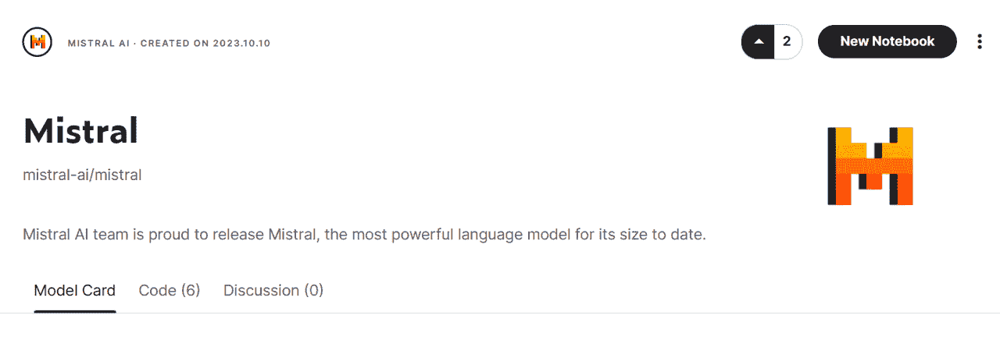

Image from Mistral | Kaggle

1.  Click on the “+Add Models” button on the right side panel.

1.  Search for your model and click on the Plus button to add it.

1.  Select the correct variation “7b-v0.1-hf” and the version.

1.  After that, copy the directory path and add it to your notebook.

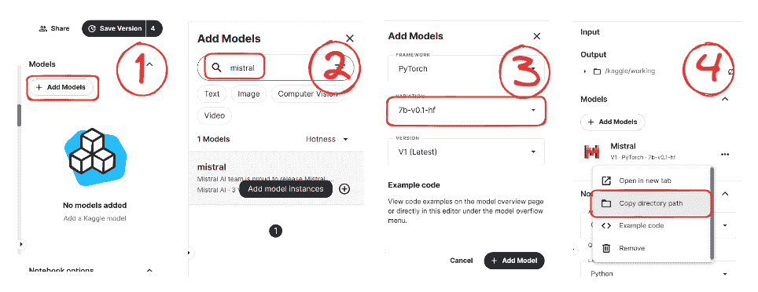

We will now load the model and tokenizer using the transformer library.

model_name = "/kaggle/input/mistral/pytorch/7b-v0.1-hf/1"

tokenizer = AutoTokenizer.from_pretrained(model_name)

model = AutoModelForCausalLM.from_pretrained(

model_name,

load_in_4bit=True,

quantization_config=bnb_config,

torch_dtype=torch.bfloat16,

device_map="auto",

trust_remote_code=True,)

[**Powered By **](https://www.datacamp.com/datalab)

To make our life easy, we will use the pipeline function from the Transformers library to generate the response based on the prompt.

pipe = pipeline("text-generation",    model=model,    tokenizer = tokenizer,    torch_dtype=torch.bfloat16,    device_map="auto")

[**Powered By **](https://www.datacamp.com/datalab)

We will then provide the prompt to the pipeline object and set additional parameters to create the maximum number of tokens and improve our response.

prompt = "As a data scientist, can you explain the concept of regularization in machine learning?"

sequences = pipe(

prompt,

do_sample=True,

max_new_tokens=100,    temperature=0.7,    top_k=50,    top_p=0.95,

num_return_sequences=1,)print(sequences[0]['generated_text'])

[**Powered By **](https://www.datacamp.com/datalab)

As we can see, Mistral 7B has generated proper results explaining the process of regularization in machine learning.

As a data scientist, can you explain the concept of regularization in machine learning?

Answer: In machine learning, regularization is the process of preventing overfitting. Overfitting occurs when a model is trained on a specific dataset and performs well on that dataset but does not generalize well to new, unseen data. Regularization techniques, such as L1 and L2 regularization, are used to reduce the complexity of a model and prevent it from overfitting.

[**Powered By **](https://www.datacamp.com/datalab)

Y[**ou can duplicat**](https://www.kaggle.com/code/kingabzpro/mistral-7b-4bit-inference)e and run the code by using the Mistral 7B 4-bit inference notebook on Kaggle.

Note: Kaggle provides enough GPU memory for you to load the model without 4-bit Quantization. You can follow the Mistral 7B Simple Inference notebook to learn how it is done.

## Mistral 7B Fine-tuning

I[**n this section, we will follow similar st**](https://www.datacamp.com/tutorial/fine-tuning-llama-2)eps from the guide Fine-Tuning LLaMA 2: A Step-by-Step Guide to Customizing the Large Language Model to fine-tune the Mistral 7B model on our favorite dataset guanaco-llama2-1k. You can also read the guide to learn about PEFT, 4-bit quantization, QLoRA, and SFT.

### Setting up

We will update and install the necessary Python libraries.

%%capture

%pip install -U bitsandbytes

%pip install -U transformers

%pip install -U peft

%pip install -U accelerate

%pip install -U trl

[**Powered By **](https://www.datacamp.com/datalab)

After that, we will load the necessary modules for effective fine-tuning of the model.

from transformers import AutoModelForCausalLM, AutoTokenizer, BitsAndBytesConfig,HfArgumentParser,TrainingArguments,pipeline, logging

from peft import LoraConfig, PeftModel, prepare_model_for_kbit_training, get_peft_model

import os,torch, wandb

from datasets import load_dataset

from trl import SFTTrainer

[**Powered By **](https://www.datacamp.com/datalab)

Note that we are using Kaggle Notebook to fine-tune our model. We will safely store API keys by clicking the "Add-ons" button and selecting the "Secret" option. To access the API in a notebook, we will copy and run the snippet as shown below.

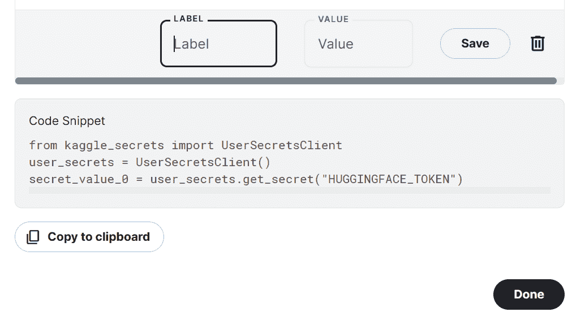

In our case, we will save Hugging Face and Weights and Biases API keys and access them in the Kaggle notebook.

from kaggle_secrets import UserSecretsClient

user_secrets = UserSecretsClient()

secret_hf = user_secrets.get_secret("HUGGINGFACE_TOKEN")

secret_wandb = user_secrets.get_secret("wandb")

[**Powered By **](https://www.datacamp.com/datalab)

We will use the Hugging Face API to save and push the model to the Hugging Face Hub.

!huggingface-cli login --token $secret_hf

[**Powered By **](https://www.datacamp.com/datalab)

To monitor LLM performance, we will initialize Weights and Biases experiments using API.

wandb.login(key = secret_wandb)

run = wandb.init(

project='Fine tuning mistral 7B',    job_type="training",    anonymous="allow")

[**Powered By **](https://www.datacamp.com/datalab)

In this section, we will set the base model, dataset, and new model name. The name of the new model will be used to save a fine-tuned model.

Note: If you are using the free version of Colab, you should load the sharded version of the model (someone13574/Mistral-7B-v0.1-sharded).

You can also load the model from Hugging Face Hub using the base model name: mistralai/Mistral-7B-v0.1

base_model = "/kaggle/input/mistral/pytorch/7b-v0.1-hf/1"

dataset_name = "mlabonne/guanaco-llama2-1k"

new_model = "mistral_7b_guanaco"

[**Powered By **](https://www.datacamp.com/datalab)

### Data loading

We will now load the dataset from Hugging Face Hub and visualize the 100th row.

#Importing the dataset

dataset = load_dataset(dataset_name, split="train")

dataset["text"][100]

[**Powered By **](https://www.datacamp.com/datalab)

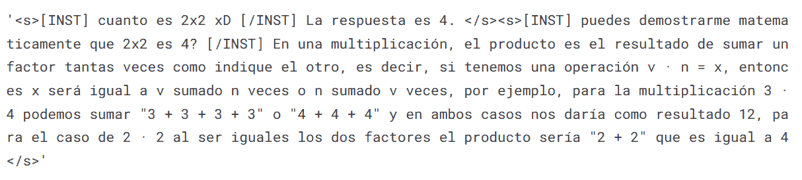

### Loading the Mistral 7B model

We will now load a model using 4-bit precision from Kaggle for faster training. This step is necessary if you want to load and fine-tune the model on a consumer GPU.

bnb_config = BitsAndBytesConfig(    load_in_4bit= True,

bnb_4bit_quant_type= "nf4",

bnb_4bit_compute_dtype= torch.bfloat16,

bnb_4bit_use_double_quant= False,)

model = AutoModelForCausalLM.from_pretrained(

base_model,

load_in_4bit=True,

quantization_config=bnb_config,

torch_dtype=torch.bfloat16,

device_map="auto",

trust_remote_code=True,)

model.config.use_cache = False # silence the warnings

model.config.pretraining_tp = 1

model.gradient_checkpointing_enable()

[**Powered By **](https://www.datacamp.com/datalab)

### Loading the Tokenizer

Next, we will load the tokenizer and configure it to fix the issue with fp16.

tokenizer = AutoTokenizer.from_pretrained(base_model, trust_remote_code=True)

tokenizer.padding_side = 'right'

tokenizer.pad_token = tokenizer.eos_token

tokenizer.add_eos_token = True

tokenizer.add_bos_token, tokenizer.add_eos_token

[**Powered By **](https://www.datacamp.com/datalab)

### Adding the adopter to the layer

In the next step, we will include an adopter layer in our model. This will enable us to fine-tune the model using a small number of parameters, making the entire process faster and more memory-efficient. To gain a better understanding of parameters, you can refer to the official documentation of PEFT.

model = prepare_model_for_kbit_training(model)

peft_config = LoraConfig(

lora_alpha=16,

lora_dropout=0.1,

r=64,

bias="none",

task_type="CAUSAL_LM",

target_modules=["q_proj", "k_proj", "v_proj", "o_proj","gate_proj"])

model = get_peft_model(model, peft_config)

[**Powered By **](https://www.datacamp.com/datalab)

### Hyperparmeters

It's crucial to set the right hyperparameters. You can learn about each hyperparameter by reading the Fine-Tuning LLaMA 2 tutorial.

training_arguments = TrainingArguments(

output_dir="./results",

num_train_epochs=1,

per_device_train_batch_size=4,

gradient_accumulation_steps=1,

optim="paged_adamw_32bit",

save_steps=25,

logging_steps=25,

learning_rate=2e-4,

weight_decay=0.001,

fp16=False,

bf16=False,

max_grad_norm=0.3,

max_steps=-1,

warmup_ratio=0.03,

group_by_length=True,

lr_scheduler_type="constant",

report_to="wandb")

[**Powered By **](https://www.datacamp.com/datalab)

### SFT parameters

HuggingFace's TRL library offers a user-friendly API that allows for the creation and training of Supervised fine-tuning (SFT) models on your dataset with minimal coding. We will provide the SFT Trainer with the necessary components, such as the model, dataset, Lora configuration, tokenizer, and training parameters.

trainer = SFTTrainer(

model=model,

train_dataset=dataset,

peft_config=peft_config,

max_seq_length= None,

dataset_text_field="text",

tokenizer=tokenizer,

args=training_arguments,

packing= False,)

[**Powered By **](https://www.datacamp.com/datalab)

### Model training

After setting up everything, we will train our model.

trainer.train()

[**Powered By **](https://www.datacamp.com/datalab)

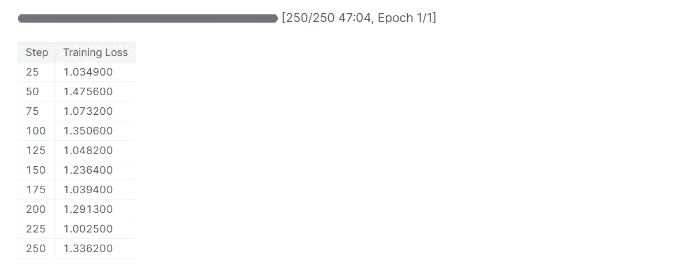

Note that you are using the T4 x2 version of the GPU, which can reduce training time to 1 hour and 30 minutes.

### Saving the fine-tuned model

Ultimately, we will save a pre-trained adopter and finish the W&B run.

trainer.model.save_pretrained(new_model)

wandb.finish()

model.config.use_cache = True

[**Powered By **](https://www.datacamp.com/datalab)

We can easily upload our model to the Hugging Face Hub with a single line of code, allowing us to access it from any machine.

trainer.model.push_to_hub(new_model, use_temp_dir=False)

[**Powered By **](https://www.datacamp.com/datalab)

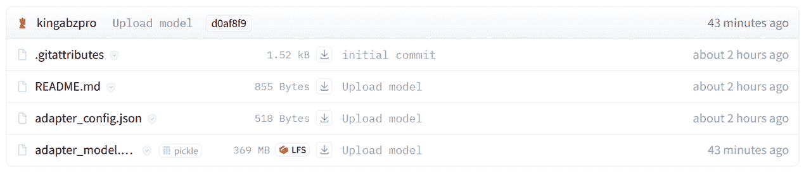

### Model evaluation

Yo[**u can view**](https://wandb.ai/kingabzpro/Fine%20tuning%20mistral%207B/runs/mzxmgtmf?workspace=user-kingabzpro) system metrics and model performance by going to wandb.ai and checking the recent run.

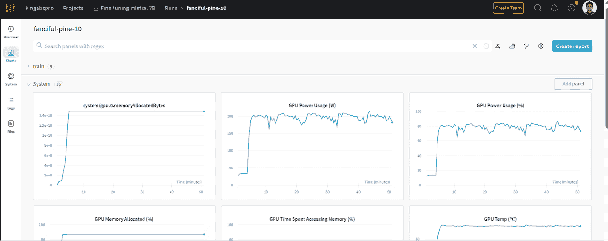

Image from [**wandb.ai**](https://wandb.ai/kingabzpro/Fine%20tuning%20mistral%207B/runs/mzxmgtmf?workspace=user-kingabzpro)

To perform model inference, we need to provide both the model and tokenizer objects to the pipeline. Then, we can provide the prompt in dataset style to the pipeline object.

logging.set_verbosity(logging.CRITICAL)

prompt = "How do I find true love?"

pipe = pipeline(task="text-generation", model=model, tokenizer=tokenizer, max_length=200)

result = pipe(f"<s>[INST] {prompt} [/INST]")print(result[0]['generated_text'])

[**Powered By **](https://www.datacamp.com/datalab)

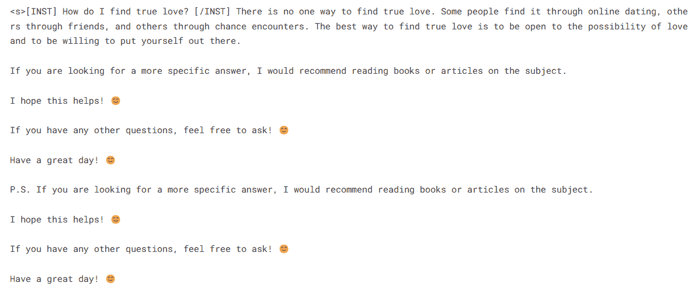

Let’s generate the response for another prompt.

prompt = "What is Datacamp Career track?"

result = pipe(f"<s>[INST] {prompt} [/INST]")print(result[0]['generated_text'])

[**Powered By **](https://www.datacamp.com/datalab)

It looks like we are getting perfect responses to our simple questions.

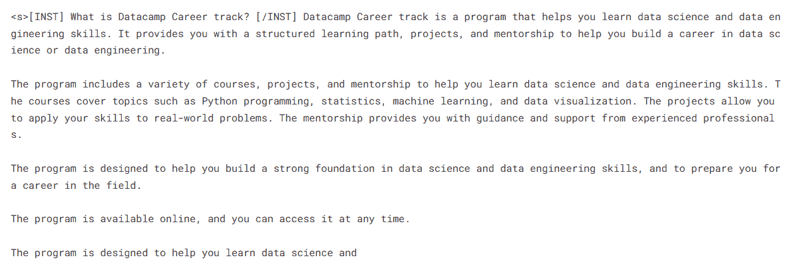

Important links for Mistral 7B:

+   Mistral 7B Fine-tuning Notebook

+   Mistral 7B Fine-tuned Model

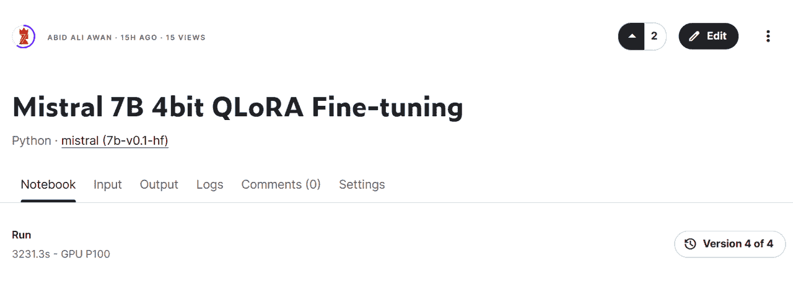

Image from Mistral 7B 4bit QLoRA Fine-tuning | Kaggle

**Important links for **Mistral 7B Instruct:

+   Mistral 7B Instruct Fine-tuning Notebook

Mistral 7B Instruct Fine-tuned Model

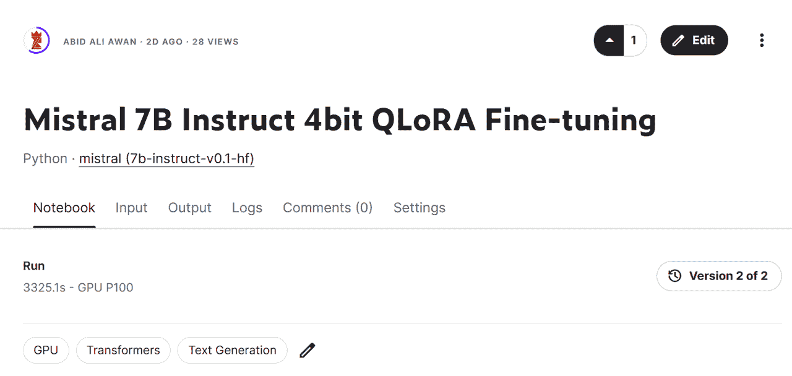

### Merging the adopter

In this section, we will load the base model and attach the adapter using PeftModel, run the inference, merge the model weights, and push it to the Hugging Face Hub.

from transformers import AutoModelForCausalLM, AutoTokenizer,pipeline

from peft import PeftModel

import torch

[**Powered By **](https://www.datacamp.com/datalab)

### Load base model with adopter

First, we will reload the base mode and fine-tuned adapter using peft. The function below will attach the adapter with the base model.

base_model_reload = AutoModelForCausalLM.from_pretrained(

base_model,

return_dict=True,

low_cpu_mem_usage=True,

device_map="auto",

trust_remote_code=True,)

model = PeftModel.from_pretrained(base_model_reload, new_model)

[**Powered By **](https://www.datacamp.com/datalab)

### Reload tokenizer

Load the base model tokenizer and fix the issue with fp16.

tokenizer = AutoTokenizer.from_pretrained(base_model, trust_remote_code=True)

tokenizer.pad_token = tokenizer.eos_token

tokenizer.padding_side = "right"

[**Powered By **](https://www.datacamp.com/datalab)

### Inference

Build an inference pipeline with tokenizer and the model.

pipe = pipeline("text-generation",    model=model,    tokenizer = tokenizer,    torch_dtype=torch.bfloat16,    device_map="auto")

[**Powered By **](https://www.datacamp.com/datalab)

Provide the prompt and run the pipeline to generate the response.

prompt = "How become a DataCamp certified data professional"

sequences = pipe(f"<s>[INST] {prompt} [/INST]",

do_sample=True,

max_new_tokens=100,    temperature=0.7,    top_k=50,    top_p=0.95,

num_return_sequences=1,)print(sequences[0]['generated_text'])

[**Powered By **](https://www.datacamp.com/datalab)

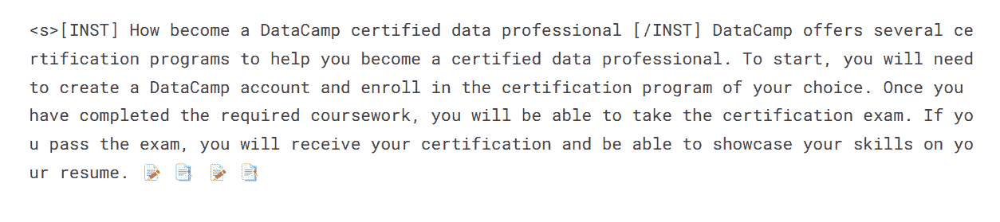

### Pushing the fine-tuned model

We will now merge the adopter with the base model so that you can use the fine-tuned model directly, like the original Mistral 7B model, and run the inference. For that, we will use the merge_and_unload function.

After merging the model, we will push both the tokenizer[** and model to t**](https://www.kaggle.com/code/kingabzpro/mistral-7b-adopter-with-base)he Hugging Face Hub. You can also follow the Kaggle notebook if you are stuck somewhere.

model = model.merge_and_unload()

model.push_to_hub(new_model, use_temp_dir=False)

tokenizer.push_to_hub(new_model, use_temp_dir=False)

[**Powered By **](https://www.datacamp.com/datalab)

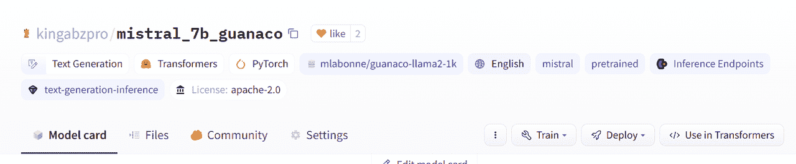

Image from kingabzpro/mistral_7b_guanaco

As you can see, instead of just an adapter, now we have a full model with a size of 13.98 GB.

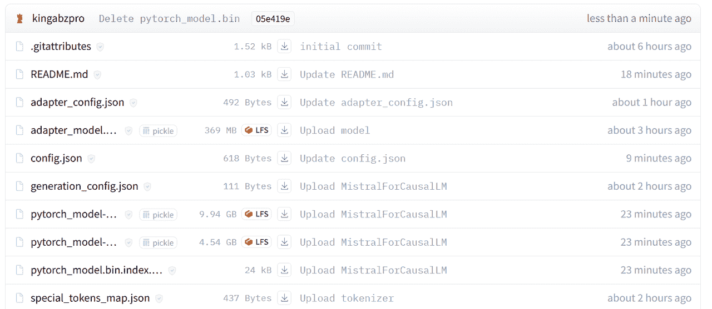

Image from kingabzpro/mistral_7b_guanaco

### Accessing the fine-tuned model

To showcase that we can load and run inference without the help of the base model, we will load the fine-tuned model from Hugging Face Hub and run the inference.

from transformers import pipeline

pipe = pipeline("text-generation",    model = "kingabzpro/mistral_7b_guanaco",

device_map="auto")

prompt = "How do I become a data engineer in 6 months?"

sequences = pipe(f"<s>[INST] {prompt} [/INST]",

do_sample=True,

max_new_tokens=200,    temperature=0.7,    top_k=50,    top_p=0.95,

num_return_sequences=1,)print(sequences[0]['generated_text'])

[**Powered By **](https://www.datacamp.com/datalab)

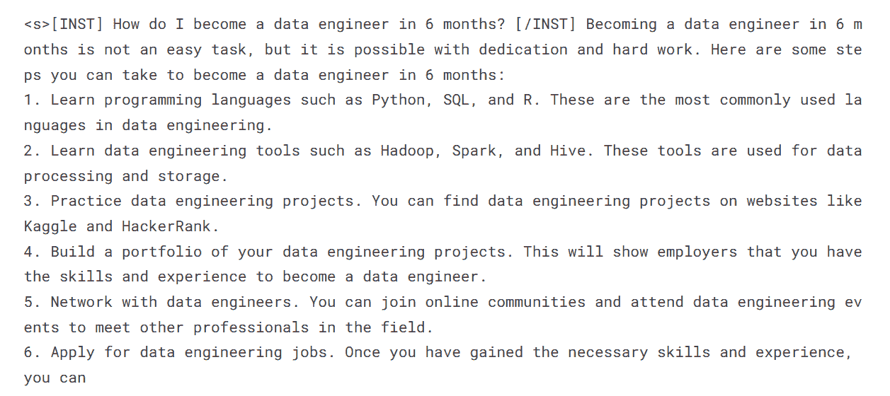

## Conclusion

Mistral 7B represents an exciting advancement in large language model capabilities. Through innovations like Grouped-query Attention and Sliding Window Attention, it achieves state-of-the-art performance while remaining efficient enough to deploy.

In this tutorial, we have learned how to access the Mistral 7B model on Kaggle. Additionally, we have learned how to fine-tune the model on a small dataset and merge the adopter with the base model.

This guide is a comprehensive resource for both machine learning enthusiasts and beginners who want to experiment and train the large language model on consumer GPUs.

If [**you are new to **](https://www.datacamp.com/tracks/ai-fundamentals)large language models, we recommend taking the Master LLMs Concepts course. For those interested in starting a career in artificial intelligence, enrolling in the AI Fundamentals skill track is a great first step.

### Resources

+   [**Official Blog**](https://mistral.ai/news/announcing-mistral-7b/)

+   [**GitHub**](https://github.com/mistralai/mistral-src)

+   [**Research Paper**](https://arxiv.org/abs/2310.06825)

+   [**Hugging Face**](https://huggingface.co/mistralai)

+   [**Ollama**](https://ollama.ai/library/mistral)

+   [**Demo**](https://chat.lmsys.org/)