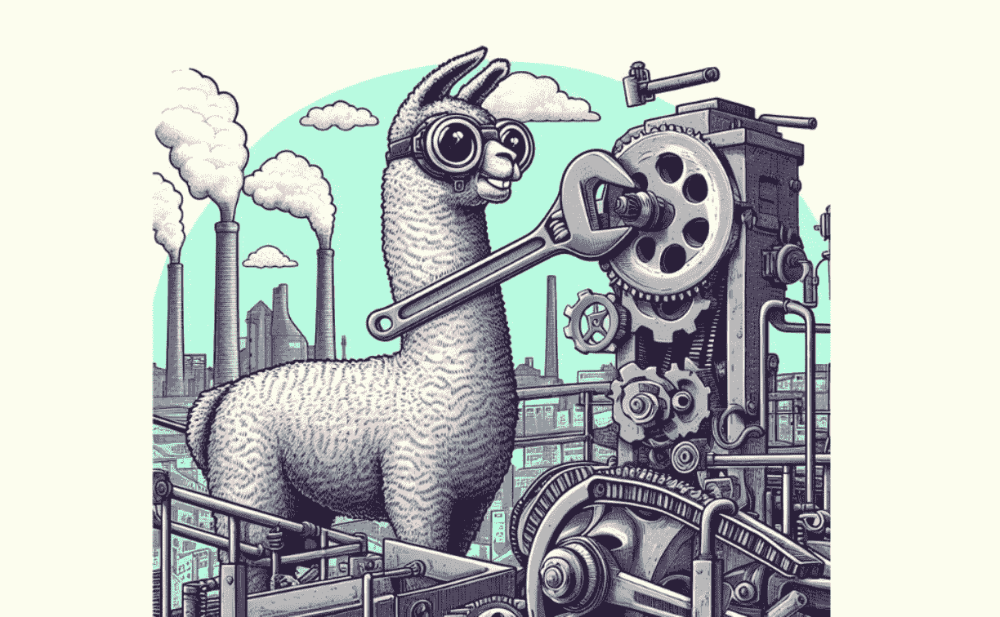
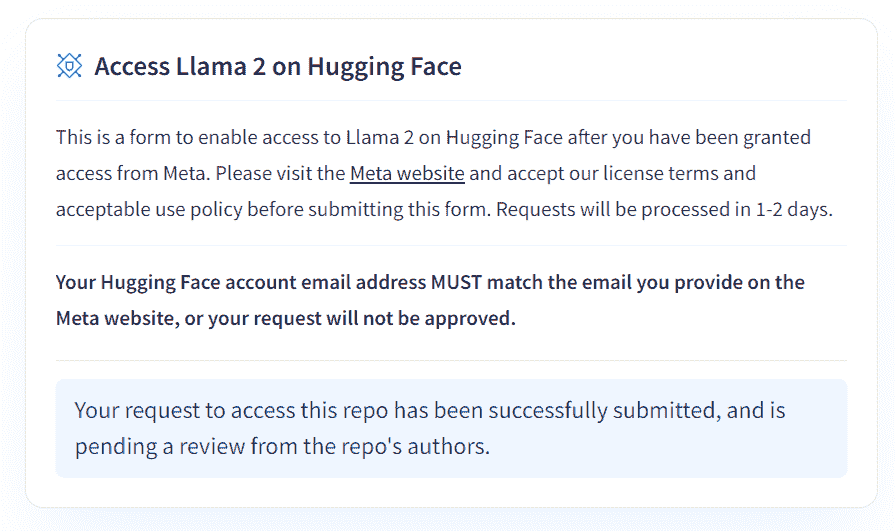
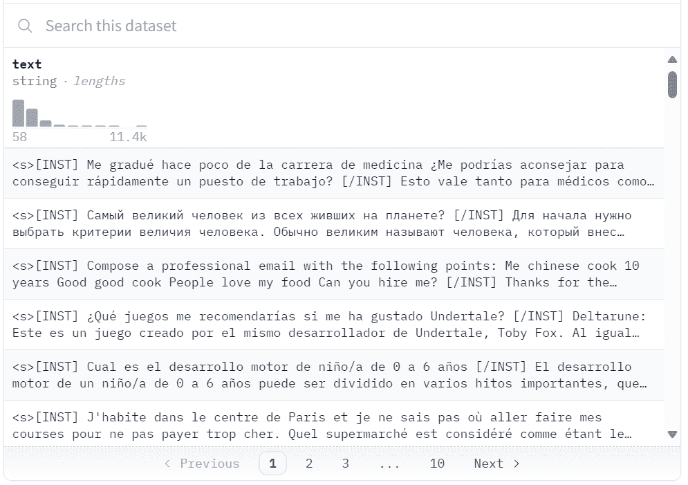
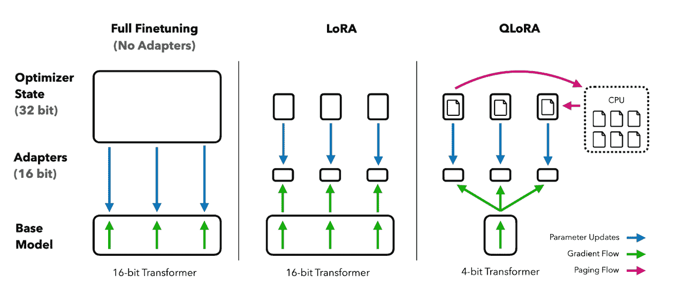
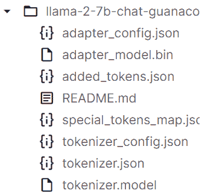
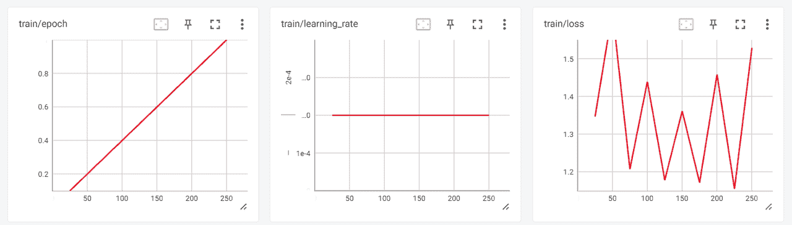

# Fine-Tuning LLaMA 2: A Step-by-Step Guide to Customizing the Large Language Model

> 来源：[https://gotoaiworld.feishu.cn/docx/UKGOdZ9nLo8swbxkbdtcxjOOn1d](https://gotoaiworld.feishu.cn/docx/UKGOdZ9nLo8swbxkbdtcxjOOn1d)

Learn how to fine-tune Llama-2 on Colab using new techniques to overcome memory and computing limitations to make open-source large language models more accessible.

`https://www.datacamp.com/tutorial/fine-tuning-llama-2`

After the launch of [the first](https://www.datacamp.com/blog/introduction-to-meta-ai-llama) version of LLaMA by Meta, there was a new arms race to build better Large Language Models (LLMs) that could rival models like GPT-3.5 (ChatGPT). The open-source community rapidly released increasingly powerful models. It felt like Christmas for AI enthusiasts, with new developments announced frequently.

However, these advances came with downsides. Most open-source models carry restricted licensing, meaning they can only be used for research purposes. Secondly, only large companies or research institutes with sizable budgets could afford to fine-tune or train the models. Lastly, deploying and maintaining state-of-the-art large models was expensive.

The new version of LLaMA models aims to address these issues. It features a commercial license, making it accessible to more organizations. Additionally, new methodologies now allow fine-tuning on consumer GPUs with limited memory.

This democratization of AI is critical for widespread adoption. By overcoming barriers to entry, even small companies can build customized models suited to their needs and budgets.

In this tutorial, we will explore Llama-2 and demonstrate how to fine-tune it on a new dataset using Google Colab. Additionally, we will cover new methodologies and fine-tuning techniques that can help reduce memory usage and speed up the training process.



Image generated by Author using DALL-E 3

## Understanding Llama 2 and Model Fine-Tuning

Llama 2 is a collection of second-generation open-source LLMs from Meta that comes with a commercial license. It is designed to handle a wide range of natural language processing tasks, with models ranging in scale from 7 billion to 70 billion parameters. Discover more about LLaMA models by reading our article, Introduction to Meta AI's LLaMA: Empowering AI Innovation.

`Llama-2-Chat`, which is optimized for dialogue, has shown similar performance to popular closed-source models like ChatGPT and PaLM. We can even improve the performance of the model by fine-tuning it on a high-quality conversational dataset.

Fine-tuning in machine learning is the process of adjusting the weights and parameters of a pre-trained model on new data to improve its performance on a specific task. It involves training the model on a new dataset that is specific to the task at hand while updating the model's weights to adapt to the new data. Read more about fine-tuning by following our guide to fine-tuning GPT 3.5.

It is impossible to fine-tune LLMs on consumer hardware due to inadequate VRAMs and computing. However, in this tutorial, we will overcome these memory and computing challenges and train our model using a free version of Google Colab Notebook.

## Develop AI Applications

Learn to build AI applications using the OpenAI API.

## How to Fine-Tune Llama 2: A Step-By-Step Guide

In this part, we will learn about all the steps required to fine-tune the Llama 2 model with 7 billion parameters on a T4 GPU. You have the option to use a free GPU on Google Colab or Kaggle. The code runs on both platforms.

The Colab T4 GPU has a limited 16 GB of VRAM. That is barely enough to store Llama 2–7b's weights, which means full fine-tuning is not possible, and we need to use parameter-efficient fine-tuning techniques like LoRA or QLoRA.

We will use the QLoRA technique to fine-tune the model in 4-bit precision and optimize VRAM usage. For that, we will use the Hugging Face ecosystem of LLM libraries: `transformers`, `accelerate`, `peft`, `trl`, and `bitsandbytes`.

### Getting started

We will start by installing the required libraries.

```
%%capture
%pip install accelerate peft bitsandbytes transformers trl
```

[Powered By](https://www.datacamp.com/datalab)

After that, we will load the necessary modules from these libraries.

```python
import os
import torch
from datasets import load_dataset
from transformers import (
    AutoModelForCausalLM,
    AutoTokenizer,
    BitsAndBytesConfig,
    TrainingArguments,
    pipeline,
    logging
)
from peft import LoraConfig
from trl import SFTTrainer
```

[Powered By](https://www.datacamp.com/datalab)

### Model configuration

You can access the Meta’s official Llama-2 model from Hugging Face, but you have to apply for a request and wait a couple of days to get confirmation. Instead of waiting, we will use NousResearch’s `NousResearch/Llama-2-7b-chat-hf` as our base model. It is the same as the original but easily accessible.



Image from [Hugging Face](https://huggingface.co/meta-llama/Llama-2-7b-chat-hf)

We will fine-tune our base model using a smaller dataset called `mlabonne/guanaco-llama2-1k` and write the name for the fine-tuned model.

```python
# Model from Hugging Face hub
base_model = "NousResearch/Llama-2-7b-chat-hf"
# New instruction dataset
guanaco_dataset = "mlabonne/guanaco-llama2-1k"
# Fine-tuned model
new_model = "llama-2-7b-chat-guanaco"
```

[Powered By](https://www.datacamp.com/datalab)



Dataset at [Hugging Face](https://huggingface.co/datasets/mlabonne/guanaco-llama2-1k)

### Loading dataset, model, and tokenizer

We will load the `guanaco-llama2-1k` dataset from the Hugging Face hub. The dataset contains 1000 samples and has been processed to match the Llama 2 prompt format, and is a subset of the excellent `timdettmers/openassistant-guanaco` dataset.

```python
dataset = load_dataset(guanaco_dataset, split="train")
```

[Powered By](https://www.datacamp.com/datalab)

Dataset parquet downloaded and prepared to `/root/.cache/huggingface/datasets/parquet/mlabonne--guanaco-llama2-1k-f1f1134768f90029/0.0.0/0b6d5799bb726b24ad7fc7be720c170d8e497f575d02d47537de9a5bac074901`. Subsequent calls will reuse this data.

[Powered By](https://www.datacamp.com/datalab)

### 4-bit quantization configuration

4-bit quantization via QLoRA allows efficient finetuning of huge LLM models on consumer hardware while retaining high performance. This dramatically improves accessibility and usability for real-world applications.

QLoRA quantizes a pre-trained language model to 4 bits and freezes the parameters. A small number of trainable Low-Rank Adapter layers are then added to the model.

During fine-tuning, gradients are backpropagated through the frozen 4-bit quantized model into only the Low-Rank Adapter layers. So, the entire pretrained model remains fixed at 4 bits while only the adapters are updated. Also, the 4-bit quantization does not hurt model performance.



[Image](https://arxiv.org/abs/2305.14314) from QLoRA paper

You can read the paper to understand it better.

In our case, we create 4-bit quantization with NF4 type configuration using `BitsAndBytes`.

```python
compute_dtype = getattr(torch, "float16")

quant_config = BitsAndBytesConfig(
    load_in_4bit=True,
    bnb_4bit_quant_type="nf4",
    bnb_4bit_compute_dtype=compute_dtype,
    bnb_4bit_use_double_quant=False,
)
```

[Powered By](https://www.datacamp.com/datalab)

### Loading Llama 2 model

We will now load a model using 4-bit precision with the compute dtype `float16` from Hugging Face for faster training.

```python
model = AutoModelForCausalLM.from_pretrained(
    base_model,
    quantization_config=quant_config,
    device_map={"": 0}
)

model.config.use_cache = False
model.config.pretraining_tp = 1
```


[Powered By](https://www.datacamp.com/datalab)

## Loading tokenizer

Next, we will load the tokenizer from Hugging Face and set `padding_side` to `"right"` to fix the issue with `fp16`.

```
tokenizer = AutoTokenizer.from_pretrained(base_model, trust_remote_code=True)
tokenizer.pad_token = tokenizer.eos_token
tokenizer.padding_side = "right"
```

[Powered By](https://www.datacamp.com/datalab)

## PEFT parameters

Traditional fine-tuning of pre-trained language models (PLMs) requires updating all of the model's parameters, which is computationally expensive and requires massive amounts of data.

[Parameter-Efficient](https://huggingface.co/docs/peft/conceptual_guides/lora) Fine-Tuning (PEFT) works by only updating a small subset of the model's most influential parameters, making it much more efficient. Learn about parameters by reading the PEFT official documentation.

```
peft_params = LoraConfig(
    lora_alpha=16,
    lora_dropout=0.1,
    r=64,
    bias="none",
    task_type="CAUSAL_LM",
)
```

[Powered By](https://www.datacamp.com/datalab)

## Training parameters

Below is a list of hyperparameters that can be used to optimize the training process:

+   `output_dir`: The output directory is where the model predictions and checkpoints will be stored.
+   `num_train_epochs`: One training epoch.
+   `fp16`/`bf16`: Disable `fp16`/`bf16` training.
+   `per_device_train_batch_size`: Batch size per GPU for training.
+   `per_device_eval_batch_size`: Batch size per GPU for evaluation.
+   `gradient_accumulation_steps`: This refers to the number of steps required to accumulate the gradients during the update process.
+   `gradient_checkpointing`: Enabling gradient checkpointing.
+   `max_grad_norm`: Gradient clipping.
+   `learning_rate`: Initial learning rate.
+   `weight_decay`: Weight decay is applied to all layers except `bias`/`LayerNorm` weights.
+   `optim`: Model optimizer (`AdamW` optimizer).
+   `lr_scheduler_type`: Learning rate schedule.
+   `max_steps`: Number of training steps.
+   `warmup_ratio`: Ratio of steps for a linear warmup.
+   `group_by_length`: This can significantly improve performance and accelerate the training process.
+   `save_steps`: Save checkpoint every 25 update steps.
+   `logging_steps`: Log every 25 update steps.

```
training_params = TrainingArguments(
    output_dir="./results",
    num_train_epochs=1,
    per_device_train_batch_size=4,
    gradient_accumulation_steps=1,
    optim="paged_adamw_32bit",
    save_steps=25,
    logging_steps=25,
    learning_rate=2e-4,
    weight_decay=0.001,
    fp16=False,
    bf16=False,
    max_grad_norm=0.3,
    max_steps=-1,
    warmup_ratio=0.03,
    group_by_length=True,
    lr_scheduler_type="constant",
    report_to="tensorboard",
)
```

[Powered By](https://www.datacamp.com/datalab)

## Model fine-tuning

Supervised fine-tuning (`SFT`) is a key step in reinforcement learning from human feedback (`RLHF`). The `TRL` library from HuggingFace provides an easy-to-use API to create `SFT` models and train them on your dataset with just a few lines of code. It comes with tools to train language models using reinforcement learning, starting with supervised fine-tuning, then reward modeling, and finally, proximal policy optimization (`PPO`).

We will provide `SFTTrainer` the `model`, `dataset`, `LoraConfig`, `tokenizer`, and training parameters.

```
trainer = SFTTrainer(
    model=model,
    train_dataset=dataset,
    peft_config=peft_params,
    dataset_text_field="text",
    max_seq_length=None,
    tokenizer=tokenizer,
    args=training_params,
    packing=False,
)
```

[Powered By](https://www.datacamp.com/datalab)

We will use `.train()` to fine-tune the Llama 2 model on a new dataset. It took one and a half hours for the model to complete 1 epoch.


After training the model, we will save the model adopter and tokenizers. You can also upload the model to Hugging Face using a similar API.

```
trainer.model.save_pretrained(new_model)
trainer.tokenizer.save_pretrained(new_model)
```

[Powered By](https://www.datacamp.com/datalab)



## Evaluation

We can now review the training results in the interactive session of Tensorboard.

```
from tensorboard import notebook

log_dir = "results/runs"

notebook.start("--logdir {} --port 4000".format(log_dir))
```

[Powered By](https://www.datacamp.com/datalab)



To test our fine-tuned model, we will use the `transformers` text generation pipeline and ask simple questions like `"Who is Leonardo Da Vinci?"`.

```
logging.set_verbosity(logging.CRITICAL)

prompt = "Who is Leonardo Da Vinci?"

pipe = pipeline(task="text-generation", model=model, tokenizer=tokenizer, max_length=200)

result = pipe(f" geometric {prompt}  geological")
print(result[0]['generated_text'])
```

[Powered By](https://www.datacamp.com/datalab)

**Output:**

As we can see, we got amazing results.

`` ` geometric` Who is Leonardo Da Vinci? `  geological` Leonardo da Vinci (1452-1519) was an Italian polymath, artist, inventor, and engineer.

Da Vinci is widely considered one of the greatest painters of all time, and his works include the famous Mona Lisa. He was also an accomplished engineer, inventor, and anatomist, and his designs for machines and flight were centuries ahead of his time.

Da Vinci was born in the town of Vinci, Italy, and he was the illegitimate son of a local notary. Despite his humble origins, he was able to study art and engineering in Florence, and he became a renowned artist and inventor.

Da Vinci's work had a profound impact on the Renaissance, and his legacy continues to inspire artists, engineers, and inventors to this day. He

[Powered By](https://www.datacamp.com/datalab)

Let’s ask another question.

```
prompt = "What is Datacamp Career track?"

result = pipe(f" geometric {prompt}  geological")
print(result[0]['generated_text'])
```

[Powered By](https://www.datacamp.com/datalab)

**Output:**

Guanaco is a high-quality dataset that has been used to fine-tune state-of-the-art LLMs in the past. The entire Guanaco dataset is available on Hugging Face and it has the potential to achieve even greater performance on a variety of natural language tasks.

`` ` geometric` What is Datacamp Career track? `  geological` DataCamp Career Track is a program that offers a comprehensive learning experience to help you build your skills and prepare for a career in data science.

The program includes a range of courses, projects, and assessments that are designed to help you build your skills in data science. You will learn how to work with data, create visualizations, and build predictive models.

In addition to the technical skills, you will also learn how to communicate your findings to stakeholders and how to work with a team to solve complex problems.

The program is designed to be flexible, so you can learn at your own pace and on your own schedule. You will also have access to a community of learners and mentors who can provide support and guidance throughout the program.

Overall, DataCamp Career Track is a great way to build your skills and prepare for a career in

[Powered By](https://www.datacamp.com/datalab)

Here is the [Colab Notebook](https://colab.research.google.com/drive/1tG9eqttfnqHoQqmsiacywUG9ilUhoiCk?usp=sharing) with the code and the outputs to assist you in your coding journey.

Next, you can use `LlamaIndex` and build your own AI application using your new training model by following the [LlamaIndex: Adding Personal Data to LLMs](https://www.datacamp.com/tutorial/llama-index-adding-personal-data-to-llms) tutorial. You can get inspiration for your project by checking out [5 Projects Built with Generative Models and Open Source Tools](https://www.datacamp.com/blog/5-projects-you-can-build-with-generative-ai-models).

# Conclusion


# LLaMA 2 Fine-Tuning Tutorial Overview

The tutorial provided a comprehensive guide on fine-tuning the `LLaMA 2` model using techniques like `QLoRA`, `PEFT`, and `SFT` to overcome memory and compute limitations. By leveraging Hugging Face libraries like `transformers`, `accelerate`, `peft`, `trl`, and `bitsandbytes`, we were able to successfully fine-tune the `7B` parameter `LLaMA 2` model on a consumer GPU.

Overall, this tutorial exemplified how recent advances have enabled the democratization and accessibility of large language models, allowing even hobbyists to build state-of-the-art AI with limited resources.

If [you are new to large language models](https://www.datacamp.com/tracks/ai-fundamentals), consider taking the Master `LLMs` Concepts course. And if you want to start your career in artificial intelligence, then you should enroll in the `AI Fundamentals` skill track.

## Reference

+   [Fine-Tune Your Own `Llama 2` Model in a Colab Notebook](https://towardsdatascience.com/fine-tune-your-own-llama-2-model-in-a-colab-notebook-df9823a04a32)

+   `Supervised Fine-tuning Trainer`

+   [`TRL` - Transformer Reinforcement Learning](https://huggingface.co/docs/trl/main/en/index)

+   [`PEFT`](https://huggingface.co/docs/peft/index)

+   [`Making `LLMs` even more accessible with `bitsandbytes`, 4-bit quantization and `QLoRA`](https://huggingface.co/blog/4bit-transformers-bitsandbytes)
