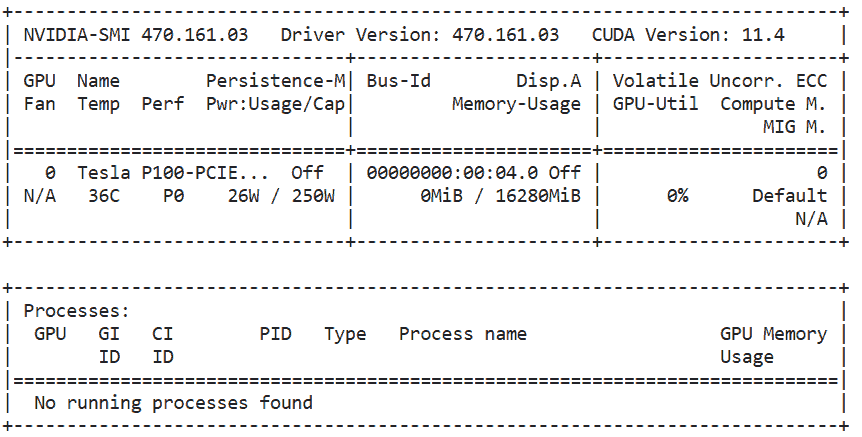
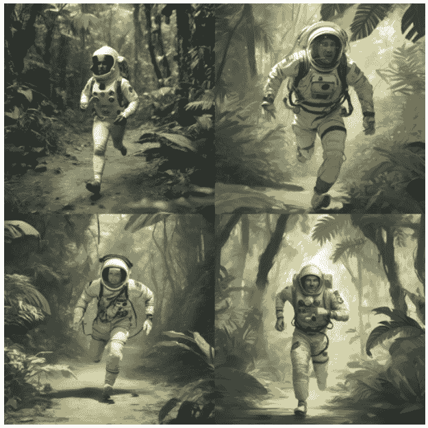
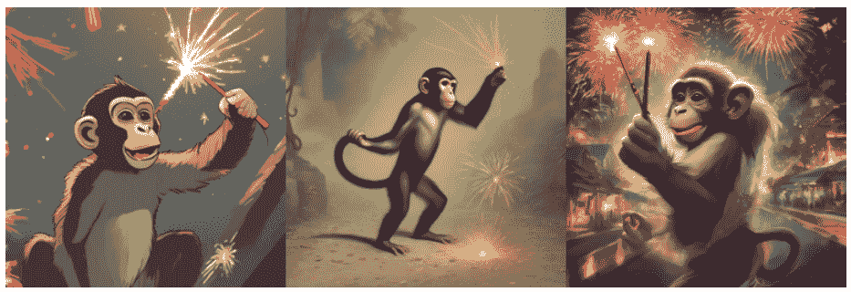
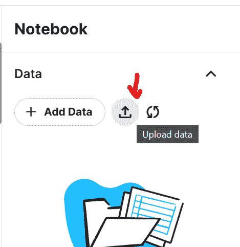
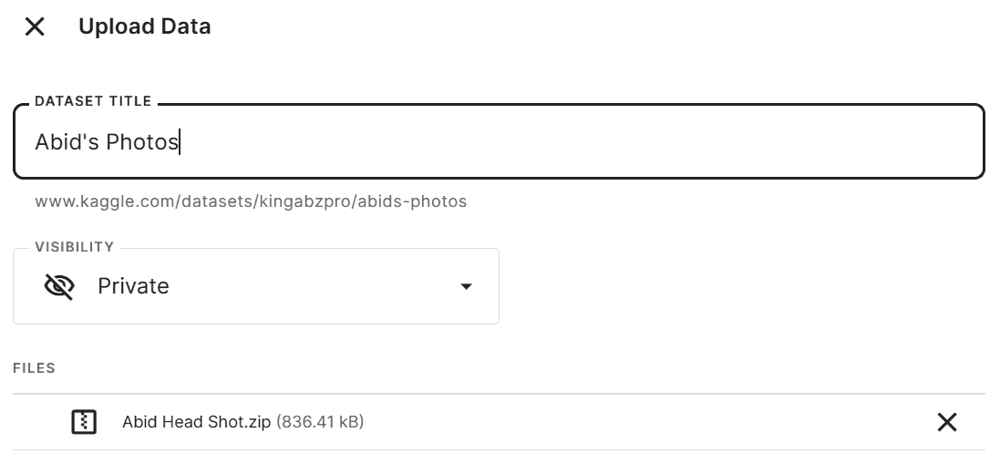
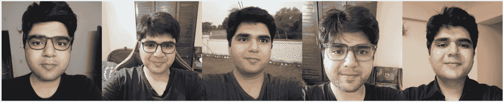
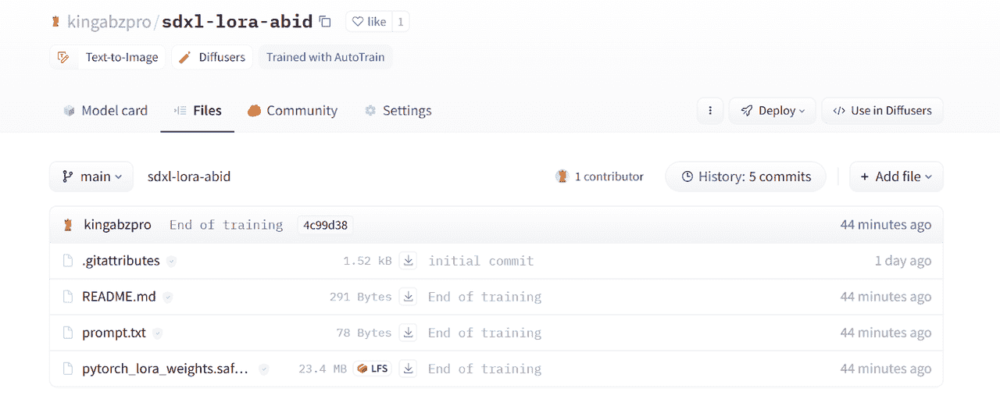
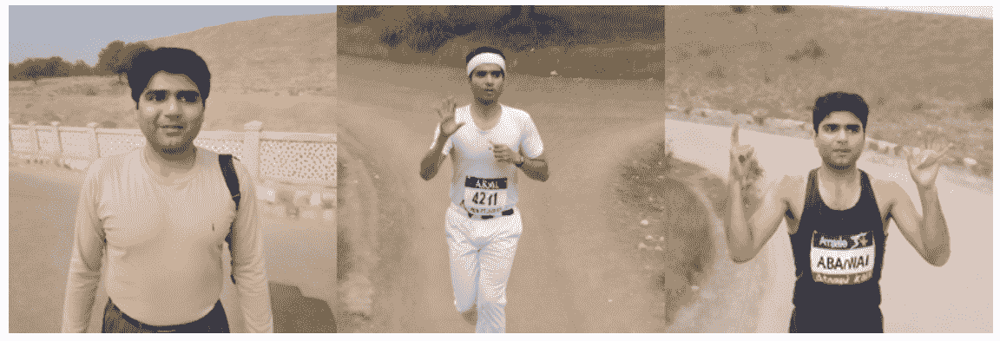

# Fine-tuning Stable Diffusion XL with DreamBooth and LoRA

> 来源：[https://gotoaiworld.feishu.cn/docx/BqUzdUdYuogKTTxvjfmcJWacn0f](https://gotoaiworld.feishu.cn/docx/BqUzdUdYuogKTTxvjfmcJWacn0f)

In this tutorial, we will learn about Stable Diffusion XL and Dream Booth, and how to access the image generation model using the [`diffusion`](https://www.datacamp.com/tracks/ai-fundamentals) library. Additionally, we will learn to fine-tune the model on personal photos and evaluate its performance. If you're a newcomer to AI, we suggest taking an AI Fundamentals course to give you a primer.

https://www.datacamp.com/tutorial/fine-tuning-stable-diffusion-xl-with-dreambooth-and-lora

## Understanding Stable Diffusion XL

The Stability AI team has released Stable Diffusion XL (SDXL) 1.0, representing the next evolution in AI text-to-image generation models. This open-source model builds on the previous research-only SDXL 0.9 model to become the world's most capable publicly available image creation model.

Both quantitative analysis and qualitative human evaluations over weeks of experimentation demonstrate SDXL's capabilities to generate the highest quality and most preferred images compared to other open-source models.


Image from [`arxiv.org`](https://arxiv.org/pdf/2307.01952.pdf)

This high quality was achieved by using an ensemble of two models - a 3.5 billion parameter base generator and a 6.6 billion parameter refiner. This dual pipeline maximizes image quality while remaining efficient enough to run on consumer GPUs.

Now, with SDXL 1.0, users no longer need long, complex prompts to generate stunning images. Its intelligence allows the creation of intricate images from just a few words.

Fine-tuning SDXL on custom datasets and tasks has become even easier. It allows us granular control over structure, style, and composition.

## What is DreamBooth?

[`DreamBooth`](https://arxiv.org/abs/2208.12242), introduced in 2022 by the Google research team, represents a significant advancement in the field of generative AI, particularly in the realm of text-to-image models like Stable Diffusion.

It is called DreamBooth because, in the words of the Google researchers:

"It's like a photo booth but captures the subject in a way that allows it to be synthesized wherever your dreams take you."


Image from [`DreamBooth`](https://huggingface.co/docs/diffusers/training/dreambooth)

DreamBooth allows you to inject a specific custom subject that the fine-tuned model then becomes specialized at rendering in different ways. So, in a sense, it opens up the possibility to create your own image generator focused on a particular person, character, object, or scene.

DreamBooth requires only a few (typically 3-5) images of the subject to train the model effectively. Once trained, the model can place the subject in a myriad of settings, scenes, and poses, limited only by the user's imagination.

### DreamBooth Use Cases

Fine-tuning the image generation model with DreamBooth can be beneficial for many fields. It provides more freedom to experiment and generate high-quality images without Photoshop skills. Here are some examples of how it can easily add value to the workspace.

1. Creative industries such as graphic design, advertising, and entertainment can greatly benefit from DreamBooth, as it offers a high level of customization and uniqueness in visual content creation.

1. `DreamBooth`allows for personalization by creating scenarios that may be difficult to replicate in real life or purely fictional.

1. It can also be applied in educational and research fields where visual representation is crucial, as it can be used to create personalized educational content or for research purposes.

In the following sections, we will delve deeper into the process of accessing and fine-tuning the SDXL model on a custom dataset using free Kaggle GPUs.

## Accessing Stable Diffusion XL

We can try the Stable [Diff](https://huggingface.co/spaces/google/sdxl)usion XL Spaces demo on Hugging Face, which quickly generates four images based on your input. Play around before deciding if it's right for your application.


Image from Stable Diffusion XL on TPUv5e

The other way is to use the Python library `diffusers` to generate the image using the custom prompt.

### Setting Up

Before we jump into running the code, make sure you are running a GPU machine with the CUDA support.

```
!nvidia-smi
```

[Powered By](https://www.datacamp.com/datalab)



After that, install the `diffuser` package using PIP.

```
%pip install --upgrade diffusers[torch] -q
```

[Powered By](https://www.datacamp.com/datalab)

### Loading the Base Model and VAE Decoder

We will load the custom VAE decoder that is modified to run in `fp16` precision without generating NaNs.

After that, we will build a pipeline by loading the base SDXL model with `fp16` precision by integrating the VAE decoder in the `diffusers` workflow.

We could have loaded base model directly without “`fp16`”, but it would have caused GPU memory issues. So, to run it on Kaggle, Colab, and Laptop GPUs, you have to access the model in the `fp16` variant.

```
from diffusers import DiffusionPipeline, AutoencoderKL

import torch

vae = AutoencoderKL.from_pretrained("madebyollin/sdxl-vae-fp16-fix", torch_dtype=torch.float16)

pipe = DiffusionPipeline.from_pretrained("stabilityai/stable-diffusion-xl-base-1.0",
    vae=vae,
    torch_dtype=torch.float16,
    variant="fp16",
    use_safetensors=True,
)

pipe.to("cuda");
```

[Powered By](https://www.datacamp.com/datalab)

### Running the Image Generation Pipeline

To generate the image, you have to provide a simple prompt, inference steps, and the number of images per prompt.

In our case, we will be generating four images from the single prompt.

```
prompt = "A man in a spacesuit is running a marathon in the jungle."
image = pipe(prompt=prompt, num_inference_steps=25, num_images_per_prompt = 4)
```

[Powered By](https://www.datacamp.com/datalab)

To display images in a grid, we can write a simple Python function that resizes the images and displays them in a grid.

```
from PIL import Image

def image_grid(imgs, rows, cols, resize=256):
    assert len(imgs) == rows * cols
    if resize is not None:
        imgs = [img.resize((resize, resize)) for img in imgs]
    w, h = imgs[0].size
    grid_w, grid_h = cols * w, rows * h
    grid = Image.new("RGB", size=(grid_w, grid_h))
    for i, img in enumerate(imgs):
        x = i % cols * w
        y = i // cols * h
        grid.paste(img, box=(x, y))
    return grid
```

[Powered By](https://www.datacamp.com/datalab)

We will display four images in a 2x2 grid to easily compare model output.

```
image_grid(image.images, 2, 2)
```

[Powered By](https://www.datacamp.com/datalab)

The results are amazing. Certainly, SDXL is a lot better than Stable Diffusion 1.6.



Let's write another prompt and generate three images of a monkey playing with fireworks.

```
prompt = "A playful monkey handling fireworks with ease."
image = pipe(prompt=prompt, num_inference_steps=25, num_images_per_prompt = 3)
image_grid(image.images, 1, 3)
```

[Powered By](https://www.datacamp.com/datalab)



Learn how to access the Stable Diffusion model online and locally by following the How to Run Stable Diffusion tutorial.

### Improve the Results with Refiner

To [further](https://huggingface.co/stabilityai/stable-diffusion-xl-refiner-1.0) improve the image quality and model accuracy, we will use Refiner.

1. Load SDXL refiner 1.0 using diffusion pipeline.

2. Generate the image with the base SDXL model. We will change the output type to `latent` which will return the latent representation of the input, rather than the reconstructed image.


1. Provide the `refiner` with the `prompt` and latent representation of generated image.

```python
refiner = DiffusionPipeline.from_pretrained("stabilityai/stable-diffusion-xl-refiner-1.0",
    vae=vae,
    torch_dtype=torch.float16,
    use_safetensors=True,
    variant="fp16",)

refiner.to("cuda")

n_steps = 40

high_noise_frac = 0.7

image = pipe(
    prompt=prompt,
    num_inference_steps=n_steps,
    denoising_end=high_noise_frac,
    output_type="latent",).images

image = refiner(
    prompt=prompt,
    num_inference_steps=n_steps,
    denoising_start=high_noise_frac,
    image=image,).images[0]

image
```

[Powered By](https://www.datacamp.com/datalab)

The refined image is high quality and follows the prompt accurately.


Learn how to generate photorealistic images using [Python](https://www.datacamp.com/code-along/generating-photorealistic-images-using-ai-with-diffusers-in-python) with state-of-the-art diffusion models by watching the Generating Photorealistic Images using AI with Diffusers in Python code-along.

# Fine-Tuning SDXL using AutoTrain Advanced

Fine-tuning `SDXL` has become much easier with time. Thanks to `AutoTrain Advance`, we can now fine-tune our model with just one Python script. This Automatic Machine learning library is designed for training and deploying state-of-the-art machine-learning models with minimal code.

You can install the Python package using `PIP`:

```bash
%pip install -U autotrain-advanced
```

[Powered By](https://www.datacamp.com/datalab)

If you're interested in fine-tuning the `SDXL` model with `accelerate` and `transformers`, check out the SDXL DreamBoot LoRA Colab Notebook. The notebook is a bit outdated, and you might have to make changes in order to run it properly.

## Setting Up

Before we run the `AutoTrain` `DreamBooth` script, we should set up some variables that we are going to use to run the script.

1. Name the project.
1. Location of the base model.
1. Directory of the dataset.
1. Repo ID for pushing the model to Hugging Face.

```python
PROJECT_NAME = "Dreambooth_SDXL"
MODEL_NAME = "stabilityai/stable-diffusion-xl-base-1.0"
DATA_DIR = "/kaggle/input/abids-photos"
REPO_ID = "kingabzpro/sdxl-lora-abid"
```

[Powered By](https://www.datacamp.com/datalab)

Next, you will set up a [Hugging Face](https://www.datacamp.com/tutorial/mistral-7b-tutorial) token by using the Kaggle’s Secret feature. Learn how to set up secrets by reading Mistral 7B Tutorial: Step-by-Step Guide for Using Mistral 7B.

```python
from kaggle_secrets import UserSecretsClient

user_secrets = UserSecretsClient()

HF_TOKEN = user_secrets.get_secret("HUGGINGFACE_TOKEN")
```

[Powered By](https://www.datacamp.com/datalab)

## Creating the Private Dataset in Kaggle

To create the private dataset of your selfies in Kaggle, you have to click on the upload button on the right-side panel of the notebook.



Add the dataset title and upload the zip file containing five photos of the selfies taken at different locations. In this case, it's the photos of the author.



To view all five images in the Jupyter Notebook, we will load the images using `PIL` and feed it to our `image_grid` function.

```python
from PIL import Image

def image_grid(imgs, rows, cols, resize=256):
    assert len(imgs) == rows * cols

    if resize is not None:
        imgs = [img.resize((resize, resize)) for img in imgs]

    w, h = imgs[0].size

    grid_w, grid_h = cols * w, rows * h

    grid = Image.new("RGB", size=(grid_w, grid_h))
    for i, img in enumerate(imgs):
        x = i % cols * w
        y = i // cols * h
        grid.paste(img, box=(x, y))
    return grid

import glob
```

[Powered By](https://www.datacamp.com/datalab)

We displayed five high-quality images of the author at different locations. Please ensure that all photos are high quality and of similar size.

```python
imgs = [Image.open(path) for path in glob.glob("/kaggle/input/abids-photos/*.jpg")]
image_grid(imgs, 1, 5)
```

[Powered By](https://www.datacamp.com/datalab)



## AutoTrain Dream Booth Training Script

It is time to fine-tune our model on these five images using the AutoTrain DreamBooth script.

1. Provide base model, project name, and data directory.
1. Ensure the instance prompt is unique, describing the person or the object. Use the person's full name, "Abid Ali Awan," and describe the photo in detail.
1. Keep the rest of the argument the same to get the best performance.
1. Provide the Hugging Face access token and repository ID to upload model LoRA adopter to the Hugging Face Hub.

```bash
!autotrain dreambooth \

--model $MODEL_NAME \

--project-name $PROJECT_NAME \

--image-path $DATA_DIR \

--prompt "A photo of Abid Ali Awan wearing casual clothes, taking a selfie, and smiling." \

--resolution 1024 \

--batch-size 1 \

--num-steps 500 \

--gradient-accumulation 4 \

--lr 1e-4 \

--fp16 \

--gradient-checkpointing \

--push-to-hub \

--token $HF_TOKEN \

--repo-id $REPO_ID
```

[Powered By](https://www.datacamp.com/datalab)

It took 2 hours and 15 minutes to train the model and push the `LoRA` weights to Hugging Face.

`LoRA`, short for Low-Rank Adaptation, is a technique that involves adding small trainable layers to an existing model without modifying the original weights.

`LoRA` is beneficial because it allows the introduction of new concepts, such as art styles, characters, or themes, to the model without requiring extensive computation or memory usage.

```
Steps: 100%|█████████| 500/500 [2:15:11<00:00, 14.49s/it, loss=0.119, lr=0.0001]Model weights saved in Dreambooth_SDXL/pytorch_lora_weights.safetensors

Steps: 100%|█████████| 500/500 [2:15:11<00:00, 16.22s/it, loss=0.119, lr=0.0001]

pytorch_lora_weights.safetensors: 100%|████| 23.4M/23.4M [00:01<00:00, 11.9MB/s]
```

[Powered By](https://www.datacamp.com/datalab)

Instead of saving a 7GB model file, we will save a `LoRA` adapter of 23.4MB that will be attached to the base model during inference.



Image from `kingabzpro/sdxl-lora-abid`

## SDXL Fine-tuned Model Inference

We will create a diffusion pipeline to generate the image, using a custom `VAE` decoder and `SDXL` base model with `FP16` precision.

Then, we will load the `LoRA` weights and add them to the base model using our Hugging Face repo ID.

In the end, we will run the pipeline with the prompt and generate three images.

```python
from diffusers import DiffusionPipeline, AutoencoderKL, StableDiffusionXLImg2ImgPipeline

import torch

vae = AutoencoderKL.from_pretrained("madebyollin/sdxl-vae-fp16-fix", torch_dtype=torch.float16)

pipe = DiffusionPipeline.from_pretrained("stabilityai/stable-diffusion-xl-base-1.0",
    vae=vae,
    torch_dtype=torch.float16,
    variant="fp16",
    use_safetensors=True,)

pipe.to("cuda");

pipe.load_lora_weights(REPO_ID, weight_name="pytorch_lora_weights.safetensors")

prompt = "A photo of Abid Ali Awan participating in a marathon."

image = pipe(prompt=prompt, num_inference_steps=25, num_images_per_prompt = 3)

image_grid(image.images, 1, 3)
```

[Powered By](https://www.datacamp.com/datalab)

The results are impressive. We have successfully fine-tuned our model to generate images of the author “Abid Ali Awan”.



Let’s try again with another prompt.

```python
prompt = "A photo of Abid Ali Awan giving a press conference."

image = pipe(prompt=prompt, num_inference_steps=25, num_images_per_prompt = 3)

image_grid(image.images, 1, 3)
```

[Powered By](https://www.datacamp.com/datalab)

The results are once again exceptional.


## Using Refiner

In this section, we will improve the generated image with the `SDXL Refiner 1.0`.

First, we will generate the image using the `Stable Diffusion` pipeline and provide a manual seed to ensure reproducibility.

```python
prompt = "A photo of Abid Ali Awan wearing a business suit at an office meeting."
seed = 65
generator = torch.Generator("cuda").manual_seed(seed)
```


```
image = pipe(prompt=prompt, num_inference_steps=25, generator=generator).images[0]
image.resize((300, 300))
```

[**Powered By **](https://www.datacamp.com/datalab)


Next, we will load SDXL refiner and run the refiner pipeline with the same prompt, generator, and generated image.

```
refiner = StableDiffusionXLImg2ImgPipeline.from_pretrained("stabilityai/stable-diffusion-xl-refiner-1.0",
vae=vae,
torch_dtype=torch.float16,
use_safetensors=True,
variant="fp16",)
refiner.to("cuda");
image = refiner(prompt=prompt, num_inference_steps=25, generator=generator, image=image)
image.images[0].resize((300, 300))
```

[**Powered By **](https://www.datacamp.com/datalab)

The image refiner has enhanced the image quality, but the resulting image bears no resemblance to the original photo of the author. Instead, it features a generic businessman from South Asia. Perhaps, for fine-tuned models, it's better that we avoid using the refiner.


After fine-tuning the SDXL model, the next step is to build a Gen[**e**](https://www.datacamp.com/blog/5-projects-you-can-build-with-generative-ai-models)rative AI application. For inspiration on creating your project, check out the 5 Projects Built with Generative Models and Open Source Tools blog.

## Conclusion

In this tutorial, we have learned about the Stable Difusion XL model and DreamBooth technique. Additionally, we have learned to fine-tune Stable Diffusion XL using AutoTrain Advance’s DreamBooth script for personalized image generation.

After loading the base SDXL model, we trained a lightweight LoRA adapter using just five photos of the author. Then. LoRA weights were attached to base SDXL, allowing it to generate high-quality images of the author in various imagined scenarios while retaining the capabilities of the full multi-billion parameter model.

Although the SDXL Refiner enhanced the image quality, it was most effective for generic prompts and appeared to override some personalization achieved through fine-tuning. Nonetheless, the tutorial demonstrated how simple it is to fine-tune an SDXL model using AutoTrain Advance with just a few images.

If[** you're new to **](https://www.datacamp.com/tracks/ai-fundamentals)the [**world of AI and wa**](https://www.datacamp.com/tracks/machine-learning-scientist-with-python)nt to understand what all the hype is about, we suggest taking an AI Fundamentals course. This will help you learn about Generative AI and complex language models. Additionally, you can kickstart your career in AI engineering by enrolling in the Machine Learning Scientist with Python career track. This complete program will help you learn natural language processing and image processing, as well as popular Python machine learning packages such as `scikit-learn`, `PySpark`, and `Keras`.
