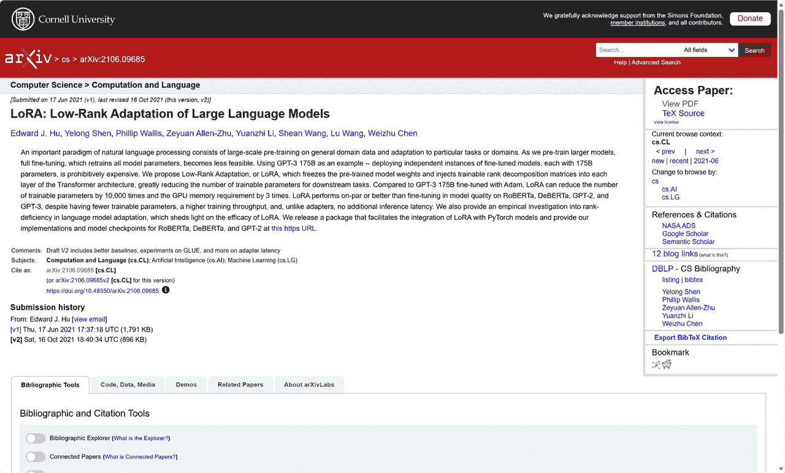

# LoRA: Low-Rank Adaptation of Large Language Models

> 来源：[https://gotoaiworld.feishu.cn/docx/BuL3dGb0uoNxXRxzoqGcTUlwnlf](https://gotoaiworld.feishu.cn/docx/BuL3dGb0uoNxXRxzoqGcTUlwnlf)

# LoRA: Low-Rank Adaptation of Large Language Models

[Edward J. Hu](https://arxiv.org/search/cs?searchtype=author&query=Hu,+E+J), [Yelong Shen](https://arxiv.org/search/cs?searchtype=author&query=Shen,+Y), [Phillip Wallis](https://arxiv.org/search/cs?searchtype=author&query=Wallis,+P), Ze[yuan Allen](https://arxiv.org/search/cs?searchtype=author&query=Li,+Y)-Z[hu, Yuanzh](https://arxiv.org/search/cs?searchtype=author&query=Wang,+S)i [Li, She](https://arxiv.org/search/cs?searchtype=author&query=Wang,+L)an[ Wang, Lu W](https://arxiv.org/search/cs?searchtype=author&query=Chen,+W)ang, Weizhu Chen

> An important para[digm of natura](https://github.com/microsoft/LoRA)l language processing consists of large-scale pre-training on general domain data and adaptation to particular tasks or domains. As we pre-train larger models, full fine-tuning, which retrains all model parameters, becomes less feasible. Using GPT-3 175B as an example -- deploying independent instances of fine-tuned models, each with 175B parameters, is prohibitively expensive. We propose Low-Rank Adaptation, or LoRA, which freezes the pre-trained model weights and injects trainable rank decomposition matrices into each layer of the Transformer architecture, greatly reducing the number of trainable parameters for downstream tasks. Compared to GPT-3 175B fine-tuned with Adam, LoRA can reduce the number of trainable parameters by 10,000 times and the GPU memory requirement by 3 times. LoRA performs on-par or better than fine-tuning in model quality on RoBERTa, DeBERTa, GPT-2, and GPT-3, despite having fewer trainable parameters, a higher training throughput, and, unlike adapters, no additional inference latency. We also provide an empirical investigation into rank-deficiency in language model adaptation, which sheds light on the efficacy of LoRA. We release a package that facilitates the integration of LoRA with PyTorch models and provide our implementations and model checkpoints for RoBERTa, DeBERTa, and GPT-2 at this https URL.

https://arxiv.org/abs/2106.09685