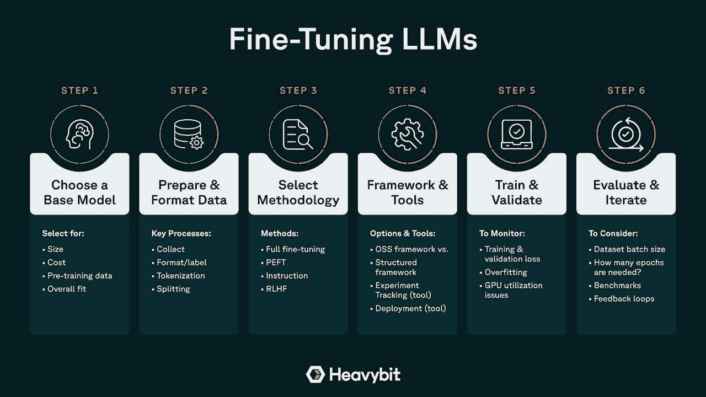
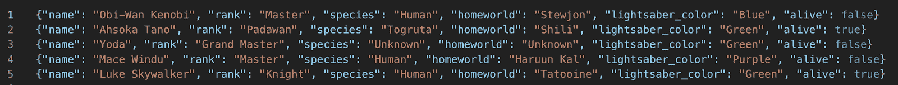
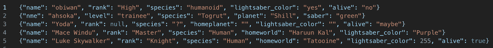
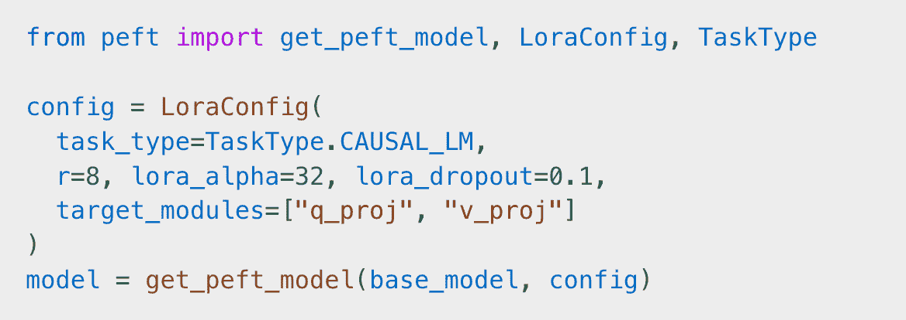

# LLM Fine-Tuning: A Guide for Engineering Teams in 2025

> 来源：[https://gotoaiworld.feishu.cn/docx/LnngdsxMkoer8cxXSyscQ4INnvf](https://gotoaiworld.feishu.cn/docx/LnngdsxMkoer8cxXSyscQ4INnvf)

`https://www.heavybit.com/library/article/llm-fine-tuning`

General-purpose large language models (LLMs) are built for broad artificial intelligence (AI) applications. The most popular open-weight models, which make their core hyperparameters publicly available, are usually general-purpose models prepared with pre-training, an important practice in using deep learning to improve a model’s analysis capabilities.

Off the shelf, these pre-trained models can explain a wide range of complex topics, handle rote tasks to free up their human partners, handle customer service queries as a chatbot, spin up text generation for specific content needs, handle summarization of large blocks of text data, and more. While this will not be a full tutorial, this step-by-step guide, we’ll cover how teams can use the process of fine tuning on already-trained AI models to boost performance and provide better outcomes faster. Fine-tuning is generally one of the core processes in creating a custom LLM of your own.

## How Fine-Tuning Improves LLM Performance for Engineering Teams

Out of the box, LLMs made for any task may not be suited to any single organization’s specific tasks. (Some teams will look to more purpose-built alternatives, such as Bidirectional Encoder Representations from Transformers, or `BERT` models, which use self-supervised learning, or other custom models.) There are other barriers for startups that may be interested in using LLMs: non-deterministic outcomes that introduce unpredictability, the high cost of accessing popular models and maintaining the resources to host them, and the rapid pace of change in the LLM landscape.

There are several popular techniques for improving what an LLM produces: refining the prompts you feed it (prompt engineering), introducing data from new sources to the LLM (retrieval-augmented generation, or `RAG`), and changing the training parameters of the model itself (fine tuning).

All three approaches will get you better outputs. (`RAG` in particular has gained popularity for providing ad hoc performance boosts for models.) However, only fine-tuning large language models delivers the sort of persistent behavior change that consistently channels an LLM’s power toward your organization’s purposes. A model customized to your startup’s specific task (and your customers’ needs) can help you outclass your competitors.

Next, we’ll cover how fine-tuning works, different approaches to fine tuning, how to do it (from model selection to output evaluation) responsibly, and which AI infrastructure investments make the difference in fine tuning effectively.

## What is LLM Fine-Tuning?

Fine-tuning LLMs means conducting additional training on an already pre-trained LLM, like `OpenAI’s ChatGPT`, `Anthropic Claude`, `Meta’s Llama` family, or your own LLM internally to improve its performance. In essence, fine-tuning extends the training of an LLM beyond pre-training, tailoring it for specific domains and use cases on subsequent prompts, as opposed to more-transient methods like `RAG`.

The fine-tuning process can involve connecting your pre-trained model to one or more data sources (such as a knowledge base of your own data) via `API` to flow fine-tuning data to the model (as well as to connect the fine-tuned model directly to downstream applications). The fine-tuning process can benefit from embedding, effectively providing a starting point within your own data to which your fine-tuned model can refer. It’s also a good idea to automate time-consuming data preprocessing and other preparation tasks.

Specifically, training LLMs updates and refits your models’ parameters—the weights and biases it applies to a dataset during the training process as well as the preset hyperparameters (i.e., learning rate, epochs, batch size) that guide how those weights and biases are applied—to provide better, fit-for-purpose responses. LLMs tuned for a specific domain or use case tuned with an appropriate learning rate deliver faster performance and better, more relevant answers that ideally require fewer re-prompts.

Poorly done, fine-tuning can also introduce safety risks. Most popular LLMs have built-in guardrails to prevent their misuse; fine-tuning can compromise them. In a study, researchers from Princeton University, Stanford University, Virginia Tech University, and IBM Research found that fine-tuning enabled LLMs from Meta and OpenAI to offer advice on bomb-making, run scams, and participate in other criminal activities.

Such risks can be mitigated with thoughtful planning and deliberate execution. Real-world fine-tuning success stories aren’t hard to find, particularly for teams that go beyond using the largest large language models and consider going smaller:

+ `laSMol`, a `Mistral`-based LLM fine-tuned by researchers at Ohio State University and Google for chemistry projects, substantially outperformed non-fine-tuned models

+ At Harvard University, large language models with smaller parameter counts fine-tuned to scan medical records for non-medical factors that influence health found more results with less bias than advanced `GPT` models trained on a larger, more-general set of parameters

+ Researchers at three Chinese universities developed `LegiLM`, an LLM fine-tuned to interpret and support compliance with data privacy regulations

+ Sentiment analysis and other natural language processing (NLP) tasks are also popular use case for LLM fine-tuning

### Key Approaches to LLM Fine-Tuning

There are several broad approaches to LLM fine-tuning, including full fine-tuning, parameter-efficient fine-tuning (`PEFT`), and instruction tuning or reinforcement learning from human feedback (`RLHF`). Each has merits and drawbacks, but at least one is likely to suit your organization’s goals and budget, which are important to consider, particularly if training your own LLM internally.

### Full Fine-Tuning

Full fine-tuning is a method for fine-tuning LLMs that retrains all of your base model’s parameters. Full fine-tuning offers the most control over model outputs, which may be ideal for developers looking to execute obscure, domain-specific tasks. (In contrast, few-shot learning attempts to train models on extremely few data points.)

It is, however, very resource-intensive. Meta’s `Llama 3.1` family, for instance, has between 8 billion and 405 billion parameters, depending on which version you use. Fine-tuning a `405B`-parameter model would likely demand an enormous amount of expensive computational resources, of the kind conventionally provided by high-end graphics processing units (`GPU`), and would yield a model as large as the base model. Fine-tuning often aims to scale general-use models down for domain-specific tasks.

# LLM Fine-Tuning

Full fine-tuning also c[arries some](https://en.wikipedia.org/wiki/Overfitting) risk of overfitting, which can cause your LLM to overindex only on recognizing its previous training data and fail to perform well against future, net-new datasets. Overfitting can be a particularly significant risk when you’re tuning an LLM for use on smaller custom datasets. In those cases, a fully fine-tuned model can memorize training examples and behave erratically when presented with unfamiliar data. Catastrophic forgetting—a phenomenon where an LLM overwrites general knowledge learned in its original training—is also a possibility.

## Parameter-Efficient Fine-Tuning

Parameter-efficient fine tuning (PEFT), in which only a subset of model parameters undergo fine-tuning, addresses some of the drawbacks to full fine-tuning. With most parameters frozen, PEFT demands less memory and compute resources, reduces the risk of catastrophic forgetting, and takes less time.

Low-rank adaptation (LoRA) is a common PEFT method. LoRA is a method for fine-tuning LLMs that involves injecting low-rank trainable matrices into each layer of a transformer architecture, cutting the number of parameters that need to be trained for a downstream task. Quantized low-rank adaptation (QLoRA) is an extension of LoRA that compresses base model parameters to reduce the amount of storage needed for fine-tuning.

PEFT comes with trade-offs. Fully fine-tuned models typically perform better, and they offer more-complete control. But when computing resources or domain-specific data are scarce, PEFT can be a useful alternative.

## Instruction Tuning and Reinforcement Learning from Human Feedback

Instruction tuning improves overall ability to follow instructions by training LLMs on a labeled set of instructional prompts and correct corresponding outputs. It’s often used in tandem with reinforcement learning from human feedback (RLHF). RLHF is a method to fine-tune LLMs that “rewards” a model for correctly responding to questions and commands.

Together, these techniques make models more predictable and helpful. They’re also inherently complex, given their dependence on well-crafted instruction/response datasets and human input.

## The LLM Fine-Tuning Workflow

Fine-tuning is a complex process. Build in enough time for preparing up front and iterating on the back end to get the most value out of it. You’ll make important choices along the way: base model, tuning method, number of iterations, and more. Be sure to align them with your needs, infrastructure, and capabilities.

### Step 1: Choose a Base Model

Start by selecting a flexible base LLM with published parameters. Open-weight models offer access to the weights and biases you’ll need to tweak as you fine-tune for your own specific task, although their underlying training data, algorithms, and model architecture remain hidden.

Size and inference cost will be major considerations—startups may prefer models small enough to tune, train, and operate on a single on-prem or cloud GPU. But there are other decision factors: the quality, objectivity, breadth of the LLM’s training data, and its overall level of fit to your use case, as well as its carbon footprint and other sustainability factors.

Here are four popular open-weight LLMs. Each offers several size options:

+ [LLaMA](https://www.llama.com/) by META
+ [Mistral](https://mistral.ai/) by Mistral
+ [Falcon](https://falconllm.tii.ae/) by TII
+ [Gemma](https://ai.google.dev/gemma) by Google

The LLM fine-tuning workflow.

[>> Click to zoom in](https://cdn.sanity.io/images/50q6fr1p/production/70ead44421413c7ad2e277a4cd099869f56a8c04-1600x900.jpg?rect=125,0,1350,900&w=600&h=400&fit=fillmax&dpr=2) on this infographic

### Step 2: Prepare and Format Your Dataset

Preparing data begins with collection and formatting, but data quality i[s non-negotiab](https://www.heavybit.com/library/article/synthetic-data-for-ai)le. Whether you’re training on your own domain-specific datasets, synthetic data, or third-party data, you’ll need to make sure you have a high-quality dataset that is accurate, unbiased, free of duplicates, and well labeled. You may also need to tokenize your data (depending on your model) and split your dataset into training, validation, and test sets. LLM training datasets typically use JSONL format:

Well-labeled data

Poorly labeled, incomplete data

There are good, low-cost tools and approaches to help you prep and format your datasets:

+ [Label Studio](https://labelstud.io/), an open source tool for labeling a range of data types
+ [Snorkel](https://www.snorkel.org/get-started), an open source Python library for weak supervision with label functions
+ Custom scripts are also useful for data preparation

### Step 3: Select Your Fine-Tuning Method

This is a moment to revisit the fundamentals of your fine-tuning plans. Do you need to improve the base model’s ability to follow instructions? How much experience with LLM workflows does your team have? Do you have the budget and resources to support full fine-tuning?

All these questions should guide your choice of fine-tuning method. Consider how your answers match up with the attributes of common fine-tuning approaches:

Full Fine-Tuning

A high-cost alternative (due to steep compute and storage needs) requiring a large, task-specific dataset, significant infrastructure (including powerful silicon, long training times, and significant storage), large-scale full-model deployment, high complexity requiring deep ML expertise, but allowing for high customization that can deeply change model behavior.

PEFT

Significantly lower costs than full fine-tuning, requiring a small-to-medium-sized dataset, can run on consumer-grade GPUs with faster training, efficient deployment size as only adapter weights are added, low-to-moderate complexity, and medium to high levels of customization with focused adaptation.

Instruction Tuning

Moderate costs requiring training and curated data, medium-sized data requirements for a diverse dataset, moderate infrastructure needs, deployment of the same size as the base model, moderate complexity that involves task curation, and a moderate amount of customization with general task adaptation.

RLHF

High cost that requires labeling, fine-tuning, and reward modeling, manual labeling requirements for data, typically involves distributed training with custom environments, deployment of the same size as the model or larger depending on reward models, very high complexity that requires training reward models plus human evaluations, and high levels of customization optimized for desired outputs.

### Step 4: Choose Your Framework and Tools

Choosing the right frameworks and tools is another important consideration.

E[ase of use a](https://huggingface.co/)nd[ broad ](https://pytorch.org/)co[mmunity su](https://www.tensorflow.org/)pport[ make eco](https://replicate.com/)systems like Hugging Face, PyTorch, TensorFlow, or Replicate attractive to startups, particularly those using a PEFT approach. Combining tools like transformers with LoRA-based tuning methods streamlines development and reduces the barrier to entry and can integrate well with reinforcement learning techniques.

A basic LoRA setup snippet using Hugging Face’s PEFT.

More-advanced workflows might benefit from structured training frameworks like Axolotl, LangChain, Unsloth, or TorchTune, especially when scaling up. Built on top of Hugging Face libraries, Axolotl is also well suited to PEFT techniques.

# LLM Fine-Tuning: Best Practices and Infrastructure

Startups should also look at compatibility[ with ](https://github.com/mlflow/mlflow)ex[perimen](https://github.com/clearml/clearml)t tracking tools such [as MLFl](https://www.bentoml.com/)ow, [ClearML](https://github.com/bentoml/OpenLLM), or Weights & Biases, and consider deployment tools like BentoML or OpenLLM if real-time inference is needed. The frameworks chosen should ideally match the team’s technical skills and integrate well with existing infrastructure.

## Step 5: Train and Validate

Use standard model training loops with checkpoints and early stopping. Monitor:

+   Training/Validation Loss: How well your model learns from training data and how well it generalizes to net-new data
+   Overfitting Signs: Such as huge gaps between high performance on known datasets compared to significantly lower performance on net-new datasets
+   GPU Utilization Issues: Such as low or spiky utilization that may indicate bottlenecks

## Step 6: Evaluate and Iterate

Don’t stop at “it trains.” Evaluation is the key t[o refinemen](https://www.geeksforgeeks.org/how-to-choose-batch-size-and-number-of-epochs-when-fitting-a-model)t. For smaller datasets, some estimates suggests 3-10 epochs can be sufficient, but every model and every dataset differs. It’s important to consider your data batch size against the number of epochs you plan to run. Larger data batches will likely require more epochs for your model to “see” and process all the data in your set a sufficient number of times. However, running too many epochs can lead to overfitting, not to mention potentially overspending on compute to run excessive training cycles that actually diminish your performance.

## Common Mistakes Teams Make When Fine-Tuning

Fine-tuning should be an iterative process with frequent oversight and feedback cycles and an eye toward ensuring the highest data quality as inputs. Here are some common mistakes teams make during the process:

+   Using Poor-Quality or Inconsistent Training Data: A bad dataset can lead to overfitting or underfitting, as well as performance drops that ultimately, hurt customer experience
+   Choosing an Overly Complex Model or Method: Overcomplicated fine-tuning can lead to loss of performance on generalized datasets, catastrophic forgetting, and higher costs if retraining is needed
+   Skipping Human Evaluations: Without human evaluation, models can miss important subjective factors such as ethical safety issues or societal biases
+   Failing to Benchmark Against a Baseline: Without a baseline, it can be difficult to assess performance or the impact of any changes made during fine-tuning
+   Ignoring Iteration Cycles and Feedback: Skipping iterative feedback can lead to lower adaptability to new data and models preserving unwanted biases.

## LLM Evaluation and Optimization: Measuring What Matters

LLM behavior can feel unpredictable. Fine-tuning may seem like black magic unless you have a sound evaluation plan. Start simple: Test whether the model actually performs your desired task better than the base. Use both quantitative and qualitative metrics, tailored to your use case.

No single metric will tell you everything you need to know about your model’s performance. There’s no sho[rtage of t](https://www.perplexity.ai/)oo[ls and m](https://www.v7labs.com/blog/f1-score-guide)easure[s to](https://www.trix-ai.pro/) help as you broaden your measurement and optimization plans. Just a few examples include Perplexity, F1 Score, BLEU/ROUGE/METEOR, LM Evaluation Harness, trix, and Hugging Face's Open LLM Leaderboard.

## How to Fine-Tune Responsibly and Build Trust in Your Model

Most teams hesitate to ship black-box models into production, as they should. Responsible fine-tuning means thoughtful experiments, grounded in user needs and focused on recording important learnings you can use to iteratively improve your model’s performance.

### Build a Tight Feedback Loop

To ensure optimal performance, it’s important to build in a feedback loop that monitors performance deltas across successive epochs and against any data variations. By making iterative observations, your team stands a better chance of identifying issues of data quality, compute bottlenecks, and other obstacles standing between you and a highly performant model.

### Right-Size Your Infrastructure

Choose tools and systems that match your scale. Don’t spin up a tensor processing unit pod when a LoRA adapter will do. As your organization’s needs scale, compute costs may become a larger issue, particularly as you fine-tune against larger datasets run across multiple epochs. Teams running enterprise-level workloads will need to be aware of I/O issues transferring data across their compute hardware, CPU/GPU bottlenecks, memory limitations, or mismatched batch sizes that lead to latency or timeouts.

### Bake in Safety and Guardrails

Rather than wait for compliance headaches and lawsuits to find you, it’s a good idea to proactively build in safety measures that ensure your fine-tuning leads to a model that is both safe and performant:

+   Filter Training Data for Toxicity or Bias: Removing harmful or biased content from your dataset before fine-tuning helps make your model less likely to output toxic responses, and more likely to be fair and unbiased.
+   Run Safety Evaluations Before Release: It’s a best practice to run iterative safety evals that can include, but aren’t limited to, standard benchmark evaluations, automated evals, and even adversarial red teaming to root out potentially harmful outputs.
+   Use Output Filters, Rate-Limiting, or Human-in-the-Loop Systems: Output filters can be a helpful final safeguard against biased or harmful content. Setting rate limits caps maximum requests at a time and can prevent unauthorized attacks. And adding human safeguards to better label data and evaluate outputs can prevent unanticipated issues.

### Understand and Embrace the Weirdness

At the risk of stating the obvious, LLMs are probabilistic, not deterministic. Generative AI can and does output unexpected responses, hallucinate, or otherwise do unexpected things. Yes, it can be a frustrating and novel experience for engineering teams to operate a seemingly unpredictable system.

However, aside from adopting the mindset that LLMs simply behave differently than a deterministic codebase, it’s not a bad idea to note unusual behavior as potential opportunities for improvement. Unexpected responses that recur could be a sign of gaps in training data or a need for additional training runs, for example. Teams that learn to expect the unexpected can apply those learnings to fine-tune a more-performant model.

## The Real Payoff: Why the Infrastructure Around Fine-Tuning Matters Most

The most immediate win from successful fine-tuning is a more-robust model that performs better on any given day. However, the infrastructure, feedback loops, and team processes you build around it are also enormously valuable, particularly as the AI space changes and your team is expected to continuously adapt.

More resources that may be helpful to teams standing up AI programs:

+   How to Create Data Pipelines: A starter guide on the basics of building key data infrastructure for AI programs
+   [How to Scope and Ev](https://www.heavybit.com/library/article/how-to-scope-and-evolve-data-pipelines)olve Data Pipelines: An in-depth interview on best practices for evolving data pipelines over time
+   [The Data Pipeline Is t](https://www.heavybit.com/library/article/ai-infrastructure-top-challenges-data-inference)he New Secret Sauce: A deep-dive into the hardware infrastructure and CI/CD-like data discipline needed for AI programs
+   Machine Learning Model Monitoring: How to approach monitoring for models in production
+   [Machine Learning Lifec](https://www.heavybit.com/library/article/machine-learning-lifecycle)cle: Idea to Launch: A starter guide on how to approach standing up an AI/ML program

+ DevToolsDigest Newsletter: A weekly newsletter that covers the most important news for software teams
+ The Humans in the Loop: A biweekly newsletter that bottom-lines AI news for busy software teams
