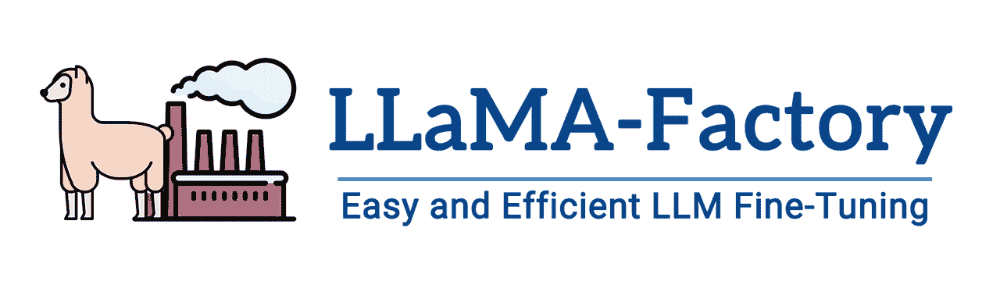

# LLaMA Factory

> 来源：[https://gotoaiworld.feishu.cn/docx/GwqmdTYCUoB4lPx7Jw1cPYbGn7b](https://gotoaiworld.feishu.cn/docx/GwqmdTYCUoB4lPx7Jw1cPYbGn7b)

# 一、LLaMA Factory 概述

> LLaMA Factory 是一个开源的大语言模型（LLM）微调与部署框架，专注于降低大模型定制化门槛，让开发者和研究者能够高效地对开源预训练模型（如 Meta 的 LLaMA 系列、Llama 3、Mistral、Baichuan 等）进行微调、评估和部署，尤其适合资源有限的场景。

LLaMA Factory 是一个开源的大语言模型（LLM）微调与部署框架，专注于降低大模型定制化门槛，让开发者和研究者能够高效地对开源预训练模型（如 Meta 的 LLaMA 系列、Llama 3、Mistral、Baichuan 等）进行微调、评估和部署，尤其适合资源有限的场景。

### 核心定位

它的核心目标是提供 “一站式大模型微调解决方案”，整合了主流的微调技术、评估工具和部署能力，让用户无需从零搭建复杂的训练流程，只需通过简单配置即可完成模型的定制化开发（例如针对特定领域数据微调，优化模型在专业场景的表现）。

### 核心功能与特性

1.  支持多种微调方法
覆盖主流高效微调技术，兼顾效果与成本：

+   LoRA（低秩适应）：通过冻结预训练模型大部分参数，仅训练少量低秩矩阵，大幅降低显存需求（适合消费级 GPU）；

+   QLoRA：在 LoRA 基础上加入量化（如 4-bit/8-bit），进一步压缩显存占用（例如微调 70 亿参数模型可在单张 10GB 显存显卡上运行）；

+   全参数微调：对模型所有参数进行训练，适合追求极致效果且资源充足的场景；

+   还支持 Prefix Tuning、P-Tuning 等轻量级微调方法。

1.  广泛的模型兼容性
支持主流开源大模型，包括但不限于：

+   Meta 的 LLaMA 系列（LLaMA 2、Llama 3）、Mistral、Mixtral、Phi-2；

+   国产模型如 Baichuan、Qwen（通义千问）、Yi 等；

+   支持多模态模型（如 LLaVA）的微调。

1.  易用的操作方式

+   可视化界面：提供 Web UI（基于 Gradio），通过图形化界面配置微调参数（如数据集、学习率、训练轮次等），无需编写代码；

+   命令行工具：支持脚本化调用，方便自动化流程和批量任务；

+   丰富的配置模板：内置针对不同场景（如对话、摘要、翻译）的微调模板，开箱即用。

1.  完整的工具链集成

+   数据处理：支持多种数据格式（JSON、CSV 等），内置数据清洗、格式转换工具，适配不同模型的输入要求（如对话格式）；

+   评估工具：集成模型性能评估指标（如困惑度、BLEU、人工打分接口），方便对比微调前后的效果；

+   部署能力：微调后的模型可直接导出为 Hugging Face 格式，支持通过 FastAPI、Gradio 等快速部署为 API 服务或交互界面。

### 典型应用场景

+   学术研究：快速验证新的微调算法或数据集对模型性能的影响；

+   企业定制：基于行业数据（如医疗文献、法律条文）微调模型，构建领域专属大模型（如医疗问答机器人）；

+   个人开发者：在消费级硬件（如 RTX 3090/4090）上微调小参数模型（如 7B/13B），实现个性化功能（如自定义对话风格）。

### 优势

+   低门槛：无需深入掌握大模型训练的底层细节，通过配置即可完成微调；

+   高效性：优化的训练流程和显存管理，让中小参数模型的微调可在普通 GPU 上实现；

+   开源免费：代码完全开源（基于 Apache 2.0 许可证），支持二次开发和商业化使用；

+   社区活跃：持续更新对新模型（如 Llama 3）和新技术（如最新量化方法）的支持，问题响应及时。

# 二、LlaMA Factory GitHub

https://github.com/hiyouga/LLaMA-Factory

选择你的打开方式：

+   入门教程：[https://zhuanlan.z](https://zhuanlan.zhihu.com/p/695287607)hihu.com/p/695287607

+   微调视频教程：[https://www.bilibili.com](https://www.bilibili.com/video/BV1djgRzxEts/)/video/BV1djgRzxEts/

+   框架文档：[https://llamafactory.readthed](https://llamafactory.readthedocs.io/zh-cn/latest/)ocs.io/zh-cn/latest/

+   框架文档（昇腾 NPU）：[https://ascend.github.io/docs/s](https://ascend.github.io/docs/sources/llamafactory/)ources/llamafactory/

+   Colab（免费）：[https://colab.research.google.com/drive/1d5KQ](https://colab.research.google.com/drive/1d5KQtbemerlSDSxZIfAaWXhKr30QypiK?usp=sharing)tbemerlSDSxZIfAaWXhKr30QypiK?usp=sharing

+   本地机器：请见[如何使用](https://github.com/hiyouga/LLaMA-Factory/blob/main/README_zh.md#%E5%A6%82%E4%BD%95%E4%BD%BF%E7%94%A8)

+   PAI-DSW（免费试用）：[h](https://gallery.pai-ml.com/#/preview/deepLearning/nlp/llama_factory)ttps://gallery.pai-ml.com/#/preview/deepLearning/nlp/llama_factory

+   九章智算云（算力优惠活动）：[ht](https://docs.alayanew.com/docs/documents/useGuide/LLaMAFactory/mutiple/?utm_source=LLaMA-Factory)tps://docs.alayanew.com/docs/documents/useGuide/LLaMAFactory/mutiple/?utm_source=LLaMA-Factory

## 目录

+   [项目特色](https://github.com/hiyouga/LLaMA-Factory/blob/main/README_zh.md#%E9%A1%B9%E7%9B%AE%E7%89%B9%E8%89%B2)

+   [官方博客](https://github.com/hiyouga/LLaMA-Factory/blob/main/README_zh.md#%E5%AE%98%E6%96%B9%E5%8D%9A%E5%AE%A2)

+   [更新日志](https://github.com/hiyouga/LLaMA-Factory/blob/main/README_zh.md#%E6%9B%B4%E6%96%B0%E6%97%A5%E5%BF%97)

+   [模型](https://github.com/hiyouga/LLaMA-Factory/blob/main/README_zh.md#%E6%A8%A1%E5%9E%8B)

+   [训练方法](https://github.com/hiyouga/LLaMA-Factory/blob/main/README_zh.md#%E8%AE%AD%E7%BB%83%E6%96%B9%E6%B3%95)

+   [数据集](https://github.com/hiyouga/LLaMA-Factory/blob/main/README_zh.md#%E6%95%B0%E6%8D%AE%E9%9B%86)

+   [软硬件依赖](https://github.com/hiyouga/LLaMA-Factory/blob/main/README_zh.md#%E8%BD%AF%E7%A1%AC%E4%BB%B6%E4%BE%9D%E8%B5%96)

+   [如何使用](https://github.com/hiyouga/LLaMA-Factory/blob/main/README_zh.md#%E5%A6%82%E4%BD%95%E4%BD%BF%E7%94%A8)

+   安装 LLaMA Factory

+   [数据准备](https://github.com/hiyouga/LLaMA-Factory/blob/main/README_zh.md#%E6%95%B0%E6%8D%AE%E5%87%86%E5%A4%87)

+   [快速开始](https://github.com/hiyouga/LLaMA-Factory/blob/main/README_zh.md#%E5%BF%AB%E9%80%9F%E5%BC%80%E5%A7%8B)

+   LLaMA Board 可视化微调

+   [构建 Docker](https://github.com/hiyouga/LLaMA-Factory/blob/main/README_zh.md#%E6%9E%84%E5%BB%BA-docker)

+   利用 vLLM 部署 OpenAI API

+   [从魔搭社区下载](https://github.com/hiyouga/LLaMA-Factory/blob/main/README_zh.md#%E4%BB%8E%E9%AD%94%E6%90%AD%E7%A4%BE%E5%8C%BA%E4%B8%8B%E8%BD%BD)

+   [从魔乐社区下载](https://github.com/hiyouga/LLaMA-Factory/blob/main/README_zh.md#%E4%BB%8E%E9%AD%94%E4%B9%90%E7%A4%BE%E5%8C%BA%E4%B8%8B%E8%BD%BD)

+   [使用 W&B 面板](https://github.com/hiyouga/LLaMA-Factory/blob/main/README_zh.md#%E4%BD%BF%E7%94%A8-wb-%E9%9D%A2%E6%9D%BF)

+   [使用 SwanLab 面板](https://github.com/hiyouga/LLaMA-Factory/blob/main/README_zh.md#%E4%BD%BF%E7%94%A8-swanlab-%E9%9D%A2%E6%9D%BF)

+   使用了 LLaMA Factory 的项目

## 项目特色

+   多种模型：LLaMA、LLaVA、Mistral、Mixtral-MoE、Qwen、Qwen2-VL、DeepSeek、Yi、Gemma、ChatGLM、Phi 等等。

+   集成方法：（增量）预训练、（多模态）指令监督微调、奖励模型训练、PPO 训练、DPO 训练、KTO 训练、ORPO 训练等等。

+   多种精度：16 比特全参数微调、冻结微调、LoRA 微调和基于 AQLM/AWQ/GPTQ/LLM.int8/HQQ/EETQ 的 2/3/4/5/6/8 比特 QLoRA 微调。

+   先进算法：[GaLore](https://github.com/jiaweizzhao/GaLore)、[BAdam](https://github.com/Ledzy/BAdam)、[APOLLO](https://github.com/zhuhanqing/APOLLO)、[Adam-mini](https://github.com/zyushun/Adam-mini)、[Muon](https://github.com/KellerJordan/Muon)、DoRA、LongLoRA、LLaMA Pro、Mixture-of-Depths、LoRA+、LoftQ 和 PiSSA。

+   实用技巧：F[lashAtt](https://github.com/unslothai/unsloth)e[ntion-2、Unsl](https://github.com/linkedin/Liger-Kernel)oth、Liger Kernel、RoPE scaling、NEFTune 和 rsLoRA。

+   广泛任务：多轮对话、工具调用、图像理解、视觉定位、视频识别和语音理解等等。

+   实验监控：LlamaBoard、Tenso[rBoard、](https://github.com/SwanHubX/SwanLab)Wandb、MLflow、SwanLab 等等。

+   极速推理：基于 [vLLM](https://github.com/vllm-project/vllm) 或 [SGLang](https://github.com/sgl-project/sglang) 的 OpenAI 风格 API、浏览器界面和命令行接口。

### 最新模型的 Day-N 微调适配

# 三、Supported Models

https://github.com/hiyouga/LLaMA-Factory

Note

For the "base" models, the template argument can be chosen from default, alpaca, vicuna etc. But make sure to use the corresponding template for the "instruct/chat" models.

Remember to use the SAME template in training and inference.

*: You should install the transformers from main branch and use DISABLE_VERSION_CHECK=1 to skip version check.

**: You need to install a specific version of transformers to use the corresponding model.

[Please refer](https://github.com/hiyouga/LLaMA-Factory/blob/main/src/llamafactory/extras/constants.py) to constants.py for a full list of models we supported.

You also can add a cust[om chat tem](https://github.com/hiyouga/LLaMA-Factory/blob/main/src/llamafactory/data/template.py)plate to template.py.

# 四、Supported Training Approaches