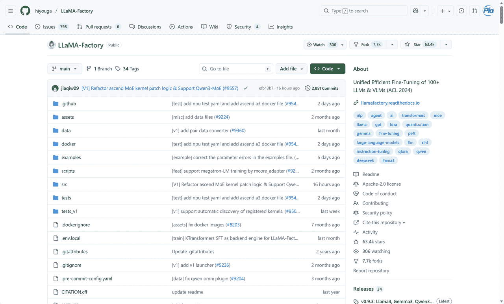

# LLaMA-Factory GitHub

> 来源：[https://gotoaiworld.feishu.cn/docx/Z9M9dASa2oX5iwxQCMmcn4O7nJh](https://gotoaiworld.feishu.cn/docx/Z9M9dASa2oX5iwxQCMmcn4O7nJh)

## About

Unified Efficient Fine-Tuning of 100+ LLMs & VLMs (ACL 2024)

https://github.com/hiyouga/LLaMA-Factory

llamafactory.readthedocs.io

👋 Join our W[eChat,](https://github.com/hiyouga/llamafactory-community/blob/main/wechat/main.jpg) N[PU,](https://github.com/hiyouga/llamafactory-community/blob/main/wechat/npu.jpg) L[ab4AI,](https://github.com/hiyouga/llamafactory-community/blob/main/wechat/lab4ai.jpg) LLaMA Factory Online user group.

[ English | [中文](https://github.com/hiyouga/LLaMA-Factory/blob/main/README_zh.md) ]

Fine-tuning a large language model can be easy as...

train_en.mp4

Start local training:

+   [Pleas](https://github.com/hiyouga/LLaMA-Factory#getting-started)e refer to usage

Start cloud training:

+   Colab (free): [https://colab.research.google.com/drive/1eRTP](https://colab.research.google.com/drive/1eRTPn37ltBbYsISy9Aw2NuI2Aq5CQrD9?usp=sharing)n37ltBbYsISy9Aw2NuI2Aq5CQrD9?usp=sharing

+   [P](https://gallery.pai-ml.com/#/preview/deepLearning/nlp/llama_factory)AI-DSW (free trial): https://gallery.pai-ml.com/#/preview/deepLearning/nlp/llama_factory

+   [L](https://www.llamafactory.com.cn/?utm_source=LLaMA-Factory)LaMA Factory Online: https://www.llamafactory.com.cn/?utm_source=LLaMA-Factory

+   [Al](https://docs.alayanew.com/docs/documents/useGuide/LLaMAFactory/mutiple/?utm_source=LLaMA-Factory)aya NeW (cloud GPU deal): https://docs.alayanew.com/docs/documents/useGuide/LLaMAFactory/mutiple/?utm_source=LLaMA-Factory

Read technical notes:

+   [Documentation (WIP): https](https://llamafactory.readthedocs.io/en/latest/)://llamafactory.readthedocs.io/en/latest/

+   [Do](https://rocm.docs.amd.com/projects/ai-developer-hub/en/latest/notebooks/fine_tune/llama_factory_llama3.html)cumentation (AMD GPU): https://rocm.docs.amd.com/projects/ai-developer-hub/en/latest/notebooks/fine_tune/llama_factory_llama3.html

+   Official Blog: https://blog.llamafactory.net/en/

+   [Of](https://www.lab4ai.cn/course/detail?id=7c13e60f6137474eb40f6fd3983c0f46&utm_source=LLaMA-Factory)ficial Course: https://www.lab4ai.cn/course/detail?id=7c13e60f6137474eb40f6fd3983c0f46&utm_source=LLaMA-Factory

Note

Except for the above links, all other websites are unauthorized third-party websites. Please carefully use them.

## Table of Contents

+   [Features](https://github.com/hiyouga/LLaMA-Factory#features)

+   [Blogs](https://github.com/hiyouga/LLaMA-Factory#blogs)

+   [Changelog](https://github.com/hiyouga/LLaMA-Factory#changelog)

+   Supported Models

+   Supported Training Approaches

+   Provided Datasets

+   [Requirement](https://github.com/hiyouga/LLaMA-Factory#requirement)

+   [Getting Started](https://github.com/hiyouga/LLaMA-Factory#getting-started)

+   [Installation](https://github.com/hiyouga/LLaMA-Factory#installation)

+   Data Preparation

+   [Quickstart](https://github.com/hiyouga/LLaMA-Factory#quickstart)

+   Fine-Tuning with LLaMA Board GUI

+   LLaMA Factory Online

+   [Build Docker](https://github.com/hiyouga/LLaMA-Factory#build-docker)

+   [Deploy with OpenA](https://github.com/hiyouga/LLaMA-Factory#deploy-with-openai-style-api-and-vllm)I-style API and vLLM

+   Download from ModelScope Hub

+   Download from Modelers Hub

+   [Use W&B Logger](https://github.com/hiyouga/LLaMA-Factory#use-wb-logger)

+   Use SwanLab Logger

+   Projects using LLaMA Factory

+   [License](https://github.com/hiyouga/LLaMA-Factory#license)

+   [Citation](https://github.com/hiyouga/LLaMA-Factory#citation)

+   [Acknowledgement](https://github.com/hiyouga/LLaMA-Factory#acknowledgement)

## Features

+   Various models: LLaMA, LLaVA, Mistral, Mixtral-MoE, Qwen, Qwen2-VL, DeepSeek, Yi, Gemma, ChatGLM, Phi, etc.

+   Integrated methods: (Continuous) pre-training, (multimodal) supervised fine-tuning, reward modeling, PPO, DPO, KTO, ORPO, etc.

+   Scalable resources: 16-bit full-tuning, freeze-tuning, LoRA and 2/3/4/5/6/8-bit QLoRA via AQLM/AWQ/GPTQ/LLM.int8/HQQ/EETQ.

+   [Advanc](https://github.com/jiaweizzhao/GaLore)ed[ algo](https://github.com/Ledzy/BAdam)ri[thms: ](https://github.com/zhuhanqing/APOLLO)Ga[Lore, BAd](https://github.com/zyushun/Adam-mini)am[, AP](https://github.com/KellerJordan/Muon)OL[LO,](https://github.com/huggingface/peft/tree/main/src/peft/tuners/oft) Adam-mini, Muon, OFT, DoRA, LongLoRA, LLaMA Pro, Mixture-of-Depths, LoRA+, LoftQ and PiSSA.

+   Pr[actical](https://github.com/unslothai/unsloth) t[ricks: Flash](https://github.com/linkedin/Liger-Kernel)At[tention-2, Un](https://github.com/kvcache-ai/ktransformers/)sloth, Liger Kernel, KTransformers, RoPE scaling, NEFTune and rsLoRA.

+   Wide tasks: Multi-turn dialogue, tool using, image understanding, visual grounding, video recognition, audio understanding, etc.

+   E[xperime](https://github.com/SwanHubX/SwanLab)nt monitors: LlamaBoard, TensorBoard, Wandb, MLflow, SwanLab, etc.

+   F[aster infer](https://github.com/vllm-project/vllm)ence[: OpenAI-styl](https://github.com/sgl-project/sglang)e API, Gradio UI and CLI with vLLM worker or SGLang worker.

### Day-N Support for Fine-Tuning Cutting-Edge Models

## Blogs

Tip

Now we have a dedicated blog for LLaMA Factory!

Website: https://blog.llamafactory.net/en/

+   💡 K[Tr](https://blog.llamafactory.net/en/posts/ktransformers/)ansformers Fine-Tuning × LLaMA Factory: Fine-tuning 1000 Billion models with 2 4090-GPU + CPU (English)

+   💡 E[asy Dataset × LLaMA Factory: Enabling LLM](https://buaa-act.feishu.cn/wiki/GVzlwYcRFiR8OLkHbL6cQpYin7g)s to Efficiently Learn Domain Knowledge (English)

+   [Fine-tune a mental health LLM](https://www.lab4ai.cn/project/detail?id=25cce32ec131497b9e06a93336a0817f&type=project&utm_source=LLaMA-Factory) using LLaMA-Factory (Chinese)

+   [F](https://docs.llamafactory.com.cn/docs/documents/best-practice/gptroleplay/?utm_source=LLaMA-Factory)ine-tune GPT-OSS for Role-Playing using LLaMA-Factory (Chinese)

+   [A ](https://aws.amazon.com/cn/blogs/china/building-llm-model-hub-based-on-llamafactory-and-easyr1/)One-Stop Code-Free Model Reinforcement Learning and Deployment Platform based on LLaMA-Factory and EasyR1 (Chinese)

+   [How Apoidea Group enhances visual information extraction from banking d](https://aws.amazon.com/cn/blogs/machine-learning/how-apoidea-group-enhances-visual-information-extraction-from-banking-documents-with-multimodal-models-using-llama-factory-on-amazon-sagemaker-hyperpod/)ocuments with multimodal models using LLaMA-Factory on Amazon SageMaker HyperPod (English)

All Blogs

+   [F](https://docs.alayanew.com/docs/documents/bestPractice/bigModel/llama70B/?utm_source=LLaMA-Factory)ine-tune Llama3.1-70B for Medical Diagnosis using LLaMA-Factory (Chinese)

+   [F](https://docs.alayanew.com/docs/documents/useGuide/LLaMAFactory/mutiple/?utm_source=LLaMA-Factory)ine-tune Qwen2.5-VL for Autonomous Driving using LLaMA-Factory (Chinese)

+   [LLaMA Factory: Fine-tuning the DeepSeek-R1-D](https://gallery.pai-ml.com/#/preview/deepLearning/nlp/llama_factory_deepseek_r1_distill_7b)istill-Qwen-7B Model for News Classifier (Chinese)

+   [A ](https://aws.amazon.com/cn/blogs/china/a-one-stop-code-free-model-fine-tuning-deployment-platform-based-on-sagemaker-and-llama-factory/)One-Stop Code-Free Model Fine-Tuning & Deployment Platform based on SageMaker and LLaMA-Factory (Chinese)

+   [LL](https://gallery.pai-ml.com/#/preview/deepLearning/nlp/llama_factory_qwen2vl)aMA Factory Multi-Modal Fine-Tuning Practice: Fine-Tuning Qwen2-VL for Personal Tourist Guide (Chinese)

+   [LLaMA Factory: Fine-tuning Lla](https://gallery.pai-ml.com/#/preview/deepLearning/nlp/llama_factory)ma3 for Role-Playing (Chinese)

## Changelog

[[25/10/26] We ](https://github.com/alibaba/ROLL/tree/main/mcore_adapter)suppor[t Megatr](https://github.com/hiyouga/LLaMA-Factory/pull/9237)on-core training backend with mcore_adapter. See PR #9237 to get started.

[[25](https://arxiv.org/abs/2306.07280)/08/2[2] We](https://arxiv.org/abs/2506.19847) suppo[rted OFT](https://github.com/hiyouga/LLaMA-Factory/blob/main/examples/README.md) and OFTv2. See examples for usage.

[25/08/20] We suppor[ted fine-tunin](https://huggingface.co/internlm/Intern-S1-mini)g the Intern-[S1-mini ](https://github.com/hiyouga/LLaMA-Factory/pull/8976)models. See PR #8976 to get started.

[25/08/06] We suppor[ted fin](https://github.com/openai/gpt-oss)e-tuning the [GPT-OSS ](https://github.com/hiyouga/LLaMA-Factory/pull/8826)models. See PR #8826 to get started.

Full Changelog

[25/07/02] We supported fine-tuning the GLM-4.1V-9B-Thinking model.

[25/04/28] We suppor[ted f](https://qwenlm.github.io/blog/qwen3/)ine-tuning the Qwen3 model family.

[[25/](https://github.com/KellerJordan/Muon)[04/21] W](https://github.com/hiyouga/LLaMA-Factory/blob/main/examples/README.md)[e supported ](https://github.com/tianshijing)the Muon optimizer. See examples for usage. Thank @tianshijing's PR.

[25/04/16] We suppor[ted fine-](https://huggingface.co/OpenGVLab/InternVL3-8B)tuning the I[nternVL3](https://github.com/hiyouga/LLaMA-Factory/pull/7258) model. See PR #7258 to get started.

[25/04/14] We suppor[ted fi](https://huggingface.co/THUDM/GLM-Z1-9B-0414)ne-tu[ning th](https://huggingface.co/moonshotai/Kimi-VL-A3B-Instruct)e GLM-Z1 and Kimi-VL models.

[25/04/06] We suppor[ted fin](https://ai.meta.com/blog/llama-4-multimodal-intelligence/)e-tuning the[ Llama 4](https://github.com/hiyouga/LLaMA-Factory/pull/7611) model. See PR #7611 to get started.

[25/03/31] We suppor[ted fine-tun](https://qwenlm.github.io/blog/qwen2.5-omni/)ing the Qwen[2.5 Omni](https://github.com/hiyouga/LLaMA-Factory/pull/7537) model. See PR #7537 to get started.

[[25/03](https://github.com/sgl-project/sglang)/15] We supported SGLang as inference backend. Try infer_backend: sglang to accelerate inference.

[25/03/12] We suppor[ted fin](https://huggingface.co/blog/gemma3)e-tuning the Gemma 3 model.

[[25/02](https://github.com/hiyouga/EasyR1)/24] Announcing EasyR1, an efficient, scalable and multi-modality RL training framework for efficient GRPO training.

[[25/02](https://github.com/ollama/ollama)/[11] We s](https://github.com/hiyouga/LLaMA-Factory/blob/main/examples/README.md)upported saving the Ollama modelfile when exporting the model checkpoints. See examples for usage.

[25/02/05] We suppor[ted fine-tu](https://github.com/hiyouga/LLaMA-Factory/blob/main/Qwen/Qwen2-Audio-7B-Instruct)ning [the Qwen2-Aud](https://huggingface.co/openbmb/MiniCPM-o-2_6)io and MiniCPM-o-2.6 on audio understanding tasks.

[25/01/31] We suppor[ted fine-tu](https://huggingface.co/deepseek-ai/DeepSeek-R1)ning [the DeepSe](https://huggingface.co/Qwen/Qwen2.5-VL-7B-Instruct)ek-R1 and Qwen2.5-VL models.

[[25/01](https://arxiv.org/abs/2412.05270)[/15] We ](https://github.com/hiyouga/LLaMA-Factory/blob/main/examples/README.md)supported APOLLO optimizer. See examples for usage.

[25/01/14] We suppor[ted fine-tuni](https://huggingface.co/openbmb/MiniCPM-o-2_6)ng th[e MiniCPM-o-2](https://huggingface.co/openbmb/MiniCPM-V-2_6).6 and MiniCPM-[V-2.6 models](https://github.com/BUAADreamer). Thank @BUAADreamer's PR.

[25/01/14] We suppor[ted fine-t](https://huggingface.co/collections/internlm/)uning the Inter[nLM 3 model](https://github.com/hhaAndroid)s. Thank @hhaAndroid's PR.

[25/01/10] We suppor[ted f](https://huggingface.co/microsoft/phi-4)ine-tuning the Phi-4 model.

[[24/12/](https://github.com/SwanHubX/SwanLab)21] We supported using SwanL[ab for exper](https://github.com/hiyouga/LLaMA-Factory#use-swanlab-logger)iment tracking and visualization. See this section for details.

[24/11/27] We suppor[ted fine-t](https://huggingface.co/Skywork/Skywork-o1-Open-Llama-3.1-8B)uning the Skywo[rk-o1 ](https://huggingface.co/datasets/O1-OPEN/OpenO1-SFT)model and the OpenO1 dataset.

[24/10/09] We supported downloading p[re-trained m](https://modelers.cn/models)odels [and datasets ](https://github.com/hiyouga/LLaMA-Factory#download-from-modelers-hub)from the Modelers Hub. See this tutorial for usage.

[24/09/19] We suppor[ted fin](https://qwenlm.github.io/blog/qwen2.5/)e-tuning the Qwen2.5 models.

[24/08/30] We suppor[ted fine](https://qwenlm.github.io/blog/qwen2-vl/)-tuning the Qwe[n2-VL mod](https://github.com/simonJJJ)els. Thank @simonJJJ's PR.

[[24/08/27] W](https://github.com/linkedin/Liger-Kernel)e supported Liger Kernel. Try enable_liger_kernel: true for efficient training.

[[24/08/09](https://github.com/zyushun/Adam-mini)[] We sup](https://github.com/hiyouga/LLaMA-Factory/blob/main/examples/README.md)[ported Adam-](https://github.com/relic-yuexi)mini optimizer. See examples for usage. Thank @relic-yuexi's PR.

[24/07[/04] We s](https://github.com/chuan298)upported contamination-free packed training. Use neat_packing: true to activate it. Thank @chuan298's PR.

[[24/0](https://arxiv.org/abs/2404.02948)[6/16] We](https://github.com/hiyouga/LLaMA-Factory/blob/main/examples/README.md) supported PiSSA algorithm. See examples for usage.

[24/06/07] We suppor[ted f](https://qwenlm.github.io/blog/qwen2/)ine-t[uning](https://github.com/THUDM/GLM-4) the Qwen2 and GLM-4 models.

[[24/0](https://arxiv.org/abs/2405.14734)5/26] We supported S[imPO alg](https://github.com/hiyouga/LLaMA-Factory/blob/main/examples/README.md)orithm for preference learning. See examples for usage.

[24/05/20] We supported fine-tuning the PaliGemma series models. Note that the PaliGemma models are pre-trained models, you need to fine-tune them with paligemma template for chat completion.

[[24](https://arxiv.org/abs/2402.01306)/05/18] We supported[ KTO alg](https://github.com/hiyouga/LLaMA-Factory/blob/main/examples/README.md)orithm for preference learning. See examples for usage.

[24/05/14] We supported training and inf[erence on th](https://github.com/hiyouga/LLaMA-Factory#installation)e Ascend NPU devices. Check installation section for details.

[[24/04/26](https://github.com/hiyouga/LLaMA-Factory/blob/main/examples/README.md)] We supported fine-tuning the LLaVA-1.5 multimodal LLMs. See examples for usage.

[[24/04/22] We ](https://colab.research.google.com/drive/1eRTPn37ltBbYsISy9Aw2NuI2Aq5CQrD9?usp=sharing)provided a Colab notebook for fine-tuning the Llama-3 model on a free T4 [GPU. Two Llama](https://huggingface.co/zhichen/Llama3-Chinese)-3-derived models fine-tuned using LLaMA Factory are available at Hugging Face, check Llama3-8B-Chinese-Chat and Llama3-Chinese for details.

[24/04/21] We suppor[ted Mixt](https://github.com/hiyouga/LLaMA-Factory/blob/main/examples/README.md)ure-of-Depths according to AstraMindAI's implementation. See examples for usage.

[[24/0](https://arxiv.org/abs/2404.02827)[4/16] We](https://github.com/hiyouga/LLaMA-Factory/blob/main/examples/README.md) supported BAdam optimizer. See examples for usage.

[[24/04/](https://github.com/unslothai/unsloth)16] We supported unsloth's long-sequence training (Llama-2-7B-56k within 24GB)[. It achi](https://github.com/hiyouga/LLaMA-Factory/wiki/Performance-comparison)eves 117% speed and 50% memory compared with FlashAttention-2, more benchmarks can be found in this page.

[[24/](https://arxiv.org/abs/2403.07691)03/31][ We supp](https://github.com/hiyouga/LLaMA-Factory/blob/main/examples/README.md)orted ORPO. See examples for usage.

[24/03/21] Our paper "LlamaFactory: Unified Efficient Fine-Tuning of 100+ Language Models" is available at arXiv!

[24/03/20] We supported FSDP+QLoRA that fin[e-tunes ](https://github.com/hiyouga/LLaMA-Factory/blob/main/examples/README.md)a 70B model on 2x24GB GPUs. See examples for usage.

[[24/0](https://arxiv.org/abs/2402.12354)3/13] [We suppo](https://github.com/hiyouga/LLaMA-Factory/blob/main/examples/README.md)rted LoRA+. See examples for usage.

[[24/03](https://arxiv.org/abs/2403.03507)[/07] We ](https://github.com/hiyouga/LLaMA-Factory/blob/main/examples/README.md)supported GaLore optimizer. See examples for usage.

[[24/](https://github.com/vllm-project/vllm)03/07] We integrated vLLM for faster and concurrent inference. Try infer_backend: vllm to enjoy 270% inference speed.

[24/02/28] We supported weig[ht-d](https://arxiv.org/abs/2402.09353)ecomposed LoRA (DoRA). Try use_dora: true to activate DoRA training.

[[24/02/15]](https://github.com/TencentARC/LLaMA-Pro) We su[pported ](https://github.com/hiyouga/LLaMA-Factory/blob/main/examples/README.md)block expansion proposed by LLaMA Pro. See examples for usage.

[2[4/02/05] ](https://qwenlm.github.io/blog/qwen1.5/)Qwen1.5 (Qwen2 beta version) series models are supported in LLaMA-Factory. Check this blog post for details.

[24/01/18] We supported agent tuning for most models, equipping model with tool using abilities by fine-tuning with dataset: glaive_toolcall_en.

[[23/12/](https://github.com/unslothai/unsloth)23] We supported unsloth's implementation to boost LoRA tuning for the LLaMA, Mistral[ and Yi m](https://github.com/hiyouga/LLaMA-Factory/wiki/Performance-comparison)odels. Try use_unsloth: true argument to activate unsloth patch. It achieves 170% speed in our benchmark, check this page for details.

[[23/12/12] We](https://huggingface.co/mistralai/Mixtral-8x7B-v0.1) supported fine-tuning t[he l](https://github.com/hiyouga/LLaMA-Factory#hardware-requirement)atest MoE model Mixtral 8x7B in our framework. See hardware requirement here.

[23/12/01] We supported downloading p[re-trained mod](https://modelscope.cn/models)els an[d datasets fr](https://github.com/hiyouga/LLaMA-Factory#download-from-modelscope-hub)om the ModelScope Hub. See this tutorial for usage.

[[23/10/](https://arxiv.org/abs/2310.05914)21] We supported NEFTune trick for fine-tuning. Try neftune_noise_alpha: 5 argument to activate NEFTune.

[23/09/27] We supported [S2-Attn ](https://github.com/dvlab-research/LongLoRA)proposed by LongLoRA for the LLaMA models. Try shift_attn: true argument to enable shift short attention.

[23/09/23] We integrated MMLU, C-Eval[ and CMM](https://github.com/hiyouga/LLaMA-Factory/blob/main/examples/README.md)LU benchmarks in this repo. See examples for usage.

[23/09/10] We supported FlashAttention-2. Try flash_attn: fa2 argument to enable FlashAttention-2 if you are using RTX4090, A100 or H100 GPUs.

[23/08/12] We supported RoPE scaling to extend the context length of the LLaMA models. Try rope_scaling: linear argument in training and rope_scaling: dynamic argument at inference to extrapolate the position embeddings.

[[23/08/11] W](https://arxiv.org/abs/2305.18290)[e suppor](https://github.com/hiyouga/LLaMA-Factory/blob/main/examples/README.md)ted DPO training for instruction-tuned models. See examples for usage.

[23/07/31] We supported dataset streaming. Try streaming: true and max_steps: 10000 arguments to load your dataset in streaming mode.

[2[3/07/29](https://huggingface.co/hiyouga/Llama-2-Chinese-13b-chat)] W[e releas](https://huggingface.co/hiyouga/Baichuan-13B-sft)ed two instruction-tuned 13B models at Hugging Face. See these Hugging Face Repos (LLaMA-2 / Baichuan) for details.

[23/07/18] We developed an all-in-one Web [UI for train](https://github.com/KanadeSiina)ing, [evaluatio](https://github.com/codemayq)n and inference. Try train_web.py to fine-tune models in your Web browser. Thank @KanadeSiina and @codemayq for their efforts in the development.

[[23/07/0](https://github.com/hiyouga/FastEdit)9] We released FastEdit ⚡🩹, an easy-to-use package for [editing ](https://github.com/hiyouga/FastEdit)the factual knowledge of large language models efficiently. Please follow FastEdit if you are interested.

[23/06/29] We provided a reproducible example of trai[ning a chat mod](https://huggingface.co/hiyouga/Baichuan-7B-sft)el using instruction-following datasets, see Baichuan-7B-sft for details.

[[23/06/2](https://github.com/hiyouga/LLaMA-Factory/blob/main/src/api_demo.py)2] We alig[ned the ](https://platform.openai.com/docs/api-reference/chat)demo API with the OpenAI's format where you can insert the fine-tuned model in arbitrary ChatGPT-based applications.

[[23/06](https://github.com/artidoro/qlora)/03] We[ support](https://github.com/hiyouga/LLaMA-Factory/blob/main/examples/README.md)ed quantized training and inference (aka QLoRA). See examples for usage.

Tip

If you cannot use the latest feature, please pull the latest code and install LLaMA-Factory again.

## Supported Models

Note

For the "base" models, the template argument can be chosen from default, alpaca, vicuna etc. But make sure to use the corresponding template for the "instruct/chat" models.

If the model has both reasoning and non-reasoning versions, please use the _nothink suffix to distinguish between them. For example, qwen3 and qwen3_nothink.

Remember to use the SAME template in training and inference.

*: You should install the transformers from main branch and use DISABLE_VERSION_CHECK=1 to skip version check.

**: You need to install a specific version of transformers to use the corresponding model.

[Please refer](https://github.com/hiyouga/LLaMA-Factory/blob/main/src/llamafactory/extras/constants.py) to constants.py for a full list of models we supported.

You also can add a cust[om chat tem](https://github.com/hiyouga/LLaMA-Factory/blob/main/src/llamafactory/data/template.py)plate to template.py.

## Supported Training Approaches

Tip

The implementation details of [PPO can b](https://newfacade.github.io/notes-on-reinforcement-learning/17-ppo-trl.html)e found in this blog.

## Provided Datasets

Pre-training datasets

+   [Wiki Demo (en)](https://github.com/hiyouga/LLaMA-Factory/blob/main/data/wiki_demo.txt)

+   [RefinedWeb (en)](https://huggingface.co/datasets/tiiuae/falcon-refinedweb)

+   RedPajama V2 (en)

+   [Wikipedia (en)](https://huggingface.co/datasets/olm/olm-wikipedia-20221220)

+   [Wikipedia (zh)](https://huggingface.co/datasets/pleisto/wikipedia-cn-20230720-filtered)

+   [Pile (en)](https://huggingface.co/datasets/EleutherAI/pile)

+   [SkyPile (zh)](https://huggingface.co/datasets/Skywork/SkyPile-150B)

+   [FineWeb (en)](https://huggingface.co/datasets/HuggingFaceFW/fineweb)

+   FineWeb-Edu (en)

+   [CCI3-HQ (zh)](https://huggingface.co/datasets/BAAI/CCI3-HQ)

+   [CCI3-Data (zh)](https://huggingface.co/datasets/BAAI/CCI3-Data)

+   CCI4.0-M2-Base-v1 (en&zh)

+   CCI4.0-M2-CoT-v1 (en&zh)

+   CCI4.0-M2-Extra-v1 (en&zh)

+   [The Stack (en)](https://huggingface.co/datasets/bigcode/the-stack)

+   [StarCoder (en)](https://huggingface.co/datasets/bigcode/starcoderdata)

Supervised fine-tuning datasets

+   Identity (en&zh)

+   Stanford Alpaca (en)

+   Stanford Alpaca (zh)

+   Alpaca GPT4 (en&zh)

+   Glaive Function Calling V2 (en&zh)

+   [LIMA (en)](https://huggingface.co/datasets/GAIR/lima)

+   Guanaco Dataset (multilingual)

+   [BELLE 2M (zh)](https://huggingface.co/datasets/BelleGroup/train_2M_CN)

+   [BELLE 1M (zh)](https://huggingface.co/datasets/BelleGroup/train_1M_CN)

+   [BELLE 0.5M (zh)](https://huggingface.co/datasets/BelleGroup/train_0.5M_CN)

+   BELLE Dialogue 0.4M (zh)

+   BELLE School Math 0.25M (zh)

+   BELLE Multiturn Chat 0.8M (zh)

+   [UltraChat (en)](https://github.com/thunlp/UltraChat)

+   OpenPlatypus (en)

+   CodeAlpaca 20k (en)

+   Alpaca CoT (multilingual)

+   [OpenOrca (en)](https://huggingface.co/datasets/Open-Orca/OpenOrca)

+   [SlimOrca (en)](https://huggingface.co/datasets/Open-Orca/SlimOrca)

+   MathInstruct (en)

+   Firefly 1.1M (zh)

+   [Wiki QA (en)](https://huggingface.co/datasets/wiki_qa)

+   [Web QA (zh)](https://huggingface.co/datasets/suolyer/webqa)

+   [WebNovel (zh)](https://huggingface.co/datasets/zxbsmk/webnovel_cn)

+   [Nectar (en)](https://huggingface.co/datasets/berkeley-nest/Nectar)

+   deepctrl (en&zh)

+   Advertise Generating (zh)

+   ShareGPT Hyperfiltered (en)

+   ShareGPT4 (en&zh)

+   UltraChat 200k (en)

+   Infinity Instruct (zh)

+   AgentInstruct (en)

+   LMSYS Chat 1M (en)

+   Evol Instruct V2 (en)

+   [Cosmopedia (en)](https://huggingface.co/datasets/HuggingFaceTB/cosmopedia)

+   [STEM (zh)](https://huggingface.co/datasets/hfl/stem_zh_instruction)

+   [Ruozhiba (zh)](https://huggingface.co/datasets/hfl/ruozhiba_gpt4_turbo)

+   [Neo-sft (zh)](https://huggingface.co/datasets/m-a-p/neo_sft_phase2)

+   Magpie-Pro-300K-Filtered (en)

+   Magpie-ultra-v0.1 (en)

+   WebInstructSub (en)

+   OpenO1-SFT (en&zh)

+   Open-Thoughts (en)

+   Open-R1-Math (en)

+   Chinese-DeepSeek-R1-Distill (zh)

+   LLaVA mixed (en&zh)

+   Pokemon-gpt4o-captions (en&zh)

+   Open Assistant (de)

+   [Dolly 15k (de)](https://huggingface.co/datasets/mayflowergmbh/dolly-15k_de)

+   Alpaca GPT4 (de)

+   OpenSchnabeltier (de)

+   Evol Instruct (de)

+   [Dolphin (de)](https://huggingface.co/datasets/mayflowergmbh/dolphin_de)

+   [Booksum (de)](https://huggingface.co/datasets/mayflowergmbh/booksum_de)

+   [Airoboros (de)](https://huggingface.co/datasets/mayflowergmbh/airoboros-3.0_de)

+   [Ultrachat (de)](https://huggingface.co/datasets/mayflowergmbh/ultra-chat_de)

Preference datasets

+   DPO mixed (en&zh)

+   UltraFeedback (en)

+   [COIG-P (zh)](https://huggingface.co/datasets/m-a-p/COIG-P)

+   [RLHF-V (en)](https://huggingface.co/datasets/openbmb/RLHF-V-Dataset)

+   [VLFeedback (en)](https://huggingface.co/datasets/Zhihui/VLFeedback)

+   [RLAIF-V (en)](https://huggingface.co/datasets/openbmb/RLAIF-V-Dataset)

+   Orca DPO Pairs (en)

+   [HH-RLHF (en)](https://huggingface.co/datasets/Anthropic/hh-rlhf)

+   [Nectar (en)](https://huggingface.co/datasets/berkeley-nest/Nectar)

+   [Orca DPO (de)](https://huggingface.co/datasets/mayflowergmbh/intel_orca_dpo_pairs_de)

+   [KTO mixed (en)](https://huggingface.co/datasets/argilla/kto-mix-15k)

Some datasets require confirmation before using them, so we recommend logging in with your Hugging Face account using these commands.

pip install "huggingface_hub<1.0.0"

huggingface-cli login

## Requirement

### Hardware Requirement

* estimated

## Getting Started

### Installation

Important

Installation is mandatory.

#### Install from Source

git clone --depth 1 https://github.com/hiyouga/LLaMA-Factory.git

cd LLaMA-Factory

pip install -e ".[torch,metrics]" --no-build-isolation

Extra dependencies available: torch, torch-npu, metrics, deepspeed, liger-kernel, bitsandbytes, hqq, eetq, gptq, aqlm, vllm, sglang, galore, apollo, badam, adam-mini, qwen, minicpm_v, openmind, swanlab, dev

#### Install from Docker Image

docker run -it --rm --gpus=all --ipc=host hiyouga/llamafactory:latest

This image is built on Ubuntu 22.04 (x86_64), CUDA 12.4, Python 3.11, PyTorch 2.6.0, and Flash-attn 2.7.4.

[Find the pre-built images: htt](https://hub.docker.com/r/hiyouga/llamafactory/tags)ps://hub.docker.com/r/hiyouga/llamafactory/tags

[Please refer](https://github.com/hiyouga/LLaMA-Factory#build-docker) to build docker to build the image yourself.

Setting up a virtual environment with uv

Create an isolated Pyth[on](https://github.com/astral-sh/uv) environment with uv:

uv sync --extra torch --extra metrics --prerelease=allow

Run LLaMA-Factory in the isolated environment:

uv run --prerelease=allow llamafactory-cli train examples/train_lora/llama3_lora_pretrain.yaml

For Windows users

#### Install PyTorch

You need to manually install the GPU version of PyTorch on the Windows platform. Please refer to the official website and the following command to install PyTorch with CUDA support:

pip uninstall torch torchvision torchaudio

pip install torch torchvision torchaudio --index-url https://download.pytorch.org/whl/cu126

python -c "import torch; print(torch.cuda.is_available())"

If you see True then you have successfully installed PyTorch with CUDA support.

Try dataloader_num_workers: 0 if you encounter Can't pickle local object error.

#### Install BitsAndBytes

If you want to enable the quantized LoRA (QLoRA) on the Windows platform, you need to install a pre-bui[lt version of b](https://github.com/jllllll/bitsandbytes-windows-webui/releases/tag/wheels)itsandbytes library, which supports CUDA 11.1 to 12.2, please select the appropriate release version based on your CUDA version.

pip install https://github.com/jllllll/bitsandbytes-windows-webui/releases/download/wheels/bitsandbytes-0.41.2.post2-py3-none-win_amd64.whl

#### Install Flash Attention-2

To enable FlashAttention-2 on the Windows platform, please use the script from flash-attention-windows-wheel to compile and install it by yourself.

For Ascend NPU users

To install LLaMA Factory on Ascend NPU devices, please upgrade Python to version 3.10 or higher and specify extra dependencies: pip install -e ".[torch-npu,metrics]". Additionally, you need to install the Ascend CANN Toolkit and Kernels. Please follow the installation tutorial or use the following commands:

# replace the url according to your CANN version and devices# install CANN Toolkit

wget https://ascend-repo.obs.cn-east-2.myhuaweicloud.com/Milan-ASL/Milan-ASL%20V100R001C20SPC702/Ascend-cann-toolkit_8.0.0.alpha002_linux-"$(uname -i)".run

bash Ascend-cann-toolkit_8.0.0.alpha002_linux-"$(uname -i)".run --install

# install CANN Kernels

wget https://ascend-repo.obs.cn-east-2.myhuaweicloud.com/Milan-ASL/Milan-ASL%20V100R001C20SPC702/Ascend-cann-kernels-910b_8.0.0.alpha002_linux-"$(uname -i)".run

bash Ascend-cann-kernels-910b_8.0.0.alpha002_linux-"$(uname -i)".run --install

# set env variablessource /usr/local/Ascend/ascend-toolkit/set_env.sh

Remember to use ASCEND_RT_VISIBLE_DEVICES instead of CUDA_VISIBLE_DEVICES to specify the device to use.

If you cannot infer model on NPU devices, try setting do_sample: false in the configurations.

Download the pre-b[uilt](http://mirrors.cn-central-221.ovaijisuan.com/detail/130.html) Do[cker](http://mirrors.cn-central-221.ovaijisuan.com/detail/131.html) images: 32GB | 64GB

#### Install BitsAndBytes

To use QLoRA based on bitsandbytes on Ascend NPU, please follow these 3 steps:

1.  Manually compile bitsandbytes: Refer to the installation documentation for the NPU version of bitsandbytes to complete the compilation and installation. The compilation requires a cmake version of at least 3.22.1 and a g++ version of at least 12.x.

# Install bitsandbytes from source# Clone bitsandbytes repo, Ascend NPU backend is currently enabled on multi-backend-refactor branch

git clone -b multi-backend-refactor https://github.com/bitsandbytes-foundation/bitsandbytes.git

cd bitsandbytes/

# Install dependencies

pip install -r requirements-dev.txt

# Install the dependencies for the compilation tools. Note that the commands for this step may vary depending on the operating system. The following are provided for reference

apt-get install -y build-essential cmake

# Compile & install

cmake -DCOMPUTE_BACKEND=npu -S .

make

pip install .

1.  Install transformers from the main branch.

git clone -b main https://github.com/huggingface/transformers.git

cd transformers

pip install .

1.  Set double_quantization: fal[se in t](https://github.com/hiyouga/LLaMA-Factory/blob/main/examples/train_qlora/llama3_lora_sft_bnb_npu.yaml)he configuration. You can refer to the example.

### Data Preparation

[Please refer t](https://github.com/hiyouga/LLaMA-Factory/blob/main/data/README.md)o data/README.md for checking the details about the format of dataset files. You can use datasets on HuggingFace / ModelScope / Modelers hub, load the dataset in local disk, or specify a path to s3/gcs cloud storage.

Note

Please update data/dataset_info.json to use your custom dataset.

[You can also](https://github.com/ConardLi/easy-dataset) u[se Easy ](https://github.com/OpenDCAI/DataFlow)Datas[et, Data](https://github.com/open-sciencelab/GraphGen)Flow and GraphGen to create synthetic data for fine-tuning.

### Quickstart

Use the following 3 commands to run LoRA fine-tuning, inference and merging of the Llama3-8B-Instruct model, respectively.

llamafactory-cli train examples/train_lora/llama3_lora_sft.yaml

llamafactory-cli chat examples/inference/llama3_lora_sft.yaml

llamafactory-cli export examples/merge_lora/llama3_lora_sft.yaml

See examples/README.md for advanced usage (including distributed training).

Tip

Use llamafactory-cli help to show help information.

Read [FAQs](https://github.com/hiyouga/LLaMA-Factory/issues/4614) first if you encounter any problems.

### Fine-Tuning with LLaMA Bo[ard GU](https://github.com/gradio-app/gradio)I (powered by Gradio)

llamafactory-cli webui

### LLaMA Factory Online

Read our [documentation](https://docs.llamafactory.com.cn/docs/documents/quickstart/getstarted/?utm_source=LLaMA-Factory).

### Build Docker

For CUDA users:

cd docker/docker-cuda/

docker compose up -d

docker compose exec llamafactory bash

For Ascend NPU users:

cd docker/docker-npu/

docker compose up -d

docker compose exec llamafactory bash

For AMD ROCm users:

cd docker/docker-rocm/

docker compose up -d

docker compose exec llamafactory bash

Build without Docker Compose

For CUDA users:

docker build -f ./docker/docker-cuda/Dockerfile \

--build-arg PIP_INDEX=https://pypi.org/simple \

--build-arg EXTRAS=metrics \

-t llamafactory:latest .

docker run -dit --ipc=host --gpus=all \

-p 7860:7860 \

-p 8000:8000 \

--name llamafactory \

llamafactory:latest

docker exec -it llamafactory bash

For Ascend NPU users:

docker build -f ./docker/docker-npu/Dockerfile \

--build-arg PIP_INDEX=https://pypi.org/simple \

--build-arg EXTRAS=torch-npu,metrics \

-t llamafactory:latest .

docker run -dit --ipc=host \

-v /usr/local/dcmi:/usr/local/dcmi \

-v /usr/local/bin/npu-smi:/usr/local/bin/npu-smi \

-v /usr/local/Ascend/driver:/usr/local/Ascend/driver \

-v /etc/ascend_install.info:/etc/ascend_install.info \

-p 7860:7860 \

-p 8000:8000 \

--device /dev/davinci0 \

--device /dev/davinci_manager \

--device /dev/devmm_svm \

--device /dev/hisi_hdc \

--name llamafactory \

llamafactory:latest

docker exec -it llamafactory bash

For AMD ROCm users:

docker build -f ./docker/docker-rocm/Dockerfile \

--build-arg PIP_INDEX=https://pypi.org/simple \

--build-arg EXTRAS=metrics \

-t llamafactory:latest .

docker run -dit --ipc=host \

-p 7860:7860 \

-p 8000:8000 \

--device /dev/kfd \

--device /dev/dri \

--name llamafactory \

llamafactory:latest

docker exec -it llamafactory bash

Use Docker volumes

You can uncomment VOLUME [ "/root/.cache/huggingface", "/app/shared_data", "/app/output" ] in the Dockerfile to use data volumes.

When building the Docker image, use -v ./hf_cache:/root/.cache/huggingface argument to mount the local directory to the container. The following data volumes are available.

+   hf_cache: Utilize Hugging Face cache on the host machine.

+   shared_data: The directionary to store datasets on the host machine.

+   output: Set export dir to this location so that the merged result can be accessed directly on the host machine.

### Deploy with OpenAI-style API and vLLM

API_PORT=8000 llamafactory-cli api examples/inference/llama3.yaml infer_backend=vllm vllm_enforce_eager=true

Tip

Visit [this page](https://platform.openai.com/docs/api-reference/chat/create) for API document.

Examples: Image understanding | Function calling

### Download from ModelScope Hub

If you have trouble with downloading models and datasets from Hugging Face, you can use ModelScope.

export USE_MODELSCOPE_HUB=1 # `set USE_MODELSCOPE_HUB=1` for Windows

Train the model by speci[fying a model ](https://modelscope.cn/models)ID of the ModelScope Hub as the model_name_or_path. You can find a full list of model IDs at ModelScope Hub, e.g., LLM-Research/Meta-Llama-3-8B-Instruct.

### Download from Modelers Hub

You can also use Modelers Hub to download models and datasets.

export USE_OPENMIND_HUB=1 # `set USE_OPENMIND_HUB=1` for Windows

Train the model by speci[fying a mode](https://modelers.cn/models)l ID of the Modelers Hub as the model_name_or_path. You can find a full list of model IDs at Modelers Hub, e.g., TeleAI/TeleChat-7B-pt.

### Use W&B Logger

To use Weights & Biases for logging experimental results, you need to add the following arguments to yaml files.

report_to: wandbrun_name: test_run # optional

Set WANDB_API_KEY to [your key](https://wandb.ai/authorize) when launching training tasks to log in with your W&B account.

### Use SwanLab Logger

To use [SwanLab](https://github.com/SwanHubX/SwanLab) for logging experimental results, you need to add the following arguments to yaml files.

use_swanlab: trueswanlab_run_name: test_run # optional

When launching training tasks, you can log in to SwanLab in three ways:

1.  Add swanlab_api_key=<y[our_api](https://swanlab.cn/settings)_key> to the yaml file, and set it to your API key.

1.  Set the environment vari[able SW](https://swanlab.cn/settings)ANLAB_API_KEY to your API key.

1.  Use the swanlab login command to complete the login.

## Projects using LLaMA Factory

If you have a project that should be incorporated, please contact via email or create a pull request.

Click to show

1.  Wa[ng et a](https://arxiv.org/abs/2308.02223)l. ESRL: Efficient Sampling-based Reinforcement Learning for Sequence Generation. 2023. [arxiv]

1.  Yu et al. Open, Closed, or Small Languag[e Model](https://arxiv.org/abs/2308.10092)s for Text Classification? 2023. [arxiv]

1.  Wang et al. UbiPhysio: Support Daily Functioning, Fitness, and R[ehabili](https://arxiv.org/abs/2308.10526)tation with Action Understanding and Feedback in Natural Language. 2023. [arxiv]

1.  Lu[ceri et](https://arxiv.org/abs/2311.07816) al. Leveraging Large Language Models to Detect Influence Campaigns in Social Media. 2023. [arxiv]

1.  Zh[ang et ](https://arxiv.org/abs/2312.15710)al. Alleviating Hallucinations of Large Language Models through Induced Hallucinations. 2023. [arxiv]

1.  Wan[g et al](https://arxiv.org/abs/2401.04319). Know Your Needs Better: Towards Structured Understanding of Marketer Demands with Analogical Reasoning Augmented LLMs. KDD 2024. [arxiv]

1.  Wan[g et al](https://arxiv.org/abs/2401.07286). CANDLE: Iterative Conceptualization and Instantiation Distillation from Large Language Models for Commonsense Reasoning. ACL 2024. [arxiv]

1.  Choi et al. FACT-GPT: Fact-Checking Augmentat[ion via](https://arxiv.org/abs/2402.05904) Claim Matching with LLMs. 2024. [arxiv]

1.  Zh[ang et ](https://arxiv.org/abs/2402.07625)al. AutoMathText: Autonomous Data Selection with Language Models for Mathematical Texts. 2024. [arxiv]

1.  Lyu et al. KnowTuning: Knowledge-aware Fine-[tuning ](https://arxiv.org/abs/2402.11176)for Large Language Models. 2024. [arxiv]

1.  Yang et al. LaCo: Large Language[ Model ](https://arxiv.org/abs/2402.11187)Pruning via Layer Collaps. 2024. [arxiv]

1.  Bha[rdwaj e](https://arxiv.org/abs/2402.11746)t al. Language Models are Homer Simpson! Safety Re-Alignment of Fine-tuned Language Models through Task Arithmetic. 2024. [arxiv]

1.  Yang et al. Enhancing Empathetic Response Generation b[y Augme](https://arxiv.org/abs/2402.11801)nting LLMs with Small-scale Empathetic Models. 2024. [arxiv]

1.  Yi et al. Generation Meets Verification: Accelerating Large Languag[e Model](https://arxiv.org/abs/2402.11809) Inference with Smart Parallel Auto-Correct Decoding. ACL 2024 Findings. [arxiv]

1.  Cao et al. Head-wise Shareable Att[ention ](https://arxiv.org/abs/2402.11819)for Large Language Models. 2024. [arxiv]

1.  Zha[ng et a](https://arxiv.org/abs/2402.12204)l. Enhancing Multilingual Capabilities of Large Language Models through Self-Distillation from Resource-Rich Languages. 2024. [arxiv]

1.  Ki[m et al](https://arxiv.org/abs/2402.14714). Efficient and Effective Vocabulary Expansion Towards Multilingual Large Language Models. 2024. [arxiv]

1.  Yu et al. KIEval: A Knowledge-grounded Interactiv[e Evalu](https://arxiv.org/abs/2402.15043)ation Framework for Large Language Models. ACL 2024. [arxiv]

1.  Hu[ang et ](https://arxiv.org/abs/2403.02333)al. Key-Point-Driven Data Synthesis with its Enhancement on Mathematical Reasoning. 2024. [arxiv]

1.  Dua[n et al](https://arxiv.org/abs/2403.03419). Negating Negatives: Alignment without Human Positive Samples via Distributional Dispreference Optimization. 2024. [arxiv]

1.  Xie and Schwertfeger. Empowering Robotics with Larg[e Langu](https://arxiv.org/abs/2403.08228)age Models: osmAG Map Comprehension with LLMs. 2024. [arxiv]

1.  Wu et al. Large Language Models ar[e Paral](https://arxiv.org/abs/2403.09073)lel Multilingual Learners. 2024. [arxiv]

1.  Zhang et al. EDT: Improving Large Language Models' Gene[ration ](https://arxiv.org/abs/2403.14541)by Entropy-based Dynamic Temperature Sampling. 2024. [arxiv]

1.  We[ller et](https://arxiv.org/abs/2403.15246) al. FollowIR: Evaluating and Teaching Information Retrieval Models to Follow Instructions. 2024. [arxiv]

1.  Hon[gbin Na](https://arxiv.org/abs/2403.16008). CBT-LLM: A Chinese Large Language Model for Cognitive Behavioral Therapy-based Mental Health Question Answering. COLING 2024. [arxiv]

1.  Zan et al. CodeS: Natural Language to Code R[eposito](https://arxiv.org/abs/2403.16443)ry via Multi-Layer Sketch. 2024. [arxiv]

1.  Li[u et al](https://arxiv.org/abs/2404.00604). Extensive Self-Contrast Enables Feedback-Free Language Model Alignment. 2024. [arxiv]

1.  Lu[o et al](https://arxiv.org/abs/2404.02827). BAdam: A Memory Efficient Full Parameter Training Method for Large Language Models. 2024. [arxiv]

1.  Du et al. Chinese Tiny LLM: Pretraining a Chin[ese-Cen](https://arxiv.org/abs/2404.04167)tric Large Language Model. 2024. [arxiv]

1.  Ma[ et al.](https://arxiv.org/abs/2404.04316) Parameter Efficient Quasi-Orthogonal Fine-Tuning via Givens Rotation. ICML 2024. [arxiv]

1.  Liu et al. Dynamic Generation of Personal[ities w](https://arxiv.org/abs/2404.07084)ith Large Language Models. 2024. [arxiv]

1.  Sh[ang et ](https://arxiv.org/abs/2404.09836)al. How Far Have We Gone in Stripped Binary Code Understanding Using Large Language Models. 2024. [arxiv]

1.  Hu[ang et ](https://arxiv.org/abs/2404.11581)al. LLMTune: Accelerate Database Knob Tuning with Large Language Models. 2024. [arxiv]

1.  Den[g et al](https://arxiv.org/abs/2404.14215). Text-Tuple-Table: Towards Information Integration in Text-to-Table Generation via Global Tuple Extraction. 2024. [arxiv]

1.  Acikgoz et al. Hippocrates: An Open-Source Framewo[rk for ](https://arxiv.org/abs/2404.16621)Advancing Large Language Models in Healthcare. 2024. [arxiv]

1.  Zh[ang et ](https://arxiv.org/abs/2404.17140)al. Small Language Models Need Strong Verifiers to Self-Correct Reasoning. ACL 2024 Findings. [arxiv]

1.  Zhou et al. FREB-TQA: A Fine-Grained Robustness Eva[luation](https://arxiv.org/abs/2404.18585) Benchmark for Table Question Answering. NAACL 2024. [arxiv]

1.  Xu[ et al.](https://arxiv.org/abs/2405.04760) Large Language Models for Cyber Security: A Systematic Literature Review. 2024. [arxiv]

1.  Dammu et al. "They are uncultured": Unveiling Covert Har[ms and ](https://arxiv.org/abs/2405.05378)Social Threats in LLM Generated Conversations. 2024. [arxiv]

1.  Yi et al. A safety realignment framework via subs[pace-or](https://arxiv.org/abs/2405.09055)iented model fusion for large language models. 2024. [arxiv]

1.  Lo[u et al](https://arxiv.org/abs/2405.12739). SPO: Multi-Dimensional Preference Sequential Alignment With Implicit Reward Modeling. 2024. [arxiv]

1.  Zhang et al. Getting More from Less: Large Langua[ge Mode](https://arxiv.org/abs/2405.13816)ls are Good Spontaneous Multilingual Learners. 2024. [arxiv]

1.  Zha[ng et a](https://arxiv.org/abs/2405.20215)l. TS-Align: A Teacher-Student Collaborative Framework for Scalable Iterative Finetuning of Large Language Models. 2024. [arxiv]

1.  Zihong Chen. Sentence Segmentation and Sentenc[e Punct](https://aclanthology.org/2024.lt4hala-1.30)uation Based on XunziALLM. 2024. [paper]

1.  Ga[o et al](https://arxiv.org/abs/2406.00380). The Best of Both Worlds: Toward an Honest and Helpful Large Language Model. 2024. [arxiv]

1.  Wan[g and S](https://arxiv.org/abs/2406.02106)ong. MARS: Benchmarking the Metaphysical Reasoning Abilities of Language Models with a Multi-task Evaluation Dataset. 2024. [arxiv]

1.  Hu[ et al.](https://arxiv.org/abs/2406.03136) Computational Limits of Low-Rank Adaptation (LoRA) for Transformer-Based Models. 2024. [arxiv]

1.  Ge et al. Time Sensitive Knowledge Editing [through](https://arxiv.org/abs/2406.04496) Efficient Finetuning. ACL 2024. [arxiv]

1.  Ta[n et al](https://arxiv.org/abs/2406.05688). Peer Review as A Multi-Turn and Long-Context Dialogue with Role-Based Interactions. 2024. [arxiv]

1.  So[ng et a](https://arxiv.org/abs/2406.05955)l. Turbo Sparse: Achieving LLM SOTA Performance with Minimal Activated Parameters. 2024. [arxiv]

1.  Gu et al. RWKV-CLIP: A Robust Vision[-Langua](https://arxiv.org/abs/2406.06973)ge Representation Learner. 2024. [arxiv]

1.  Chen et al. Advancing Tool-Augmented Large Language Models:[ Integr](https://arxiv.org/abs/2406.07115)ating Insights from Errors in Inference Trees. 2024. [arxiv]

1.  Z[hu et a](https://arxiv.org/abs/2406.07815)l. Are Large Language Models Good Statisticians?. 2024. [arxiv]

1.  Li[ et al.](https://arxiv.org/abs/2406.10099) Know the Unknown: An Uncertainty-Sensitive Method for LLM Instruction Tuning. 2024. [arxiv]

1.  Din[g et al](https://arxiv.org/abs/2406.10173). IntentionQA: A Benchmark for Evaluating Purchase Intention Comprehension Abilities of Language Models in E-commerce. 2024. [arxiv]

1.  He [et al. ](https://arxiv.org/abs/2406.12074)COMMUNITY-CROSS-INSTRUCT: Unsupervised Instruction Generation for Aligning Large Language Models to Online Communities. 2024. [arxiv]

1.  Lin et al. FVEL: Interactive Formal Verification Enviro[nment w](https://arxiv.org/abs/2406.14408)ith Large Language Models via Theorem Proving. 2024. [arxiv]

1.  Treutlein et al. Connecting the Dots: LLMs can Infer and Ver[balize ](https://arxiv.org/abs/2406.14546)Latent Structure from Disparate Training Data. 2024. [arxiv]

1.  Feng et al. SS-Bench: A Benchmark for Social[ Story ](https://arxiv.org/abs/2406.15695)Generation and Evaluation. 2024. [arxiv]

1.  Fe[ng et a](https://arxiv.org/abs/2406.17233)l. Self-Constructed Context Decompilation with Fined-grained Alignment Enhancement. 2024. [arxiv]

1.  Li[u et al](https://arxiv.org/abs/2406.18069). Large Language Models for Cuffless Blood Pressure Measurement From Wearable Biosignals. 2024. [arxiv]

1.  Iyer[ et al.](https://aclanthology.org/2024.americasnlp-1.25) Exploring Very Low-Resource Translation with LLMs: The University of Edinburgh's Submission to AmericasNLP 2024 Translation Task. AmericasNLP 2024. [paper]

1.  Li [et al. ](https://arxiv.org/abs/2406.19949)Calibrating LLMs with Preference Optimization on Thought Trees for Generating Rationale in Science Question Scoring. 2024. [arxiv]

1.  Y[ang et ](https://arxiv.org/abs/2407.00365)al. Financial Knowledge Large Language Model. 2024. [arxiv]

1.  Li[n et al](https://arxiv.org/abs/2407.01470). DogeRM: Equipping Reward Models with Domain Knowledge through Model Merging. 2024. [arxiv]

1.  Bak[o et al](https://arxiv.org/abs/2407.06129). Evaluating the Semantic Profiling Abilities of LLMs for Natural Language Utterances in Data Visualization. 2024. [arxiv]

1.  Huang et al. RoLoRA: Fine-tuning Rotated Outlier-fr[ee LLMs](https://arxiv.org/abs/2407.08044) for Effective Weight-Activation Quantization. 2024. [arxiv]

1.  Ji[ang et ](https://arxiv.org/abs/2407.09756)al. LLM-Collaboration on Automatic Science Journalism for the General Audience. 2024. [arxiv]

1.  I[nouye e](https://scholarcommons.scu.edu/cseng_senior/272/)t al. Applied Auto-tuning on LoRA Hyperparameters. 2024. [paper]

1.  Qi[ et al.](https://arxiv.org/abs/2407.13561) Research on Tibetan Tourism Viewpoints information generation system based on LLM. 2024. [arxiv]

1.  Xu et al. Course-Correction: Safety Align[ment Us](https://arxiv.org/abs/2407.16637)ing Synthetic Preferences. 2024. [arxiv]

1.  S[un et a](https://arxiv.org/abs/2407.17535)l. LAMBDA: A Large Model Based Data Agent. 2024. [arxiv]

1.  Zhu[ et al.](https://arxiv.org/abs/2407.19705) CollectiveSFT: Scaling Large Language Models for Chinese Medical Benchmark with Collective Instructions in Healthcare. 2024. [arxiv]

1.  Yu et al. Correcting Negative Bias in Large Langua[ge Mode](https://arxiv.org/abs/2408.00137)ls through Negative Attention Score Alignment. 2024. [arxiv]

1.  Xie et al. The Power of Personalized Datasets: Advancing Chinese Compositi[on Writ](https://www.asianlp.sg/conferences/ialp2024/proceedings/papers/IALP2024_P055.pdf)ing for Elementary School through Targeted Model Fine-Tuning. IALP 2024. [paper]

1.  Liu et al. Instruct-Code-Llama: Improving Capabilities of Language [Model i](https://link.springer.com/chapter/10.1007/978-981-97-5669-8_11)n Competition Level Code Generation by Online Judge Feedback. ICIC 2024. [paper]

1.  Wan[g et al](https://link.springer.com/chapter/10.1007/978-981-97-5669-8_23). Cybernetic Sentinels: Unveiling the Impact of Safety Data Selection on Model Security in Supervised Fine-Tuning. ICIC 2024. [paper]

1.  Xi[a et al](https://arxiv.org/abs/2408.04693). Understanding the Performance and Estimating the Cost of LLM Fine-Tuning. 2024. [arxiv]

1.  Zeng et al. Perceive, Reflect, and Plan: Designing LLM Agent fo[r Goal-](https://arxiv.org/abs/2408.04168)Directed City Navigation without Instructions. 2024. [arxiv]

1.  Xia et al. Using Pre-trained Language Model fo[r Accur](https://aclanthology.org/2024.finnlp-2.1/)ate ESG Prediction. FinNLP 2024. [paper]

1.  Liang et al. I-SHEEP: Self-Alignment of LLM from Sc[ratch t](https://arxiv.org/abs/2408.08072)hrough an Iterative Self-Enhancement Paradigm. 2024. [arxiv]

1.  Bai et al. Aligning Large Language Model with Direct M[ulti-Pr](https://dl.acm.org/doi/10.1145/3627673.3679611)eference Optimization for Recommendation. CIKM 2024. [paper]

1.  Zhang et al. CPsyCoun: A Report-based Multi-turn Dialogue Reconstr[uction ](https://aclanthology.org/2024.findings-acl.830.pdf)and Evaluation Framework for Chinese Psychological Counseling. ACL 2024. [paper]

1.  [StarWhisper](https://github.com/Yu-Yang-Li/StarWhisper): A large language model for Astronomy, based on ChatGLM2-6B and Qwen-14B.

1.  [DISC-LawLLM](https://github.com/FudanDISC/DISC-LawLLM): A large language model specialized in Chinese legal domain, based on Baichuan-13B, is capable of retrieving and reasoning on legal knowledge.

1.  [Sunsimiao](https://github.com/X-D-Lab/Sunsimiao): A large language model specialized in Chinese medical domain, based on Baichuan-7B and ChatGLM-6B.

1.  [CareGPT](https://github.com/WangRongsheng/CareGPT): A series of large language models for Chinese medical domain, based on LLaMA2-7B and Baichuan-13B.

1.  [MachineMindset](https://github.com/PKU-YuanGroup/Machine-Mindset/): A series of MBTI Personality large language models, capable of giving any LLM 16 different personality types based on different datasets and training methods.

1.  [Luminia-13B-v3](https://huggingface.co/Nekochu/Luminia-13B-v3): A large language model specialized in [genera](https://huggingface.co/spaces/Nekochu/Luminia-13B_SD_Prompt)te metadata for stable diffusion. [demo]

1.  Chinese-LLaVA-Med: A multimodal large language model specialized in Chinese medical domain, based on LLaVA-1.5-7B.

1.  [AutoRE](https://github.com/THUDM/AutoRE): A document-level relation extraction system based on large language models.

1.  NVIDIA RTX AI Toolkit: SDKs for fine-tuning LLMs on Windows PC for NVIDIA RTX.

1.  [LazyLLM](https://github.com/LazyAGI/LazyLLM): An easy and lazy way for building multi-agent LLMs applications and supports model fine-tuning via LLaMA Factory.

1.  [RAG-Retrieval](https://github.com/NLPJCL/RAG-Retrieval): A full pipeline for RAG retrieval model fi[ne-tun](https://zhuanlan.zhihu.com/p/987727357)ing, inference, and distillation. [blog]

1.  360-LLaMA-Factory: A modified library that supports long sequence SFT & DPO using ring attention.

1.  [Sky-T1](https://novasky-ai.github.io/posts/sky-t1/): An o1-like model fine-tuned by NovaSky AI with very small cost.

1.  [WeClone](https://github.com/xming521/WeClone): One-stop solution for creating your digital avatar from chat logs.

1.  [EmoLLM](https://github.com/SmartFlowAI/EmoLLM): A project about large language models (LLMs) and mental health.

## License

This repository is licensed under the Apache-2.0 License.

Please follow the model licenses [to use the](https://huggingface.co/baichuan-inc/Baichuan2-7B-Base/blob/main/Community%20License%20for%20Baichuan%202%20Model.pdf) co[rresp](https://huggingface.co/spaces/bigscience/license)ond[ing mode](https://github.com/THUDM/ChatGLM3/blob/main/MODEL_LICENSE)l w[eights: B](https://cohere.com/c4ai-cc-by-nc-license)aic[huan 2 /](https://github.com/deepseek-ai/DeepSeek-LLM/blob/main/LICENSE-MODEL) BL[OOM / ](https://huggingface.co/tiiuae/falcon-180B/blob/main/LICENSE.txt)Cha[tGLM3](https://ai.google.dev/gemma/terms) / Command R / DeepSeek / Falcon / Gemma / GLM-4 / GPT-2 / Granite / Index / InternLM / Llama / Llama 2 / Llama 3 / Llama 4 / MiniCPM / Mistral/Mixtral/Pixtral / OLMo / Phi-1.5/Phi-2 / Phi-3/Phi-4 / Qwen / Skywork / StarCoder 2 / TeleChat2 / XVERSE / Yi / Yi-1.5 / Yuan 2

## Citation

If this work is helpful, please kindly cite as:

@inproceedings{zheng2024llamafactory,title={LlamaFactory: Unified Efficient Fine-Tuning of 100+ Language Models},author={Yaowei Zheng and Richong Zhang and Junhao Zhang and Yanhan Ye and Zheyan Luo and Zhangchi Feng and Yongqiang Ma},booktitle={Proceedings of the 62nd Annual Meeting of the Association for Computational Linguistics (Volume 3: System Demonstrations)},address={Bangkok, Thailand},publisher={Association for Computational Linguistics},year={2024},url={http://arxiv.org/abs/2403.13372}

}

## Acknowledgement

[This](https://github.com/huggingface/peft) r[epo](https://github.com/huggingface/trl) b[enefi](https://github.com/artidoro/qlora)ts fr[om PEFT,](https://github.com/lm-sys/FastChat) TRL, QLoRA and FastChat. Thanks for their wonderful works.

开始本地训练：

+   请见[如何使用](https://github.com/hiyouga/LLaMA-Factory/blob/main/README_zh.md#%E5%A6%82%E4%BD%95%E4%BD%BF%E7%94%A8)

开始云端训练：

+   Colab（免费）：[https://colab.research.google.com/drive/1d5KQ](https://colab.research.google.com/drive/1d5KQtbemerlSDSxZIfAaWXhKr30QypiK?usp=sharing)tbemerlSDSxZIfAaWXhKr30QypiK?usp=sharing

+   PAI-DSW（免费试用）：[h](https://gallery.pai-ml.com/#/preview/deepLearning/nlp/llama_factory)ttps://gallery.pai-ml.com/#/preview/deepLearning/nlp/llama_factory

+   [L](https://www.llamafactory.com.cn/?utm_source=LLaMA-Factory)LaMA Factory Online（在线微调）：https://www.llamafactory.com.cn/?utm_source=LLaMA-Factory

+   九章智算云（算力优惠活动）：[ht](https://docs.alayanew.com/docs/documents/useGuide/LLaMAFactory/mutiple/?utm_source=LLaMA-Factory)tps://docs.alayanew.com/docs/documents/useGuide/LLaMAFactory/mutiple/?utm_source=LLaMA-Factory

阅读技术文档：

+   入门教程：[https://zhuanlan.z](https://zhuanlan.zhihu.com/p/695287607)hihu.com/p/695287607

+   微调视频教程：[https://www.bilibili.com](https://www.bilibili.com/video/BV1djgRzxEts/)/video/BV1djgRzxEts/

+   框架文档：[https://llamafactory.readthed](https://llamafactory.readthedocs.io/zh-cn/latest/)ocs.io/zh-cn/latest/

+   框架文档（昇腾 NPU）：[https://ascend.github.io/docs/s](https://ascend.github.io/docs/sources/llamafactory/)ources/llamafactory/

+   官方博客：https://blog.llamafactory.net/

+   官方课程：[ht](https://www.lab4ai.cn/course/detail?id=7c13e60f6137474eb40f6fd3983c0f46&utm_source=LLaMA-Factory)tps://www.lab4ai.cn/course/detail?id=7c13e60f6137474eb40f6fd3983c0f46&utm_source=LLaMA-Factory

Note

除上述链接以外的其他网站均为未经许可的第三方网站，请小心甄别。

## 目录

+   [项目特色](https://github.com/hiyouga/LLaMA-Factory/blob/main/README_zh.md#%E9%A1%B9%E7%9B%AE%E7%89%B9%E8%89%B2)

+   [官方博客](https://github.com/hiyouga/LLaMA-Factory/blob/main/README_zh.md#%E5%AE%98%E6%96%B9%E5%8D%9A%E5%AE%A2)

+   [更新日志](https://github.com/hiyouga/LLaMA-Factory/blob/main/README_zh.md#%E6%9B%B4%E6%96%B0%E6%97%A5%E5%BF%97)

+   [模型](https://github.com/hiyouga/LLaMA-Factory/blob/main/README_zh.md#%E6%A8%A1%E5%9E%8B)

+   [训练方法](https://github.com/hiyouga/LLaMA-Factory/blob/main/README_zh.md#%E8%AE%AD%E7%BB%83%E6%96%B9%E6%B3%95)

+   [数据集](https://github.com/hiyouga/LLaMA-Factory/blob/main/README_zh.md#%E6%95%B0%E6%8D%AE%E9%9B%86)

+   [软硬件依赖](https://github.com/hiyouga/LLaMA-Factory/blob/main/README_zh.md#%E8%BD%AF%E7%A1%AC%E4%BB%B6%E4%BE%9D%E8%B5%96)

+   [如何使用](https://github.com/hiyouga/LLaMA-Factory/blob/main/README_zh.md#%E5%A6%82%E4%BD%95%E4%BD%BF%E7%94%A8)

+   安装 LLaMA Factory

+   [数据准备](https://github.com/hiyouga/LLaMA-Factory/blob/main/README_zh.md#%E6%95%B0%E6%8D%AE%E5%87%86%E5%A4%87)

+   [快速开始](https://github.com/hiyouga/LLaMA-Factory/blob/main/README_zh.md#%E5%BF%AB%E9%80%9F%E5%BC%80%E5%A7%8B)

+   LLaMA Board 可视化微调

+   LLaMA Factory Online 在线微调

+   [构建 Docker](https://github.com/hiyouga/LLaMA-Factory/blob/main/README_zh.md#%E6%9E%84%E5%BB%BA-docker)

+   利用 vLLM 部署 OpenAI API

+   [从魔搭社区下载](https://github.com/hiyouga/LLaMA-Factory/blob/main/README_zh.md#%E4%BB%8E%E9%AD%94%E6%90%AD%E7%A4%BE%E5%8C%BA%E4%B8%8B%E8%BD%BD)

+   [从魔乐社区下载](https://github.com/hiyouga/LLaMA-Factory/blob/main/README_zh.md#%E4%BB%8E%E9%AD%94%E4%B9%90%E7%A4%BE%E5%8C%BA%E4%B8%8B%E8%BD%BD)

+   [使用 W&B 面板](https://github.com/hiyouga/LLaMA-Factory/blob/main/README_zh.md#%E4%BD%BF%E7%94%A8-wb-%E9%9D%A2%E6%9D%BF)

+   [使用 SwanLab 面板](https://github.com/hiyouga/LLaMA-Factory/blob/main/README_zh.md#%E4%BD%BF%E7%94%A8-swanlab-%E9%9D%A2%E6%9D%BF)

+   使用了 LLaMA Factory 的项目

+   [协议](https://github.com/hiyouga/LLaMA-Factory/blob/main/README_zh.md#%E5%8D%8F%E8%AE%AE)

+   [引用](https://github.com/hiyouga/LLaMA-Factory/blob/main/README_zh.md#%E5%BC%95%E7%94%A8)

+   [致谢](https://github.com/hiyouga/LLaMA-Factory/blob/main/README_zh.md#%E8%87%B4%E8%B0%A2)

## 项目特色

+   多种模型：LLaMA、LLaVA、Mistral、Mixtral-MoE、Qwen、Qwen2-VL、DeepSeek、Yi、Gemma、ChatGLM、Phi 等等。

+   集成方法：（增量）预训练、（多模态）指令监督微调、奖励模型训练、PPO 训练、DPO 训练、KTO 训练、ORPO 训练等等。

+   多种精度：16 比特全参数微调、冻结微调、LoRA 微调和基于 AQLM/AWQ/GPTQ/LLM.int8/HQQ/EETQ 的 2/3/4/5/6/8 比特 QLoRA 微调。

+   先进算法：[GaLore](https://github.com/jiaweizzhao/GaLore)、[BAdam](https://github.com/Ledzy/BAdam)、[APOLLO](https://github.com/zhuhanqing/APOLLO)、[Adam-mini](https://github.com/zyushun/Adam-mini)、[Muon](https://github.com/KellerJordan/Muon)、[OFT](https://github.com/huggingface/peft/tree/main/src/peft/tuners/oft)、DoRA、LongLoRA、LLaMA Pro、Mixture-of-Depths、LoRA+、LoftQ 和 PiSSA。

+   实用技巧：F[lashAtt](https://github.com/unslothai/unsloth)e[ntion-2、Unsl](https://github.com/linkedin/Liger-Kernel)o[th、Liger Kern](https://github.com/kvcache-ai/ktransformers/)el、KTransformers、RoPE scaling、NEFTune 和 rsLoRA。

+   广泛任务：多轮对话、工具调用、图像理解、视觉定位、视频识别和语音理解等等。

+   实验监控：LlamaBoard、Tenso[rBoard、](https://github.com/SwanHubX/SwanLab)Wandb、MLflow、SwanLab 等等。

+   极速推理：基于 [vLLM](https://github.com/vllm-project/vllm) 或 [SGLang](https://github.com/sgl-project/sglang) 的 OpenAI 风格 API、浏览器界面和命令行接口。

### 最新模型的 Day-N 微调适配

## 官方博客

Tip

我们现在拥有了 LLaMA Factory 的专属博客！

网站地址：https://blog.llamafactory.net/

+   💡 K[Transformers Fine-Tuning × LLaMA Fa](https://swcil84qspu.feishu.cn/wiki/Z1sSwb2poijybxkyPEkcDG6enVc)ctory: 用2张4090级的GPU+CPU 微调 1000B规模的超大模型 (中文)

+   💡 E[asy Dataset × LLaMA Fa](https://buaa-act.feishu.cn/wiki/KY9xwTGs1iqHrRkjXBwcZP9WnL9)ctory: 让大模型高效学习领域知识（中文）

+   使用 LLaMA-Factory 微调心理健康大模型（中文）

+   使用 LLaMA-Factory 构建 GPT-OSS 角色扮演模型（中文）

+   [基](https://aws.amazon.com/cn/blogs/china/building-llm-model-hub-based-on-llamafactory-and-easyr1/)于 LLaMA-Factory 和 EasyR1 打造一站式无代码大模型强化学习和部署平台 LLM Model Hub（中文）

+   [通](https://aws.amazon.com/cn/blogs/machine-learning/how-apoidea-group-enhances-visual-information-extraction-from-banking-documents-with-multimodal-models-using-llama-factory-on-amazon-sagemaker-hyperpod/)过亚马逊 SageMaker HyperPod 上的 LLaMA-Factory 增强多模态模型银行文档的视觉信息提取（英文）

全部博客

+   [使用 LLaMA-Factory 微调](https://docs.alayanew.com/docs/documents/bestPractice/bigModel/llama70B/?utm_source=LLaMA-Factory) Llama3.1-70B 医学诊断模型（中文）

+   [使用 LLaMA-Factory 微调 Q](https://docs.alayanew.com/docs/documents/useGuide/LLaMAFactory/mutiple/?utm_source=LLaMA-Factory)wen2.5-VL 实现自动驾驶场景微调（中文）

+   [L](https://gallery.pai-ml.com/#/preview/deepLearning/nlp/llama_factory_deepseek_r1_distill_7b)LaMA Factory：微调 DeepSeek-R1-Distill-Qwen-7B 模型实现新闻标题分类器（中文）

+   [基](https://aws.amazon.com/cn/blogs/china/a-one-stop-code-free-model-fine-tuning-deployment-platform-based-on-sagemaker-and-llama-factory/)于 Amazon SageMaker 和 LLaMA-Factory 打造一站式无代码模型微调部署平台 Model Hub（中文）

+   [LLaMA Factory 多模态微调实践](https://gallery.pai-ml.com/#/preview/deepLearning/nlp/llama_factory_qwen2vl)：微调 Qwen2-VL 构建文旅大模型（中文）

+   LLaMA Factory：微调 Llama3 模型实现角色扮演（中文）

## 更新日志

[25/10/26] 我们支持了Meg[atron-core作为训](https://github.com/alibaba/ROLL/tree/main/mcore_adapter)练后端[和适配了mcor](https://github.com/hiyouga/LLaMA-Factory/pull/9237)e_adapter。查看PR #9237以使用。

[[25](https://arxiv.org/abs/2306.07280)/08[/22] ](https://arxiv.org/abs/2506.19847)我们支持了 OFT [和 OFTv2 ](https://github.com/hiyouga/LLaMA-Factory/blob/main/examples/README.md)模型的微调。查看 examples 以使用。

[[25/08/20] 我们支](https://huggingface.co/internlm/Intern-S1-mini)持了 Intern-[S1-mini ](https://github.com/hiyouga/LLaMA-Factory/pull/8976)模型的微调。查看 PR #8976 以使用。

[[25/08/](https://github.com/openai/gpt-oss)06] 我们支持了 [GPT-OSS ](https://github.com/hiyouga/LLaMA-Factory/pull/8826)模型的微调。查看 PR #8826 以使用。

展开日志

[25/07/02] 我们支持了 GLM-4.1V-9B-Thinking 模型的微调。

[[25/0](https://qwenlm.github.io/blog/qwen3/)4/28] 我们支持了 Qwen3 系列模型的微调。

[[25/](https://github.com/KellerJordan/Muon)04/21] 我们支持了 [Muon 优化器](https://github.com/hiyouga/LLaMA-Factory/blob/main/examples/README_zh.md)。详细用[法请参照 example](https://github.com/tianshijing)s。感谢 @tianshijing 的 PR。

[[25/04/16](https://huggingface.co/OpenGVLab/InternVL3-8B)] 我们支持了 In[ternVL3 ](https://github.com/hiyouga/LLaMA-Factory/pull/7258)模型的微调。查看 PR #7258 以使用。

[[25/04](https://huggingface.co/THUDM/GLM-Z1-9B-0414)/14[] 我们支持了](https://huggingface.co/moonshotai/Kimi-VL-A3B-Instruct) GLM-Z1 和 Kimi-VL 模型的微调。

[[25/04/](https://ai.meta.com/blog/llama-4-multimodal-intelligence/)06] 我们支持了 [Llama 4 ](https://github.com/hiyouga/LLaMA-Factory/pull/7611)模型的微调。查看 PR #7611 以使用。

[[25/03/31] 我](https://qwenlm.github.io/blog/qwen2.5-omni/)们支持了 Qwen2[.5 Omni ](https://github.com/hiyouga/LLaMA-Factory/pull/7537)模型的微调。查看 PR #7537 以使用。

[[25/03](https://github.com/sgl-project/sglang)/15] 我们支持了 SGLang 推理后端，请使用 infer_backend: sglang 启用。

[[25/03/](https://huggingface.co/blog/gemma3)12] 我们支持了 Gemma 3 模型的微调。

[[25/02](https://github.com/hiyouga/EasyR1)/24] 我们宣布开源 EasyR1，一个高效可扩展的多模态强化学习框架，支持高效的 GRPO 训练。

[[25/02](https://github.com/ollama/ollama)/11] 我们支持了在导出模[型时保存 Oll](https://github.com/hiyouga/LLaMA-Factory/blob/main/examples/README_zh.md)ama 配置文件。详细用法请参照 examples。

[[25/02/05] ](https://github.com/hiyouga/LLaMA-Factory/blob/main/Qwen/Qwen2-Audio-7B-Instruct)我们支[持了在语音理解任务上微调 ](https://huggingface.co/openbmb/MiniCPM-o-2_6)Qwen2-Audio 和 MiniCPM-o-2.6 模型。

[[25/01/31] ](https://huggingface.co/deepseek-ai/DeepSeek-R1)我们支[持了 DeepSee](https://huggingface.co/Qwen/Qwen2.5-VL-7B-Instruct)k-R1 和 Qwen2.5-VL 模型的微调。

[[25/01](https://arxiv.org/abs/2412.05270)/15] 我们支持了 AP[OLLO 优化器](https://github.com/hiyouga/LLaMA-Factory/blob/main/examples/README_zh.md)。详细用法请参照 examples。

[[25/01/14] 我们](https://huggingface.co/openbmb/MiniCPM-o-2_6)支持了[ MiniCPM-o-2.](https://huggingface.co/openbmb/MiniCPM-V-2_6)6 和 MiniCPM[-V-2.6 模型的微调](https://github.com/BUAADreamer)。 感谢 @BUAADreamer 的 PR.

[[25/01/14]](https://huggingface.co/collections/internlm/) 我们支持了 Int[ernLM 3 模型的](https://github.com/hhaAndroid)微调。感谢 @hhaAndroid 的 PR。

[[25/0](https://huggingface.co/microsoft/phi-4)1/10] 我们支持了 Phi-4 模型的微调。

[[24/12/](https://github.com/SwanHubX/SwanLab)[21]](https://github.com/hiyouga/LLaMA-Factory/blob/main/README_zh.md#%E4%BD%BF%E7%94%A8-swanlab-%E9%9D%A2%E6%9D%BF) 我们支持了使用 SwanLab 跟踪与可视化实验。详细用法请参考 此部分。

[[24/11/27]](https://huggingface.co/Skywork/Skywork-o1-Open-Llama-3.1-8B) 我们支持了 S[kywork](https://huggingface.co/datasets/O1-OPEN/OpenO1-SFT)-o1 模型的微调和 OpenO1 数据集。

[[24/](https://modelers.cn/models)[10/](https://github.com/hiyouga/LLaMA-Factory/blob/main/README_zh.md#%E4%BB%8E%E9%AD%94%E4%B9%90%E7%A4%BE%E5%8C%BA%E4%B8%8B%E8%BD%BD)09] 我们支持了从 魔乐社区 下载预训练模型和数据集。详细用法请参照 此教程。

[[24/09/](https://qwenlm.github.io/blog/qwen2.5/)19] 我们支持了 Qwen2.5 模型的微调。

[[24/08/3](https://qwenlm.github.io/blog/qwen2-vl/)0] 我们支持了 Q[wen2-VL 模](https://github.com/simonJJJ)型的微调。感谢 @simonJJJ 的 PR。

[[24/08/27] 我](https://github.com/linkedin/Liger-Kernel)们支持了 Liger Kernel。请使用 enable_liger_kernel: true 来加速训练。

[[24/08/09](https://github.com/zyushun/Adam-mini)] 我们支持了 Adam-[mini 优化器](https://github.com/hiyouga/LLaMA-Factory/blob/main/examples/README_zh.md)。详细用[法请参照 example](https://github.com/relic-yuexi)s。感谢 @relic-yuexi 的 PR。

[[24/07/](https://github.com/MeetKai/functionary/tree/main/functionary/train/packing)04] 我们支持了无污染[打包训练。请使用 ](https://github.com/chuan298)neat_packing: true 参数。感谢 @chuan298 的 PR。

[[24/0](https://arxiv.org/abs/2404.02948)6/16] 我们支持了 [PiSSA 算法](https://github.com/hiyouga/LLaMA-Factory/blob/main/examples/README_zh.md)。详细用法请参照 examples。

[[24/0](https://qwenlm.github.io/blog/qwen2/)6/0[7] 我们](https://github.com/THUDM/GLM-4)支持了 Qwen2 和 GLM-4 模型的微调。

[[24/0](https://arxiv.org/abs/2405.14734)[5/26] 我们](https://github.com/hiyouga/LLaMA-Factory/blob/main/examples/README_zh.md)支持了 SimPO 偏好对齐算法。详细用法请参照 examples。

[24/05/20] 我们支持了 PaliGemma 系列模型的微调。注意 PaliGemma 是预训练模型，你需要使用 paligemma 模板进行微调使其获得对话能力。

[[24](https://arxiv.org/abs/2402.01306)[/05/18] ](https://github.com/hiyouga/LLaMA-Factory/blob/main/examples/README_zh.md)我们支持了 KTO 偏好对齐算法。详细用法请参照 examples。

[24/05/14] 我们支持了昇[腾 ](https://github.com/hiyouga/LLaMA-Factory/blob/main/README_zh.md#%E5%AE%89%E8%A3%85-llama-factory)NPU 设备的训练和推理。详情请查阅安装部分。

[24/04/26] 我们支持了多模态模型 LL[aVA-1.5 ](https://github.com/hiyouga/LLaMA-Factory/blob/main/examples/README_zh.md)的微调。详细用法请参照 examples。

[24/04/22] 我们提供了在免费 T4 [GPU 上微调 L](https://colab.research.google.com/drive/1d5KQtbemerlSDSxZIfAaWXhKr30QypiK?usp=sharing)lama[-3 模型的 Colab 笔](https://huggingface.co/zhichen/Llama3-Chinese)记本。Hugging Face 社区公开了两个利用 LLaMA Factory 微调的 Llama-3 模型，详情请见 Llama3-8B-Chinese-Chat 和 Llama3-Chinese。

[[24/04/21] 我们基于](https://github.com/astramind-ai/Mixture-of-depths) Ast[raMind](https://arxiv.org/abs/2404.02258)AI 的仓库支持了[ 混合深度训练。](https://github.com/hiyouga/LLaMA-Factory/blob/main/examples/README_zh.md)详细用法请参照 examples。

[[24/0](https://arxiv.org/abs/2404.02827)4/16] 我们支持了 B[Adam 优化器](https://github.com/hiyouga/LLaMA-Factory/blob/main/examples/README_zh.md)。详细用法请参照 examples。

[[24/04/](https://github.com/unslothai/unsloth)16[] 我](https://github.com/hiyouga/LLaMA-Factory/wiki/Performance-comparison)们支持了 unsloth 的长序列训练（24GB 可训练 Llama-2-7B-56k）。该方法相比 FlashAttention-2 提供了 117% 的训练速度和 50% 的显存节约。更多数据请见此页面。

[[24/](https://arxiv.org/abs/2403.07691)03/31] 我们[支持了 ORPO](https://github.com/hiyouga/LLaMA-Factory/blob/main/examples/README_zh.md)。详细用法请参照 examples。

[24/03/21] 我们的论文 "LlamaFactory: Unified Efficient Fine-Tuning of 100+ Language Models" 可在 arXiv 上查看！

[[24/03/20](https://github.com/hiyouga/LLaMA-Factory/blob/main/examples/README_zh.md)] 我们支持了能在 2x24GB GPU 上微调 70B 模型的 FSDP+QLoRA。详细用法请参照 examples。

[[24/0](https://arxiv.org/abs/2402.12354)3/13] 我们支[持了 LoRA+](https://github.com/hiyouga/LLaMA-Factory/blob/main/examples/README_zh.md)。详细用法请参照 examples。

[[24/03](https://arxiv.org/abs/2403.03507)/07] 我们支持了 Ga[Lore 优化器](https://github.com/hiyouga/LLaMA-Factory/blob/main/examples/README_zh.md)。详细用法请参照 examples。

[[24/](https://github.com/vllm-project/vllm)03/07] 我们集成了 vLLM 以实现极速并发推理。请使用 infer_backend: vllm 来获得 270% 的推理速度。

[[24/](https://arxiv.org/abs/2402.09353)02/28] 我们支持了 DoRA 微调。请使用 use_dora: true 参数进行 DoRA 微调。

[[24/02/15](https://github.com/TencentARC/LLaMA-Pro)[] 我们支持了 ](https://github.com/hiyouga/LLaMA-Factory/blob/main/examples/README_zh.md)LLaMA Pro 提出的块扩展方法。详细用法请参照 examples。

[[24/0](https://qwenlm.github.io/zh/blog/qwen1.5/)2/05] Qwen1.5（Qwen2 测试版）系列模型已在 LLaMA-Factory 中实现微调支持。详情请查阅该博客页面。

[24/01/18] 我们针对绝大多数模型实现了 Agent 微调，微调时指定 dataset: glaive_toolcall_zh 即可使模型获得工具调用能力。

[23/12/23] 我们针对 LLaMA,[ Mistra](https://github.com/unslothai/unsloth)l 和 Yi 模型支持了 unsloth[ 的 ](https://github.com/hiyouga/LLaMA-Factory/wiki/Performance-comparison)LoRA 训练加速。请使用 use_unsloth: true 参数启用 unsloth 优化。该方法可提供 170% 的训练速度，详情请查阅此页面。

[[23/12/12] 我](https://huggingface.co/mistralai/Mixtral-8x7B-v0.1)们支持了微调最新[的混](https://github.com/hiyouga/LLaMA-Factory/blob/main/README_zh.md#%E7%A1%AC%E4%BB%B6%E4%BE%9D%E8%B5%96)合专家模型 Mixtral 8x7B。硬件需求请查阅此处。

[[23/](https://modelscope.cn/models)[12/](https://github.com/hiyouga/LLaMA-Factory/blob/main/README_zh.md#%E4%BB%8E%E9%AD%94%E6%90%AD%E7%A4%BE%E5%8C%BA%E4%B8%8B%E8%BD%BD)01] 我们支持了从 魔搭社区 下载预训练模型和数据集。详细用法请参照 此教程。

[[23/10/](https://arxiv.org/abs/2310.05914)21] 我们支持了 NEFTune 训练技巧。请使用 neftune_noise_alpha: 5 参数启用 NEFTune。

[[23/09/2](https://github.com/dvlab-research/LongLoRA)7] 我们针对 LLaMA 模型支持了 LongLoRA 提出的 S2-Attn。请使用 shift_attn: true 参数以启用该功能。

[[23/09/23](https://github.com/hiyouga/LLaMA-Factory/blob/main/examples/README_zh.md)] 我们在项目中集成了 MMLU、C-Eval 和 CMMLU 评估集。详细用法请参照 examples。

[23/09/10] 我们支持了 FlashAttention-2。如果您使用的是 RTX4090、A100 或 H100 GPU，请使用 flash_attn: fa2 参数以启用 FlashAttention-2。

[23/08/12] 我们支持了 RoPE 插值来扩展 LLaMA 模型的上下文长度。请使用 rope_scaling: linear 参数训练模型或使用 rope_scaling: dynamic 参数评估模型。

[[23/08](https://arxiv.org/abs/2305.18290)/11] 我们支持[了指令模型的 D](https://github.com/hiyouga/LLaMA-Factory/blob/main/examples/README_zh.md)PO 训练。详细用法请参照 examples。

[23/07/31] 我们支持了数据流式加载。请使用 streaming: true 和 max_steps: 10000 参数来流式加载数据集。

[23/07/29] 我们在 Hugging Face 发布了两[个 13B 指](https://huggingface.co/hiyouga/Llama-2-Chinese-13b-chat)令微调[模型。详细内容请](https://huggingface.co/hiyouga/Baichuan-13B-sft)查阅我们的 Hugging Face 项目（LLaMA-2 / Baichuan）。

[23/07/18] 我们开发了支持训练和测试的浏览器一体[化界面。请使用 trai](https://github.com/KanadeSiina)n_w[eb.py 在您的](https://github.com/codemayq)浏览器中微调模型。感谢 @KanadeSiina 和 @codemayq 在该功能开发中付出的努力。

[[23/07/0](https://github.com/hiyouga/FastEdit)9] 我们开源了 FastEdit ⚡🩹，一个[简单易用的、能迅](https://github.com/hiyouga/FastEdit)速编辑大模型事实记忆的工具包。如果您感兴趣请关注我们的 FastEdit 项目。

[23/06/29] 我们提供了一个可[复现的指令模型微调示例，详细内](https://huggingface.co/hiyouga/Baichuan-7B-sft)容请查阅 Baichuan-7B-sft。

[[23/06](https://github.com/hiyouga/LLaMA-Factory/blob/main/src/api_demo.py)/22[] 我们对齐了示例 ](https://platform.openai.com/docs/api-reference/chat)API 与 OpenAI API 的格式，您可以将微调模型接入任意基于 ChatGPT 的应用中。

[[23/0](https://github.com/artidoro/qlora)6/03] 我们实现[了 4 比特的 ](https://github.com/hiyouga/LLaMA-Factory/blob/main/examples/README_zh.md)LoRA 训练（也称 QLoRA）。详细用法请参照 examples。

Tip

如果您无法使用最新的功能，请尝试重新拉取代码并再次安装 LLaMA-Factory。

## 模型

Note

对于所有“基座”（Base）模型，template 参数可以是 default, alpaca, vicuna 等任意值。但“对话”（Instruct/Chat）模型请务必使用对应的模板。

如果模型有推理 / 非推理两个版本，请使用 _nothink 后缀来区分不同的模板。例如 qwen3 和 qwen3_nothink。

请务必在训练和推理时采用完全一致的模板。

*：您需要从 main 分支安装 transformers 并使用 DISABLE_VERSION_CHECK=1 来跳过版本检查。

**：您需要安装特定版本的 transformers 以使用该模型。

[项目所支持模型的完整列表](https://github.com/hiyouga/LLaMA-Factory/blob/main/src/llamafactory/extras/constants.py)请参阅 constants.py。

您也可以在 [template.py](https://github.com/hiyouga/LLaMA-Factory/blob/main/src/llamafactory/data/template.py) 中添加自己的对话模板。

## 训练方法

Tip

[有关 ](https://newfacade.github.io/notes-on-reinforcement-learning/17-ppo-trl.html)PPO 的实现细节，请参考此博客。

## 数据集

预训练数据集

+   [Wiki Demo (en)](https://github.com/hiyouga/LLaMA-Factory/blob/main/data/wiki_demo.txt)

+   [RefinedWeb (en)](https://huggingface.co/datasets/tiiuae/falcon-refinedweb)

+   RedPajama V2 (en)

+   [Wikipedia (en)](https://huggingface.co/datasets/olm/olm-wikipedia-20221220)

+   [Wikipedia (zh)](https://huggingface.co/datasets/pleisto/wikipedia-cn-20230720-filtered)

+   [Pile (en)](https://huggingface.co/datasets/EleutherAI/pile)

+   [SkyPile (zh)](https://huggingface.co/datasets/Skywork/SkyPile-150B)

+   [FineWeb (en)](https://huggingface.co/datasets/HuggingFaceFW/fineweb)

+   FineWeb-Edu (en)

+   [CCI3-HQ (zh)](https://huggingface.co/datasets/BAAI/CCI3-HQ)

+   [CCI3-Data (zh)](https://huggingface.co/datasets/BAAI/CCI3-Data)

+   CCI4.0-M2-Base-v1 (en&zh)

+   CCI4.0-M2-CoT-v1 (en&zh)

+   CCI4.0-M2-Extra-v1 (en&zh)

+   [The Stack (en)](https://huggingface.co/datasets/bigcode/the-stack)

+   [StarCoder (en)](https://huggingface.co/datasets/bigcode/starcoderdata)

指令微调数据集

+   Identity (en&zh)

+   Stanford Alpaca (en)

+   Stanford Alpaca (zh)

+   Alpaca GPT4 (en&zh)

+   Glaive Function Calling V2 (en&zh)

+   [LIMA (en)](https://huggingface.co/datasets/GAIR/lima)

+   Guanaco Dataset (multilingual)

+   [BELLE 2M (zh)](https://huggingface.co/datasets/BelleGroup/train_2M_CN)

+   [BELLE 1M (zh)](https://huggingface.co/datasets/BelleGroup/train_1M_CN)

+   [BELLE 0.5M (zh)](https://huggingface.co/datasets/BelleGroup/train_0.5M_CN)

+   BELLE Dialogue 0.4M (zh)

+   BELLE School Math 0.25M (zh)

+   BELLE Multiturn Chat 0.8M (zh)

+   [UltraChat (en)](https://github.com/thunlp/UltraChat)

+   OpenPlatypus (en)

+   CodeAlpaca 20k (en)

+   Alpaca CoT (multilingual)

+   [OpenOrca (en)](https://huggingface.co/datasets/Open-Orca/OpenOrca)

+   [SlimOrca (en)](https://huggingface.co/datasets/Open-Orca/SlimOrca)

+   MathInstruct (en)

+   Firefly 1.1M (zh)

+   [Wiki QA (en)](https://huggingface.co/datasets/wiki_qa)

+   [Web QA (zh)](https://huggingface.co/datasets/suolyer/webqa)

+   [WebNovel (zh)](https://huggingface.co/datasets/zxbsmk/webnovel_cn)

+   [Nectar (en)](https://huggingface.co/datasets/berkeley-nest/Nectar)

+   deepctrl (en&zh)

+   Advertise Generating (zh)

+   ShareGPT Hyperfiltered (en)

+   ShareGPT4 (en&zh)

+   UltraChat 200k (en)

+   Infinity Instruct (zh)

+   AgentInstruct (en)

+   LMSYS Chat 1M (en)

+   Evol Instruct V2 (en)

+   [Cosmopedia (en)](https://huggingface.co/datasets/HuggingFaceTB/cosmopedia)

+   [STEM (zh)](https://huggingface.co/datasets/hfl/stem_zh_instruction)

+   [Ruozhiba (zh)](https://huggingface.co/datasets/hfl/ruozhiba_gpt4_turbo)

+   [Neo-sft (zh)](https://huggingface.co/datasets/m-a-p/neo_sft_phase2)

+   Magpie-Pro-300K-Filtered (en)

+   Magpie-ultra-v0.1 (en)

+   WebInstructSub (en)

+   OpenO1-SFT (en&zh)

+   Open-Thoughts (en)

+   Open-R1-Math (en)

+   Chinese-DeepSeek-R1-Distill (zh)

+   LLaVA mixed (en&zh)

+   Pokemon-gpt4o-captions (en&zh)

+   Open Assistant (de)

+   [Dolly 15k (de)](https://huggingface.co/datasets/mayflowergmbh/dolly-15k_de)

+   Alpaca GPT4 (de)

+   OpenSchnabeltier (de)

+   Evol Instruct (de)

+   [Dolphin (de)](https://huggingface.co/datasets/mayflowergmbh/dolphin_de)

+   [Booksum (de)](https://huggingface.co/datasets/mayflowergmbh/booksum_de)

+   [Airoboros (de)](https://huggingface.co/datasets/mayflowergmbh/airoboros-3.0_de)

+   [Ultrachat (de)](https://huggingface.co/datasets/mayflowergmbh/ultra-chat_de)

偏好数据集

+   DPO mixed (en&zh)

+   UltraFeedback (en)

+   [COIG-P (zh)](https://huggingface.co/datasets/m-a-p/COIG-P)

+   [RLHF-V (en)](https://huggingface.co/datasets/openbmb/RLHF-V-Dataset)

+   [VLFeedback (en)](https://huggingface.co/datasets/Zhihui/VLFeedback)

+   [RLAIF-V (en)](https://huggingface.co/datasets/openbmb/RLAIF-V-Dataset)

+   Orca DPO Pairs (en)

+   [HH-RLHF (en)](https://huggingface.co/datasets/Anthropic/hh-rlhf)

+   [Nectar (en)](https://huggingface.co/datasets/berkeley-nest/Nectar)

+   [Orca DPO (de)](https://huggingface.co/datasets/mayflowergmbh/intel_orca_dpo_pairs_de)

+   [KTO mixed (en)](https://huggingface.co/datasets/argilla/kto-mix-15k)

部分数据集的使用需要确认，我们推荐使用下述命令登录您的 Hugging Face 账户。

pip install --upgrade huggingface_hub

huggingface-cli login

## 软硬件依赖

### 硬件依赖

* 估算值

## 如何使用

### 安装 LLaMA Factory

Important

此步骤为必需。

#### 从源码安装

git clone --depth 1 https://github.com/hiyouga/LLaMA-Factory.git

cd LLaMA-Factory

pip install -e ".[torch,metrics]" --no-build-isolation

可选的额外依赖项：torch、torch-npu、metrics、deepspeed、liger-kernel、bitsandbytes、hqq、eetq、gptq、aqlm、vllm、sglang、galore、apollo、badam、adam-mini、qwen、minicpm_v、openmind、swanlab、dev

#### 从镜像安装

docker run -it --rm --gpus=all --ipc=host hiyouga/llamafactory:latest

该镜像基于 Ubuntu 22.04（x86_64）、CUDA 12.4、Python 3.11、PyTorch 2.6.0 和 Flash-attn 2.7.4 构建。

查看全部镜像：[https://hub.docker.com/r/hiyou](https://hub.docker.com/r/hiyouga/llamafactory/tags)ga/llamafactory/tags

请参阅[构建 Docker](https://github.com/hiyouga/LLaMA-Factory/blob/main/README_zh.md#%E6%9E%84%E5%BB%BA-docker) 来重新构建镜像。

使用 uv 构建虚拟环境

使用 [uv](https://github.com/astral-sh/uv) 创建隔离的 Python 环境：

uv sync --extra torch --extra metrics --prerelease=allow

在环境中运行 LLaMA-Factory：

uv run --prerelease=allow llamafactory-cli train examples/train_lora/llama3_lora_pretrain.yaml

Windows 用户指南

#### 安装 PyTorch

Windows 平台需要额外手动安装 GPU 版[本的 P](https://pytorch.org/get-started/locally/)yTorch 依赖包，您可以参考官方网站和以下命令安装并测试 PyTorch 是否正确安装。

pip uninstall torch torchvision torchaudio

pip install torch torchvision torchaudio --index-url https://download.pytorch.org/whl/cu126

python -c "import torch; print(torch.cuda.is_available())"

如果看到 True 则说明安装成功。

若遇到类似 Can't pickle local object 的报错，请设置 dataloader_num_workers: 0。

#### 安装 BitsAndBytes

如果要在 Windows 平台上开启量化 LoRA（QLoRA），需要安装预编译的 bitsandbytes 库, 支[持 CU](https://github.com/jllllll/bitsandbytes-windows-webui/releases/tag/wheels)DA 11.1 到 12.2, 请根据您的 CUDA 版本情况选择适合的发布版本。

pip install https://github.com/jllllll/bitsandbytes-windows-webui/releases/download/wheels/bitsandbytes-0.41.2.post2-py3-none-win_amd64.whl

#### 安装 Flash Attention-2

如果要在 Windows 平台上开启 FlashAttention-2，请使用 flash-attention-windows-wheel 中的脚本自行编译与安装。

昇腾 NPU 用户指南

在昇腾 NPU 设备上安装 LLaMA Factory 时，请升级 Python [到 3.](https://www.hiascend.com/document/detail/zh/CANNCommunityEdition/80RC2alpha002/quickstart/quickstart/quickstart_18_0004.html)10 及以上，并需要指定额外依赖项，使用 pip install -e ".[torch-npu,metrics]" 命令安装。此外，还需要安装 Ascend CANN Toolkit 与 Kernels，安装方法请参考安装教程或使用以下命令：

# 请替换 URL 为 CANN 版本和设备型号对应的 URL# 安装 CANN Toolkit

wget https://ascend-repo.obs.cn-east-2.myhuaweicloud.com/Milan-ASL/Milan-ASL%20V100R001C17SPC701/Ascend-cann-toolkit_8.0.RC1.alpha001_linux-"$(uname -i)".run

bash Ascend-cann-toolkit_8.0.RC1.alpha001_linux-"$(uname -i)".run --install

# 安装 CANN Kernels

wget https://ascend-repo.obs.cn-east-2.myhuaweicloud.com/Milan-ASL/Milan-ASL%20V100R001C17SPC701/Ascend-cann-kernels-910b_8.0.RC1.alpha001_linux.run

bash Ascend-cann-kernels-910b_8.0.RC1.alpha001_linux.run --install

# 设置环境变量source /usr/local/Ascend/ascend-toolkit/set_env.sh

请使用 ASCEND_RT_VISIBLE_DEVICES 而非 CUDA_VISIBLE_DEVICES 来指定运算设备。

如果遇到无法正常推理的情况，请尝试设置 do_sample: false。

[下载预构](http://mirrors.cn-central-221.ovaijisuan.com/detail/130.html)建 D[ocke](http://mirrors.cn-central-221.ovaijisuan.com/detail/131.html)r 镜像：32GB | 64GB

#### 安装 BitsAndBytes

如果要在 Ascend NPU 上进行基于 bitsandbytes 的 QLoRA 量化微调，请执行如下步骤：

1.  [手动编译](https://huggingface.co/docs/bitsandbytes/installation?backend=Ascend+NPU&platform=Ascend+NPU) bitsandbytes：请参考安装文档完成 NPU 版的 bitsandbytes 安装，编译要求环境 cmake 版本不低于 3.22.1，g++ 版本不低于 12.x。

# 从源码安装 bitsandbytes# 克隆 bitsandbytes 仓库, Ascend NPU 目前在 multi-backend-refactor 中支持

git clone -b multi-backend-refactor https://github.com/bitsandbytes-foundation/bitsandbytes.git

cd bitsandbytes/

# 安装依赖

pip install -r requirements-dev.txt

# 安装编译工具依赖，该步骤在不同系统上命令有所不同，供参考

apt-get install -y build-essential cmake

# 编译 & 安装

cmake -DCOMPUTE_BACKEND=npu -S .

make

pip install .

1.  安装 transformers 的 main 分支版本。

git clone -b main https://github.com/huggingface/transformers.git

cd transformers

pip install .

1.  在训练参数中设置 doub[le](https://github.com/hiyouga/LLaMA-Factory/blob/main/examples/train_qlora/llama3_lora_sft_bnb_npu.yaml)_quantization: false，可参考示例。

### 数据准备

关于数据集文件的格式，请参考 data/README_zh.md 的内容。你可以使用 HuggingFace / ModelScope / Modelers 上的数据集或加载本地数据集。

Note

使用自定义数据集时，请更新 data/dataset_info.json 文件。

您也可以使用 [Easy Dataset](https://github.com/ConardLi/easy-dataset)、[DataFlow](https://github.com/OpenDCAI/DataFlow) 和 [GraphGen](https://github.com/open-sciencelab/GraphGen) 构建用于微调的合成数据。

### 快速开始

下面三行命令分别对 Llama3-8B-Instruct 模型进行 LoRA 微调、推理和合并。

llamafactory-cli train examples/train_lora/llama3_lora_sft.yaml

llamafactory-cli chat examples/inference/llama3_lora_sft.yaml

llamafactory-cli export examples/merge_lora/llama3_lora_sft.yaml

高级用法请参考 examples/README_zh.md（包括多 GPU 微调）。

Tip

使用 llamafactory-cli help 显示帮助信息。

遇到报错请先看[常见问题](https://github.com/hiyouga/LLaMA-Factory/issues/4614)。

### [LLaMA ](https://github.com/gradio-app/gradio)Board 可视化微调（由 Gradio 驱动）

llamafactory-cli webui

### LLaMA Factory Online 在线微调

详情阅读该[文档](https://docs.llamafactory.com.cn/docs/documents/quickstart/getstarted/?utm_source=LLaMA-Factory)。

### 构建 Docker

CUDA 用户：

cd docker/docker-cuda/

docker compose up -d

docker compose exec llamafactory bash

昇腾 NPU 用户：

cd docker/docker-npu/

docker compose up -d

docker compose exec llamafactory bash

AMD ROCm 用户：

cd docker/docker-rocm/

docker compose up -d

docker compose exec llamafactory bash

不使用 Docker Compose 构建

CUDA 用户：

docker build -f ./docker/docker-cuda/Dockerfile \

--build-arg PIP_INDEX=https://pypi.org/simple \

--build-arg EXTRAS=metrics \

-t llamafactory:latest .

docker run -dit --ipc=host --gpus=all \

-p 7860:7860 \

-p 8000:8000 \

--name llamafactory \

llamafactory:latest

docker exec -it llamafactory bash

昇腾 NPU 用户：

docker build -f ./docker/docker-npu/Dockerfile \

--build-arg PIP_INDEX=https://pypi.org/simple \

--build-arg EXTRAS=torch-npu,metrics \

-t llamafactory:latest .

docker run -dit --ipc=host \

-v /usr/local/dcmi:/usr/local/dcmi \

-v /usr/local/bin/npu-smi:/usr/local/bin/npu-smi \

-v /usr/local/Ascend/driver:/usr/local/Ascend/driver \

-v /etc/ascend_install.info:/etc/ascend_install.info \

-p 7860:7860 \

-p 8000:8000 \

--device /dev/davinci0 \

--device /dev/davinci_manager \

--device /dev/devmm_svm \

--device /dev/hisi_hdc \

--name llamafactory \

llamafactory:latest

docker exec -it llamafactory bash

AMD ROCm 用户：

docker build -f ./docker/docker-rocm/Dockerfile \

--build-arg PIP_INDEX=https://pypi.org/simple \

--build-arg EXTRAS=metrics \

-t llamafactory:latest .

docker run -dit --ipc=host \

-p 7860:7860 \

-p 8000:8000 \

--device /dev/kfd \

--device /dev/dri \

--name llamafactory \

llamafactory:latest

docker exec -it llamafactory bash

使用数据卷

您可以通过移除 Dockerfile 中 VOLUME [ "/root/.cache/huggingface", "/app/shared_data", "/app/output" ] 的注释来使用数据卷。

在构建 Docker 时使用参数 -v ./hf_cache:/root/.cache/huggingface 来挂载数据卷。各个数据卷的含义表示如下。

+   hf_cache：使用宿主机的 Hugging Face 缓存文件夹。

+   shared_data：宿主机中存放数据集的文件夹路径。

+   output：将导出目录设置为该路径后，即可在宿主机中访问导出后的模型。

### 利用 vLLM 部署 OpenAI API

API_PORT=8000 llamafactory-cli api examples/inference/llama3.yaml infer_backend=vllm vllm_enforce_eager=true

Tip

API 文档请查阅[这里](https://platform.openai.com/docs/api-reference/chat/create)。

示例：[图像理解](https://github.com/hiyouga/LLaMA-Factory/blob/main/scripts/api_example/test_image.py) | [工具调用](https://github.com/hiyouga/LLaMA-Factory/blob/main/scripts/api_example/test_toolcall.py)

### 从魔搭社区下载

如果您在 Hugging Face 模型和数据集的下载中遇到了问题，可以通过下述方法使用魔搭社区。

export USE_MODELSCOPE_HUB=1 # Windows 使用 `set USE_MODELSCOPE_HUB=1`

将 [mode](https://modelscope.cn/models)l_name_or_path 设置为模型 ID 来加载对应的模型。在魔搭社区查看所有可用的模型，例如 LLM-Research/Meta-Llama-3-8B-Instruct。

### 从魔乐社区下载

您也可以通过下述方法，使用魔乐社区下载数据集和模型。

export USE_OPENMIND_HUB=1 # Windows 使用 `set USE_OPENMIND_HUB=1`

将 [mode](https://modelers.cn/models)l_name_or_path 设置为模型 ID 来加载对应的模型。在魔乐社区查看所有可用的模型，例如 TeleAI/TeleChat-7B-pt。

### 使用 W&B 面板

若要使用 Weights & Biases 记录实验数据，请在 yaml 文件中添加下面的参数。

report_to: wandbrun_name: test_run # 可选

在启动训练任务时，将 WANDB_API_KEY 设置为[密钥](https://wandb.ai/authorize)来登录 W&B 账户。

### 使用 SwanLab 面板

若要使用 [SwanLab](https://github.com/SwanHubX/SwanLab) 记录实验数据，请在 yaml 文件中添加下面的参数。

use_swanlab: trueswanlab_run_name: test_run # 可选

在启动训练任务时，登录SwanLab账户有以下三种方式：

方式一：在 yam[l 文件中添](https://swanlab.cn/settings)加 swanlab_api_key=<your_api_key> ，[并设置为你的](https://swanlab.cn/settings) API 密钥。 方式二：将环境变量 SWANLAB_API_KEY 设置为你的 API 密钥。 方式三：启动前使用 swanlab login 命令完成登录。

## 使用了 LLaMA Factory 的项目

如果您有项目希望添加至下述列表，请通过邮件联系或者创建一个 PR。

点击显示

1.  Wa[ng et a](https://arxiv.org/abs/2308.02223)l. ESRL: Efficient Sampling-based Reinforcement Learning for Sequence Generation. 2023. [arxiv]

1.  Yu et al. Open, Closed, or Small Languag[e Model](https://arxiv.org/abs/2308.10092)s for Text Classification? 2023. [arxiv]

1.  Wang et al. UbiPhysio: Support Daily Functioning, Fitness, and R[ehabili](https://arxiv.org/abs/2308.10526)tation with Action Understanding and Feedback in Natural Language. 2023. [arxiv]

1.  Lu[ceri et](https://arxiv.org/abs/2311.07816) al. Leveraging Large Language Models to Detect Influence Campaigns in Social Media. 2023. [arxiv]

1.  Zh[ang et ](https://arxiv.org/abs/2312.15710)al. Alleviating Hallucinations of Large Language Models through Induced Hallucinations. 2023. [arxiv]

1.  Wan[g et al](https://arxiv.org/abs/2401.04319). Know Your Needs Better: Towards Structured Understanding of Marketer Demands with Analogical Reasoning Augmented LLMs. KDD 2024. [arxiv]

1.  Wan[g et al](https://arxiv.org/abs/2401.07286). CANDLE: Iterative Conceptualization and Instantiation Distillation from Large Language Models for Commonsense Reasoning. ACL 2024. [arxiv]

1.  Choi et al. FACT-GPT: Fact-Checking Augmentat[ion via](https://arxiv.org/abs/2402.05904) Claim Matching with LLMs. 2024. [arxiv]

1.  Zh[ang et ](https://arxiv.org/abs/2402.07625)al. AutoMathText: Autonomous Data Selection with Language Models for Mathematical Texts. 2024. [arxiv]

1.  Lyu et al. KnowTuning: Knowledge-aware Fine-[tuning ](https://arxiv.org/abs/2402.11176)for Large Language Models. 2024. [arxiv]

1.  Yang et al. LaCo: Large Language[ Model ](https://arxiv.org/abs/2402.11187)Pruning via Layer Collaps. 2024. [arxiv]

1.  Bha[rdwaj e](https://arxiv.org/abs/2402.11746)t al. Language Models are Homer Simpson! Safety Re-Alignment of Fine-tuned Language Models through Task Arithmetic. 2024. [arxiv]

1.  Yang et al. Enhancing Empathetic Response Generation b[y Augme](https://arxiv.org/abs/2402.11801)nting LLMs with Small-scale Empathetic Models. 2024. [arxiv]

1.  Yi et al. Generation Meets Verification: Accelerating Large Languag[e Model](https://arxiv.org/abs/2402.11809) Inference with Smart Parallel Auto-Correct Decoding. ACL 2024 Findings. [arxiv]

1.  Cao et al. Head-wise Shareable Att[ention ](https://arxiv.org/abs/2402.11819)for Large Language Models. 2024. [arxiv]

1.  Zha[ng et a](https://arxiv.org/abs/2402.12204)l. Enhancing Multilingual Capabilities of Large Language Models through Self-Distillation from Resource-Rich Languages. 2024. [arxiv]

1.  Ki[m et al](https://arxiv.org/abs/2402.14714). Efficient and Effective Vocabulary Expansion Towards Multilingual Large Language Models. 2024. [arxiv]

1.  Yu et al. KIEval: A Knowledge-grounded Interactiv[e Evalu](https://arxiv.org/abs/2402.15043)ation Framework for Large Language Models. ACL 2024. [arxiv]

1.  Hu[ang et ](https://arxiv.org/abs/2403.02333)al. Key-Point-Driven Data Synthesis with its Enhancement on Mathematical Reasoning. 2024. [arxiv]

1.  Dua[n et al](https://arxiv.org/abs/2403.03419). Negating Negatives: Alignment without Human Positive Samples via Distributional Dispreference Optimization. 2024. [arxiv]

1.  Xie and Schwertfeger. Empowering Robotics with Larg[e Langu](https://arxiv.org/abs/2403.08228)age Models: osmAG Map Comprehension with LLMs. 2024. [arxiv]

1.  Wu et al. Large Language Models ar[e Paral](https://arxiv.org/abs/2403.09073)lel Multilingual Learners. 2024. [arxiv]

1.  Zhang et al. EDT: Improving Large Language Models' Gene[ration ](https://arxiv.org/abs/2403.14541)by Entropy-based Dynamic Temperature Sampling. 2024. [arxiv]

1.  We[ller et](https://arxiv.org/abs/2403.15246) al. FollowIR: Evaluating and Teaching Information Retrieval Models to Follow Instructions. 2024. [arxiv]

1.  Hon[gbin Na](https://arxiv.org/abs/2403.16008). CBT-LLM: A Chinese Large Language Model for Cognitive Behavioral Therapy-based Mental Health Question Answering. COLING 2024. [arxiv]

1.  Zan et al. CodeS: Natural Language to Code R[eposito](https://arxiv.org/abs/2403.16443)ry via Multi-Layer Sketch. 2024. [arxiv]

1.  Li[u et al](https://arxiv.org/abs/2404.00604). Extensive Self-Contrast Enables Feedback-Free Language Model Alignment. 2024. [arxiv]

1.  Lu[o et al](https://arxiv.org/abs/2404.02827). BAdam: A Memory Efficient Full Parameter Training Method for Large Language Models. 2024. [arxiv]

1.  Du et al. Chinese Tiny LLM: Pretraining a Chin[ese-Cen](https://arxiv.org/abs/2404.04167)tric Large Language Model. 2024. [arxiv]

1.  Ma[ et al.](https://arxiv.org/abs/2404.04316) Parameter Efficient Quasi-Orthogonal Fine-Tuning via Givens Rotation. ICML 2024. [arxiv]

1.  Liu et al. Dynamic Generation of Personal[ities w](https://arxiv.org/abs/2404.07084)ith Large Language Models. 2024. [arxiv]

1.  Sh[ang et ](https://arxiv.org/abs/2404.09836)al. How Far Have We Gone in Stripped Binary Code Understanding Using Large Language Models. 2024. [arxiv]

1.  Hu[ang et ](https://arxiv.org/abs/2404.11581)al. LLMTune: Accelerate Database Knob Tuning with Large Language Models. 2024. [arxiv]

1.  Den[g et al](https://arxiv.org/abs/2404.14215). Text-Tuple-Table: Towards Information Integration in Text-to-Table Generation via Global Tuple Extraction. 2024. [arxiv]

1.  Acikgoz et al. Hippocrates: An Open-Source Framewo[rk for ](https://arxiv.org/abs/2404.16621)Advancing Large Language Models in Healthcare. 2024. [arxiv]

1.  Zh[ang et ](https://arxiv.org/abs/2404.17140)al. Small Language Models Need Strong Verifiers to Self-Correct Reasoning. ACL 2024 Findings. [arxiv]

1.  Zhou et al. FREB-TQA: A Fine-Grained Robustness Eva[luation](https://arxiv.org/abs/2404.18585) Benchmark for Table Question Answering. NAACL 2024. [arxiv]

1.  Xu[ et al.](https://arxiv.org/abs/2405.04760) Large Language Models for Cyber Security: A Systematic Literature Review. 2024. [arxiv]

1.  Dammu et al. "They are uncultured": Unveiling Covert Har[ms and ](https://arxiv.org/abs/2405.05378)Social Threats in LLM Generated Conversations. 2024. [arxiv]

1.  Yi et al. A safety realignment framework via subs[pace-or](https://arxiv.org/abs/2405.09055)iented model fusion for large language models. 2024. [arxiv]

1.  Lo[u et al](https://arxiv.org/abs/2405.12739). SPO: Multi-Dimensional Preference Sequential Alignment With Implicit Reward Modeling. 2024. [arxiv]

1.  Zhang et al. Getting More from Less: Large Langua[ge Mode](https://arxiv.org/abs/2405.13816)ls are Good Spontaneous Multilingual Learners. 2024. [arxiv]

1.  Zha[ng et a](https://arxiv.org/abs/2405.20215)l. TS-Align: A Teacher-Student Collaborative Framework for Scalable Iterative Finetuning of Large Language Models. 2024. [arxiv]

1.  Zihong Chen. Sentence Segmentation and Sentenc[e Punct](https://aclanthology.org/2024.lt4hala-1.30)uation Based on XunziALLM. 2024. [paper]

1.  Ga[o et al](https://arxiv.org/abs/2406.00380). The Best of Both Worlds: Toward an Honest and Helpful Large Language Model. 2024. [arxiv]

1.  Wan[g and S](https://arxiv.org/abs/2406.02106)ong. MARS: Benchmarking the Metaphysical Reasoning Abilities of Language Models with a Multi-task Evaluation Dataset. 2024. [arxiv]

1.  Hu[ et al.](https://arxiv.org/abs/2406.03136) Computational Limits of Low-Rank Adaptation (LoRA) for Transformer-Based Models. 2024. [arxiv]

1.  Ge et al. Time Sensitive Knowledge Editing [through](https://arxiv.org/abs/2406.04496) Efficient Finetuning. ACL 2024. [arxiv]

1.  Ta[n et al](https://arxiv.org/abs/2406.05688). Peer Review as A Multi-Turn and Long-Context Dialogue with Role-Based Interactions. 2024. [arxiv]

1.  So[ng et a](https://arxiv.org/abs/2406.05955)l. Turbo Sparse: Achieving LLM SOTA Performance with Minimal Activated Parameters. 2024. [arxiv]

1.  Gu et al. RWKV-CLIP: A Robust Vision[-Langua](https://arxiv.org/abs/2406.06973)ge Representation Learner. 2024. [arxiv]

1.  Chen et al. Advancing Tool-Augmented Large Language Models:[ Integr](https://arxiv.org/abs/2406.07115)ating Insights from Errors in Inference Trees. 2024. [arxiv]

1.  Z[hu et a](https://arxiv.org/abs/2406.07815)l. Are Large Language Models Good Statisticians?. 2024. [arxiv]

1.  Li[ et al.](https://arxiv.org/abs/2406.10099) Know the Unknown: An Uncertainty-Sensitive Method for LLM Instruction Tuning. 2024. [arxiv]

1.  Din[g et al](https://arxiv.org/abs/2406.10173). IntentionQA: A Benchmark for Evaluating Purchase Intention Comprehension Abilities of Language Models in E-commerce. 2024. [arxiv]

1.  He [et al. ](https://arxiv.org/abs/2406.12074)COMMUNITY-CROSS-INSTRUCT: Unsupervised Instruction Generation for Aligning Large Language Models to Online Communities. 2024. [arxiv]

1.  Lin et al. FVEL: Interactive Formal Verification Enviro[nment w](https://arxiv.org/abs/2406.14408)ith Large Language Models via Theorem Proving. 2024. [arxiv]

1.  Treutlein et al. Connecting the Dots: LLMs can Infer and Ver[balize ](https://arxiv.org/abs/2406.14546)Latent Structure from Disparate Training Data. 2024. [arxiv]

1.  Feng et al. SS-Bench: A Benchmark for Social[ Story ](https://arxiv.org/abs/2406.15695)Generation and Evaluation. 2024. [arxiv]

1.  Fe[ng et a](https://arxiv.org/abs/2406.17233)l. Self-Constructed Context Decompilation with Fined-grained Alignment Enhancement. 2024. [arxiv]

1.  Li[u et al](https://arxiv.org/abs/2406.18069). Large Language Models for Cuffless Blood Pressure Measurement From Wearable Biosignals. 2024. [arxiv]

1.  Iyer[ et al.](https://aclanthology.org/2024.americasnlp-1.25) Exploring Very Low-Resource Translation with LLMs: The University of Edinburgh's Submission to AmericasNLP 2024 Translation Task. AmericasNLP 2024. [paper]

1.  Li [et al. ](https://arxiv.org/abs/2406.19949)Calibrating LLMs with Preference Optimization on Thought Trees for Generating Rationale in Science Question Scoring. 2024. [arxiv]

1.  Y[ang et ](https://arxiv.org/abs/2407.00365)al. Financial Knowledge Large Language Model. 2024. [arxiv]

1.  Li[n et al](https://arxiv.org/abs/2407.01470). DogeRM: Equipping Reward Models with Domain Knowledge through Model Merging. 2024. [arxiv]

1.  Bak[o et al](https://arxiv.org/abs/2407.06129). Evaluating the Semantic Profiling Abilities of LLMs for Natural Language Utterances in Data Visualization. 2024. [arxiv]

1.  Huang et al. RoLoRA: Fine-tuning Rotated Outlier-fr[ee LLMs](https://arxiv.org/abs/2407.08044) for Effective Weight-Activation Quantization. 2024. [arxiv]

1.  Ji[ang et ](https://arxiv.org/abs/2407.09756)al. LLM-Collaboration on Automatic Science Journalism for the General Audience. 2024. [arxiv]

1.  I[nouye e](https://scholarcommons.scu.edu/cseng_senior/272/)t al. Applied Auto-tuning on LoRA Hyperparameters. 2024. [paper]

1.  Qi[ et al.](https://arxiv.org/abs/2407.13561) Research on Tibetan Tourism Viewpoints information generation system based on LLM. 2024. [arxiv]

1.  Xu et al. Course-Correction: Safety Align[ment Us](https://arxiv.org/abs/2407.16637)ing Synthetic Preferences. 2024. [arxiv]

1.  S[un et a](https://arxiv.org/abs/2407.17535)l. LAMBDA: A Large Model Based Data Agent. 2024. [arxiv]

1.  Zhu[ et al.](https://arxiv.org/abs/2407.19705) CollectiveSFT: Scaling Large Language Models for Chinese Medical Benchmark with Collective Instructions in Healthcare. 2024. [arxiv]

1.  Yu et al. Correcting Negative Bias in Large Langua[ge Mode](https://arxiv.org/abs/2408.00137)ls through Negative Attention Score Alignment. 2024. [arxiv]

1.  Xie et al. The Power of Personalized Datasets: Advancing Chinese Compositi[on Writ](https://www.asianlp.sg/conferences/ialp2024/proceedings/papers/IALP2024_P055.pdf)ing for Elementary School through Targeted Model Fine-Tuning. IALP 2024. [paper]

1.  Liu et al. Instruct-Code-Llama: Improving Capabilities of Language [Model i](https://link.springer.com/chapter/10.1007/978-981-97-5669-8_11)n Competition Level Code Generation by Online Judge Feedback. ICIC 2024. [paper]

1.  Wan[g et al](https://link.springer.com/chapter/10.1007/978-981-97-5669-8_23). Cybernetic Sentinels: Unveiling the Impact of Safety Data Selection on Model Security in Supervised Fine-Tuning. ICIC 2024. [paper]

1.  Xi[a et al](https://arxiv.org/abs/2408.04693). Understanding the Performance and Estimating the Cost of LLM Fine-Tuning. 2024. [arxiv]

1.  Zeng et al. Perceive, Reflect, and Plan: Designing LLM Agent fo[r Goal-](https://arxiv.org/abs/2408.04168)Directed City Navigation without Instructions. 2024. [arxiv]

1.  Xia et al. Using Pre-trained Language Model fo[r Accur](https://aclanthology.org/2024.finnlp-2.1/)ate ESG Prediction. FinNLP 2024. [paper]

1.  Liang et al. I-SHEEP: Self-Alignment of LLM from Sc[ratch t](https://arxiv.org/abs/2408.08072)hrough an Iterative Self-Enhancement Paradigm. 2024. [arxiv]

1.  Bai et al. Aligning Large Language Model with Direct M[ulti-Pr](https://dl.acm.org/doi/10.1145/3627673.3679611)eference Optimization for Recommendation. CIKM 2024. [paper]

1.  [StarWhisper](https://github.com/Yu-Yang-Li/StarWhisper): 天文大模型 StarWhisper，基于 ChatGLM2-6B 和 Qwen-14B 在天文数据上微调而得。

1.  [DISC-LawLLM](https://github.com/FudanDISC/DISC-LawLLM): 中文法律领域大模型 DISC-LawLLM，基于 Baichuan-13B 微调而得，具有法律推理和知识检索能力。

1.  [Sunsimiao](https://github.com/X-D-Lab/Sunsimiao): 孙思邈中文医疗大模型 Sumsimiao，基于 Baichuan-7B 和 ChatGLM-6B 在中文医疗数据上微调而得。

1.  [CareGPT](https://github.com/WangRongsheng/CareGPT): 医疗大模型项目 CareGPT，基于 LLaMA2-7B 和 Baichuan-13B 在中文医疗数据上微调而得。

1.  [MachineMindset](https://github.com/PKU-YuanGroup/Machine-Mindset/)：MBTI性格大模型项目，根据数据集与训练方式让任意 LLM 拥有 16 个不同的性格类型。

1.  [Luminia-13B-v3](https://huggingface.co/Nekochu/Luminia-13B-v3)：一个用于生成 Stable D[iffusi](https://huggingface.co/spaces/Nekochu/Luminia-13B_SD_Prompt)on 提示词的大型语言模型。[demo]

1.  Chinese-LLaVA-Med：中文多模态医学大模型，基于 LLaVA-1.5-7B 在中文多模态医疗数据上微调而得。

1.  [AutoRE](https://github.com/THUDM/AutoRE)：基于大语言模型的文档级关系抽取系统。

1.  NVIDIA RTX AI Toolkit：在 Windows 主机上利用英伟达 RTX 设备进行大型语言模型微调的开发包。

1.  [LazyLLM](https://github.com/LazyAGI/LazyLLM)：一个低代码构建多 Agent 大模型应用的开发工具，支持基于 LLaMA Factory 的模型微调.

1.  [RAG-Retrieval](https://github.com/NLPJCL/RAG-Retrieval)[：一个全链路](https://zhuanlan.zhihu.com/p/987727357) RAG 检索模型微调、推理和蒸馏代码库。[blog]

1.  360-LLaMA-Factory：一个魔改后的代码库，通过 Ring Attention 支持长序列的 SFT 和 DPO 训练。

1.  [Sky-T1](https://novasky-ai.github.io/posts/sky-t1/)：由 NovaSky AI 微调的低成本类 o1 长推理模型。

1.  [WeClone](https://github.com/xming521/WeClone)：从聊天记录创造数字分身的一站式解决方案。

## 协议

本仓库的代码依照 [Apache-2.0](https://github.com/hiyouga/LLaMA-Factory/blob/main/LICENSE) 协议开源。

[使用模型权重时，请遵](https://huggingface.co/baichuan-inc/Baichuan2-7B-Base/blob/main/Community%20License%20for%20Baichuan%202%20Model.pdf)循对应[的模型协议](https://huggingface.co/spaces/bigscience/license)：Ba[ichuan 2](https://github.com/THUDM/ChatGLM3/blob/main/MODEL_LICENSE) / [BLOOM / C](https://cohere.com/c4ai-cc-by-nc-license)hat[GLM3 / C](https://github.com/deepseek-ai/DeepSeek-LLM/blob/main/LICENSE-MODEL)omm[and R ](https://huggingface.co/tiiuae/falcon-180B/blob/main/LICENSE.txt)/ D[eepSe](https://ai.google.dev/gemma/terms)ek / Falcon / Gemma / GLM-4 / GPT-2 / Granite / Index / InternLM / Llama / Llama 2 / Llama 3 / Llama 4 / MiniCPM / Mistral/Mixtral/Pixtral / OLMo / Phi-1.5/Phi-2 / Phi-3/Phi-4 / Qwen / Skywork / StarCoder 2 / TeleChat2 / XVERSE / Yi / Yi-1.5 / Yuan 2

## 引用

如果您觉得此项目有帮助，请考虑以下列格式引用

@inproceedings{zheng2024llamafactory,title={LlamaFactory: Unified Efficient Fine-Tuning of 100+ Language Models},author={Yaowei Zheng and Richong Zhang and Junhao Zhang and Yanhan Ye and Zheyan Luo and Zhangchi Feng and Yongqiang Ma},booktitle={Proceedings of the 62nd Annual Meeting of the Association for Computational Linguistics (Volume 3: System Demonstrations)},address={Bangkok, Thailand},publisher={Association for Computational Linguistics},year={2024},url={http://arxiv.org/abs/2403.13372}

}

## 致谢

本项目受益于 [PEFT](https://github.com/huggingface/peft)、[TRL](https://github.com/huggingface/trl)、[QLoRA](https://github.com/artidoro/qlora) 和 [FastChat](https://github.com/lm-sys/FastChat)，感谢以上诸位作者的付出。