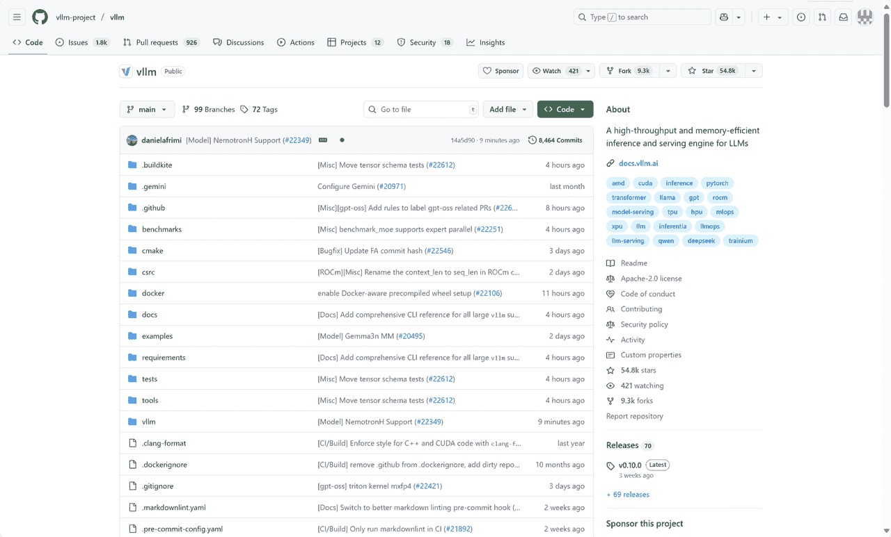
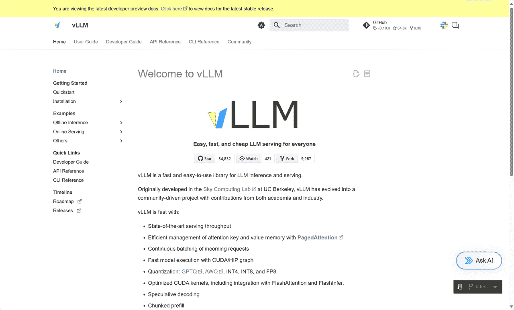
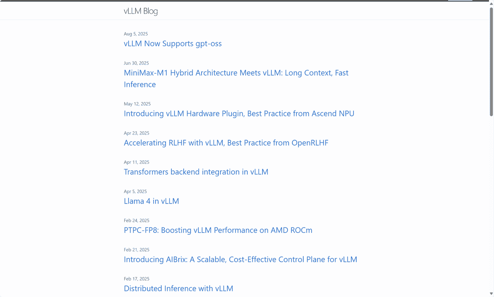

# vLLM

> 来源：[https://gotoaiworld.feishu.cn/docx/B6OHdlR0qo6aTlxrECFc6TRcnZe](https://gotoaiworld.feishu.cn/docx/B6OHdlR0qo6aTlxrECFc6TRcnZe)

# 一、vLLM概述

> vLLM 是一个高性能的大语言模型（LLM）推理与服务框架

vLLM 是一个高性能的大语言模型（LLM）推理与服务框架，由加州大学伯克利分校等机构开发，核心目标是大幅提升大模型的推理效率、吞吐量和部署灵活性，解决传统 LLM 推理中存在的高延迟、低并发、显存利用率低等痛点，使其能更高效地应用于生产环境。

### 核心定位

vLLM 专注于 “大模型推理加速”，通过创新的内存管理和计算优化技术，让单个或集群 GPU 能承载更多并发请求，同时降低响应延迟，是连接预训练模型与实际服务的关键中间件，尤其适合需要高并发、低延迟的 LLM 应用（如聊天机器人、智能客服、内容生成 API 等）。

### 核心技术与功能

1.  PagedAttention：突破性内存管理
这是 vLLM 的核心创新，灵感来自操作系统的 “分页内存管理”：

+   传统 LLM 推理中，注意力机制的 KV 缓存（存储输入序列的键值对，用于生成后续 token）需连续内存空间，易导致内存碎片和浪费；

+   PagedAttention 将 KV 缓存拆分为 “块”（类似内存页），允许非连续存储，通过页表记录块的位置，大幅减少内存碎片，提高显存利用率（实测可提升 3-5 倍）。
这一技术让 vLLM 能在有限显存下处理更长序列（如 100k+ token）和更多并发请求。

1.  高吞吐量与低延迟

+   相比传统框架（如 Hugging Face Transformers），vLLM 在相同硬件下的吞吐量提升 10-100 倍（例如，单张 A100 GPU 可支持数千并发请求）；

+   延迟降低 50% 以上，尤其在长序列生成场景（如文档摘要、多轮对话）中优势明显。

1.  动态批处理（Dynamic Batching）
自动适配不同请求的长度和生成速度，动态调整批处理大小，避免 “短板效应”（即单个长请求阻塞整个批次），最大化 GPU 利用率。例如，同时处理短问答（如 “天气如何”）和长文档生成时，能灵活分配计算资源。

1.  广泛的模型兼容性
支持主流开源大模型，包括但不限于：

+   LLaMA 系列（LLaMA 2、Llama 3）、Mistral、Mixtral、Phi-2；

+   GPT-2、GPT-NeoX、Pythia、Falcon；

+   国产模型如 Qwen（通义千问）、Baichuan、Yi 等；
无需修改模型结构即可直接加载，适配 Hugging Face 模型格式。

1.  生产级部署能力

+   支持流式输出（Streamming）：实时返回生成的 token，适合对话场景（如 ChatGPT 式交互）；

+   兼容 OpenAI API：提供与 OpenAI 一致的接口（如/v1/completions），现有基于 OpenAI API 的应用可无缝迁移；

+   支持张量并行（Tensor Parallelism）：将大模型拆分到多 GPU，支持千亿参数级模型推理（如 LLaMA 2 70B）；

+   集成监控工具：提供吞吐量、延迟、显存占用等指标，便于生产环境监控。

### 典型工作流程

1.  加载预训练模型（如 Llama 3 70B）到 vLLM 框架，配置显存分配、并发数等参数；

1.  客户端发送推理请求（如 “写一篇关于 AI 的短文”）；

1.  vLLM 通过 PagedAttention 管理 KV 缓存，动态批处理多个请求，利用 GPU 高效计算；

1.  实时返回生成结果（支持流式输出，逐句返回），同时优化后续 token 生成的计算资源分配。

### 应用场景

+   高并发 API 服务：如开源模型的云服务（如 Together.ai、Anyscale 等基于 vLLM 构建）；

+   企业内部 LLM 部署：为客服、文档处理等场景提供低延迟响应；

+   长文本处理：支持 100k+ token 的长文档理解、生成（如法律合同分析、书籍摘要）；

+   边缘设备适配：通过量化（如 4-bit/8-bit）和优化，在消费级 GPU（如 RTX 4090）上部署大模型。

### 优势

+   性能碾压：PagedAttention 技术带来的显存效率和吞吐量提升是核心竞争力；

+   易用性高：API 简洁，与 Hugging Face、OpenAI 生态兼容，无需深入底层优化；

+   轻量化部署：单文件安装（pip install vllm），快速启动服务（一行命令部署）；

+   开源免费：代码开源（Apache 2.0 许可证），支持二次开发和商业化使用。

### 获取与使用

+   项目地址：[https://github.c](https://github.com/vllm-project/vllm)om/vllm-project/vllm

+   官方文档：提供快速入门、模型部署、性能调优等详细指南，适合新手快速上手。

总之，vLLM 是大模型推理领域的 “性能加速器”，通过创新的内存管理技术，解决了 LLM 从实验室到生产环境的核心瓶颈，已成为高并发 LLM 服务的主流选择，尤其受到云服务商、企业和开发者的青睐。

## vLLM GitHub

https://github.com/vllm-project/vllm

## vLLM Docs文档库

https://docs.vllm.ai/en/latest/

## vLLM Blog

https://blog.vllm.ai/

