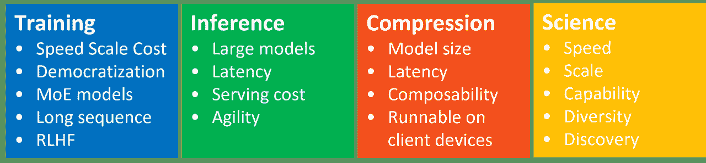
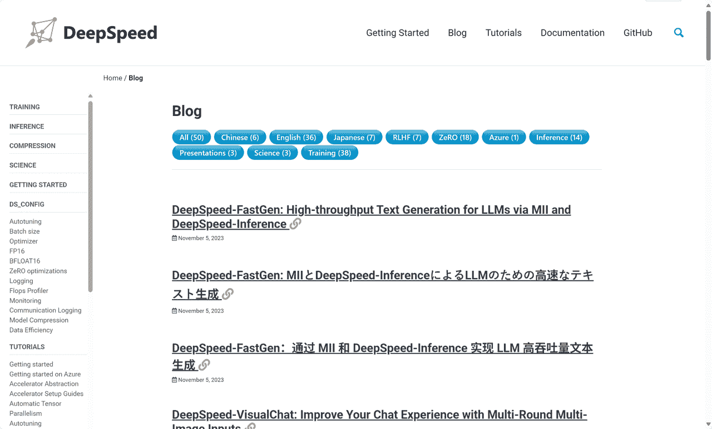

# DeepSpeed

> 来源：[https://gotoaiworld.feishu.cn/docx/RMpodXzOzoD6qaxfK0cck6TBnOZ](https://gotoaiworld.feishu.cn/docx/RMpodXzOzoD6qaxfK0cck6TBnOZ)

# 一、DeepSpeed 概述

DeepSpeed 是微软开发的一款开源深度学习优化库，专注于大幅提升大模型（尤其是千亿 / 万亿参数级模型）的训练效率、显存利用率和可扩展性，同时支持高性能推理。它与 PyTorch 等框架兼容，核心目标是解决超大规模模型训练中面临的 “显存瓶颈”“计算效率低”“集群扩展难” 等痛点，让研究者和开发者能更高效地训练和部署超大模型。

### 核心定位

DeepSpeed 是大模型训练与推理的 “效率引擎”，通过创新的内存优化、并行计算和通信优化技术，让单台服务器或分布式集群能承载远超硬件理论上限的模型规模（例如，在单张 GPU 上训练原本需要 10 张 GPU 才能容纳的模型），同时缩短训练时间、降低成本。

### 核心技术与功能

1.  ZeRO（零冗余优化器）：突破显存限制
这是 DeepSpeed 的核心内存优化技术，通过 “分片存储” 减少冗余数据：

+   传统数据并行中，每个 GPU 需存储完整的优化器状态、梯度和模型参数，导致显存浪费；

+   ZeRO 将这些数据分片到不同 GPU，每个 GPU 仅存部分数据，通过通信按需交换，显存占用可降低 4-8 倍。

+   衍生版本 ZeRO-Infinity 进一步支持 CPU 和 NVMe 存储扩展，理论上可训练 “无限参数” 模型（如万亿参数级）。

1.  混合精度与量化训练

+   支持 FP16、BF16 等混合精度训练，在保证模型精度的同时，将显存需求减半，计算速度提升 2-3 倍；

+   集成量化训练技术（如 INT8），进一步压缩模型大小和计算量，适合资源受限场景。

1.  并行计算优化

+   与 Megatron-LM 深度集成，支持数据并行、模型并行、张量并行等多种并行策略，灵活适配不同模型结构和硬件规模；

+   优化跨节点通信效率，在数千 GPU 集群上仍能保持高性能（如微软用 2048 张 A100 训练 5300 亿参数模型）。

1.  推理优化（DeepSpeed-Inference）

+   针对大模型推理场景，优化层融合、KV 缓存管理和批处理策略，吞吐量提升 10-30 倍，延迟降低 50% 以上；

+   支持动态批处理和模型分片，适配高并发 API 服务（如对话机器人、内容生成接口）。

1.  自适应训练控制

+   自动调整学习率、批处理大小等超参数，平衡训练稳定性和效率；

+   支持 “弹性训练”，集群节点故障时可自动恢复，避免训练中断。

### 典型应用场景

+   超大规模模型训练：如微软的 Megatron-Turing NLG 530B（5300 亿参数）、GPT-4 相关预训练等，均基于 DeepSpeed 实现；

+   科研与企业定制：高校和企业用其训练领域大模型（如医疗、金融），在有限硬件上实现百亿参数级模型训练；

+   低资源环境适配：通过 ZeRO 和量化技术，让中小实验室或开发者在消费级 GPU（如 RTX 4090）上训练 10B+ 参数模型；

+   生产级推理部署：为大模型 API 服务（如聊天机器人、智能写作）提供高性能推理支持，降低服务成本。

### 优势

+   显存效率革命：ZeRO 技术让模型规模不再受单卡显存限制，是训练超大规模模型的 “标配工具”；

+   兼容性强：无缝集成 PyTorch，支持主流模型结构（如 Transformer、GPT、BERT 等），无需重写代码；

+   全生命周期支持：从训练到推理全覆盖，避免训练与部署的技术割裂；

+   企业级验证：微软、斯坦福等机构的大规模实践验证，稳定性和扩展性经过严苛考验。

### 获取与使用

+   官方文档：https://www.deepspeed.ai/（提供安装指南、技术白皮书和示例教程）；

+   GitHub 仓库：[https://github.com](https://github.com/microsoft/DeepSpeed)/microsoft/DeepSpeed（开源代码、模型配置模板和社区支持）。

总之，DeepSpeed 是大模型时代的 “基础设施”，其核心价值在于让超大规模模型的训练和部署从 “不可能” 变为 “高效可行”，推动了千亿 / 万亿参数模型的普及，是科研和工业界训练大模型的核心工具之一。

# 二、DeepSpeed 官方文档库

https://www.deepspeed.ai/

# 三、DeepSpeed Tutorials 培训

https://www.deepspeed.ai/tutorials/

# 四、DeepSpeed GitHub

https://github.com/deepspeedai/DeepSpeed

# 五、DeepSpeed Blog

https://www.deepspeed.ai/posts/

