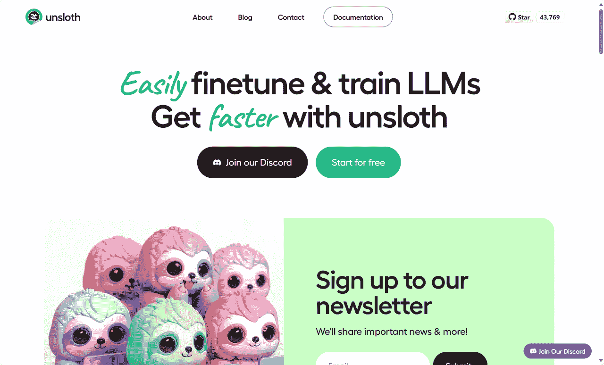
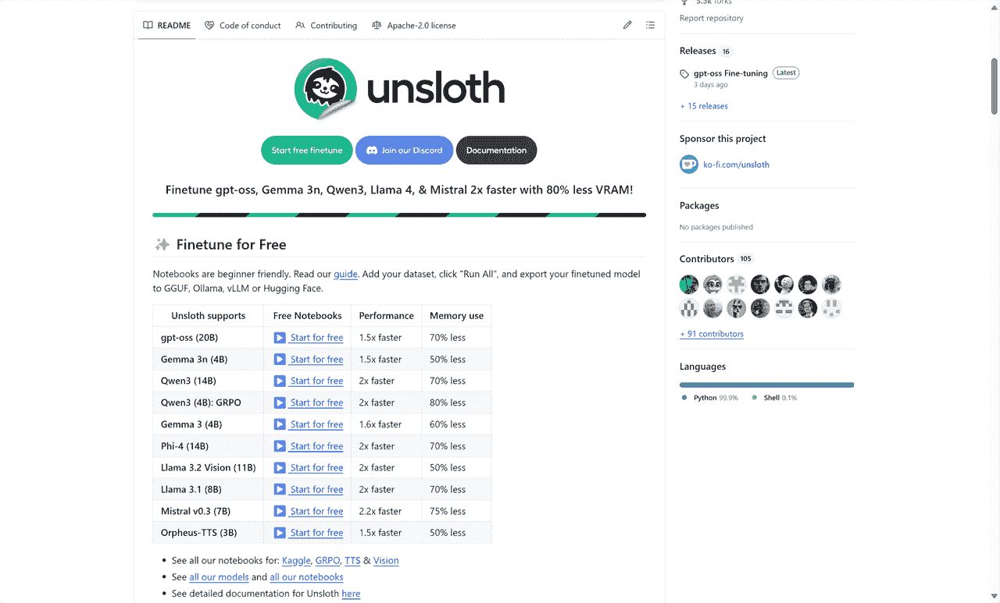

# Unsloth

> 来源：[https://gotoaiworld.feishu.cn/docx/IZwLdiGysox89Oxw4i3cCfk4n0b](https://gotoaiworld.feishu.cn/docx/IZwLdiGysox89Oxw4i3cCfk4n0b)

# 一、Unsloth 概述

> Unsloth 是一款开源的大语言模型（LLM）微调加速框架，由 Unsloth AI 团队开发，专注于通过底层优化技术大幅提升训练效率并降低硬件门槛。

Unsloth 是一款开源的大语言模型（LLM）微调加速框架，由 Unsloth AI 团队开发，专注于通过底层优化技术大幅提升训练效率并降低硬件门槛。其核心目标是让开发者在消费级 GPU（如 RTX 4090）或有限资源环境下，高效完成千亿参数级模型的微调任务，同时保持模型精度unsloth.ai。

### 核心价值：突破算力与显存的双重枷锁

+   训练速度革命：通过手动优化计算步骤、手写 GPU 内核（基于 Triton 框架）和动态量化技术，Unsloth 在单 GPU 上实现最高 10 倍、多 GPU 上最高 32 倍的加速效果，远超传统框架（如 FlashAttention 2）unsloth.ai。例如，微调 Llama-3-70B 模型时，单卡训练时间从 5 小时缩短至 30 分钟。

+   显存占用锐减：结合动态 4bit 量化和显存智能管理，显存使用量减少 70%-80%。例如，在 80GB 显存的 GPU 上可支持 Llama 3.3（70B）模型的 89K 长上下文训练，而传统方法仅能处理 16K 以下。

+   低门槛适配：无需高端 A100/H100 显卡，普通开发者可在 RTX 3060（12GB 显存）或 Colab 免费 GPU 上完成 7B-70B 模型的微调。

### 核心技术与功能

1.  动态量化与混合精度训练

+   4bit/8bit 量化：在训练过程中动态调整权重精度，显存占用降低 70% 以上，同时通过误差补偿技术（如指数移动平均）保持模型收敛性。

+   混合精度支持：无缝兼容 FP16、BF16 及 QLoRA 技术，适配不同硬件特性。

1.  高性能计算优化

+   Triton 内核重写：对计算密集型算子（如注意力机制、FFN 层）进行底层优化，数据复用率提升至 78%，寄存器压力均衡避免 GPU 单元空闲unsloth.ai。

+   梯度稀疏化：采用分层稀疏策略（FFN 层 0.5%、Attention 层 0.1% 稀疏度），减少 40% 的 FLOPs（浮点运算量）而不影响收敛性。

1.  参数高效微调（PEFT）

+   LoRA/QLoRA 深度集成：仅训练少量低秩适配器参数（如 1-5% 的模型参数），显存占用进一步降低，且支持与全量微调效果接近的性能。

+   动态批处理与弹性训练：根据 GPU 利用率自动调整 batch size，支持集群节点故障时的自动恢复。

1.  长上下文与复杂架构支持

+   长序列优化：通过 FlashAttention-3 改进版，在 32K token 长度下，训练速度比原生实现快 40%，显存节省 62%。

+   MOE 架构适配：支持 Gemini-1.5、Qwen-3 MOE 等复杂模型，动态加载专家网络以减少通信开销 40%。

1.  全流程生态兼容

+   Hugging Face 无缝集成：可直接使用 Transformers 库的模型和数据集，支持导出为 GGUF、Ollama 等格式，适配 vLLM 推理引擎。

+   零代码迁移：无需重写代码，兼容 PyTorch 原生训练流程，同时支持 DeepSpeed、BitsandBytes 等工具。

### 典型应用场景

1.  垂直领域模型定制

+   医疗 / 法律场景：通过《伤寒论》、合同判例等领域数据微调，构建专属问答模型，在 8GB 显存显卡上实现 150 亿参数模型训练。

+   企业知识库：将内部文档嵌入模型，实现产品参数、流程规范的精准问答，替代传统检索系统。

1.  科研与低成本实验

+   学术研究：高校团队可在 RTX 4090 上验证千亿参数模型的微调策略，节省 90% 以上算力成本。

+   快速迭代：支持 15 分钟内完成 7B 模型的单 epoch 训练，适合快速验证 LoRA 适配器效果。

1.  生产级推理部署

+   实时 API 服务：与 vLLM 集成后，推理吞吐量提升 20 倍，延迟降低 50%，支持动态批处理和高并发请求。

+   边缘设备适配：通过 4bit 量化，模型体积压缩至 2GB 以下，可部署于 Jetson 等嵌入式平台。

### 核心优势对比

### 获取与使用

+   官方资源：

+   官网：https://unsloth.ai/（提供快速入门指南和性能基准）unsloth.ai。

+   GitHub 仓库：[https://github.c](https://github.com/unslothai/unsloth)om/unslothai/unsloth（开源代码、示例项目和社区支持）。

+   快速上手：

+   python

```
from unsloth import FastLanguageModel, SFTTrainer

# 加载量化后的模型（显存占用仅 2GB）
model, tokenizer = FastLanguageModel.from_pretrained(&quot;unsloth/meta-llama-3.1-8b-bnb-4bit&quot;,
    load_in_4bit=True)# 微调配置
trainer = SFTTrainer(
    model=model,
    dataset=load_dataset(&quot;json&quot;, data_files=&quot;train.json&quot;),
    max_seq_length=2048,
    lora_r=8,  # 低秩矩阵维度
    learning_rate=2e-4)# 启动训练
trainer.train()
```

（示例代码来自）

### 总结

Unsloth 的核心价值在于通过系统级创新打破算力垄断，让大模型微调从 “巨头专属” 变为 “全民可及”。其技术突破（如动态量化、Triton 内核优化）不仅提升了训练效率，更重新定义了中小开发者的硬件选择标准。无论是科研探索、企业定制还是边缘部署，Unsloth 都为高效利用现有资源提供了革命性解决方案，是当前大模型微调领域最具潜力的工具之一。

# 二、Unsloth 官方网站

https://unsloth.ai/



# 三、Unsloth 官方文档库

https://docs.unsloth.ai/


# 四、Unsloth GitHub

https://github.com/unslothai/unsloth



## ✨ Finetune for Free

Notebooks are beginner[ frie](https://docs.unsloth.ai/get-started/fine-tuning-guide)ndly. Read our guide. Add your dataset, click "Run All", and export your finetuned model to GGUF, Ollama, vLLM or Hugging Face.

+   [See al](https://github.com/unslothai/notebooks?tab=readme-ov-file#-kaggle-notebooks)l [our ](https://docs.unsloth.ai/get-started/unsloth-notebooks#grpo-reasoning-rl-notebooks)no[teb](https://docs.unsloth.ai/get-started/unsloth-notebooks#text-to-speech-tts-notebooks)ook[s for:](https://docs.unsloth.ai/get-started/unsloth-notebooks#vision-multimodal-notebooks) Kaggle, GRPO, TTS & Vision

+   See [all our models](https://docs.unsloth.ai/get-started/all-our-models) and all our notebooks

+   See detailed docume[ntat](https://docs.unsloth.ai/)ion for Unsloth here