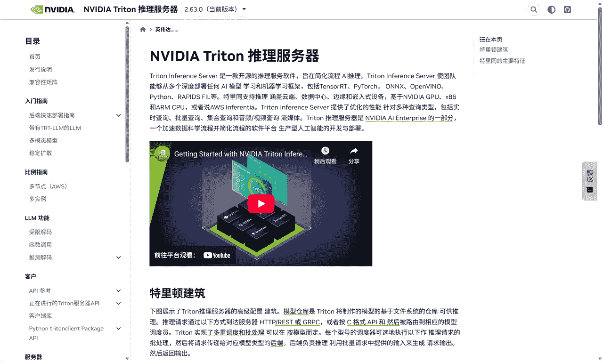
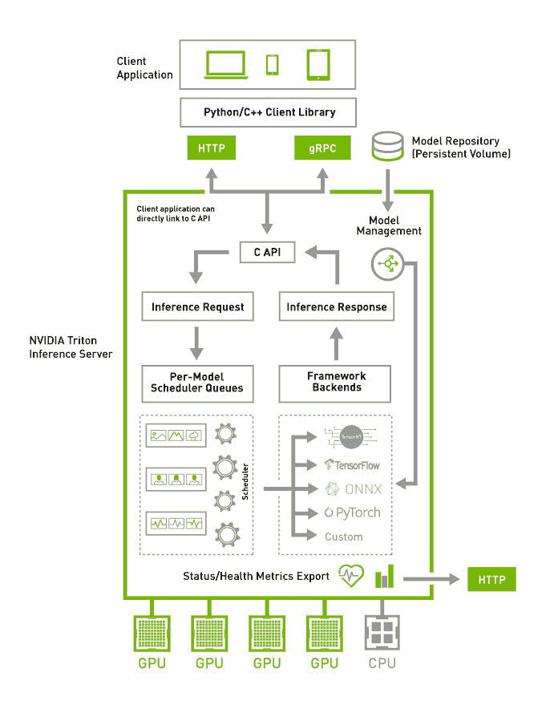
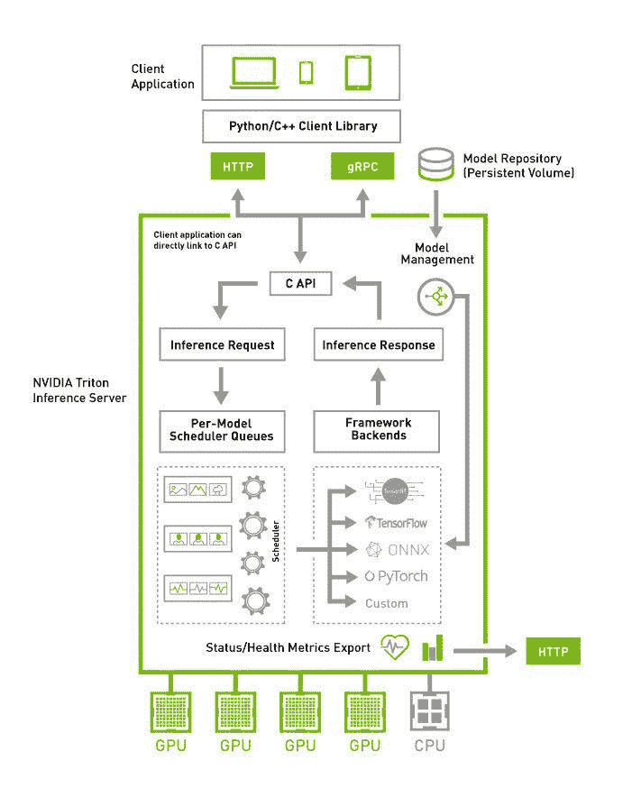

# Triton Inference Server Docs官方文档库

> 来源：[https://gotoaiworld.feishu.cn/docx/AyENd7VtUoY1y6xzfM6cfhfpnDd](https://gotoaiworld.feishu.cn/docx/AyENd7VtUoY1y6xzfM6cfhfpnDd)

Triton Inference Server 是一款开源的推理服务软件，旨在简化流程 AI推理。Triton Inference Server 使团队能够从多个深度部署任何 AI 模型 学习和机器学习框架，包括TensorRT、PyTorch， ONNX、OpenVINO、Python、RAPIDS FIL等。特里同支持推理 涵盖云端、数据中心、边缘和嵌入式设备，基于NVIDIA GPU、x86和ARM CPU，或者说AWS Inferentia。Triton Inference Server 提供了优化的性能 针对多种查询类型，包括实时查询、批量查询、集合查询和音频/视频查询 流媒体。Triton 推理服务器是 NVIDIA AI Enterprise 的一部分， 一个加速数据科学流程并简化流程的软件平台 生产型人工智能的开发与部署。

## Triton Architecture

The following figure shows the Triton Inference Server high-level architecture. The model repository is a file-system based [repos](https://docs.nvidia.com/deeplearning/triton-inference-server/user-guide/docs/customization_guide/inference_protocols.html)itory of the models that Triton will ma[ke available for infere](https://docs.nvidia.com/deeplearning/triton-inference-server/user-guide/docs/index.html#models-and-schedulers)ncin[g. Infe](https://docs.nvidia.com/deeplearning/triton-inference-server/user-guide/docs/backend/README.html)rence requests arrive at the server via either HTTP/REST or GRPC or by the C API and are then routed to the appropriate per-model scheduler. Triton implements multiple scheduling and batching algorithms that can be configured on a model-by-model basis. Each model’s scheduler optionally performs batching of inference requests and then passes the requests to the backend corresponding to the model type. The backend performs inferencing using the inputs provided in the batched requests to produce the requested outputs. The outputs are then returned.

[Triton suppor](https://docs.nvidia.com/deeplearning/triton-inference-server/user-guide/docs/backend/README.html#triton-backend-api)ts a backend C API that allows Triton to be extended with new functionality such as custom pre- and post-processing operations or even a new deep-learning framework.

The models being served by Triton can be queried and controlled by a dedicated model management API that is available by HTTP/REST or GRPC protocol, or by the C API.

Readiness and liveness health endpoints and utilization, throughput and latency metrics ease the integration of Triton into deployment framework such as Kubernetes.

## Triton major features

Major features include:

+   [Supports multiple deep](https://docs.nvidia.com/deeplearning/triton-inference-server/user-guide/docs/backend/README.html#where-can-i-find-all-the-backends-that-are-available-for-triton) learning frameworks

+   [Supports multiple machine](https://github.com/triton-inference-server/fil_backend) learning frameworks

+   Concurrent model execution

+   Dynamic batching

+   Sequence batching and implicit state management for stateful models

+   Provides [Backend API](https://github.com/triton-inference-server/backend) that allows adding custom backends and pre/post processing operations

+   [Model pipe](https://docs.nvidia.com/deeplearning/triton-inference-server/user-guide/docs/user_guide/ensemble_models.html#ensemble-models)lines using Ensembling or Business Logic Scripting (BLS)

+   [HTTP/REST and GRPC](https://docs.nvidia.com/deeplearning/triton-inference-server/user-guide/docs/customization_guide/inference_protocols.html)[ inference prot](https://github.com/kserve/kserve/tree/master/docs/predict-api/v2)ocols based on the community developed KServe protocol

+   A [C API](https://docs.nvidia.com/deeplearning/triton-inference-server/user-guide/docs/customization_guide/inprocess_c_api.html) and [Java API](https://docs.nvidia.com/deeplearning/triton-inference-server/user-guide/docs/customization_guide/inprocess_java_api.html) allow Triton to link directly into your application for edge and other in-process use cases

+   [Metrics](https://docs.nvidia.com/deeplearning/triton-inference-server/user-guide/docs/user_guide/metrics.html) indicating GPU utilization, server throughput, server latency, and more

Join the Triton and TensorRT community and stay current on the latest product updates, bug fixes, content, best practices, and more. Need enterprise support? NVIDIA global support is available for Triton Inference Server with the NVIDIA AI Enterprise software suite.

See the Latest Release Notes for updates on the newest features and bug fixes.