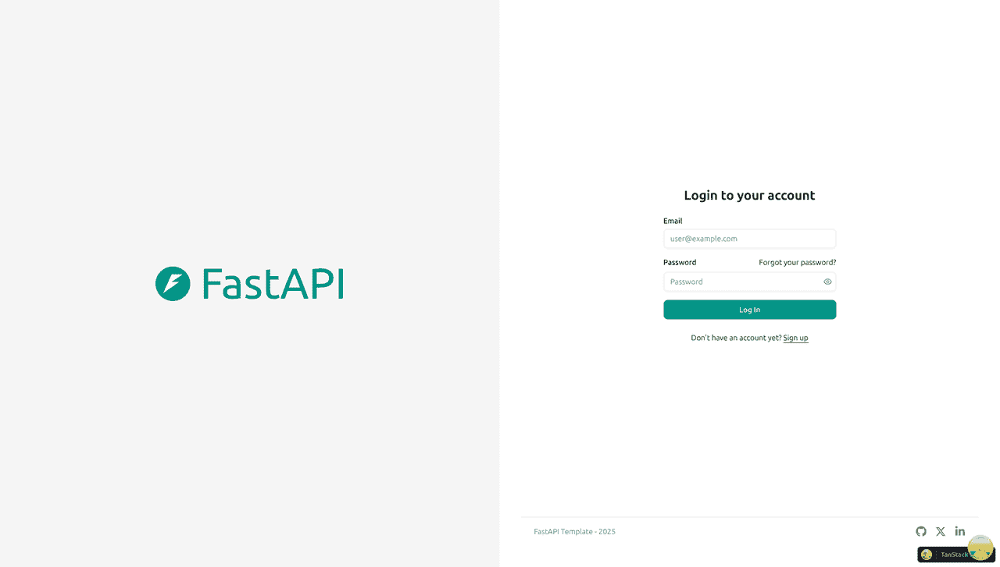
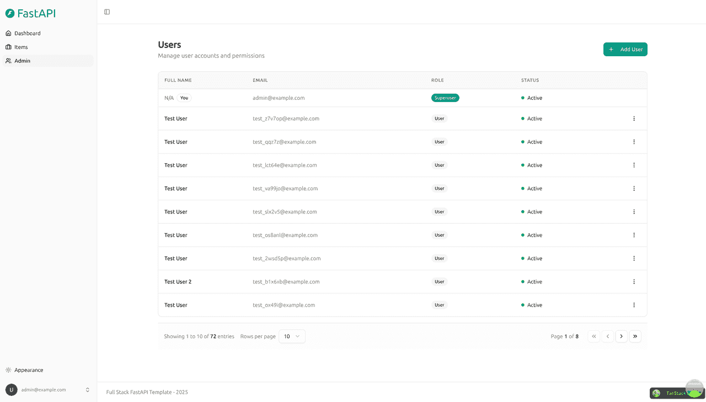
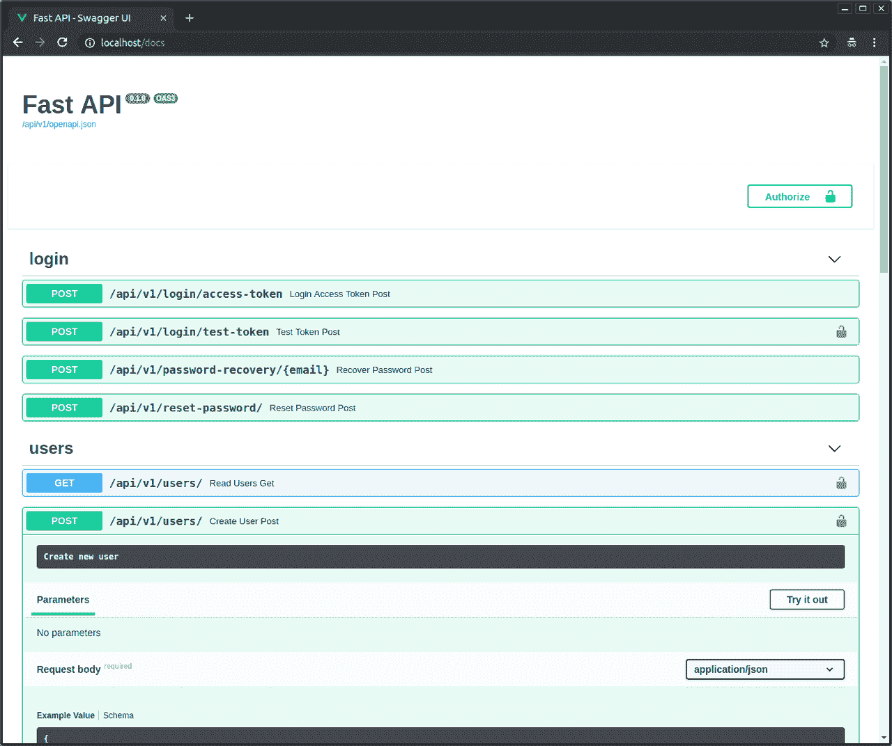

# Full-stack-fastapi-template

> 来源：[https://gotoaiworld.feishu.cn/docx/PLXcduAWToNQRsx2cdQc0tbIncg](https://gotoaiworld.feishu.cn/docx/PLXcduAWToNQRsx2cdQc0tbIncg)

Full stack, modern web application template. Using FastAPI, React, SQLModel, PostgreSQL, Docker, GitHub Actions, automatic HTTPS and more.

https://github.com/fastapi/full-stack-fastapi-template

# Full Stack FastAPI Template

[ht](https://github.com/fastapi/full-stack-fastapi-template/workflows/Test Docker Compose/badge.svg)tps://github.com/fastapi/full-stack-fastapi-template/workflows/Test%20Docker%20Compose/badge.svg

## Technology Stack and Features

+   ⚡ [FastAPI](https://fastapi.tiangolo.com/) for the Python backend API.

+   🧰 S[QLModel ](https://sqlmodel.tiangolo.com/)for the Python SQL database interactions (ORM).

+   🔍 P[ydantic,](https://docs.pydantic.dev/) used by FastAPI, for the data validation and settings management.

+   💾 P[ostgreSQL ](https://www.postgresql.org/)as the SQL database.

+   🚀 R[eact ](https://react.dev/)for the frontend.

+   [💃 Us](https://vitejs.dev/)ing TypeScript, hooks, Vite, and other parts of a modern frontend stack.

+   🎨 T[ailwind CSS ](https://tailwindcss.com/)and s[hadcn/ui ](https://ui.shadcn.com/)for the frontend components.

+   🤖 An automatically generated frontend client.

+   🧪 P[laywright ](https://playwright.dev/)for End-to-End testing.

+   🦇 Dark mode support.

+   🐋 D[ocker Compose ](https://www.docker.com/)for development and production.

+   🔒 Secure password hashing by default.

+   🔑 JWT (JSON Web Token) authentication.

+   📫 Email based password recovery.

+   📬 M[ailcatcher ](https://mailcatcher.me/)for local email testing during development.

+   ✅ Tests with [Pytest](https://pytest.org/).

+   📞 T[raefik ](https://traefik.io/)as a reverse proxy / load balancer.

+   🚢 Deployment instructions using Docker Compose, including how to set up a frontend Traefik proxy to handle automatic HTTPS certificates.

+   🏭 CI (continuous integration) and CD (continuous deployment) based on GitHub Actions.

### Dashboard Login

### Dashboard - Admin

### Dashboard - Items

[ht](https://github.com/fastapi/full-stack-fastapi-template/raw/master/img/dashboard-items.png)tps://github.com/fastapi/full-stack-fastapi-template/raw/master/img/dashboard-items.png

### Dashboard - Dark Mode

[ht](https://github.com/fastapi/full-stack-fastapi-template/raw/master/img/dashboard-dark.png)tps://github.com/fastapi/full-stack-fastapi-template/raw/master/img/dashboard-dark.png

### Interactive API Documentation

## How To Use It