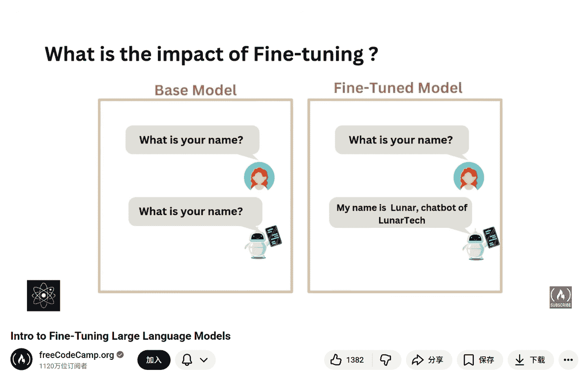

# freeCodeCamp - Fine-Tuning Large Language Models

> 来源：[https://gotoaiworld.feishu.cn/docx/A4Wid3vrvoatvtxLsUAc9rZxnMc](https://gotoaiworld.feishu.cn/docx/A4Wid3vrvoatvtxLsUAc9rZxnMc)

# Fine-Tuning Large Language Models

Learn about fine-tuning large language models (LLMs). The course covers key methodologies, including supervised fine-tuning and reinforcement learning with human feedback (RLHF). It also introduces a technique called QLoRA, which enables you to fine-tune massive models like Llama 70B on a home workstation. The course guides you from theory to practical implementation using tools like Python, PyTorch, and Hugging Face.

✏️ Created by @LunarTech_ai

❤️ Try interactive AI courses we love, right in your browser: https://scrimba.com/freeCodeCamp-AI (Made possible by a grant from our friends at Scrimba)

⭐️ Contents ❤️

+   [0:00:00](https://www.youtube.com/watch?v=H-oCV5brtU4) Course Overview

+   [0:00:15](https://www.youtube.com/watch?v=H-oCV5brtU4&t=15s) What is Fine-Tuning and How is it Different?

+   [0:00:21](https://www.youtube.com/watch?v=H-oCV5brtU4&t=21s) Hands-on Methodologies

+   [0:00:28](https://www.youtube.com/watch?v=H-oCV5brtU4&t=28s) Deep Dive into Parameter Efficient Fine-Tuning

+   [0:00:36](https://www.youtube.com/watch?v=H-oCV5brtU4&t=36s) Exploring QLoRA: A Revolutionary Method

+   [0:00:44](https://www.youtube.com/watch?v=H-oCV5brtU4&t=44s) Practical Case Studies

+   [0:01:15](https://www.youtube.com/watch?v=H-oCV5brtU4&t=75s) Instructor Introduction

+   [0:02:05](https://www.youtube.com/watch?v=H-oCV5brtU4&t=125s) Course Outline (More Detail)

+   [0:02:30](https://www.youtube.com/watch?v=H-oCV5brtU4&t=150s) Highlight of the Course: Parameter Efficient Fine-Tuning

+   [0:03:08](https://www.youtube.com/watch?v=H-oCV5brtU4&t=188s) Who is this Course For?

+   [0:04:01](https://www.youtube.com/watch?v=H-oCV5brtU4&t=241s) Module 1: Introduction to Fine-Tuning

+   [0:05:27](https://www.youtube.com/watch?v=H-oCV5brtU4&t=327s) The Benefits of Fine-Tuning

+   [0:07:17](https://www.youtube.com/watch?v=H-oCV5brtU4&t=437s) First Part: Fine-Tuning LLMs Module

+   [0:07:51](https://www.youtube.com/watch?v=H-oCV5brtU4&t=471s) Fine-Tuning Allocation in LLM Life Cycle

+   [0:08:43](https://www.youtube.com/watch?v=H-oCV5brtU4&t=523s) Pre-trained vs Fine-Tuned Model

+   [0:10:40](https://www.youtube.com/watch?v=H-oCV5brtU4&t=640s) Understanding Shortcomings and Specialization

+   [0:11:00](https://www.youtube.com/watch?v=H-oCV5brtU4&t=660s) Fine-Tuning Impact Example: Chatbot

+   [0:13:07](https://www.youtube.com/watch?v=H-oCV5brtU4&t=787s) Formal Definition of Fine-Tuning

+   [0:18:53](https://www.youtube.com/watch?v=H-oCV5brtU4&t=1133s) Fine-Tuning Examples: Doctor and Lawyer

+   [0:26:08](https://www.youtube.com/watch?v=H-oCV5brtU4&t=1568s) Pre-Training vs. Fine-Tuning

+   [0:49:04](https://www.youtube.com/watch?v=H-oCV5brtU4&t=2944s) Prompt Engineering vs. Fine-Tuning

+   [0:55:00](https://www.youtube.com/watch?v=H-oCV5brtU4&t=3300s) Pros & Cons of Prompt Engineering vs. Fine-Tuning

+   [1:01:41](https://www.youtube.com/watch?v=H-oCV5brtU4&t=3701s) Fine-Tuning Benefits & Demerits

+   [1:07:13](https://www.youtube.com/watch?v=H-oCV5brtU4&t=4033s) Step-by-Step Fine-Tuning Process

🎉 Thanks to our Champion and Sponsor supporters:

👾 Drake Milly

👾 Ulises Moralez

👾 Goddard Tan

👾 David MG

👾 Matthew Springman

👾 Claudio

👾 Oscar R.

👾 jedi-or-sith

👾 Nattira Maneerat

👾 Justin Hual

--

Learn to code for free and get a developer job: https://www.freecodecamp.org

Read hundreds of articles on programming: https://freecodecamp.org/news

https://www.youtube.com/watch?v=H-oCV5brtU4

https://www.youtube.com/watch?v=iOdFUJiB0Zc