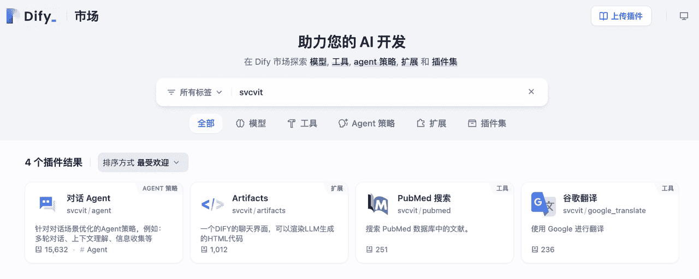
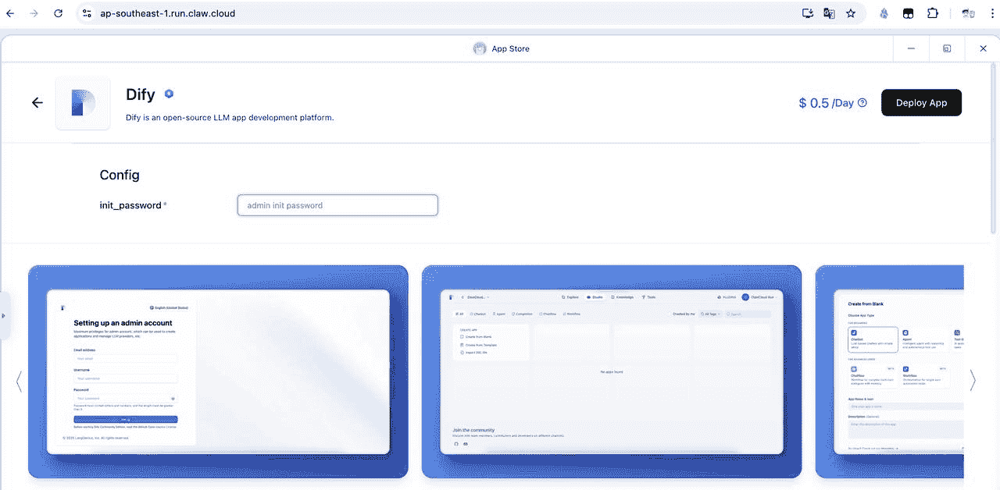

# Awesome-Dify-Workflow

> 来源：[https://gotoaiworld.feishu.cn/docx/R3phdMA9goLD1zxFdiycI5JEnpd](https://gotoaiworld.feishu.cn/docx/R3phdMA9goLD1zxFdiycI5JEnpd)

# Awesome-Dify-Workflow 🚀好用的 Dify DSL 工作流程

Share & Discover Useful Dify Workflows! For personal use & learning.

[English](https://github.com/svcvit/Awesome-Dify-Workflow/blob/main/README_EN.md) | [中文](https://github.com/svcvit/Awesome-Dify-Workflow/blob/main/README.md)

分享一些好用的 Dify 工作流程，自用、学习两相宜，请使用 Dify 0.13.0 及以上版本导入。已支持多 任务并行、会话变量、表单、echart渲染 相关特性。Agent节点为1.0版本之后功能，请尽可能使用最新版DIFY导入。

所有的 Workflow 基本都可以 免费 使用，更多 Workflow 收集整理中……

## 常见问题

这里总结了一些群里常见的问题，不定期更新，内容不会很多，希望对你有帮助。

AI 流程平台对比——Dify、Fastgpt、Ragflow

dify 有没有国内的镜像源配置呀?

sandbox 如何安装pandas这些第三方库？定时任务可以如何处理？我希望定时执行某个流程。节点间传递string数据，提示超限制，如何处理拿到图片URL后能在聊天窗口显示吗，试了下markdown但什么都没显示出来。

请教一个问题，知识库上传大文件提出报错，修改配置文件后，还是无法上传大文件，如下是配置文件中修改上传文件地方；

知识库永久排队问题在哪里可以自学Dify?Dify生成图表有什么好方案？Dify知识库上传PDF乱码怎么办？DuckDuckGo 翻译 现在是不可用了吗探索 Dify 的官方示例应用全部是英文，怎么切换成中文？管理员密码忘记了怎么搞？

## SANDBOX

s[andbox 运行pandas](https://github.com/svcvit/dify-sandbox-py)，numpy>2.0，matplotlib，scikit-learn 代码老报错，例如error: operation not permitted ，你可以尝试使用我开发的另外一个简单版dify-sandbox-py，这些依赖已经测试可以使用。

## DIFY 1.0 插件

插件功能是DIFY 1.0[最大的更](https://marketplace.dify.ai/)新，dify_plugin_collection 仓库存放着 DIFY 的官方市场 插件安装包，方便批量下载，不定期更新。

如果你希望 开发插件，我做了4款插件，都已上架插件商店。代码都已开源，包含Agent strategy，Tool，Extension 希望可以给你参考。

+   [google翻译](https://github.com/svcvit/dify-plugin-google_translate)：这是Tool，代码很少，看完之后可以理解DIFY插件的文件结构

+   [对话Agent](https://github.com/svcvit/dify-plugin-tod_agent) ：这是Agent strategy，Agent策略抽象了Dify的很多能力，可以有很多玩法，但是对开发者要求比较高，你需要有产品思维，还需要一定的开发能力。

+   [Artifacts](https://github.com/svcvit/dify-plugin-artifacts) ：这是Extension，它借鉴了 Anthropic 的 Artifacts 功能，做HTML的渲染，你可以参考这份代码，做一个简单的用户交互界面。

## 模型

+   你可以使用最近火热的deepseek-R1，硅基流动提供免费2000[万Tokens，如果使用邀请注册，你和](https://cloud.siliconflow.cn/i/MwADckCi)我都会获赠免费2000万token的额度：https://cloud.siliconflow.cn/i/MwADckCi。

+   如果你希望体验 OpenAI 或 Anthr[opic 的模](https://one.coffbox.com/)型，可以使用我搭建的服务[ CoffBox 的](https://openrouter.ai/)服务。配置方式参考 如何在Dify中使用CoffBox的服务 这个方式仅供个人使用，如果你需要大规模使用，openrouter会是个更好的选择。

## DIFY 部署

如果你知道熟悉 Docker环境，可以按照官方教程，使用Docker进行DIFY的本地部署。如果你懒得折腾，官方 https://cloud.dify.ai/ 也是个不错的选择，免费用户可以创建最多5个流程。后期可以直接充值使用。

如果你希望找个免费的云服务器部署，也可以使用CLAW[C](https://console.run.claw.cloud/signin?link=WHM8EK4T7FH9)LOUD的云服务，欢迎使用我的邀请链接https://console.run.claw.cloud/signin?link=WHM8EK4T7FH9 注册，注意：

+   注册的时候使用Github登录，如果你的github注册日期超过180天，无需绑定任何银行卡，即可获得每月5美金的免费额度，每月哦！！！

+   DIFY目前已经入驻应用商店，填入一个密码，即可完成安装。对于个人用户来讲，已经够用。

+   因为支持新加坡、日本、美国服务区，所以天然🪜，免除模型需要代理的困扰。

## 参考截图

所有 DSL 都为工作流模式，可以方便的发布为工具后，嵌入 ChatBot 流程。工作流会包含基础的输入、条件判断、变量聚合器、输出等内容。

https://github.com/svcvit/Awesome-Dify-Workflow