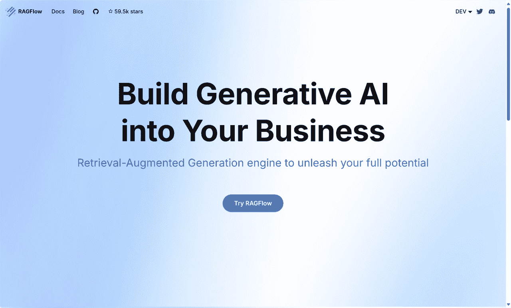
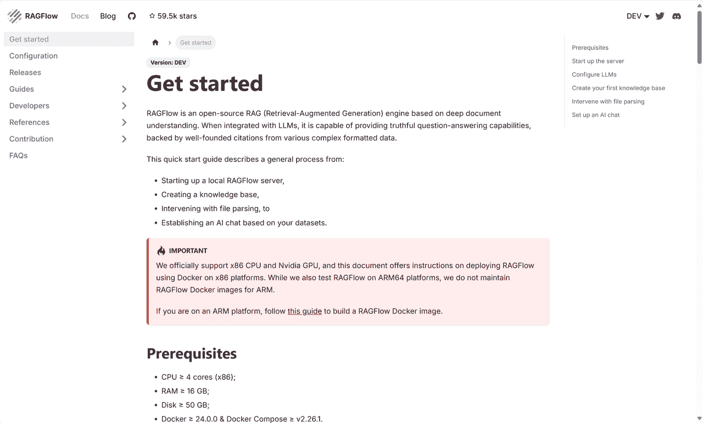

# RAGFlow

> 来源：[https://gotoaiworld.feishu.cn/docx/O1O2dSG0Ro8J4sxhBWfcbCVIn8b](https://gotoaiworld.feishu.cn/docx/O1O2dSG0Ro8J4sxhBWfcbCVIn8b)

# Ⅰ. 什么是RAGFlow ?

RAGFLOW 是一款基于深度文档理解的开源 RAG（检索增强生成）引擎，它融合了先进的自然语言处理技术和检索增强生成理念，旨在为用户提供高效、精准的文档处理和智能问答解决方案。

<https://ragflow.io/>

# 一、RAGFLOW 基础认知

### 1.1 RAGFLOW 概述

+   定义：RAGFLOW 是一款基于深度文档理解的开源 RAG（检索增强生成）引擎，它融合了先进的自然语言处理技术和检索增强生成理念，旨在为用户提供高效、精准的文档处理和智能问答解决方案。

+   核心价值：解决传统 RAG 系统在文档理解深度不足、检索精度不高、生成答案与文档关联性不强等问题，通过深度文档理解能力，提升知识检索的准确性和生成内容的可靠性，降低企业和开发者在构建智能问答系统、知识管理平台等方面的技术门槛。

+   适用人群：包括企业开发者、研究人员、对智能问答和知识管理有需求的技术爱好者等，无论是否具备深厚的自然语言处理背景，都能借助 RAGFLOW 开展相关工作。

### 1.2 RAGFLOW 的发展背景与意义

+   发展背景：随着大语言模型的快速发展，RAG 技术成为连接大模型与具体业务场景的重要桥梁。然而，传统 RAG 系统在处理复杂文档、理解语义深层含义等方面存在局限，RAGFLOW 应运而生，旨在弥补这些不足。

+   技术意义：推动了 RAG 技术在深度文档理解方向的发展，为相关领域的研究和应用提供了新的思路和工具，促进了智能问答、知识图谱构建等技术的进步。

+   应用意义：助力企业更好地管理和利用文档知识，提高业务处理效率，提升客户服务质量，在教育、医疗、金融、法律等多个行业具有广泛的应用前景。

# 二、RAGFLOW 核心原理

### 2.1 深度文档理解技术

+   文档解析：详细介绍 RAGFLOW 对不同格式文档（如 PDF、Word、TXT、HTML 等）的解析能力，包括对文本、表格、图片、公式等元素的提取和处理方法，确保文档信息的完整获取。

+   语义理解：阐述 RAGFLOW 如何利用自然语言处理技术理解文档的语义内容，包括词法分析、句法分析、语义角色标注、实体识别与链接、关系抽取等，深入挖掘文档中的关键信息和知识关联。

+   篇章结构分析：讲解 RAGFLOW 对文档篇章结构的分析能力，如识别章节、段落、标题之间的层级关系，理解文档的逻辑结构和主题分布，为后续的检索和生成提供结构化的知识基础。

### 2.2 检索增强生成机制

+   检索模块原理：介绍 RAGFLOW 的检索策略，包括基于关键词的检索、基于语义向量的检索、混合检索等方式。说明如何构建文档索引，如何根据用户查询快速、准确地从知识库中检索出相关的文档片段和知识单元。

+   增强模块原理：阐述如何将检索到的相关信息与用户查询进行融合，构建富含上下文的提示信息，为大语言模型生成答案提供充分的依据。包括信息筛选、整合、权重分配等策略，确保增强后的提示信息准确、有效。

+   生成模块原理：讲解 RAGFLOW 如何利用大语言模型基于增强后的提示信息生成符合用户需求的答案。介绍生成过程中的参数设置、解码策略等，以及如何保证生成答案的连贯性、准确性和与文档内容的一致性。

### 2.3 与传统 RAG 系统的差异

+   文档理解深度：对比 RAGFLOW 与传统 RAG 系统在文档理解方面的差异，突出 RAGFLOW 在处理复杂文档、理解深层语义和篇章结构上的优势。

+   检索精度：分析两者在检索策略和效果上的不同，说明 RAGFLOW 如何通过深度文档理解提升检索的准确性和相关性。

+   生成质量：比较两者生成答案的质量，包括答案的准确性、丰富性、与文档的关联性等，体现 RAGFLOW 在生成环节的优势。

# 三、RAGFLOW 部署与环境配置

### 3.1 部署前的准备工作

+   硬件要求：明确 RAGFLOW 部署所需的硬件配置，如 CPU、内存、硬盘空间、GPU 等，根据实际应用场景（如个人测试、企业级部署）给出不同的配置建议。

+   软件依赖：列出部署 RAGFLOW 所需的软件和库，如操作系统（Linux、Windows 等）、Python 版本、数据库（MySQL、PostgreSQL 等）、相关的 Python 库（如 PyTorch、TensorFlow、NLTK 等），并说明各依赖的作用和版本要求。

+   网络环境：说明部署过程中对网络环境的要求，如是否需要访问外部资源（如下载模型、依赖库），是否需要配置防火墙、端口等。

### 3.2 部署方式与步骤

+   源码部署：详细介绍从源码编译和部署 RAGFLOW 的步骤，包括获取源码、安装依赖、配置参数、编译程序、启动服务等，适用于有一定开发经验的用户。

+   Docker 部署：讲解使用 Docker 容器部署 RAGFLOW 的方法，包括安装 Docker、获取 RAGFLOW 的 Docker 镜像、配置容器参数、启动容器等，突出 Docker 部署的便捷性和隔离性。

+   云平台部署：介绍在主流云平台（如阿里云、腾讯云、AWS 等）上部署 RAGFLOW 的流程，包括选择云服务器实例、配置环境、上传部署文件、启动服务等，说明云平台部署的优势和注意事项。

### 3.3 环境配置与验证

+   配置文件详解：对 RAGFLOW 的主要配置文件进行详细说明，包括数据库连接配置、服务端口配置、模型路径配置、日志配置等，指导用户根据实际情况进行正确配置。

+   服务启动与检查：说明如何启动 RAGFLOW 的各项服务（如 Web 服务、检索服务、生成服务等），以及如何检查服务是否正常启动，包括查看日志、访问测试接口等方法。

+   常见部署问题及解决：列举部署过程中可能出现的常见问题，如依赖安装失败、服务启动报错、端口冲突等，并提供相应的解决方法和排查思路。

# 四、RAGFLOW 知识库搭建

### 4.1 知识库设计与规划

+   知识体系构建：指导用户根据业务需求和应用场景设计合理的知识体系，包括确定知识的分类、层级结构、属性等，如构建一个医疗知识库，可以分为疾病、症状、治疗方法等类别。

+   数据来源分析：分析知识库数据的来源，如内部文档、公开数据集、网络爬虫获取的数据等，说明不同数据来源的特点和处理方法。

+   知识库存储方案：介绍知识库的存储方式，如关系型数据库、非关系型数据库、知识图谱等，比较不同存储方案的优缺点，根据知识体系和数据特点选择合适的存储方案。

### 4.2 文档导入与处理

+   文档格式支持：说明 RAGFLOW 支持导入的文档格式，以及对不同格式文档的处理方式，如对 PDF 文档的文本提取、对图片的 OCR 处理等。

+   批量导入与单文档导入：分别介绍批量导入多个文档和单个文档导入的操作步骤，包括选择文档、设置导入参数（如是否进行预处理、是否添加标签等）。

+   文档预处理：讲解 RAGFLOW 对导入文档的预处理过程，如去重、去噪、格式转换、分词等，说明预处理对后续知识库构建和检索的重要性。

### 4.3 知识库管理与维护

+   知识查询与浏览：介绍如何在 RAGFLOW 中查询和浏览知识库中的知识，包括通过关键词查询、按分类浏览、查看知识详情等操作。

+   知识更新与删除：说明如何对知识库中的知识进行更新（如修改知识内容、补充属性）和删除，确保知识库的时效性和准确性。

+   知识库备份与恢复：强调知识库备份的重要性，介绍备份知识库的方法和频率，以及在知识库出现故障时如何进行恢复操作，保障数据安全。

# 五、RAGFLOW 应用开发与集成

### 5.1 RAGFLOW API 接口使用

+   API 接口概述：介绍 RAGFLOW 提供的主要 API 接口，如文档导入接口、知识检索接口、问答生成接口等，说明各接口的功能和用途。

+   接口调用方法：详细讲解如何调用 RAGFLOW 的 API 接口，包括请求参数的设置、请求方式（GET、POST 等）、返回结果的解析等，提供具体的代码示例（如 Python、Java 等语言）。

+   接口权限与安全：说明 API 接口的权限管理方式，如如何设置 API 密钥、控制访问权限等，以及如何保障接口调用的安全性（如数据加密、防止恶意请求等）。

### 5.2 基于 RAGFLOW 的应用开发案例

+   智能问答系统：以构建一个基于 RAGFLOW 的智能问答系统为例，详细介绍开发流程，包括需求分析、知识库搭建、前端界面设计、后端逻辑开发（调用 RAGFLOW API 进行检索和生成）、系统测试等。

+   知识管理平台：讲解如何利用 RAGFLOW 开发一个知识管理平台，实现文档的上传、处理、存储、检索、共享等功能，说明平台的架构设计和关键技术实现。

+   内容生成助手：介绍基于 RAGFLOW 开发内容生成助手的方法，如自动生成报告、文章、摘要等，阐述如何利用 RAGFLOW 的检索和生成能力提升内容生成的效率和质量。

### 5.3 与其他系统的集成

+   与大语言模型集成：说明如何将 RAGFLOW 与其他大语言模型（如 GPT 系列、LLaMA 系列等）进行集成，实现优势互补，提升系统的性能和功能。

+   与业务系统集成：讲解 RAGFLOW 与企业业务系统（如 CRM、ERP、OA 等）的集成方式，如通过 API 接口、中间件等，实现知识在业务系统中的应用，提升业务处理效率。

+   与数据可视化工具集成：介绍如何将 RAGFLOW 的检索和分析结果与数据可视化工具（如 Tableau、Power BI 等）集成，以直观的图表形式展示知识和数据，辅助决策。

# 六、RAGFLOW Agent 编排

### 6.1 Agent 编排基础

+   Agent 概念与作用：解释在 RAGFLOW 中 Agent 的概念，说明 Agent 在实现复杂业务逻辑、自动化处理任务等方面的作用，如一个客服 Agent 可以自动处理用户咨询、调用知识库、生成回复等。

+   编排方式概述：介绍 RAGFLOW 中 Agent 编排的主要方式，如可视化编排、代码编排等，说明不同编排方式的特点和适用场景。

+   核心组件：讲解 Agent 编排中的核心组件，如触发器（用于启动 Agent）、动作（Agent 执行的具体操作，如调用 API、发送消息等）、条件判断（根据条件决定 Agent 的执行路径）、循环（重复执行某些操作）等。

### 6.2 可视化 Agent 编排流程

+   编排界面介绍：详细介绍 RAGFLOW 的可视化 Agent 编排界面，包括各组件的位置、功能按钮、画布区域等，帮助用户熟悉界面操作。

+   组件拖拽与配置：说明如何通过拖拽组件到画布上进行 Agent 编排，以及如何配置各组件的参数（如触发器的触发条件、动作的执行参数、条件判断的规则等）。

+   流程测试与调试：讲解如何对编排好的 Agent 流程进行测试和调试，包括运行流程、查看执行日志、排查错误等方法，确保流程的正确性和稳定性。

### 6.3 Agent 编排实战案例

+   多步骤任务处理 Agent：以构建一个处理多步骤任务的 Agent 为例，如 “用户提交订单→查询库存→生成订单→发送通知”，详细介绍编排流程和各组件的配置，展示 Agent 如何自动化处理复杂任务。

+   智能客服 Agent：介绍如何编排一个智能客服 Agent，实现用户咨询的自动响应、问题分类、知识库检索、人工转接等功能，说明 Agent 在提升客服效率和质量方面的作用。

+   数据处理与分析 Agent：讲解如何编排一个数据处理与分析 Agent，自动从多个数据源获取数据、进行清洗和转换、调用分析工具进行分析、生成分析报告等，展示 Agent 在数据处理领域的应用。

# 七、RAGFLOW 高级功能与优化

### 7.1 性能优化策略

+   检索性能优化：介绍提升 RAGFLOW 检索性能的方法，如优化索引结构、采用分布式检索、缓存热门查询结果等，分析各种方法的适用场景和效果。

+   生成性能优化：讲解如何优化 RAGFLOW 的生成性能，如选择合适的大语言模型、调整生成参数、采用模型量化技术等，在保证生成质量的前提下提高生成速度。

+   系统整体性能调优：从硬件配置、软件参数、网络环境等方面，给出 RAGFLOW 系统整体性能调优的建议，确保系统在高并发、大数据量等场景下的稳定运行。

### 7.2 自定义模型与插件开发

+   自定义模型集成：说明如何将自定义的自然语言处理模型（如文本分类模型、实体识别模型等）集成到 RAGFLOW 中，扩展其功能，提供集成的步骤和方法。

+   插件开发指南：详细介绍 RAGFLOW 插件的开发规范和流程，包括插件的功能设计、接口定义、代码实现、测试与发布等，指导用户开发满足特定需求的插件。

+   模型训练与优化：讲解如何利用 RAGFLOW 的数据集和工具进行模型训练和优化，如针对特定领域的文档进行模型微调，提升模型在该领域的理解和处理能力。

### 7.3 多语言支持与国际化

+   多语言处理能力：介绍 RAGFLOW 对不同语言（如中文、英文、日文、韩文等）的处理能力，说明其在多语言文档理解、检索和生成方面的特点和优势。

+   国际化配置：讲解如何对 RAGFLOW 进行国际化配置，如界面语言切换、日期时间格式设置、字符编码处理等，使其适应不同国家和地区的使用需求。

+   跨语言应用案例：提供基于 RAGFLOW 的跨语言应用案例，如跨语言智能问答、多语言文档翻译与检索等，展示其在国际化场景中的应用价值。

# 八、RAGFLOW 社区与资源

### 8.1 社区介绍与贡献

+   社区组织与活动：介绍 RAGFLOW 社区的组织架构、管理模式，以及社区举办的各类活动（如技术分享会、黑客松、开源贡献者计划等），鼓励用户参与社区活动。

+   贡献指南：说明如何为 RAGFLOW 项目做出贡献，如提交代码、报告 bug、提出功能建议、编写文档等，提供贡献的流程和规范。

+   社区交流渠道：列出 RAGFLOW 社区的交流渠道，如官方论坛、微信群、QQ 群、GitHub 讨论区等，方便用户与其他开发者交流和学习。

### 8.2 学习资源与文档

+   官方文档：介绍 RAGFLOW 官方文档的内容和结构，包括快速入门、用户手册、开发指南、API 文档等，指导用户如何查阅和利用官方文档。

+   教程与视频：推荐与 RAGFLOW 相关的教程和视频资源，如入门教程、高级技巧教程、案例分析视频等，帮助用户快速掌握 RAGFLOW 的使用和开发。

+   书籍与论文：列出与 RAGFLOW 技术相关的书籍和学术论文，如自然语言处理、RAG 技术、知识图谱等领域的经典著作和最新研究成果，为用户提供深入学习的资料。

### 8.3 常见问题与解决方案

+   技术问题：收集用户在使用 RAGFLOW 过程中可能遇到的技术问题，如部署失败、服务异常、API 调用错误等，并提供详细的解决方案和排查步骤。

+   功能问题：解答关于 RAGFLOW 功能使用的疑问，如如何进行知识库的批量导入、如何优化检索结果、如何编排复杂的 Agent 流程等。

+   性能问题：针对用户反馈的性能问题（如检索速度慢、生成耗时久等），提供分析思路和优化建议，帮助用户提升系统性能。

# 九、RAGFLOW BLOG

###