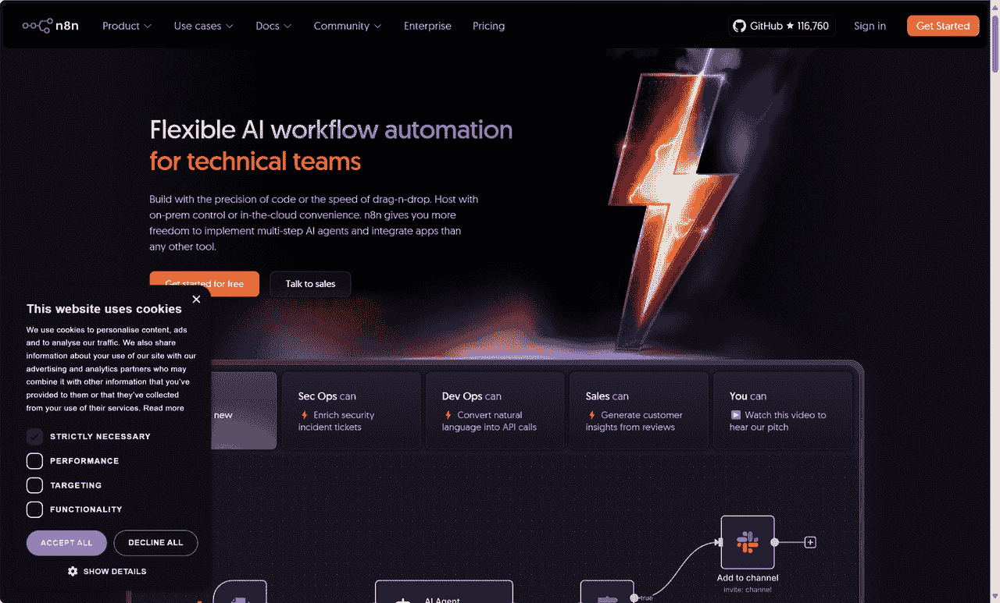
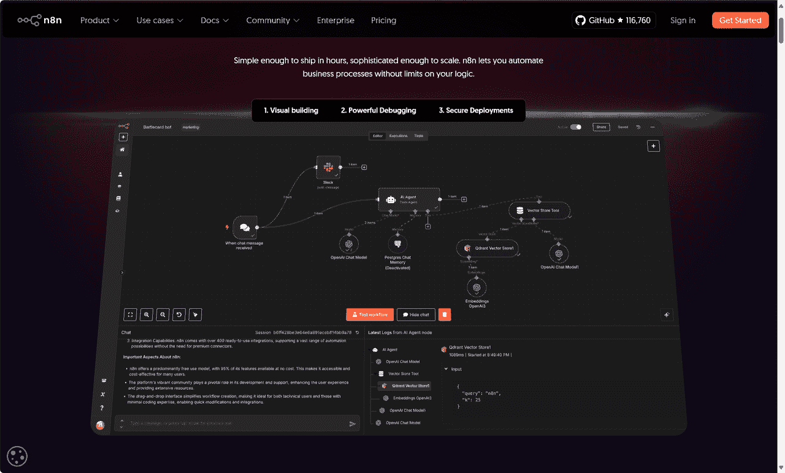
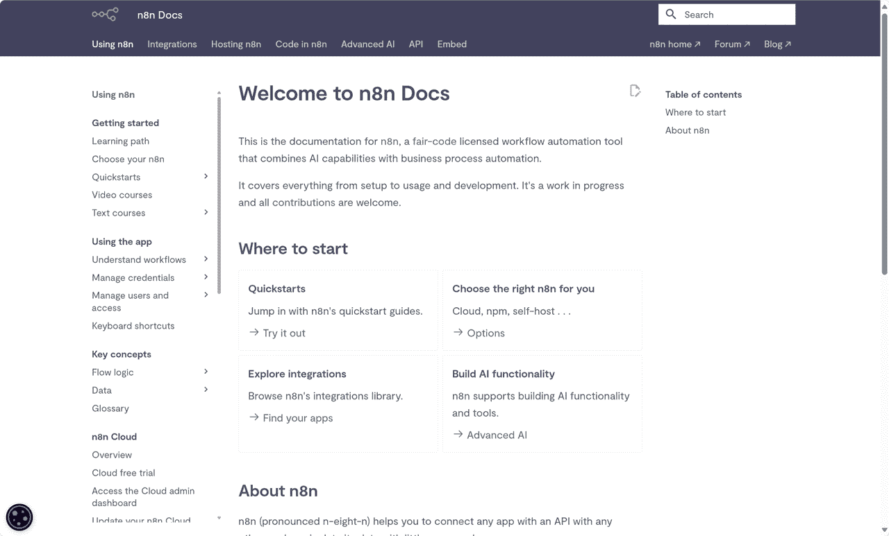
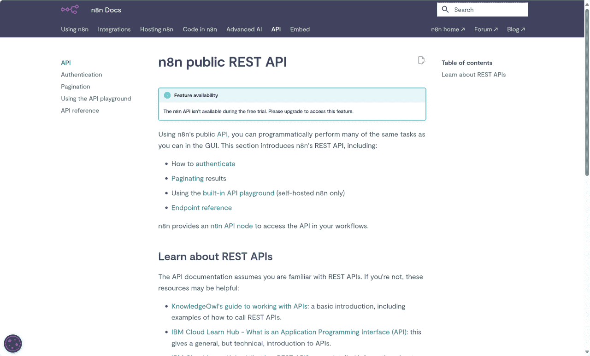

# n8n

> 来源：[https://gotoaiworld.feishu.cn/docx/V40MdKtZ8oWPTpxCJLncfIIrnne](https://gotoaiworld.feishu.cn/docx/V40MdKtZ8oWPTpxCJLncfIIrnne)

# Ⅰ. 什么是 n8n？

> N8N 是一款开源的工作流自动化工具，同时也可作为智能体引擎，通过可视化界面连接各种应用程序、服务和 API，实现任务的自动化执行和智能体的开发与编排

https://n8n.io/

n8n 功能特性

https://n8n.io/features/

n8n 技术文档库

https://docs.n8n.io/

n8n API 文档

https://docs.n8n.io/api/

n8n Blog

https://blog.n8n.io/

# N8N 开源智能体引擎技术文档库结构构思

## 一、N8N 基础认知

### 1.1 N8N 概述

+   定义：N8N 是一款开源的工作流自动化工具，同时也可作为智能体引擎，通过可视化界面连接各种应用程序、服务和 API，实现任务的自动化执行和智能体的开发与编排。

+   核心价值：打破不同系统和服务之间的数据壁垒，降低自动化流程构建的技术门槛，让开发者和非开发者都能快速创建复杂的工作流和智能体，提高工作效率，减少重复劳动。

+   发展历程：简述 N8N 的起源、重要版本更新及关键功能演进，展示其从简单工作流工具到智能体引擎的发展过程。

### 1.2 N8N 核心概念

+   节点（Node）：介绍节点是 N8N 的基本组成单位，每个节点代表一个具体的功能或操作，如数据输入、数据处理、API 调用、条件判断等，详细说明不同类型节点的特点和作用。

+   工作流（Workflow）：解释工作流是由多个节点按照一定逻辑连接而成的自动化流程，用于完成特定的任务，如数据同步、通知推送、业务流程自动化等。

+   触发器（Trigger）：说明触发器是启动工作流的条件或事件，如定时触发、新数据到来触发、API 请求触发等，介绍常见的触发器类型和配置方式。

+   智能体（Agent）：在 N8N 语境下，智能体是基于工作流和节点构建的具备一定自主决策和执行能力的自动化实体，能够根据预设规则和外部输入完成复杂任务。

### 1.3 N8N 与同类工具的对比

+   与传统工作流工具对比：从易用性、灵活性、扩展性等方面，比较 N8N 与传统工作流工具（如 JBoss jBPM、Apache Airflow）的差异，突出 N8N 可视化操作、开源免费、易于集成等优势。

+   与其他开源自动化工具对比：分析 N8N 与同类开源工具（如 Node-RED）在功能、生态、社区支持等方面的异同，帮助用户根据需求选择合适的工具。

## 二、N8N 原理与架构

### 2.1 核心工作原理

+   工作流执行机制：详细阐述 N8N 工作流的执行过程，包括触发器触发后，数据在节点之间的传递方式、节点的执行顺序和逻辑控制（如分支、循环）等。

+   节点通信机制：讲解不同节点之间如何进行数据通信和交互，包括数据格式（如 JSON）、数据传递的方式（同步、异步）等。

+   事件驱动模型：说明 N8N 基于事件驱动的工作模式，如何响应外部事件并触发相应的工作流执行，分析该模型的优势和适用场景。

### 2.2 技术架构

+   前端架构：介绍 N8N 前端的技术栈（如 React、Vue 等）和架构设计，包括界面组件、状态管理、可视化工作流编辑器的实现原理等。

+   后端架构：讲解 N8N 后端的技术组成（如 Node.js、Express 等）、服务架构（如 API 服务、工作流执行引擎、数据库交互层等），说明各部分的功能和协作方式。

+   数据存储：介绍 N8N 的数据存储方案，包括工作流配置数据、执行日志、节点信息等数据的存储方式（如 SQLite、PostgreSQL、MySQL 等），分析不同存储方案的优缺点。

### 2.3 扩展性设计

+   节点扩展机制：说明 N8N 如何支持自定义节点的开发和集成，包括节点开发的规范、API 接口、打包和发布流程，使开发者能够根据需求扩展 N8N 的功能。

+   插件系统：介绍 N8N 的插件系统，讲解插件的作用、开发方法和安装使用流程，如认证插件、存储插件、通知插件等。

+   API 扩展：阐述 N8N 提供的 API 扩展能力，允许用户通过 API 自定义工作流的执行逻辑、节点行为等，实现更灵活的功能扩展。

## 三、N8N 部署与环境配置

### 3.1 部署方式

+   本地部署：详细介绍在本地环境（Windows、macOS、Linux）部署 N8N 的步骤，包括安装 Node.js、下载 N8N 源码或安装包、配置环境变量、启动服务等，提供具体的命令和操作截图。

+   Docker 部署：讲解使用 Docker 容器部署 N8N 的方法，包括获取 N8N 的 Docker 镜像、配置容器参数（如端口映射、数据卷挂载）、启动容器等，说明 Docker 部署的优势和注意事项。

+   云平台部署：介绍在主流云平台（如阿里云、腾讯云、AWS、Azure）上部署 N8N 的流程，包括选择云服务器实例、安装必要的软件、部署 N8N、配置域名和 SSL 证书等，提供不同云平台的部署示例。

### 3.2 环境配置

+   系统要求：明确 N8N 运行所需的最低系统配置和推荐配置，包括 CPU、内存、硬盘空间、操作系统版本等。

+   依赖安装：列出 N8N 运行所需的依赖软件和库，如 Node.js 版本要求、数据库（如需要）、浏览器兼容性等，说明如何安装和验证这些依赖。

+   配置文件详解：对 N8N 的主要配置文件（如 config.js、database.json 等）进行详细解读，介绍关键配置项的含义和修改方法，如端口配置、数据库连接配置、日志配置等。

### 3.3 初始化与验证

+   首次启动与设置：说明 N8N 首次启动的流程，包括创建管理员账户、熟悉界面布局、进行基本设置（如语言、时区）等。

+   服务状态检查：讲解如何检查 N8N 服务是否正常运行，包括查看服务进程、访问 Web 界面、检查日志文件等方法。

+   基础功能测试：指导用户创建一个简单的工作流（如定时发送邮件），测试 N8N 的基本功能是否正常，验证部署的正确性。

## 四、N8N 基础操作与节点使用

### 4.1 N8N 界面导航

+   主界面介绍：详细展示 N8N 的主界面布局，包括菜单栏、工具栏、工作流画布、节点库、属性面板等部分，说明各部分的功能和操作方法。

+   工作流管理界面：介绍工作流的创建、编辑、复制、删除、导入、导出等管理操作的界面入口和操作流程。

+   节点管理界面：说明节点的搜索、添加、配置、删除等管理操作的界面使用方法，展示节点库的分类和检索功能。

### 4.2 节点详解

+   核心节点：详细介绍 N8N 的核心节点，如数据处理节点（过滤、转换、聚合）、通知节点（邮件、短信、Slack、Discord）、API 节点（HTTP 请求、REST API 调用）、数据库节点（MySQL、MongoDB、PostgreSQL 操作）等，包括节点的配置参数、输入输出格式和使用示例。

+   第三方集成节点：讲解 N8N 支持的第三方服务集成节点，如 Google 服务、Microsoft 服务、社交媒体平台（Twitter、Facebook）、云存储服务（AWS S3、Google Drive）等，说明如何配置这些节点与第三方服务进行交互。

+   自定义节点开发入门：简要介绍自定义节点的开发思路和基本步骤，为后续高级开发做铺垫，包括节点的基本结构、输入输出定义、执行逻辑实现等。

### 4.3 工作流创建基础

+   工作流创建步骤：分步讲解创建一个完整工作流的流程，包括选择触发器节点、添加功能节点、连接节点、配置节点参数、测试工作流等。

+   节点连接与逻辑控制：说明如何在工作流中连接不同的节点，以及如何使用条件节点、循环节点等实现复杂的逻辑控制，如分支判断、循环执行、错误处理等。

+   数据传递与处理：介绍工作流中数据在节点之间的传递方式和格式，讲解如何在节点中处理数据（如提取字段、转换格式、计算数值），以及如何使用表达式进行数据操作。

## 五、N8N 智能体开发基础

### 5.1 智能体开发流程

+   需求分析：指导用户明确智能体的目标和功能需求，如智能客服智能体需要实现用户咨询回复、问题分类、工单创建等功能，分析实现这些功能所需的节点和工作流逻辑。

+   工作流设计：根据需求设计智能体的工作流架构，包括确定触发器、选择合适的节点、规划节点之间的连接逻辑和数据流向，绘制工作流流程图。

+   节点配置与集成：详细说明如何配置工作流中的各个节点，包括第三方服务的集成（如知识库查询、自然语言处理 API 调用）、数据处理规则设置、条件判断逻辑定义等。

+   测试与优化：讲解智能体工作流的测试方法，包括单节点测试、部分流程测试、全流程测试，分析测试结果并进行优化，如调整节点参数、优化逻辑流程、提高响应速度等。

### 5.2 智能体核心能力实现

+   数据获取与处理：介绍如何利用 N8N 的节点实现智能体的数据获取（如从数据库、API、文件中获取数据）和数据处理（如清洗、转换、分析）能力，提供具体的节点配置和工作流示例。

+   决策与判断：讲解如何通过条件节点、函数节点等实现智能体的决策与判断能力，根据不同的输入条件执行不同的操作，如根据用户输入的问题类型路由到不同的处理节点。

+   外部交互：说明智能体如何与外部系统和用户进行交互，如通过邮件、短信、Webhook 等方式发送信息，通过 API 接收外部请求，实现双向通信。

### 5.3 基础智能体开发案例

+   定时数据同步智能体：以开发一个定时将数据从 A 系统同步到 B 系统的智能体为例，详细介绍工作流的设计和节点配置，包括定时触发器、数据读取节点、数据转换节点、数据写入节点等，展示智能体的自动化数据处理能力。

+   事件响应智能体：开发一个当特定事件发生（如收到新订单、系统报警）时自动响应的智能体，如发送通知、执行处理操作、记录日志等，说明如何配置触发器和响应节点。

+   信息聚合智能体：创建一个从多个来源（如 RSS 订阅、API 接口）收集信息，进行汇总和整理后推送给用户的智能体，展示智能体的数据聚合和分发能力。

## 六、N8N 工作流编排高级技巧

### 6.1 复杂逻辑编排

+   分支与合并：详细讲解在工作流中实现复杂分支逻辑的方法，如多条件判断分支、并行分支，以及如何将不同分支的结果进行合并处理，提供节点配置和工作流示例。

+   循环与迭代：说明如何使用循环节点实现数据的迭代处理，如遍历列表中的每个元素、重复执行某个操作直到满足条件，介绍循环的配置方式和终止条件设置。

+   错误处理与重试：讲解工作流中的错误处理机制，包括如何捕获节点执行错误、设置错误处理分支（如发送错误通知、执行备选方案），以及如何配置节点的重试策略，提高工作流的稳定性和可靠性。

### 6.2 数据处理高级技巧

+   表达式与函数：深入介绍 N8N 支持的表达式语法和内置函数，如数据提取函数、字符串处理函数、数学函数、日期函数等，展示如何使用这些表达式和函数进行复杂的数据处理和逻辑判断。

+   数据映射与转换：说明如何在节点之间进行复杂的数据映射和转换，如将 JSON 数据转换为表格格式、提取嵌套数据结构中的字段、合并多个数据源的数据等，提供具体的配置示例。

+   批量处理：讲解如何处理大量数据，如批量导入数据、批量更新记录、批量发送通知等，介绍提高批量处理效率的方法和节点配置技巧。

### 6.3 高级工作流案例

+   电商订单处理工作流：设计一个完整的电商订单处理工作流，包括订单接收、库存检查、支付验证、订单确认、物流通知、售后处理等环节，展示如何编排复杂的业务流程，处理各种异常情况。

+   内容发布自动化工作流：创建一个内容从创作、审核、排版到发布到多个平台（如网站、社交媒体）的自动化工作流，说明如何实现内容的流转和状态管理。

+   客户关系管理工作流：开发一个客户信息采集、跟进记录、需求分析、服务推送的客户关系管理工作流，展示如何通过工作流自动化客户管理流程，提升客户服务质量。

## 七、N8N 智能体高级开发与集成

### 7.1 自定义节点开发

+   节点开发环境搭建：详细介绍自定义节点开发所需的环境配置，包括 Node.js 安装、开发工具（如 VS Code）配置、N8N 开发环境搭建等。

+   节点开发规范与 API：讲解 N8N 自定义节点的开发规范，包括节点的元数据定义、输入输出描述、执行逻辑实现等，介绍相关的 API 和开发工具。

+   节点测试与发布：说明如何对开发的自定义节点进行测试（单元测试、集成测试），以及如何打包和发布节点（本地安装、发布到 NPM 仓库、提交到社区）。

### 7.2 与外部系统深度集成

+   API 集成最佳实践：介绍与外部系统 API 集成的最佳实践，包括 API 认证方式（如 OAuth、API Key）配置、请求参数处理、响应数据解析、错误处理等，提供常见 API 集成案例（如支付 API、地图 API）。

+   数据库深度集成：讲解如何与各种数据库进行深度集成，如执行复杂的 SQL 查询、事务处理、数据库备份与恢复等，说明不同数据库的集成特点和注意事项。

+   大语言模型集成：说明如何将 N8N 与大语言模型（如 GPT 系列、LLaMA 系列、国内大模型）进行集成，实现智能问答、文本生成、内容分析等功能，展示通过 API 调用大语言模型的工作流示例。

### 7.3 企业级智能体解决方案

+   企业流程自动化：介绍如何基于 N8N 构建企业级流程自动化解决方案，如人力资源流程（招聘、入职、离职）、财务流程（报销、付款）、采购流程等，说明方案的架构设计、安全考虑和实施步骤。

+   跨系统数据中台：讲解如何利用 N8N 构建跨系统的数据中台，实现不同业务系统之间的数据同步、整合和共享，为企业决策提供数据支持，展示数据中台的工作流设计和节点配置。

+   智能监控与预警系统：开发一个基于 N8N 的智能监控与预警系统，实时监控企业的业务指标、系统状态、安全事件等，当出现异常时自动发出预警并执行相应的处理措施，说明系统的实现原理和关键节点。

## 八、N8N 性能优化与运维

### 8.1 性能优化策略

+   工作流优化：介绍优化工作流性能的方法，如简化工作流逻辑、减少节点数量、合理使用并行处理、优化节点执行顺序等，分析这些方法对性能的影响。

+   资源配置优化：讲解如何根据工作负载优化 N8N 的资源配置，如调整 Node.js 的内存限制、优化数据库性能（如索引优化、查询优化）、配置缓存策略等。

+   扩展与负载均衡：说明当 N8N 面临高并发和大数据量处理时，如何进行水平扩展（增加实例数量）和配置负载均衡，以提高系统的处理能力和可用性，介绍相关的部署架构和配置方法。

### 8.2 监控与日志管理

+   工作流监控：介绍如何监控工作流的执行状态，包括查看工作流的运行次数、执行时间、成功失败率等指标，设置监控告警（如工作流失败告警、执行超时告警）。

+   日志配置与分析：讲解 N8N 的日志配置方法，包括日志级别设置、日志输出格式、日志存储路径等，说明如何分析日志文件排查工作流执行中的问题，推荐常用的日志分析工具。

+   性能指标监控：说明如何监控 N8N 的系统性能指标，如 CPU 使用率、内存占用、网络流量、数据库连接数等，使用监控工具（如 Prometheus、Grafana）进行可视化监控和告警。

### 8.3 安全与备份

+   安全配置：介绍 N8N 的安全配置措施，如启用 HTTPS、设置强密码策略、配置用户权限（如管理员、普通用户、只读用户）、限制 API 访问等，保障系统的安全性。

+   数据备份与恢复：讲解 N8N 数据备份的重要性和方法，包括工作流数据、配置数据、日志数据的备份策略（如定时备份、增量备份），以及如何在数据丢失或损坏时进行恢复操作。

+   漏洞防范：说明如何防范常见的安全漏洞，如 SQL 注入、XSS 攻击、CSRF 攻击等，介绍 N8N 的安全更新机制和最佳安全实践。

## 九、N8N 社区与生态

### 9.1 社区资源

+   官方文档与教程：介绍 N8N 官方提供的文档资源，包括用户手册、开发指南、API 文档等，以及官方发布的教程、视频教程和博客文章，指导用户如何查阅和利用这些资源。

+   社区论坛与交流群：推荐 N8N 的社区论坛、GitHub 讨论区、Slack/Discord 交流群等，说明如何在这些平台上提问、分享经验、获取帮助和参与讨论。

+   第三方资源与插件：展示社区开发的第三方资源，如自定义节点、工作流模板、插件、集成方案等，介绍如何获取和使用这些资源，丰富 N8N 的功能。

### 9.2 贡献与参与

+   开源贡献指南：说明如何为 N8N 开源项目做出贡献，包括提交 Bug 报告、提出功能建议、贡献代码（如开发新节点、修复漏洞）、完善文档等，介绍贡献的流程