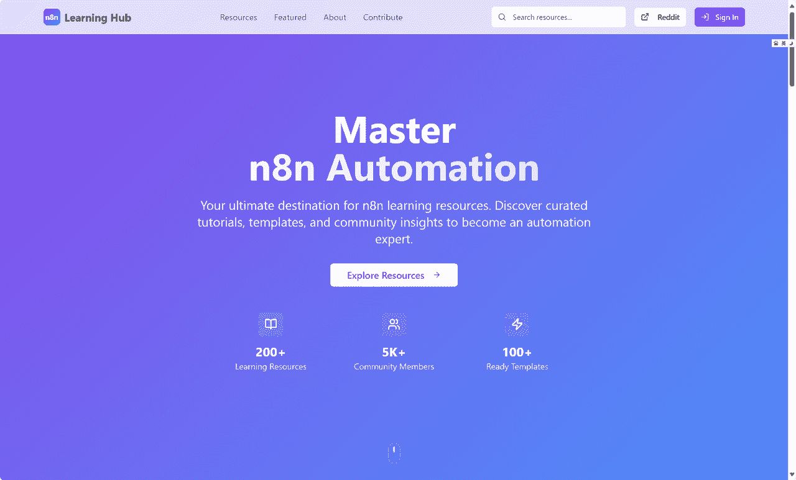
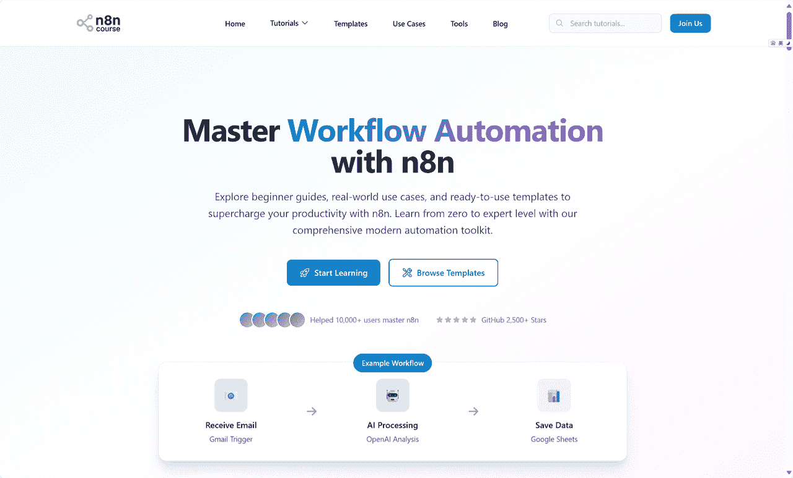
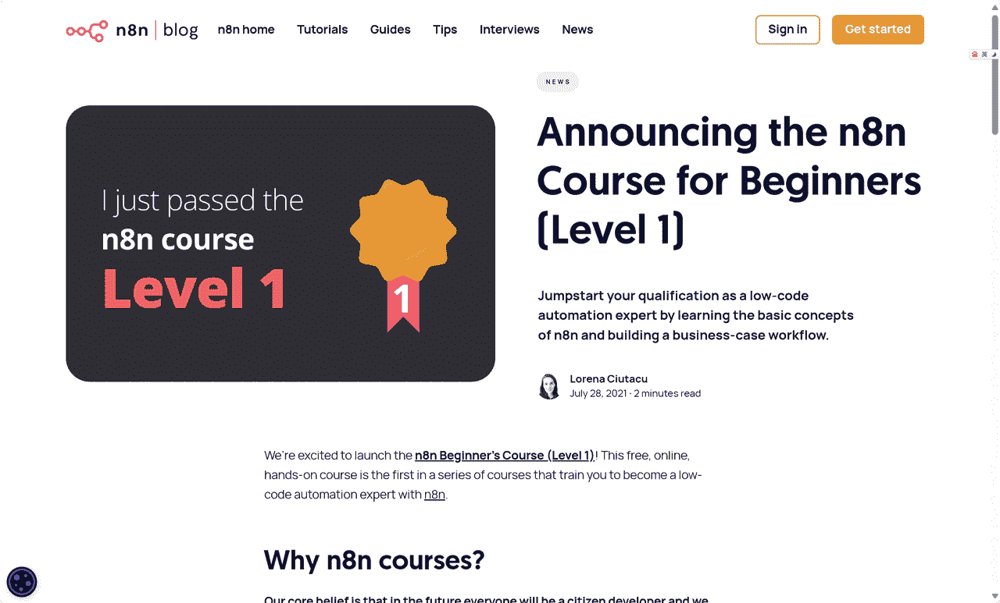

# n8n Learning Hub

> 来源：[https://gotoaiworld.feishu.cn/docx/UDsudBvvvoUfo9xA8lecLTPQnxh](https://gotoaiworld.feishu.cn/docx/UDsudBvvvoUfo9xA8lecLTPQnxh)

# **官方核心资料**

1.  **n8n 官方学习路径**docs.n8n.io：这是官方推出的系统化入门指南（https://docs.n8n.io/learning-path/ ），涵盖从部署到进阶的全流程学习框架。不仅提供了 n8n 云服务试用、Docker 或 npm 安装社区版的详细指引，还划分了视频课程和文本课程两类学习内容，其中初级课程聚焦基础操作，高级课程涉及复杂工作流和企业级功能，适合按节奏搭建完整知识体系。

1.  **n8n GitHub 开源仓库**docs.n8n.io：仓库（https://github.com/n8n-io/n8n ）是获取源码和底层配置的核心渠道。README 文件包含多系统的部署脚本，同时可查看自定义节点的开发示例，Issues 区能检索部署、节点适配等常见问题的解决方案，适合想通过源码理解平台架构或进行二次开发的学习者。

1.  **n8n 官方模板库**：官方提供大量现成的工作流模板，涵盖数据同步、通知推送等常见场景。学习者可直接导入模板拆解逻辑，快速理解不同节点的搭配方式，相比从零搭建更高效，是入门阶段熟悉工作流设计思路的优质参考。

# **中文零基础教程**

1.  [《n8n 完全入门指南：从零开始构建你的第一个工作流》](https://n8ncn.io/blog/n8n-getting-started-guide)n8ncn.io：发布于 n8n 中文分享平台的保姆级教程（https://n8ncn.io/blog/n8n-getting-started-guide ）。内容从 n8n 的核心优势讲起，详细讲解了 npm、Docker 两种安装方式，还以 “Gmail 收到新邮件自动推送至 Slack” 为例，分步演示节点配置、凭证创建和工作流测试，同时补充了数据流转、表达式使用等基础概念，适合纯新手完成首次实战。

1.  《n8n 工作流平台入门学习指南》：CSDN 的入门博客，聚焦核心概念和 Docker 快速部署。文中清晰解释了节点、连接、工作流等基础术语，简化了 Docker 拉取镜像、配置端口和目录映射的操作步骤，还推荐了中文学习辅助资源，适合快速搭建 n8n 运行环境并建立基础认知。

1.  **《简单易懂的现代魔法》中文教程**[n8n.akashio.com：这是面](https://n8n.akashio.com/article/welcome)向非技术群体的低代码教程（https://n8n.akashio.com/article/welcome ）。作者以产品经理视角拆解 n8n 的使用逻辑，避开复杂技术术语，同时分享了小团队和个人的提效场景案例，适合无编程基础的学习者理解工作流自动化的实际应用思路。

# **实战项目与进阶教程**

1.  **《n8n 自动短视频工厂》**：CSDN 的实战博客提供了可直接落地的项目教程。内容围绕 “AI 文案生成→视频生成→YouTube 自动上传” 的全流程，给出了 Docker Compose 的部署配置文件、Python 脚本和环境变量设置步骤，能帮助学习者掌握 n8n 与第三方 API（Gemini、YouTube Data API）的集成方法，适配进阶的自动化场景开发。

1.  **《n8n 接入国产大模型教程》**：发布于 n8n 中文社区，针对国内开发者的需求，讲解了如何将国产大模型接入 n8n 工作流。教程补充了国内服务适配的细节，解决了海外工具与国内服务集成的常见问题，适合拓展 n8n 的功能边界。

1.  《搞定 n8n: 从入门到精通》：CSDN 博客对比了 n8n 与同类工具的优势，同时提及自托管本地 LLM 的部署思路。文中虽侧重应用落地，但补充了工作流优化技巧，比如批量处理减少 API 调用、拆分复杂工作流等，适合从入门过渡到实际场景应用。

# **视频实操课程**

1.  n8n 官方 YouTube 频道docs.n8n.io：官方在 YouTube 发布了系列入门视频，包括节点基础操作、工作流调试、自定义节点开发等内容。视频以实操演示为主，比如 “10 分钟搭建数据同步工作流”，直观展示拖拽配置、参数设置等步骤，适合偏好可视化学习的学习者。

1.  《n8n Docker 部署与基础工作流搭建》：多个技术博主在 B 站发布的适配中文环境的实操视频。内容聚焦国内网络环境下的 Docker 部署，解决了镜像拉取缓慢等问题，同时演示了定时器、HTTP 等基础节点的使用，步骤清晰，适合跟着视频一步步完成环境搭建和首个工作流创建。

1.  **n8n 进阶功能教学视频**docs.n8n.io：涵盖子工作流、错误处理、代码节点等高级功能的讲解。比如如何为关键节点添加错误触发器，如何用代码节点实现自定义数据处理，适合入门后提升工作流的稳定性和灵活性。

# 1.n8n Learning Hub

https://n8nlearninghub.com/

# 2.n8n Course

https://n8ncourse.org/

# 3.n8n Learn Automations Course

https://github.com/justhassann/learn-n8n-automations

# 4.Announcing the n8n Course for Beginners

https://blog.n8n.io/announcing-the-n8n-certification-course-for-beginners-level-1/