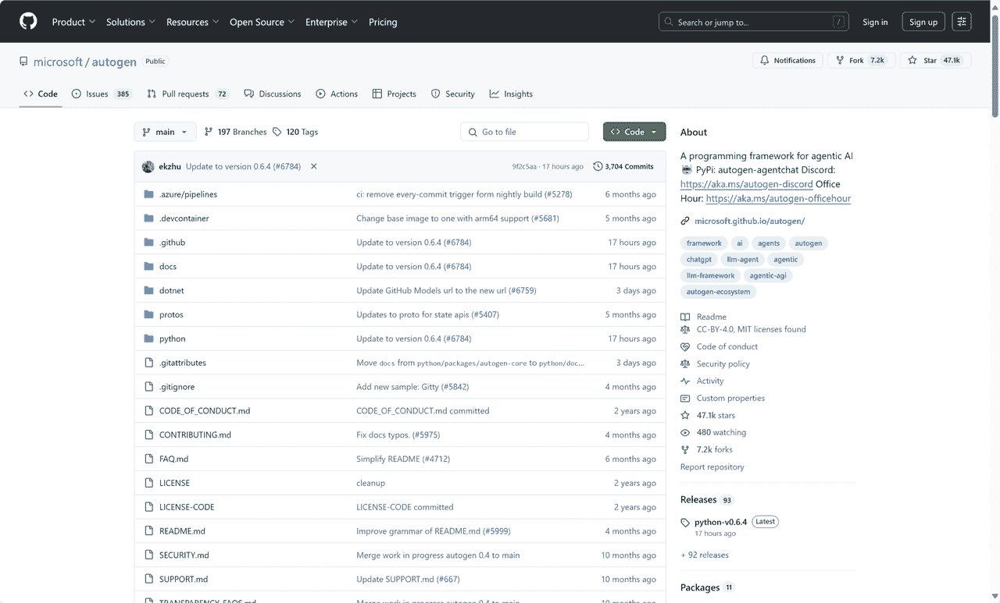

# AutoGen

> 来源：[https://gotoaiworld.feishu.cn/docx/TTzodV91Fo9MLixZqf9cAKfVnOd](https://gotoaiworld.feishu.cn/docx/TTzodV91Fo9MLixZqf9cAKfVnOd)

## 什么是 AutoGen？

> AutoGen 是微软推出的开源智能体框架，支持构建能够相互对话、协作完成任务的多智能体系统，通过大语言模型（LLM）驱动，实现复杂任务的自动化处理

AutoGen 官网  
`https://microsoft.github.io/autogen/0.2/`

AutoGen 文档库  
`https://microsoft.github.io/autogen/0.2/docs/Getting-Started/`

AutoGen 用户手册  
`https://microsoft.github.io/autogen/stable/user-guide/agentchat-user-guide/index.html`

AutoGen GitHub  
`https://github.com/microsoft/autogen`

## 一、AutoGen 基础认知

### 1.1 AutoGen 概述

+   定义：AutoGen 是微软推出的开源智能体框架，支持构建能够相互对话、协作完成任务的多智能体系统，通过大语言模型（LLM）驱动，实现复杂任务的自动化处理。
+   核心价值：打破单智能体能力局限，通过多智能体协作提升任务处理效率和复杂度，降低智能体开发门槛，支持快速搭建基于 LLM 的协同智能系统，适用于数据分析、代码生成、业务流程自动化等场景。
+   发展背景：结合大语言模型技术的爆发式发展，阐述 AutoGen 的诞生契机，以及其在开源社区的定位和影响力，介绍重要版本迭代及关键功能进化。

### 1.2 AutoGen 核心概念

+   智能体（Agent）：详解 AutoGen 中智能体的定义，作为独立的对话实体，具备接收消息、处理信息、生成响应的能力，可分为不同类型（如用户代理、助理代理、工具代理等）。
+   对话（Conversation）：说明智能体之间的交互方式，通过消息传递形成对话流程，对话历史会影响智能体的后续决策，是多智能体协作的核心机制。
+   工具调用（Tool Use）：介绍智能体调用外部工具（如代码执行、API 调用、数据库操作）的能力，扩展智能体的功能边界，实现从 “对话” 到 “行动” 的跨越。
+   协作模式（Collaboration Pattern）：讲解多智能体的协作模式，如主从模式、平等协作模式、流水线模式等，不同模式适用于不同任务场景。

### 1.3 AutoGen 与同类框架对比

+   与单智能体框架对比：比较 AutoGen 与 LangChain（单智能体为主）等框架的差异，突出 AutoGen 在多智能体协作、对话管理方面的优势。
+   与其他多智能体框架对比：分析 AutoGen 与 MetaGPT、AutoGPT 等多智能体框架在架构设计、易用性、功能丰富度等方面的异同，帮助用户选择适配工具。

## 二、AutoGen 核心原理与架构

### 2.1 多智能体协作原理

+   对话调度机制：阐述 AutoGen 如何管理智能体之间的对话流程，包括消息路由、对话状态跟踪、终止条件判断等，确保协作有序进行。
+   角色分工与通信协议：详解智能体的角色定义方式，以及基于自然语言和结构化数据的通信协议，使不同智能体能够理解彼此意图。
+   任务分解与协同策略：说明多智能体如何将复杂任务分解为子任务，通过分工协作完成目标，包括任务分配算法、进度同步机制等。

### 2.2 大语言模型集成机制

+   LLM 驱动逻辑：介绍 AutoGen 如何以大语言模型为核心，将智能体的决策、对话生成、工具调用等能力与 LLM 深度绑定，支持主流模型（GPT 系列、LLaMA 系列、国内大模型等）。
+   提示词工程优化：讲解 AutoGen 针对多智能体场景的提示词设计策略，包括角色设定提示、对话规则提示、工具调用提示等，提升 LLM 的响应质量。
+   模型选择与切换：说明如何为不同智能体配置合适的 LLM，以及在对话过程中动态切换模型的机制，平衡性能与成本。

### 2.3 工具调用与执行原理

+   工具注册与描述：阐述如何将外部工具注册到 AutoGen 中，通过工具描述（功能、参数、返回格式）使智能体理解工具用途，支持自定义工具集成。
+   调用决策逻辑：详解智能体判断何时需要调用工具、调用哪种工具的决策过程，基于对话上下文和任务目标生成工具调用请求。
+   执行结果处理：说明工具执行结果的返回方式，以及智能体如何解析结果、生成自然语言反馈，并用于后续对话或任务处理。

### 2.4 技术架构设计

+   核心模块组成：解析 AutoGen 的架构，包括智能体管理模块、对话引擎模块、工具集成模块、LLM 接口模块等，说明各模块的功能及交互关系。
+   数据流转流程：可视化展示消息在智能体之间、智能体与工具之间的流转路径，从用户输入到任务完成的全流程数据处理逻辑。
+   扩展性设计：介绍 AutoGen 的插件化架构，支持扩展智能体类型、对话策略、工具类型等，满足个性化需求。

## 三、AutoGen 部署与环境配置

### 3.1 环境准备

+   系统要求：明确 AutoGen 运行的软硬件环境要求，包括操作系统（Windows、macOS、Linux）、Python 版本（3.8+）、内存、硬盘空间等。
+   依赖库安装：列出核心依赖库（如 `pyautogen`、`openai`、`python-dotenv` 等），提供 `pip` 安装命令及版本兼容性说明，解决常见依赖冲突问题。
+   大模型配置：指导用户配置大模型接口，包括 OpenAI API 密钥、本地模型部署（如通过 vLLM 部署 LLaMA）的连接方式，支持多模型并行配置。

### 3.2 部署方式

+   本地开发环境部署：详细说明在本地搭建 AutoGen 开发环境的步骤，包括 Python 虚拟环境创建、库安装、环境变量配置（如 API 密钥设置）、验证安装是否成功。
+   Docker 容器部署：提供 `Dockerfile` 和 `docker-compose` 配置示例，讲解通过容器部署 AutoGen 的流程，包括镜像构建、容器启动、数据卷挂载（保存对话历史、配置文件）等。
+   云服务器部署：介绍在云平台（AWS、阿里云、腾讯云）上部署 AutoGen 的方法，包括服务器选型、环境配置、安全组设置（开放必要端口）、后台运行（`nohup` 或 `systemd`）等。

### 3.3 配置文件详解

+   核心配置项：解读 AutoGen 的配置文件（如 `config_list.json`、`.env`），包括模型参数（`temperature`、`max_tokens`）、智能体默认设置（超时时间、重试次数）、工具路径配置等。
+   多模型配置示例：提供同时配置多个 LLM 的示例（如 GPT-4 用于复杂任务，GPT-3.5 用于简单对话），说明如何在智能体中指定模型。
+   安全配置：讲解 API 密钥加密存储、权限控制（如限制工具调用范围）等安全相关配置，保障部署安全。

## 四、AutoGen 智能体开发基础

### 4.1 单个智能体创建

+   基础智能体定义：通过代码示例展示如何创建一个简单的智能体，包括指定名称、角色描述、关联的 LLM 模型，设置基础属性（如对话风格、最大消息数）。
+   智能体行为定制：讲解如何通过函数回调（如 `generate_reply`、`on_message`）定制智能体的响应逻辑，例如添加自定义过滤规则、修改回复格式。
+   单智能体对话测试：指导用户编写测试代码，实现智能体与用户的简单对话，查看运行日志，验证智能体是否正常工作。

### 4.2 工具调用能力开发

+   内置工具使用：介绍 AutoGen 的内置工具（如代码执行工具、搜索引擎工具），演示智能体调用工具的流程（如执行 Python 代码解决数学问题）。
+   自定义工具开发：详解如何开发自定义工具，包括工具函数定义（输入参数、返回值）、注册到智能体、编写工具描述（让 LLM 理解工具功能），提供天气查询、数据库查询等示例。
+   工具调用安全控制：说明如何限制工具调用权限（如禁止执行危险命令）、添加调用前确认机制，避免误操作风险。

### 4.3 多智能体对话入门

+   双智能体协作示例：通过 “用户代理 + 助理代理” 的代码示例，展示两个智能体如何发起对话、传递消息、协作完成任务（如生成并执行代码）。
+   对话流程控制：讲解如何设置对话终止条件（如达成任务目标、超时、用户干预），通过代码控制对话的启动、暂停、重启。
+   对话历史管理：说明如何保存和加载对话历史，实现对话断点续接，分析对话历史对智能体决策的影响。

## 五、AutoGen 多智能体编排与协作

### 5.1 协作模式设计

+   主从协作模式：演示 “主管智能体 + 执行智能体” 的模式，主管负责任务规划，执行智能体负责具体操作（如调用工具），通过代码实现角色分工和消息传递。
+   平等协作模式：设计多个功能互补的智能体（如数据分析智能体 + 可视化智能体），实现平等对话、共同解决问题，说明如何避免对话混乱。
+   流水线协作模式：构建按步骤分工的智能体链条（如数据采集→清洗→分析→报告生成），每个智能体完成特定环节后将结果传递给下一个，展示任务流自动化。

### 5.2 对话流程编排

+   消息路由控制：讲解如何通过条件判断（如消息内容包含关键词）控制消息流向，实现智能体之间的动态通信（如当检测到代码错误时，将消息转发给调试智能体）。
+   事件驱动协作：介绍基于事件的协作机制，通过监听特定事件（如工具调用成功、任务完成）触发智能体行动，示例：当数据处理完成，自动通知报告生成智能体。
+   复杂任务分解：以 “市场分析报告” 为例，展示多智能体如何将任务分解为 “数据收集→竞品分析→图表生成→文案撰写”，通过对话协商分配子任务。

### 5.3 协作案例实战

+   代码开发协作：实现 “产品经理智能体 + 开发智能体 + 测试智能体” 的协作，产品经理提出需求，开发智能体编写代码，测试智能体生成测试用例并执行，最终输出可运行程序。
+   数据分析协作：构建多智能体系统，完成 “数据导入→清洗→统计分析→可视化” 全流程，智能体之间自动传递数据和中间结果，生成分析报告。
+   客服工单处理：设计 “接待智能体 + 技术支持智能体 + 工单记录智能体”，接待智能体初步问诊，技术支持智能体解决问题，工单智能体记录处理过程，提升客服效率。

## 六、AutoGen 高级功能开发

### 6.1 智能体状态管理

+   持久化状态存储：讲解如何将智能体的状态（如对话历史、任务进度、自定义变量）存储到数据库（SQLite、MongoDB）或文件中，实现跨会话状态保持。
+   动态状态调整：通过代码示例展示如何在对话过程中动态修改智能体属性（如切换 LLM 模型、更新角色描述），适应任务需求变化。
+   状态同步机制：说明多智能体之间如何同步状态信息（如共享任务进度表），避免信息不一致导致的协作混乱。

### 6.2 复杂工具链集成

+   API 调用链开发：演示智能体如何调用多个关联 API（如先调用天气 API 获取数据，再调用地图 API 推荐户外活动），处理 API 返回的结构化数据（`JSON`/`XML`）。
+   数据库交互：开发连接 `MySQL`/`PostgreSQL` 的工具，实现智能体执行 `SQL` 查询、插入数据、生成报表，示例：销售数据统计智能体自动从数据库提取数据并分析。
+   前端交互集成：介绍如何将 AutoGen 智能体与 Web 前端（如 `Flask`/`Django` 应用）集成，通过 API 接口接收用户请求，返回智能体对话结果，实现可视化交互。

### 6.3 多模态智能体开发

+   文本与图像协作：展示智能体如何处理图像信息（如调用 CLIP 模型分析图片内容），结合文本对话生成描述或建议，示例：产品图片分析智能体生成营销文案。
+   语音交互集成：集成语音识别（如 Whisper）和语音合成工具，实现智能体的语音对话能力，说明多模态消息的格式处理和传递方式。
+   多模态工具调用：开发支持图像生成（Stable Diffusion）、文档解析（PDF 转文本）的工具，扩展智能体在创意设计、文档处理场景的应用。

## 七、AutoGen 性能优化与调试

### 7.1 性能优化策略

+   对话效率提升：讲解如何减少不必要的消息交互（如合并相似请求、设置对话缓存），优化 LLM 调用参数（如降低 `temperature` 减少冗余回复），提升响应速度。
+   资源消耗控制：说明如何限制工具调用频率、设置 LLM 令牌使用上限，避免因无限循环或大任务导致的资源耗尽，提供内存占用优化技巧。
+   分布式协作：介绍多智能体分布式部署方案，通过消息队列（RabbitMQ/Kafka）实现跨进程 / 服务器智能体通信，提升大规模任务处理能力。

### 7.2 调试工具与方法

+   日志系统使用：详解 AutoGen 的日志配置（级别、输出路径），通过日志分析智能体的对话流程、工具调用细节、错误堆栈，定位问题所在。
+   断点调试：演示如何使用 VS Code/PyCharm 在智能体的关键函数（如消息处理、工具调用）设置断点，单步执行观察变量变化。
+   常见问题排查：列举典型错误（如 LLM 调用失败、工具参数错误、对话死循环），提供排查步骤和解决方案，附错误代码示例及修复方法。

### 7.3 测试框架搭建

+   单元测试：介绍如何为智能体的核心功能（如消息解析、工具调用逻辑）编写单元测试，使用 `pytest` 框架，模拟对话场景验证功能正确性。
+   集成测试：设计多智能体协作的集成测试用例，验证端到端任务处理流程（如完整的数据分析任务），确保协作逻辑无误。
+   性能测试：提供测试脚本，评估智能体在高并发场景下的响应时间、成功率，生成性能报告用于优化参考。

## 八、AutoGen 应用场景与实战案例

### 8.1 数据分析与科学计算

+   自动化数据处理：案例展示：智能体接收 `CSV` 文件，自动调用 `Pandas` 工具清洗数据，生成统计摘要，识别异常值，输出处理报告。
+   科研协作助手：多智能体分工完成科研任务，包括文献检索智能体收集论文、数据分析智能体处理实验数据、写作智能体生成研究报告。

### 8.2 软件开发与运维

+   代码生成与调试：开发智能体团队（需求分析→代码生成→测试→部署），自动将用户需求转化为可运行的 Python 代码，并修复语法和逻辑错误。
+   运维自动化：智能体监控服务器状态（调用 Prometheus API），发现异常时自动执行诊断工具，生成修复方案，甚至调用 Ansible 执行修复命令。

### 8.3 业务流程自动化

+   客户服务智能体：多智能体协作处理客户咨询，接待智能体分流问题，技术智能体解答专业疑问，工单智能体记录反馈，提升服务效率。
+   营销内容生成：智能体团队（市场分析→文案撰写→图像设计→发布）自动生成社交媒体帖子、邮件营销内容，适配不同平台格式。

## 九、AutoGen 社区与生态

### 9.1 社区资源与贡献

+   官方文档与教程：指引用户查阅 AutoGen 官方文档（GitHub `README`、API 文档）、示例代码库，推荐官方博客和视频教程，快速入门。
+   社区交流渠道：介绍 GitHub 讨论区、Discord 社区、Stack Overflow 标签，说明如何提问、报告 bug、参与功能讨论，获取社区支持。
+   贡献指南：讲解如何为 AutoGen 项目贡献代码（提交 PR 流程、代码规范）、文档翻译、示例案例，成为开源贡献者。

### 9.2 扩展生态与插件

+   官方扩展工具：介绍 AutoGen 官方维护的工具库（如 `autogen-agentchat`、`autogen-experimental`），说明其功能和使用方法。
+   社区插件推荐：推荐社区开发的热门插件（如 Slack 集成、Excel 处理工具），提供安装和配置教程，扩展 AutoGen 的应用场景。
+   生态集成案例：展示 AutoGen 与其他框架的集成（如与 LangChain 结合使用工具、与 Weights & Biases 结合做实验跟踪），实现功能互补。

### 9.3 未来发展与趋势

+   功能 `roadmap`：解读 AutoGen 团队的开发计划，包括多模态增强、更智能的任务规划、更好的可解释性等方向。
+   行业应用前景：分析 AutoGen 在企业自动化、智能客服、科研协作等领域的落地潜力，探讨多智能体系统的商业化路径。

## 技术挑战与突破

讨论当前 AutoGen 面临的挑战（如对话一致性、复杂任务规划），以及可能的技术突破方向（如强化学习优化协作策略）。

## 附录

### 常用 API 速查表

整理 AutoGen 核心类（`Agent`、`Conversation`）和方法的参数说明、返回值，方便开发者快速查阅。

### 错误代码手册

汇总常见错误代码及解决方案，包括 LLM 调用错误、工具调用失败、配置错误等。

### 术语表

解释 AutoGen 及多智能体领域的专业术语，如 “对话终止条件”“工具注册”“角色提示” 等。

## Blog
