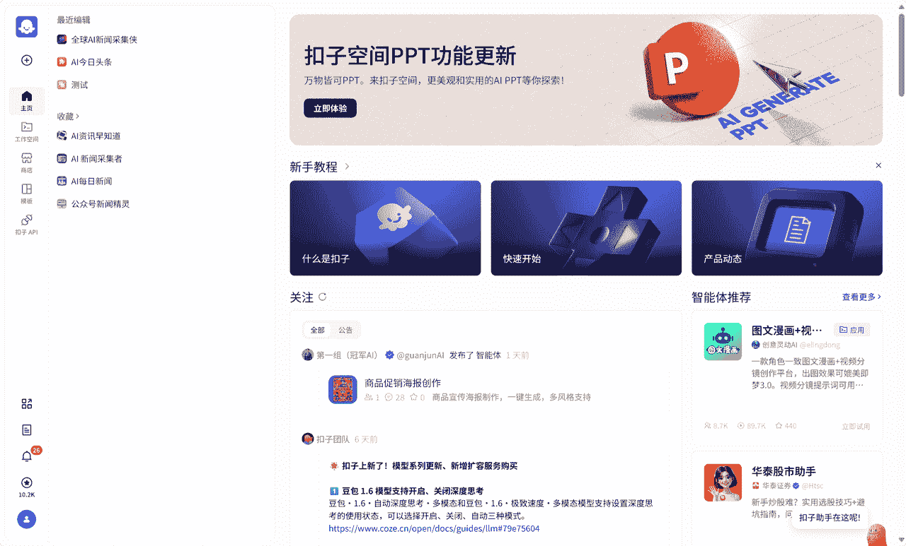
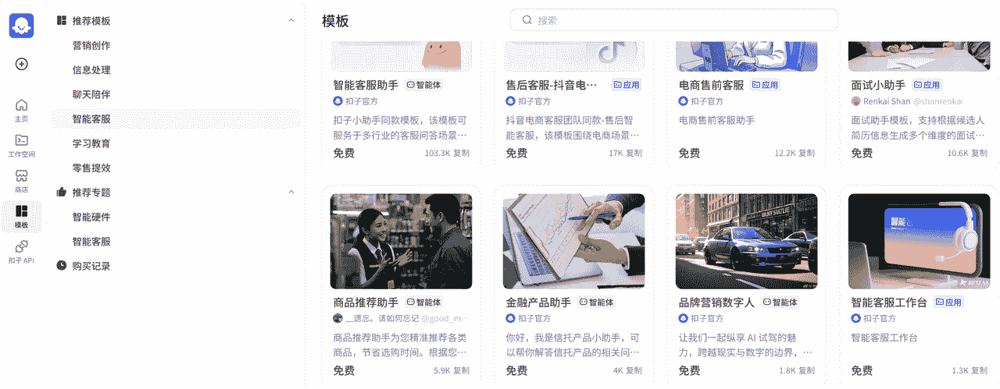
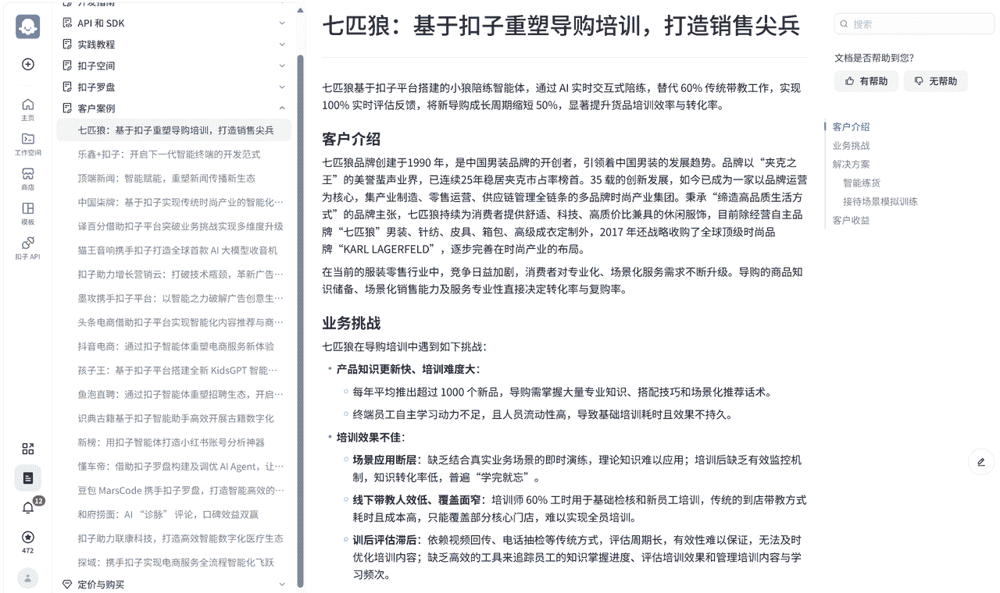

# Coze

> 来源：[https://gotoaiworld.feishu.cn/docx/SM9BdYd2AozEmLxZWBScg9BZn7g](https://gotoaiworld.feishu.cn/docx/SM9BdYd2AozEmLxZWBScg9BZn7g)

# 什么是Coze

> Coze 是字节跳动推出的一站式 AI 智能体开发平台，旨在降低 AI 应用开发门槛，让开发者（无论是技术人员还是非技术人员）能快速构建、调试和部署具备复杂能力的 AI Agent 智能体。其核心定位是 “零代码 / 低代码的智能体创作工具”，通过可视化界面、模块化组件和丰富的生态资源，实现从 “创意构思” 到 “多平台落地” 的全流程简化。

## 1.核心特性：让智能体开发更高效

1.  零代码 / 低代码开发模式
无需深入掌握大模型底层技术，通过拖拽式操作、模板化配置即可完成智能体搭建。例如：

+   用 “提示词” 定义智能体人设与目标（如 “专业的健身教练，擅长制定减脂计划”）；

+   通过可视化界面添加插件（如天气查询、知识库检索、API 调用）扩展功能；

+   用 “工作流” 串联任务逻辑（如 “用户问天气→调用天气插件→结合健身知识推荐运动时间”）。

1.  强大的多模型支持
内置字节跳动自研大模型（如豆包系列），同时兼容第三方主流模型（如 OpenAI 的 GPT 系列、阿里通义千问、智谱 GLM 等），开发者可根据场景选择模型：

+   轻量化任务用小模型提升响应速度（如客服自动回复）；

+   复杂推理任务用大模型保证效果（如法律条款解读）。

1.  丰富的插件生态与工具链
提供海量官方与社区插件，覆盖各类能力：

+   基础工具：文本处理（翻译、摘要）、数据查询（数据库连接、Excel 解析）；

+   场景化插件：电商商品查询、新闻资讯聚合、代码生成、图像理解；

+   自定义插件：支持开发者通过 API 接入私有服务（如企业内部系统、定制化数据接口）。

1.  可视化工作流编排
核心功能 “Flow 工作流” 允许用户用图形化方式设计智能体的任务逻辑，解决复杂场景下的多步骤协作：

+   例如 “旅游规划智能体” 的工作流可设计为：
接收用户需求→调用地图插件获取目的地→调用天气插件查询未来 7 天天气→调用酒店 API 推荐住宿→整合信息生成行程。

+   支持条件判断、循环执行、变量传递等高级逻辑，满足企业级场景需求。

1.  多平台一键发布
开发完成的智能体可直接发布至字节系生态（如抖音、飞书、今日头条）及外部平台（如🛰️、Discord、网页应用），无需额外适配：

+   例如：将 “企业知识库问答智能体” 发布到飞书，员工可直接在办公软件中提问；将 “穿搭推荐智能体” 发布到抖音，通过私信互动提供服务。

## 2.技术架构：轻量化与扩展性平衡

+   前端：基于现代 Web 技术构建，提供直观的可视化编辑器，支持实时预览智能体效果。

+   后端：采用云原生架构，支持自动扩缩容，应对高并发请求；通过 API 网关统一管理模型调用、插件交互。

+   数据层：内置向量数据库（用于知识库检索）、缓存系统（加速高频请求），同时支持对接外部数据库（如 MySQL、MongoDB）。

## 3.适用场景：从个人工具到企业解决方案

+   个人与中小团队：快速搭建轻量化智能体，如：

+   个人助理（日程管理、信息汇总）；

+   自媒体辅助工具（文案生成、视频脚本创作）；

+   垂直领域问答（考研资料查询、宠物养护咨询）。

+   企业级应用：通过定制化开发满足业务需求，如：

+   智能客服（对接企业知识库，自动解答产品问题）；

+   内部效率工具（合同审核、报销流程自动化）；

+   多部门协作智能体（如 “市场部门的竞品分析智能体”，自动调用销售数据、行业报告生成分析）。

## 4.与同类平台的差异

相比 LangChain、AutoGPT 等开发框架，Coze 的核心优势在于 “低门槛” 与 “生态整合”：

+   无需编写代码，非技术人员也能参与开发；

+   深度集成字节系产品，适合在抖音、飞书等生态内落地；

+   提供完整的 “开发 - 测试 - 发布 - 监控” 闭环工具，降低运维成本。

Coze 的本质是 “让 AI 智能体的能力普惠化”—— 无论是开发者快速验证想法，还是企业低成本落地 AI 应用，都能通过其可视化工具链高效实现。随着插件生态的完善与模型能力的升级，Coze 正成为连接 “大模型技术” 与 “实际业务场景” 的核心桥梁。

# 一、Coze 平台与 AI Agent 基础入门

## 1.1 认识 Coze 平台

+   Coze 平台概述：介绍字节跳动推出的 Coze 一站式 AI 应用开发平台的定位，强调其零代码或低代码开发特性，以及面向个人开发者、企业和 AI 爱好者的服务对象。阐述其致力于降低 AI 开发门槛，让用户能快速创建、调试和部署各类 AI 智能体的目标。

+   Coze 平台的优势：分析无代码开发带来的便捷性，通过拖拽式操作和模板化配置，即使无编程基础的用户也能进行功能设计。讲解多模态能力如何集成文本、图像、API 调用等数据处理方式，以满足复杂场景的智能化需求。说明跨平台发布能力，可将创建的智能体发布至🛰️、抖音、飞书、Discord 等社交平台或企业内部系统，拓展应用范围。

+   Coze 平台界面导航：以图文并茂的方式，详细展示 Coze 平台的主界面布局，包括各个主要板块（如智能体创建入口、编排区域、知识配置等）的位置和功能介绍，帮助用户快速熟悉平台操作环境。

## 1.2 理解 AI Agent

+   AI Agent 的定义与本质：解释 AI Agent 是有能力主动思考和行动的智能体，能够像人类一样工作，通过大模型理解用户需求、规划达成目标的步骤、使用各种工具完成任务并执行。强调其与传统人工智能的区别，突出其具备独立思考、调用工具逐步完成给定目标的能力，本质是使用 AI 控制各类工具解决问题的代理系统。

+   AI Agent 的核心能力：分析 AI Agent 的核心能力，如语义理解能力，如何准确理解用户输入的自然语言含义；任务规划能力，怎样根据目标制定合理的执行步骤；工具使用能力，介绍调用各种插件、API 等工具完成任务的方式；以及行动执行能力，阐述如何将规划好的任务付诸实践。

+   AI Agent 在不同场景的应用案例：列举智能客服、虚拟助手、个人助理、英语外教等典型应用场景，详细描述在每个场景中 AI Agent 的具体工作方式和发挥的作用，让读者对 AI Agent 的实际应用有更直观的认识。

# 二、Coze 平台开发环境搭建与准备

## 2.1 注册与登录 Coze 平台

+   注册流程：分步展示在 Coze 平台进行注册的详细步骤，包括打开注册页面的方式、填写注册信息（如用户名、密码、邮箱等）的要求，以及可能遇到的问题及解决方法。

+   登录操作：介绍登录 Coze 平台的多种方式（如账号密码登录、第三方账号登录等），提醒用户注意登录后的安全设置，如密码修改、二次验证等。

+   首次登录后的设置：说明首次登录后平台的引导流程，如选择语言偏好、设置个人资料等，帮助用户完成初始设置，更好地使用平台。

## 2.2 熟悉平台基础功能

+   智能体创建入口：明确指出在 Coze 平台中创建智能体的入口位置，介绍不同创建方式（如从空白创建、使用模板创建等）的特点和适用场景。

+   编排区域介绍：详细讲解编排区域的各个部分，如模型选择模块，介绍平台支持的不同大模型（如字节自己的大模型、阿里的通义千问、智谱 GLM 等）及其特点，说明如何根据任务需求选择合适的模型；技能设定部分，讲解如何添加、配置和管理插件来扩展智能体的能力；知识设定区域，介绍如何上传、整理和利用知识文档，使智能体具备特定领域的知识；对话体验设置模块，说明如何调整对话风格（如正式、轻松、幽默等）、专业程度（入门、进阶、专家级）以及多模态交互设置（文本、图片、语音等）。

+   预览与调试窗口使用：介绍预览与调试窗口的功能，如何在该窗口中输入测试问题，观察智能体的回答和行为，以及如何利用调试工具（如查看日志、分析错误信息等）排查和解决智能体运行过程中出现的问题。

## 2.3 准备开发所需资源

+   确定智能体目标与功能：引导用户思考和明确要开发的智能体的目标和功能，例如是用于客户服务、内容创作、效率提升还是其他领域，以及具体要实现哪些任务（如回答特定问题、生成特定格式的文档等）。

+   收集相关知识与数据：讲解根据智能体的目标和功能，如何收集相关的知识文档（如行业报告、操作手册、常见问题解答等）和数据（如结构化数据、图片等），以及对这些资源进行预处理（如格式转换、数据清洗等）的方法和重要性。

+   申请必要的 API 权限（若有）：如果智能体需要调用第三方 API 来实现某些功能，说明如何申请相关 API 权限，包括查找 API 提供商、了解申请流程和要求、提交申请以及处理申请结果等环节。

# 三、AI Agent 核心开发流程

## 3.1 设计智能体人设与回复逻辑

+   人设构建的重要性：强调人设是智能体给用户的第一印象，会直接影响用户对智能体的认知和使用体验，详细阐述如何通过人设构建使智能体具有独特的个性和专业形象。

+   回复逻辑设计原则：讲解回复逻辑设计应遵循的原则，如准确性，确保回答基于正确的知识和理解；完整性，全面回答用户问题；相关性，回答与用户问题紧密相关；以及友好性，使用亲切、易懂的语言。

+   编写提示词技巧：介绍提示词的作用，它是引导大模型生成准确回复的关键。详细讲解编写提示词的技巧，包括清晰明确地表达需求、合理使用关键词、设置条件和限制等。以具体案例展示如何根据智能体的人设和功能编写有效的提示词，如 “你是一位专业的健身教练，为用户提供个性化的健身计划建议。当用户询问减肥方案时，根据用户的身体状况（假设用户会提供身高、体重、体脂率等信息）和运动目标，制定详细的每周健身计划，包括有氧运动、力量训练的项目、强度和时间安排。注意要考虑用户的运动基础和可能遇到的问题，并提供相应的建议。”

+   使用 AI 优化提示词：介绍 Coze 平台提供的 AI 优化提示词功能，说明如何利用该功能对编写好的提示词进行优化，包括操作步骤和对优化结果的分析与调整，以达到更理想的效果。

## 3.2 配置智能体技能 - 插件使用

+   插件系统概述：介绍 Coze 平台的插件系统，说明插件是为智能体提供额外能力的小型模块，平台集成了丰富的插件，涵盖资讯阅读、旅游出行、效率办公、图片理解等诸多领域的 API 及多模态模型。

+   手动添加插件：详细讲解手动添加插件的步骤，包括点击添加选项右侧的插件按钮，在弹出的界面中如何根据智能体的功能需求选择合适的插件，如为一个医学资料查询智能体添加医学查询插件。

+   AI 自动添加插件：介绍如何使用 AI 自动添加插件功能，说明其操作方法和优势，即用户只需点击 “根据提示词自动添加工具”，平台会根据智能体的提示词自动添加可能需要的插件，然后用户可对自动添加的插件进行检查和调整。

+   自定义插件开发（进阶）：对于有更高需求的用户，介绍自定义插件开发的方法，包括创建自定义插件的入口、添加工具（API）的步骤、设置插件参数和权限等内容。讲解如何在自定义插件中编写代码实现特定的业务逻辑，以及如何测试和调试自定义插件，确保其能正常工作并与智能体的其他部分协同运行。

## 3.3 构建智能体工作流

+   工作流的概念与作用：解释工作流是智能体的工作流程，用于指定智能体按照预定的逻辑执行任务。强调工作流是构建智能体的核心，如果没有合理的工作流，智能体可能无法有效地完成复杂任务，与普通的大模型交互并无区别。

+   工作流核心节点介绍：详细介绍工作流的核心节点，包括开始节点，它是工作流的起始点，包含用户输入信息；结束节点，用于返回工作流的运行结果；大模型节点，是实现各种功能的核心，能够分析用户语义、提取关键字，并利用大模型的能力生成回复或执行任务；意图识别节点，专注于分析和判断用户输入内容的意图，引导工作流进入相应的处理分支；数据库节点，用于执行与数据库相关的操作，如增加、删除、检索数据等。以具体案例展示每个节点在工作流中的作用和相互之间的协作关系。

+   工作流变量与数据传递：讲解变量在工作流中的作用，变量是贯穿整个工作流的核心，用于存储和传递数据。介绍如何在工作流中设定变量、绑定变量以及在不同节点之间传递和使用变量，以实现数据的共享和处理。例如，在一个入职体检报告报表生成工作流中，变量可以用于存储用户上传的体检报告数据、分析结果以及生成报表所需的各种参数。

+   工作流的创建与编辑：分步展示在 Coze 平台中创建工作流的详细步骤，包括点击工作流选项右侧的添加工作流按钮，在弹出的界面中创建工作流并命名、添加描述（注意描述的作用和命名规范）。介绍进入工作流主界面后，如何通过拖拽式操作添加节点、连接节点以及配置节点参数，以构建符合任务需求的工作流逻辑。以具体的业务场景（如电商订单处理、内容创作流程等）为例，详细讲解工作流的创建和编辑过程，包括如何设置条件判断、分支处理和循环任务等复杂逻辑。

+   工作流的测试与优化：介绍如何对创建好的工作流进行测试，包括在预览与调试窗口中输入不同的测试数据，观察工作流的执行情况，检查每个节点的输出是否符合预期。讲解如何利用调试工具（如查看工作流执行日志、分析节点之间的数据传递）排查和解决工作流中出现的问题。同时，介绍如何根据测试结果对工作流进行优化，如调整节点顺序、优化参数设置、添加错误处理机制等，以提高工作流的效率和稳定性。

# 四、优化与调试 AI Agent

## 4.1 提升智能体性能

+   模型选择与调优：回顾模型选择对智能体性能的影响，介绍如何根据智能体的任务类型和数据特点进一步优化模型设置。例如，对于文本生成任务较重的智能体，可以调整模型的生成参数（如温度、top - k、top - p 等）来控制生成文本的多样性和准确性；对于需要处理大量数据的智能体，可以考虑选择具有更高计算资源和优化算法的模型部署方案。

+   提示词优化技巧进阶：深入讲解提示词优化的高级技巧，如使用结构化提示词，将复杂的任务分解为多个子任务，通过明确的指令引导大模型生成更符合要求的回复；利用上下文提示，在提示词中引入之前的对话历史或相关背景信息，帮助大模型更好地理解用户意图；以及采用示例驱动的提示词编写方法，通过提供具体的输入输出示例，让大模型学习任务的执行方式。

+   插件与工作流优化：分析插件的使用效率，讲解如何合理配置插件参数，避免不必要的插件调用，以提高智能体的响应速度。对于工作流，介绍如何进行流程简化和并行处理优化，如合并冗余节点、将可并行执行的任务设置为并行处理，减少工作流的执行时间。同时，讲解如何通过定期更新插件和工作流，以适应业务需求的变化和平台功能的升级。

## 4.2 处理智能体常见问题

+   模型幻觉问题解决：介绍模型幻觉的表现形式，即大模型生成看似合理但与事实不符的回答。分析模型幻觉产生的原因，如训练数据偏差、模型理解错误等。讲解针对模型幻觉问题的解决方法，如在提示词中明确限制回答范围、增加事实核查步骤（可以通过调用外部知识库或事实核查插件）、对生成的回答进行后处理（如使用文本分类模型判断回答的可信度）。

+   知识不足问题应对：当智能体遇到超出其知识范围的问题时，可能会给出不准确或无法回答的结果。讲解如何通过完善知识配置来解决知识不足问题，包括定期更新和扩充知识库，确保知识库涵盖智能体可能遇到的各种问题；利用知识图谱技术，构建知识之间的关联，提高智能体对知识的理解和应用能力；以及设置合理的兜底回答策略，当智能体无法回答问题时，给出友好的提示和引导，如 “关于这个问题，我暂时没有足够的信息，但我可以为您提供相关的搜索建议……”

+   对话逻辑不连贯问题修复：对话逻辑不连贯会影响用户体验，导致智能体与用户的交互不顺畅。分析对话逻辑不连贯的原因，如上下文理解错误、回复策略不当等。讲解修复对话逻辑不连贯问题的方法，如优化对话引擎的上下文管理机制，确保智能体能准确理解多轮对话中的上下文信息；制定合理的回复策略，根据用户的问题类型和对话历史，选择合适的回答方式和内容，保持对话的连贯性和流畅性；以及通过人工测试和用户反馈，及时发现和纠正对话逻辑中的问题。

## 4.3 调试工具与方法

+   平台内置调试工具使用：详细介绍 Coze 平台提供的内置调试工具，如日志查看功能，讲解如何查看智能体运行过程中的日志信息，包括请求日志、响应日志、工作流执行日志等，通过分析日志来排查问题的根源；错误提示与分析工具，说明如何解读平台给出的错误提示信息，了解错误发生的位置和原因，并根据提示进行相应的修复；以及可视化调试界面，介绍如何利用可视化界面直观地查看工作流的执行状态、节点之间的数据传递和处理过程，方便用户发现和解决工作流中的问题。

+   手动测试与案例分析：强调手动测试的重要性，介绍如何设计全面的测试用例，包括正常情况测试（输入符合预期的问题，检查智能体的回答是否正确）、边界情况测试（输入边界值或特殊情况的问题，如最大长度的文本、空值等，检查智能体的处理能力）和异常情况测试（输入错误或不合理的问题，检查智能体的错误处理机制是否有效）。通过具体的案例分析，展示如何通过手动测试发现智能体存在的问题，并利用调试工具进行定位和解决。

+   利用用户反馈进行优化：讲解如何收集用户反馈，如在智能体应用中设置反馈渠道（如反馈按钮、邮箱等），鼓励用户报告遇到的问题和提出改进建议。介绍如何对用户反馈进行整理和分析，将用户反馈转化为具体的优化任务，如修复用户遇到的错误、改进智能体的回答质量、优化用户界面等，以不断提升智能体的性能和用户体验。

# 五、发布与部署 AI Agent

## 5.1 发布智能体至不同平台

+   发布流程概述：介绍将开发好的 AI Agent 发布到不同平台的一般流程，包括在 Coze 平台中进行发布设置的入口和操作步骤，如填写发布记录（记录发布的版本号、发布时间、主要变更内容等信息）。

+   社交平台发布：详细讲解将智能体发布到🛰️、抖音、Discord 等社交平台的具体方法和注意事项。例如，在🛰️平台发布，需要说明如何申请🛰️小程序或👸号的相关权限，如何将智能体与🛰️平台进行对接，以及如何配置智能体在🛰️中的展示界面和交互方式；在抖音平台发布，介绍如何利用抖音开放平台的接口，将智能体集成到抖音应用中，以及如何根据抖音的用户特点和平台规则，优化智能体的功能和展示效果；在 Discord 平台发布，讲解如何创建 Discord 机器人，将智能体部署到 Discord 服务器上，并设置机器人的权限和功能，以适应 Discord 社区的使用场景。

+   企业内部系统集成：对于企业用户，介绍如何将智能体集成到企业内部系统（如飞书、企业🛰️、内部办公软件等）中。讲解与企业内部系统集成的技术方案和流程，包括如何与企业现有的数据接口进行对接，实现智能体对企业内部数据的访问和使用；如何根据企业的业务流程和安全要求，对智能体进行定制化开发和部署，确保智能体能无缝融入企业的工作环境，为企业员工提供高效的服务。

## 5.2 部署与运维考虑

+   部署方案选择：根据智能体的使用场景和性能需求，介绍不同的部署方案，如云端部署、本地部署和混合部署。分析每种部署方案的优缺点，云端部署具有便捷性、可扩展性强的优点，但可能存在数据安全和网络依赖问题；本地部署能更好地保障数据安全和隐私，但需要企业具备一定的硬件和技术维护能力；混合部署则结合了两者的优势，可以根据具体业务需求进行灵活配置。讲解如何根据企业或个人的实际情况选择合适的部署方案，如企业规模、数据敏感程度、预算等因素对部署方案选择的影响。

+   运维管理要点：介绍智能体部署后的运维管理要点，包括服务器监控，讲解如何监控服务器的性能指标（如 CPU 使用率、内存占用、网络带宽等），及时发现和解决服务器资源不足的问题；模型更新与维护，说明如何定期更新智能体所使用的大模型，以获取更好的性能和功能，以及如何对模型进行微调，使其更适应特定的业务场景；数据备份与恢复，强调数据备份的重要性，介绍如何制定数据备份策略，定期备份智能体的知识库、用户数据和运行日志等重要数据，并讲解在数据丢失或损坏时如何进行恢复操作，以保障智能体的正常运行和数据安全。

+   性能监控与优化：讲解如何对智能体的性能进行监控，包括响应时间监控，通过设置监控指标和阈值，实时监测智能体对用户请求的响应时间，当响应时间过长时及时进行优化；吞吐量监控，了解智能体在单位时间内

# 六、Coze 教程

## 6.1 Coze使用指南

https://www.coze.cn/open/docs/guides

<https://www.coze.cn/open/docs/guides>

## 6.2 Coze API

https://www.coze.cn/open/playground

<https://www.coze.cn/open/playground>

## 6.3 Coze 模板

https://www.coze.cn/template

<https://www.coze.cn/template>

# 七、Coze 相关Blog

## 5.1 发布智能体至不同平台

# 八、Coze 模板

## 1.Coze 官方智能体模板

1.  营销创作

1.  信息处理聊天陪伴

1.  智能客服

1.  学习教育

1.  零售提效

1.  智能客服

# 九、Coze 多场景应用案例

## 1、生活场景：贴心的智能生活管家

（一）旅行规划助手

（二）家庭生活助手

## 2、工作场景：高效的企业赋能工具

（一）智能客服系统

（二）自动化办公助手

## 3、学习场景：智能的学习伙伴

（一）学科知识辅导

（二）语言学习助手

## 4、教育场景：创新教学与学习模式

（一）个性化在线教育平台

（二）职业技能培训助手

## 5、医疗场景：辅助医疗服务与管理

（一）智能问诊助手

（二）医院管理优化系统

## 6、金融场景：智能金融服务与风险防控

（一）智能理财顾问

（二）金融风险防控系统

## 7、物流场景：智能调度与高效配送

（一）智能物流调度系统

（二）快递末端服务助手

## 8、文娱场景：创意生成与个性化推荐

（一）影视剧本创作助手

（二）个性化音乐推荐平台

## 9、农业场景：精准种植与智能养殖

（一）智慧农业种植管理系统

（二）智能养殖监控助手

## 10、能源场景：智能调控与节能增效

（一）智能电网调度系统

（二）企业能源管理助手

## 11、环保场景：监测预警与生态保护

（一）环境质量监测平台

（二）生态保护智能助手

## 12、政务场景：便民服务与智慧治理

（一）政务智能客服

（二）城市治理决策支持系统

## 13、智能制造场景：柔性生产与质量管控

（一）智能生产调度系统

（二）产品质量检测助手

## 14、智能家居场景：万物互联与场景联动

（一）全屋智能控制中枢

（二）家庭能源管理管家

## 15、社区服务场景：高效管理与居民互动

（一）社区智能服务平台

（二）社区安全预警系统

# 十、COZE 技术社区详细解析

https://ai-jieshuo.blog.csdn.net/?type=blogColumn

https://blog.csdn.net/fanlf/category_268501.html

## 1、COZE 基础理论

https://blog.csdn.net/fanlf/category_12976903.html

## 2、COZE 实操进阶

https://blog.csdn.net/fanlf/category_12977047.html

## 3、COZE 爆款拆解

https://blog.csdn.net/fanlf/category_12978306.html

## 4、COZE 高效办公

https://blog.csdn.net/fanlf/category_268504.html

## 5.Coze 爆款应用赚钱

https://blog.csdn.net/ai979290?type=blog

## 6.2025年Coze搞钱方向

https://blog.csdn.net/ai979290/article/details/147529349?spm=1001.2014.3001.5502

https://blog.csdn.net/andy_68147772?type=blog

https://blog.csdn.net/andy_68147772?type=blog

## 7.Coze 智能体分类

一、企业服务与自动化

智能供应链调度系统

某汽车零部件企业通过多智能体协同实现供应链全流程自动化，覆盖需求预测、产能评估、动态签约等环节，库存周转率提升至 8.2 次 / 年，缺货率降至 0.3%。

分布式临床路径优化

三甲医院应用动态优化临床路径，结合跨领域知识图谱实现个性化诊疗方案调整，平均住院天数缩短 1.8 天，医疗差错率下降 62%。

金融风控审核系统

搭建超 200 节点风控规则工作流，结合区块链存证技术，审核时效由数小时缩减至 90 秒，风险识别准确率提升 40%。

电商订单自动化处理

某跨境电商通过库存、物流、支付智能体协同，异常率下降 58%，单日管理 100 + 账号，人均产能提升 20 倍。

电子发票智能处理

自动提取发票关键信息并写入飞书多维表格，识别效率提升 300%，数据录入错误率趋近于零。

二、内容创作与营销

养生图文批量生成器

输入 “春季养肝” 等关键词，3 分钟生成 100 篇含中医理论与现代健康研究的养生图文，同步生成水墨风格配图，适配📕等平台。

📕爆款图文改写

自动提取笔记图文内容，通过 OCR 识别、文案整理、仿写扩展等流程，实现 10 倍效率提升，单月涨粉超 5 万。

数字人带货视频生成

输入主题自动生成口播文案、虚拟人视频并同步至抖音，某美妆店转化率提升 30%，程序员副业月入 8000+。

行业深度调研报告生成

一键生成含数据图表、趋势分析的行业报告，支持飞书多维表格数据聚合，某零售企业分析耗时从 2 小时压缩至 5 分钟。

热点监控与内容分发

定时采集抖音热门视频数据，结合飞书多维表格实现热点追踪，创作者可快速获取赛道趋势并生成内容，爆款率稳定 15%+。

三、生活服务与工具

每日穿搭智能助手

结合城市天气、黄历、个人特征推荐穿搭方案，同步提供运势解读与一周天气预报，生成穿搭效果图。

旅行规划全流程管理

调用高德地图 API 生成 3 天南京行程，包含景点路线、交通建议、天气预警及餐厅推荐，自动生成在线网页版攻略。

电子记账与财务分析

自动记录每日开销并生成可视化报表，结合 AI 预测功能提供月度预算建议，某 MCN 机构人工成本降低 92%。

裸眼 3D 书籍视频生成

输入书名生成名著场景 3D 动画、动态视频及解说字幕，完播率较普通图文高 40%，单条制作成本降至 200 元内。

多平台账号矩阵管理

某 MCN 机构通过工作流实现 100 + 账号内容自动分发、健康度监控，7 天起号成功率从 12% 提升至 68%，单账号月均涨粉 5.8 万。

四、教育与医疗

高考志愿填报顾问

基于考生成绩、兴趣等数据推荐院校专业，结合招生政策动态调整方案，某培训机构咨询转化率提升 50%。

患者随访智能系统

医院部署内网私有化智能体，自动调用 HIS 系统数据进行出院患者随访，随访率从 40% 提升至 95%，符合医疗数据安全规范。

文献检索与分析助手

研究生用其自动检索 CNKI、IEEE 等数据库，生成文献摘要并按引用率排序，文献收集效率提升 3 倍。

心理健康评估工具

设计包含 10 个题目的心理测试程序，结合海贼王角色模型输出性格分析报告，某心理诊所咨询量增长 30%。

英语外教口语训练

模拟真实语境进行对话练习，支持语法纠正与发音评分，某在线教育平台完课率提升 25%。

五、技术工具与创新应用

联网版 DeepSeek R1 智能体

结合必应搜索实现实时信息获取，响应速度提升 200%，可准确回答 “2025 年最新科技趋势” 等时效性问题。

网页开发与游戏设计

自动生成颜色选择器、2048 游戏等工具，某开发者用其快速搭建包含心理测试、旅行规划功能的综合应用，用户留存率超 60%。

AI 代码生成与优化

开发者通过可视化工作流调用代码生成插件，实现 API 接口、数据库操作等模块自动化开发，开发周期缩短 60%。

图像风格转换与处理

上传照片后通过参数调节生成艺术效果作品，某设计工作室用其实现电商广告图批量处理，设计成本降低 70%。

跨平台数据整合分析

连接 Shopify、金蝶 ERP 等系统，自动完成订单创建、库存扣减、财务记账全流程，某跨境电商人工干预减少 80%。

六、垂直行业解决方案

装修设计智能助手

输入户型图自动生成 3D 设计方案，某装修公司用其实现从需求分析到效果图输出的全流程自动化，客户满意度提升 35%。

制造业设备预测性维护

实时监控设备运行数据，结合强化学习模型预测故障风险，某工厂异常停机时间减少 76%，设备利用率提升 28%。

法律咨询与合同审查

上传合同自动识别风险条款，某律所审查效率提升 90%，风险识别准确率达 95%，支持中英文双语处理。

保险理赔智能处理

自动解析医疗单据并计算赔付金额，某保险公司理赔时效从 5 天缩短至 8 小时，客户投诉率下降 50%。

舆情监控与响应系统

实时抓取社交媒体关键词，自动生成舆情分析报告并触发响应机制，某品牌负面舆情处理时间缩短至 5 分钟内。

七、生活与娱乐应用

书单视频一键生成

输入书名自动生成包含 3D 场景图、动态视频、解说字幕的素材包，某读书博主用其实现日更 10 + 条，完播率提升 3 倍。

旅行 Vlog 自动剪辑

整合行程数据、照片视频生成带字幕与背景音乐的旅行记录，某自媒体用其实现 “素材导入 - 成片发布” 全流程自动化。

心理测试与性格分析

设计海贼王主题心理测试程序，结合用户回答生成个性化性格报告，某心理👸号粉丝互动率提升 40%。

热点监控与内容分发

定时采集抖音热门视频数据，结合飞书多维表格实现热点追踪，创作者可快速获取赛道趋势并生成内容，爆款率稳定 15%+。

宠物健康管理助手

记录宠物饮食、运动数据，结合 AI 模型提供健康建议，某宠物品牌用其提升用户粘性，复购率增长 25%。

八、教育与培训

作业辅导智能助手

自动解析数学、物理等学科题目，提供分步解答与知识点关联，某教育机构用其实现课后服务成本降低 60%。

个性化学习路径规划

基于学生知识点掌握情况生成定制化学习计划，某培训机构完课率提升 30%，考试通过率增长 20%。

虚拟实验教学系统

模拟化学、生物等学科实验操作，学生可在线完成实验并生成报告，某高校实验室使用效率提升 40%。

教师备课资源生成

输入课程主题自动生成教案、PPT 模板与教学视频，某学校教师备课时间缩短 50%，教学质量评估优秀率提升 25%。

职业规划智能顾问

结合用户职业经历、技能水平提供发展建议，某求职平台用其提升用户留存率 15%，简历投递成功率增长 30%。

九、医疗健康

用药提醒与健康管理

自动同步电子病历数据，提供用药时间、剂量提醒及健康指标监测，某社区医院患者依从性提升 50%。

慢性病远程监测

实时采集血压、血糖等数据，结合 AI 模型预警异常值，某三甲医院远程诊疗效率提升 300%，患者住院次数减少 20%。

智能导诊系统

通过症状输入生成初步诊断建议并推荐科室，某医院门诊排队时间缩短 40%，患者满意度提升 35%。

康复训练指导助手

基于患者康复计划生成动作指导视频，某康复中心患者训练效果提升 25%，治疗周期缩短 15%。

心理健康咨询机器人

提供情绪疏导、压力管理等服务，某心理诊所咨询量增长 30%，用户满意度达 92%。

十、前沿创新应用

元宇宙空间交互智能体

某文旅项目开发虚拟导游智能体，支持多模态交互与场景化叙事，游客停留时间延长 40%，二次消费率增长 25%。

量子计算任务调度

结合强化学习算法优化量子计算资源分配，某科研机构任务执行效率提升 50%，能耗降低 30%。

气候变化模拟分析

整合卫星数据与气候模型生成可视化报告，某环保组织用其推动政策制定，公众环保意识提升 30%。

智能合约自动审计

自动检测区块链智能合约漏洞，某金融机构风险识别准确率提升 90%，审计成本降低 70%。

自动驾驶路径优化

结合实时路况与交通预测生成最优路线，某物流公司运输效率提升 20%，燃油消耗降低 15%。

扩展查找建议

官方资源

登录Coze 官网进入模板中心，可查看智能客服、数据分析等 100 + 官方模板

访问火山引擎开发者社区获取企业级解决方案案例

行业报告

搜索《智能制造白皮书》《AI 医疗应用指南》等行业文档，获取垂直领域深度案例

技术社区

CSDN、掘金等平台搜索 “Coze 实战”，开发者分享的装修设计、金融风控等细分场景案例

社交媒体

关注 Twitter 话题 #CozeAgent、🛰️👸号 “扣子实验室”，获取最新应用动态

## 8.扣子Coze AI工作流实战

https://blog.csdn.net/andy_68147772/category_12635647.html

# 十二、Coze 企业应用场景分析

## 1.中小微企业

不定期更新

### 1.1 茶叶销售

#### 一、智能客服与知识服务

1.  茶文化百科智能体
基于 Coze 的知识库节点，整合 8000 万 + 茶叶专业知识，开发 24 小时在线的 “AI 茶博士”。用户可通过自然语言查询：

+   茶叶百科：如英德红茶的历史典故、六堡茶的制作工艺3

+   冲泡指南：针对不同茶类（如普洱、龙井）的水温、投茶量建议

+   健康功效：结合用户体质（如湿气重、易失眠）推荐茶饮方案
可嵌入👸号菜单栏或官网聊天窗口，参考英德红茶 “红红” 智能体的实现方式2，支持语音问答和方言识别，覆盖老年用户群体。

1.  售后智能助手
搭建订单处理工作流：

+   物流查询：通过 API 对接快递公司，用户输入单号即可获取实时物流信息

+   退换货指引：自动判断是否符合退换条件，生成标准化处理流程

+   客诉分析：通过 NLP 分析用户反馈，自动归类常见问题（如包装破损、口感不符），生成改进报告

#### 二、内容创作与营销裂变

1.  短视频批量生成系统
采用类似 “爆款小茶悟混剪视频” 的工作流，实现：

+   智能脚本生成：输入茶品名称（如 “金骏眉”），自动生成包含历史故事、冲泡演示、品饮场景的短视频脚本

+   素材库管理：支持上传企业自有素材（如茶园实拍、茶艺表演），与 AI 生成内容混合剪辑

+   多平台分发：根据抖音、视频号等平台特点，自动调整画幅比例和字幕样式

1.  社交媒体内容工厂
开发 “📕爆款生成器”：

+   选题挖掘：实时抓取平台热词（如 “办公室茶饮”“熬夜护肝茶”），生成选题库

+   图文创作：基于用户输入的茶品信息，自动生成带 emoji 的种草文案和排版模板

+   互动活动设计：支持 “暗号点单”“茶友穿搭挑战赛” 等互动玩法，提升 UGC 内容产出

1.  朋友圈营销神器
参考 “朋友圈社牛神器” 模板，实现：

+   情绪化文案生成：根据用户输入的心情（如 “疲惫”“庆祝”），推荐茶品并生成对应文案

+   动态配图：调用 DALL・E 等 AI 绘图工具，生成与文案匹配的国风插画或产品实拍图

+   定时推送：支持预设发布时间，适配不同目标用户的活跃时段

#### 三、个性化推荐与销售转化

1.  AI 茶饮顾问
构建 “饮茶需求诊断” 工作流：

+   多轮对话采集：通过 5-8 个问题（如 “您平时偏好哪种口感？”“是否有特殊健康需求？”）建立用户画像

+   动态推荐模型：结合茶品知识库（如龙井的清爽、熟普的醇厚）和库存数据，生成 3-5 款推荐方案

+   促销关联：自动叠加会员折扣、满减活动等信息，提升客单价

1.  场景化销售助手
开发 “饮茶场景解决方案”：

+   办公场景：推荐适合长时间久坐的茶饮（如菊花枸杞茶），并关联茶具（如保温杯）组合销售

+   礼品场景：根据预算和受赠对象（如商务伙伴、长辈），生成包含茶礼、包装、贺卡的一体化方案

+   节气营销：结合 24 节气生成应季茶饮建议（如 “芒种喝什么茶祛湿”），推送限时优惠

1.  私域流量转化引擎
集成至企业🛰️，实现：

+   用户分层运营：根据购买频次、客单价等数据，自动推送差异化内容（如新茶上市通知、老客户专属折扣）

+   智能话术库：针对不同用户类型（如首次咨询、复购用户），提供标准化回复模板和应答策略

+   销售漏斗分析：通过工作流节点记录用户行为，生成转化率漏斗图，指导运营策略优化

#### 四、会员体系与用户粘性提升

1.  会员成长智能体
搭建 “积分 - 权益” 闭环系统：

+   积分自动累积：支持订单积分、签到积分、UGC 内容积分等多维度积分获取

+   权益动态推荐：根据用户积分等级，自动推送对应权益（如免费茶样、茶艺课程、线下品鉴会邀请）

+   积分消耗场景：支持积分兑换茶品、抵扣运费、参与抽奖等多种形式

1.  专属健康管理
开发 “饮茶健康档案”：

+   健康数据采集：对接智能手环等设备，获取用户睡眠、运动数据

+   饮茶建议生成：基于健康数据和饮茶习惯，生成个性化茶饮方案（如 “睡眠不足者建议饮用酸枣仁茶”）

+   健康报告推送：每月生成饮茶效果分析报告，增强用户长期使用粘性

1.  线下活动智能管家
结合 “全球万店” 模式，实现：

+   线下活动预约：支持茶艺体验课、茶园采摘等活动的在线报名和提醒

+   附近门店推荐：根据用户定位，推送最近门店的新品体验活动和专属优惠

+   线下数据反哺：通过线下消费数据补充用户画像，优化线上推荐模型

#### 五、内部管理与经销商赋能

1.  销售培训智能体
构建 “茶叶销售能力提升” 平台：

+   产品知识库：包含茶品故事、竞品分析、冲泡技巧等模块化内容

+   模拟销售场景：通过 AI 角色扮演，训练销售人员应对常见异议（如 “价格太高”“口感不适应”）

+   考核评估：自动生成测试题并分析薄弱环节，提供针对性学习路径

1.  经销商赋能工具
开发 “经销商运营中台”：

+   市场分析：抓取区域消费数据（如广东偏好单丛、北方偏好茉莉花茶），生成选品建议

+   营销素材库：提供可自定义的海报模板、话术库和活动方案，降低经销商内容制作成本

+   库存预警：实时监控经销商库存，自动触发补货提醒和促销建议

1.  供应链协同助手
对接 ERP 系统，实现：

+   订单自动处理：接收经销商订单后，自动分配库存、生成发货单并同步物流信息

+   生产预测：通过历史销售数据和市场趋势分析，预测未来 3 个月的原料采购量

+   异常预警：对库存低于安全线、订单延迟等情况自动发送通知，提升响应效率

#### 六、技术实现与安全保障

1.  低代码开发框架

+   模块化搭建：利用 Coze 的工作流节点（大模型、API 调用、变量聚合等），实现各功能模块的灵活组合

+   模板复用：将已验证的智能体（如智能客服、短视频生成）封装为模板，支持快速复制和个性化调整

+   多端部署：支持同时部署到👸号、小程序、官网、企业🛰️等多平台，实现统一管理

1.  数据安全体系

+   传输加密：采用 AES-256 加密用户对话数据，防止中间人攻击8

+   权限分级：设置不同角色（管理员、经销商、普通用户）的访问权限，敏感数据需二次验证

+   审计追踪：记录所有数据操作日志，满足等保 2.0 等合规要求

1.  智能运维监控

+   健康监测：实时监控智能体响应时间、错误率等指标，触发自动告警

+   容错机制：针对 API 调用失败、模型响应超时等情况，设计重试逻辑和备用方案

+   版本管理：支持多版本智能体并行运行，方便 A/B 测试和功能迭代

#### 七、典型落地案例参考

1.  英德红茶 AI 智能体 “红红”
功能：茶文化知识查询、选购建议、冲泡指导
技术实现：知识库节点 + 多轮对话流程 + 👸号菜单集成
成效：上线 3 个月用户咨询量增长 200%，带动相关茶品销量提升 35%

1.  茶颜悦色品宣智能体
功能：多平台内容生成、互动活动设计
技术实现：关键词抓取 + 文案模板库 + API 调用
成效：单条📕笔记最高获赞 1.2 万，带动新品上市首月销量破百万

1.  “黄小西” 文旅茶购一体智能体
功能：行程规划 + 茶品推荐 + 一键下单
技术实现：大模型对话 + 电商 API 对接 + 线下服务联动
成效：实现旅游路线推荐与茶品销售的闭环，客单价提升 40%

### 1.2 中医养生馆

#### 一、智能咨询与体质调理场景

##### 1. AI 体质辨识与调理建议智能体

+   核心功能：

+   通过多轮对话采集用户症状（如 “易疲劳、手脚冰凉、舌苔厚腻”）、生活习惯（作息、饮食、运动），结合中医体质理论（阴虚、阳虚、痰湿等 9 种体质）自动判断体质类型。

+   生成个性化调理方案：含食疗方（如痰湿体质推荐 “茯苓陈皮茶”）、穴位按摩（配经络图）、艾灸建议（频次、穴位）、生活习惯调整指南。

+   支持上传舌苔照片（调用图像识别插件）辅助辨识，提升准确率。

+   实现方式：

+   知识库整合《中医体质分类与判定》国家标准、经典食疗方、穴位图谱等权威内容。

+   工作流设计：用户输入→症状关键词提取→体质匹配→方案生成→图文 / 语音输出。

+   价值：降低人工咨询门槛，实现 24 小时在线初步体质评估，为到店调理提供前置参考，提升客户信任度。

##### 2. 养生问题智能问答助手（“中医小顾问”）

+   核心功能：

+   解答常见养生问题：如 “失眠喝什么茶”“冬季如何补肾”“湿气重怎么调理”，结合时令节气（如 “三伏天艾灸攻略”）动态更新内容。

+   提供穴位查询：用户输入身体不适部位（如 “肩颈酸痛”），输出对应穴位定位图、按摩手法视频（调用本地视频素材库）。

+   辟谣功能：针对 “天天喝枸杞会上火” 等误区，用中医理论科普正确认知。

+   实现方式：

+   接入中医典籍知识库（《黄帝内经》《本草纲目》精选内容），通过大模型节点优化口语化表达。

+   部署在养生馆👸号 / 小程序，支持语音提问（适配中老年人使用习惯）。

+   价值：减少技师重复解答基础问题的时间，让客户随时随地获取专业养生知识，增强品牌专业度。

#### 二、内容创作与引流传播场景

##### 3. 养生内容批量生成智能体（图文 / 短视频）

+   核心功能：

+   图文创作：输入主题（如 “秋季润燥养生”“女性宫寒调理”），自动生成📕 / 👸号风格图文：含核心观点（如 “3 个穴位改善宫寒”）、食疗方（配食材图提示词）、排版模板（古风边框、节气元素）。

+   短视频生成：一键制作 “穴位按摩教学”“食疗制作教程” 短视频：自动生成脚本（分镜如 “食材准备→制作步骤→功效讲解”）、AI 配音（可选 “温柔医师音”）、字幕生成，支持导出剪映草稿直接发布抖音 / 视频号。

+   热点结合：抓取节气、养生节日（如 “三伏天”“冬至”）自动生成应景内容，提升流量相关性。

+   实现方式：

+   工作流节点：主题输入→大模型生成文案→关键词提取→图像生成插件（文生图）→视频合成节点→多平台格式适配。

+   素材库预设中医元素模板（如艾灸图、经络动画、古风背景）。

+   价值：降低门店内容创作门槛，实现 “日更 3-5 条” 高频传播，吸引同城养生人群关注，引流到店。

##### 4. 养生社群互动智能体（朋友圈 / 社群运营）

+   核心功能：

+   每日推送 “养生小 Tip”：结合用户体质标签（如给阳虚体质推 “晨起生姜水”）、当日节气（如 “芒种祛湿食疗”），配短文案 + 表情包 / 小插图。

+   社群互动活动：发起 “7 天祛湿打卡”“穴位按摩挑战赛”，自动统计打卡数据，发放优惠券奖励。

+   客户提问秒回：社群内用户咨询 “艾灸后上火怎么办”，智能体实时调取知识库回复，提升社群活跃度。

+   实现方式：

+   对接企业🛰️ / 🛰️群机器人，通过定时任务节点触发内容推送。

+   结合用户标签体系（体质、消费记录）实现精准内容触达。

+   价值：替代人工维护社群，降低运营成本，通过高频互动增强客户粘性。

#### 三、客户服务与到店体验场景

##### 5. 智能预约与到店指引助手

+   核心功能：

+   支持在线预约服务：用户选择项目（艾灸、推拿、刮痧）、技师、时间，自动同步门店排班表（对接门店 ERP 系统），生成预约提醒（短信 + 👸号通知）。

+   到店前指引：发送门店定位、停车攻略、到店须知（如 “艾灸需提前 1 小时禁食”），支持 “一键导航” 跳转高德 / 百度地图。

+   服务后随访：24 小时后自动发送 “调理后注意事项”（如 “艾灸后忌冷水”），并收集服务评价（同步至技师考核表）。

+   实现方式：

+   工作流整合 “预约表单节点 + 日历插件 + 短信 API + 评价收集节点”，对接门店排班数据库。

+   异常处理：若预约时间冲突，自动推荐邻近时段或其他技师。

+   价值：优化预约流程，减少电话沟通成本，提升到店率（降低爽约率），规范服务后跟进动作。

##### 6. 客户健康档案管理智能体

+   核心功能：

+   自动记录客户到店消费记录：含调理项目、技师、症状改善反馈（如 “第 3 次艾灸后手脚冰凉减轻”）。

+   生成 “健康调理轨迹”：以时间轴展示体质变化、项目效果（如 “痰湿体质评分从 85 分降至 62 分”），配数据图表。

+   智能提醒复购：根据调理周期（如 “肩颈推拿建议每周 1 次”），提前 3 天推送预约提醒 + 优惠券。

+   实现方式：

+   对接门店 CRM 系统，通过变量聚合节点整合消费数据、体质数据、评价数据。

+   定期生成《客户健康报告》（每月 1 次），通过👸号 / 企业🛰️推送。

+   价值：实现 “一人一档” 精细化管理，让客户直观看到调理效果，提升复购率（参考案例：某养生馆应用后复购率提升 28%）。

#### 四、技师培训与服务标准化场景

##### 7. 技师知识库与培训智能体

+   核心功能：

+   内置 “中医技法知识库”：含艾灸操作规范（如 “足三里艾灸时长”）、常见症状处理（如 “客户晕灸应急措施”）、沟通话术（如 “如何解释调理后酸痛反应”）。

+   模拟考核：随机生成案例题（如 “客户主诉失眠 + 多梦，如何推荐项目？”），技师作答后智能体评分并解析标准答案。

+   新技师入门指南：推送 “7 天速成课程”（每日学习任务 + 视频教程），自动记录学习进度。

+   实现方式：

+   知识库按 “技法”“症状”“话术” 分类标签化，支持关键词快速检索。

+   对接飞书文档，培训资料实时同步更新。

+   价值：统一服务标准，缩短新技师上手周期，减少因专业度不足导致的客户投诉。

##### 8. 服务流程标准化智能体（到店服务指引）

+   核心功能：

+   技师移动端实时提示服务流程：接待客户时，智能体根据客户体质 / 预约项目推送 “服务 SOP”（如给痰湿体质客户推 “先祛湿茶→背部刮痧→艾灸关元穴” 流程）。

+   关键节点提醒：如 “艾灸第 15 分钟需查看皮肤状态”“服务结束前 5 分钟推荐居家巩固方案”。

+   客户禁忌预警：若客户有 “高血压”“孕妇” 等禁忌，服务前自动弹窗提醒技师规避禁忌项目。

+   实现方式：

+   工作流对接预约系统 + 客户档案，通过条件判断节点触发个性化流程指引。

+   技师 APP / 企业🛰️端实时推送消息。

+   价值：确保服务流程标准化，降低人为失误风险，提升客户体验一致性。

#### 五、营销转化与活动运营场景

##### 9. 个性化优惠推荐智能体

+   核心功能：

+   根据客户标签（如 “首次到店”“肩颈问题高频客户”“会员等级”）自动推送优惠：新客推 “99 元体验套餐”，老客推 “疗程卡买 3 送 1”，高价值客户推 “私人定制调理方案”。

+   节日营销：结合中秋、冬至等节点，生成 “节气养生套餐”（如 “冬至艾灸套餐 + 当归羊肉汤礼盒”），自动计算优惠价。

+   优惠券核销提醒：客户优惠券即将过期时，自动发送 “最后 3 天使用提醒”，附预约入口。

+   实现方式：

+   对接门店收银系统，实时获取客户消费数据生成标签。

+   通过 IF 判断节点匹配优惠规则，触发消息推送。

+   价值：精准触达高转化客户，提升优惠核销率，避免 “盲目发券” 导致的利润流失。

##### 10. 老客户裂变智能体（转介绍激励）

+   核心功能：

+   自动生成 “老带新海报”：老客户分享海报给好友，好友扫码到店消费后，老客户获积分 / 优惠券奖励。

+   裂变进度追踪：老客户可实时查看 “已成功推荐 3 人，再推 2 人得免费艾灸 1 次”。

+   口碑收集：服务后自动邀请老客户撰写评价，优质评价自动生成 “客户证言” 素材用于朋友圈传播。

+   实现方式：

+   工作流整合 “海报生成插件 + 分销规则节点 + 积分系统对接”。

+   客户评价通过情感分析插件筛选 “正面评价”，自动脱敏后复用。

+   价值：低成本激活老客户裂变，降低获客成本（参考案例：某养生馆老带新占比提升至 40%）。

#### 六、技术落地与数据安全

+   部署方式：核心智能体可嵌入👸号、小程序、企业🛰️，实现 “线上咨询 - 到店服务 - 售后跟进” 全链路打通。

+   数据安全：客户健康数据加密存储，符合《中医养生保健服务规范》数据合规要求，敏感信息（如病历）需权限分级访问。

+   迭代优化：通过 Coze 的数据分析工具，监控各智能体使用频率（如体质辨识次数、内容阅读量），持续优化知识库与流程节点。

### 1.3 服装销售，批发企业

#### 一、面向服装销售企业的核心应用场景

1.  **智能导购与个性化服务智能体**

核心功能：

+   全渠道实时咨询：解答客户关于尺码（如 “160cm/50kg 穿多大码”）、面料（如 “纯棉和聚酯纤维的区别”）、洗涤保养（如 “羊毛衫能否机洗”）、风格搭配（如 “通勤西装如何配内搭”）等高频问题，替代人工客服 80% 以上的基础咨询。

+   个性化推荐：基于客户历史购买记录（如偏好风格、常穿尺码、消费价位）、当前场景（如 “面试穿搭”“秋冬保暖”）或上传的穿搭照片，智能推荐适配的服装单品或整套搭配（例：“您上次买了黑色牛仔裤，推荐搭配这款修身针织衫，显腿长且适合秋季”）。

+   场景化穿搭工具：提供 “场景穿搭库”，用户输入场景（如 “婚礼当伴娘”“周末露营”），智能体生成穿搭方案并关联对应商品链接，支持一键加购。

价值：降低客服成本，提升客户购物体验，提高连带购买率（搭配推荐可提升 30% 以上客单价）。

1.  库**存与补货智能体**

核心功能：

+   实时库存同步与预警：对接企业 ERP 系统，实时更新线上线下库存数据，当某款服装库存低于阈值（如 “仅剩 5 件”）时，自动向店长 / 采购发送补货提醒，并附历史销售数据（如 “近 7 天该款连衣裙销量 15 件，建议补货 20 件”）。

+   需求预测与备货建议：基于季节（如 “秋季风衣备货周期”）、区域（如 “南方冬季薄款羽绒服需求更高”）、流行趋势（如 “今年流行美拉德色系，建议增加棕色系外套备货”），生成备货量预测，减少库存积压或断货风险。

+   滞销品清仓辅助：识别滞销单品（如 “连续 30 天销量＜5 件”），自动生成清仓方案（如 “搭配热销款做组合折扣”“定向推送给历史购买类似风格的客户”）。

价值：优化库存周转效率，降低滞销损失，提升资金利用率。

1.  **会员运营与精准营销智能体**

核心功能：

+   会员标签与分层管理：自动采集会员消费数据（购买频率、偏好品类、价格敏感度等），生成标签（如 “高频轻奢女装客”“学生党平价 T 恤爱好者”），实现会员分层。

+   个性化营销触达：针对不同分层会员推送精准内容：

+   对 “高频客户” 推送新品优先购、专属定制服务；

+   对 “沉睡客户” 推送召回优惠券（如 “您 3 个月未到店，专属 50 元无门槛券已到账”）；

+   对 “学生客群” 推送性价比套餐（如 “开学季 3 件 T 恤 99 元”）。

+   节日 / 场景营销策划：结合春节、情人节、开学季等节点，自动生成营销话术、活动规则（如 “情人节情侣装第二件半价”），并同步到社群、短信等渠道。

价值：提升会员复购率，降低营销成本，增强客户粘性。

1.  **产品设计与趋势分析智能体**

核心功能：

+   流行趋势监测：爬取社交媒体（📕、抖音）、时尚平台（ Vogue、时装周）的热门元素（如 “2024 年秋冬流行‘美拉德风’‘oversize 卫衣’”），生成趋势报告，标注关键词（颜色、款式、面料）及热度指数。

+   用户需求洞察：分析客户咨询高频问题（如 “近期‘显瘦牛仔裤’咨询量增长 200%”）、差评反馈（如 “XX 面料起球”），输出产品改进建议（如 “建议增加高弹显瘦款牛仔裤，优化面料抗起球工艺”）。

+   设计辅助工具：基于趋势和需求，生成基础设计方向（如 “推荐秋季主推‘焦糖色灯芯绒衬衫’，搭配复古格纹元素”），辅助设计师或采购选款。

价值：降低市场调研成本，让产品更贴合消费者需求，减少 “赌款” 风险。

1.  **门店销售培训智能体**

核心功能：

+   产品知识问答库：存储所有服装的详细信息（面料成分、版型特点、搭配技巧、卖点话术），店员可随时查询（如 “这款羽绒服的充绒量和蓬松度是多少？如何向客户介绍保暖性？”）。

+   销售场景模拟：模拟客户常见异议（如 “这件衣服太贵了”“颜色不适合我”），提供应对话术（如 “这款用的是进口防风面料，性价比很高，而且支持 30 天无理由退换”），帮助新店员快速上手。

+   每日销售复盘：汇总门店销售数据，分析热销 / 滞销原因（如 “今天 XX 连衣裙热销，因搭配推荐转化率高”），给出次日销售建议（如 “重点推 XX 外套 + 内搭组合”）。

价值：提升店员专业度，缩短新人培训周期，提高门店成交率。

#### 二、面向服装批发市场的核心应用场景

服装批发市场的核心痛点是商户与采购商对接效率低、信息不对称、供应链周转慢，智能体可重点解决以下问题：

1.  采购商 “精准找货” 智能体

核心功能：

+   需求快速匹配：采购商输入需求（如 “找 2024 秋冬款加绒牛仔裤，批发价 50-80 元，日均供货量≥500 件”），智能体自动对接市场内商户数据库，匹配符合条件的商户列表，附样品图、拿货价、起批量、库存实时数据。

+   商户资质筛选：提供商户评分（基于供货稳定性、退换货服务、历史采购商评价），帮助采购商优先选择优质商户（如 “XX 档口近 30 天无投诉，补货响应时间＜2 小时”）。

+   看样 / 调货预约：采购商可通过智能体预约商户看样时间，或直接发起调货请求（如 “从 A 商户调 100 件 XX 毛衣到 B 档口拼单”），智能体同步进度并提醒双方。

价值：缩短采购商找货时间（从平均 1-2 天缩短至 30 分钟内），提高批发市场客流量转化率。

1.  商户 “供应链协作” 智能体

核心功能：

+   供应商库存共享：对接上游工厂 / 面料商库存，商户可实时查询 “XX 面料剩余库存”“XX 款式代工厂排期”，避免因原料不足导致断货。

+   采购商订单管理：自动接收采购商订单（如 “500 件卫衣，分 3 批交货”），同步生成生产 / 备货提醒，逾期未交货时自动预警并协调补救方案（如 “协调同市场 C 商户代发 200 件”）。

+   爆款预警与补货：分析市场内近期热销款（如 “XX 卫衣 3 天内被 10 家采购商下单”），提醒商户及时备货或跟进同款生产，避免错失商机。

价值：降低商户库存风险，提升供应链响应速度，增强商户供货能力。

1.  市场 “信息聚合与服务” 智能体

核心功能：

+   市场动态推送：每日推送市场通知（如 “本周六举办秋冬新品展销会”“XX 区域停电通知”）、政策更新（如 “市场物流补贴政策”）、流行趋势（如 “近期采购商最爱‘复古格纹外套’，订单量增长 150%”）。

+   商户服务助手：解答商户高频问题（如 “市场水电费缴纳流程”“质检报告办理指引”“物流合作商比价”），提供市场内服务预约（如 “预约今日下午 2 点市场货车送货”）。

+   拼单 / 清仓信息发布：支持商户发布拼单需求（如 “还差 200 件起批量，寻找拼单伙伴”）或清仓信息（如 “尾货连衣裙 10 元 / 件清仓，仅剩 300 件”），智能体推送给有需求的采购商或商户。

价值：提升市场管理效率，降低商户运营成本，增强批发市场的资源整合能力。

1.  跨市场 “资源对接” 智能体（适用于多区域批发市场联盟）

核心功能：

+   跨区域调货协作：当本地市场某款缺货时，智能体自动查询联盟内其他市场库存（如 “广州市场有 2000 件 XX 牛仔裤库存，可调拨至杭州市场”），并对接物流报价和时效（如 “圆通物流次日达，运费 8 元 / 件”）。

+   区域流行差异分析：对比不同市场热销款（如 “北方市场加绒裤占比 40%，南方市场薄款牛仔裤占比 60%”），帮助商户针对性备货（如 “向北方采购商主推加绒款，南方主推薄款”）。

价值：打破区域壁垒，提升批发市场整体供应链韧性，减少跨区域调货成本。

### 1.4 大型商业综合体，商场

#### 一、顾客服务类智能体：提升消费体验，降低服务成本

核心目标：通过全场景、全时段的智能交互，解决顾客 “找店难、问讯繁、体验散” 的问题，增强逛店便捷性和满意度。

##### 1. 智能导览 & 问询助手

+   功能：

+   实时地图导航：支持 “店铺搜索→路径规划→实时引导”（如 “去优衣库最近的入口怎么走？”“离我最近的奶茶店在哪里？”），结合商场实时客流热力图，推荐拥堵少的路线。

+   全场景问询：解答营业时间、停车场位置 / 收费、母婴室 / 卫生间分布、电梯 / 扶梯运行状态、Wi-Fi 连接等基础问题，支持语音、文字、图片交互（如拍商品图片问 “商场里有没有卖同款的店铺？”）。

+   动态信息更新：自动同步店铺开业 / 闭店、临时围挡、促销活动等实时信息，避免顾客跑空。

+   价值：替代传统人工问询台，减少人力成本，提升顾客找店效率（尤其适合面积大、店铺多的综合体）。

##### 2. 个性化消费推荐助手

+   功能：

+   基于顾客逛店轨迹、历史消费偏好（需授权会员数据）、当前位置，推荐匹配的店铺 / 商品（如 “您常逛运动品牌，3 楼新开的户外用品店正在打折，需要了解活动详情吗？”）。

+   场景化推荐：结合天气、节日、顾客状态推荐服务，如雨天推荐 “附近的雨伞店”“室内亲子乐园”；冬季推荐 “暖饮店”“羽绒服品牌区”。

+   服务需求响应：针对临时需求推荐配套服务，如 “带孩子逛累了，推荐 3 楼的亲子休息区，提供免费儿童绘本”“需要礼品包装，2 楼服务台可免费办理”。

+   价值：将 “被动问询” 转为 “主动服务”，提升顾客逛店效率和消费转化率。

##### 3. 活动 & 优惠聚合助手

+   功能：

+   全商场活动汇总：实时更新品牌促销（如 “ZARA 全场 5 折”）、商场主题活动（如 “周末亲子嘉年华”“圣诞灯光秀”）、会员专属活动（如 “金卡会员免费停车 3 小时”），支持按 “品类 / 时间 / 优惠力度” 筛选。

+   活动预约 & 提醒：支持活动报名（如 DIY 手作、明星见面会），并在活动开始前推送提醒（结合顾客位置，如 “您已到达商场 1 楼，2 楼 15:00 有美妆讲座，需要预留座位吗？”）。

+   优惠券智能管理：整合各品牌优惠券，支持 “一键领取→消费时出示→核销提醒”，避免顾客遗漏优惠。

+   价值：解决商场活动信息分散、顾客 “错过优惠” 的问题，提升复购率。

##### 4. 投诉 & 反馈智能处理助手

+   功能：

+   多渠道接收反馈：支持顾客通过小程序、👸号、现场扫码等方式反馈问题（如 “卫生间卫生差”“店铺服务态度不好”）。

+   自动分类与派单：智能识别问题类型（环境、服务、设施等），自动分配给商场对应部门（物业、招商、客服），并实时同步处理进度给顾客。

+   满意度跟踪：问题解决后自动发起满意度调查，形成 “反馈 - 处理 - 优化” 闭环。

+   价值：缩短问题响应时间，避免投诉积压，提升顾客对商场管理的信任度。

#### 二、商户服务类智能体：优化商户协同，降低沟通成本

核心目标：为商场内商户（品牌店、餐饮、服务类）提供高效的运营支持，减少商户与商场的沟通成本，提升商户配合度。

##### 1. 商户入驻 & 运营咨询助手

+   功能：

+   入驻流程指引：针对意向商户，自动解答入驻条件、租金标准、装修规范、审批流程等问题，提供材料清单和时间节点提醒。

+   日常运营问答：解答商户关心的 “营业时间调整申请”“促销活动申报流程”“广告位租赁价格”“水电费缴纳方式” 等高频问题。

+   政策同步：实时推送商场最新规则（如节假日营业时间、消防检查通知），确保商户信息同步。

+   价值：减少招商和运营团队的重复沟通，提升商户入驻效率和合规性。

##### 2. 商户数据共享 & 分析助手

+   功能：

+   客流数据共享：向商户推送其店铺周边实时客流、时段客流趋势（如 “今日 10-12 点您店铺所在楼层客流较昨日增长 20%”），辅助商户调整排班和库存。

+   消费行为分析：基于商场会员消费数据，为商户提供客群画像（如 “您店铺客群以 25-35 岁女性为主，偏好周末消费”），辅助产品选品和促销策略。

+   竞品动态提示：匿名共享同品类商户的活动效果（如 “同类女装品牌上周做满减活动，客流提升 15%”），为商户提供参考。

+   价值：帮助商户精准运营，提升坪效，增强商户对商场的粘性。

##### 3. 商户活动协同助手

+   功能：

+   活动申报与审核：商户线上提交促销活动方案，智能体自动校验是否符合商场规则（如活动安全性、宣传合规性），通过后自动同步至商场活动日历并协助推广。

+   资源对接：为商户匹配商场内的协同资源（如 “您想做亲子活动，可对接 3 楼亲子乐园联合推广”），或推荐外部合作资源（如摄影机构、异业品牌）。

+   活动效果反馈：活动结束后向商户推送参与人数、转化数据（如 “活动期间您店铺客流增长 30%，客单价提升 15%”），并生成优化建议。

+   价值：降低商户活动落地门槛，促进商户与商场联动，提升整体商业氛围。

##### 4. 商户问题报修 & 响应助手

+   功能：

+   设施故障报修：商户可通过智能体提交设备故障（如 “店铺射灯不亮”“空调不制冷”），自动定位问题区域并派单给维修团队，实时同步维修进度。

+   紧急支援对接：支持商户一键呼叫紧急支援（如 “店内突发客诉需要协助”“发现安全隐患”），智能体自动联系商场安保或客服团队到场处理。

+   价值：缩短商户问题解决周期，减少因设施故障导致的经营损失。

#### 三、运营管理类智能体：提升商场精细化运营能力

核心目标：辅助商场运营团队实现 “数据驱动决策”，优化资源配置，降低管理成本。

##### 1. 客流监测与分析助手

+   功能：

+   实时客流预警：结合各入口、楼层、通道的监控数据，智能识别客流高峰区域（如 “当前负一楼超市入口客流拥堵，建议增派引导人员”），自动推送疏导方案。

+   趋势预测：基于历史数据（周末、节假日、促销日）预测未来客流高峰，提前提醒运营团队调整安保、保洁、电梯调度等资源。

+   异常客流告警：当某区域客流密度超过阈值（如 “儿童乐园区域客流饱和”），自动触发广播提醒或小程序弹窗引导分流。

+   价值：提升客流高峰期的安全管理效率，避免拥堵和踩踏风险。

##### 2. 设施巡检 & 维护提醒助手

+   功能：

+   巡检任务生成：根据设施类型（电梯、消防设备、照明、空调）自动生成每日 / 每周巡检计划，明确巡检点和标准。

+   异常预警：对接设备传感器数据，当设备出现异常（如 “某部电梯运行异响”“消防栓压力不足”），自动提醒维修团队优先处理。

+   维护记录管理：自动记录设施维修历史、更换零件信息，生成维护成本报表，辅助商场制定设备更新计划。

+   价值：减少人工巡检遗漏，降低设施故障导致的安全风险和运营中断。

##### 3. 应急指挥智能助手

+   功能：

+   突发事件响应：当发生火灾、停电、顾客突发疾病等紧急情况，智能体自动推送应急预案（如 “火灾时关闭电梯、开启疏散通道指示”），并同步通知安保、医疗、消防等相关团队。

+   资源调度：实时显示商场内应急资源位置（如灭火器、AED 设备、急救箱），辅助指挥人员快速调配。

+   事后复盘：自动记录事件处理过程和时间节点，生成复盘报告，优化应急预案。

+   价值：提升突发事件处理效率，减少事故损失和负面影响。

#### 四、营销活动类智能体：精准触达客群，提升活动效果

核心目标：通过数据驱动的营销工具，帮助商场策划高转化活动，吸引客流并提升消费额。

##### 1. 主题活动策划助手

+   功能：

+   活动灵感推荐：基于节日、季节、热门趋势（如 “中秋、国庆、圣诞季”“露营风、国潮风”），为商场推荐主题活动方案（如市集、展览、亲子互动），并附预算参考和执行步骤。

+   商户联动方案：自动匹配适合参与活动的商户（如 “亲子活动可联动童装、玩具、儿童乐园商户”），生成商户合作话术和利益分配建议。

+   风险预判：识别活动可能存在的问题（如人流过载、天气影响），提前提供应对方案（如分时段预约、室内备用场地）。

+   价值：降低活动策划的时间成本，提升活动的商户参与度和可行性。

##### 2. 精准营销推送助手

+   功能：

+   客群分层触达：基于会员消费历史、逛店频次、偏好品类，将商场活动精准推送给目标客群（如向 “高频餐饮消费会员” 推送新开业餐厅试吃活动）。

+   多渠道联动：通过短信、小程序、👸号、场内屏等多渠道推送，支持 “扫码领券”“预约报名” 等一键转化功能。

+   实时话术优化：根据推送数据（如打开率、转化率），自动优化推送文案和时间（如 “发现 18-22 点推送转化率最高，调整发送时段”）。

+   价值：避免 “广撒网” 式营销的资源浪费，提升活动参与率和消费转化。

##### 3. 活动效果追踪 & 复盘助手

+   功能：

+   实时数据监测：跟踪活动期间的客流总量、新增会员数、消费总额、参与商户营收增长等核心指标，生成实时看板。

+   归因分析：分析活动效果与各因素的关联（如 “满减活动对餐饮商户拉动最大，展览活动对客流提升最显著”），为后续活动提供数据支持。

+   报告自动生成：活动结束后自动生成复盘报告，包含亮点、问题及优化建议（如 “下次活动可增加线上预约环节，避免现场拥挤”）。

+   价值：让营销活动效果可量化，为后续活动优化提供数据依据，持续提升 ROI。

#### 五、会员管理类智能体：增强会员粘性，提升复购率

核心目标：通过个性化服务和权益运营，提升会员活跃度和消费忠诚度。

##### 1. 会员权益智能管家

+   功能：

+   权益查询与激活：会员可随时查询自己的等级权益（如积分规则、停车优惠、专属折扣、生日福利），支持一键激活权益（如 “兑换免费停车券”“领取生日礼品”）。

+   权益升级提醒：当会员接近升级条件时（如 “再消费 500 元可升级为金卡会员”），自动提醒并推荐高性价比消费路径。

+   异业权益联动：对接商场外部异业资源（如周边影院、健身房、酒店），为会员提供跨界权益（如 “凭商场消费小票享影院折扣”），提升会员价值感。

+   价值：让会员清晰感知权益价值，增强对商场的归属感。

##### 2. 会员个性化推荐助手

+   功能：

+   消费后精准推荐：基于会员刚完成的消费（如 “购买了童装”），推送关联服务（如 “儿童乐园门票优惠”“母婴室免费使用券”）。

+   周期化需求唤醒：针对低频消费会员，推送唤醒福利（如 “您已 30 天未到店，赠送 50 元无门槛券”），结合其历史偏好推荐近期活动。

+   生日 / 纪念日专属服务：提前 3 天提醒会员生日权益，并推荐适合的庆祝场景（如 “生日当天可免费使用商场生日房，推荐 XX 餐厅生日套餐”）。

+   价值：通过 “千人千面” 的服务，提升会员复购频次和客单价。

## 2.特大型企业

# 十三、Coze 企业级案例中心

## 1.Coze官方案例

https://www.coze.cn/open/docs/customers

## 2.Coze合作伙伴案例