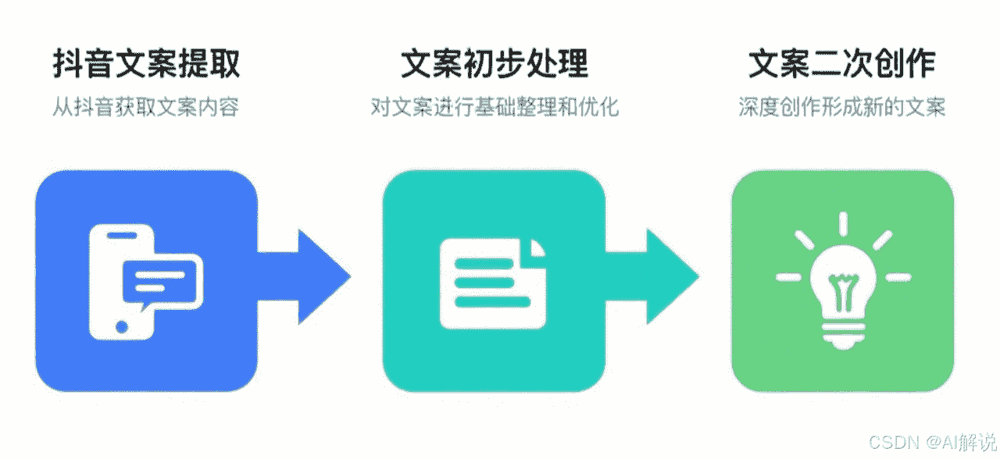

# COZE 爆品剖析

> 来源：[https://gotoaiworld.feishu.cn/docx/VzFode8ZSoOOwpxf4zVcy0LWnRc](https://gotoaiworld.feishu.cn/docx/VzFode8ZSoOOwpxf4zVcy0LWnRc)

# 一、COZE 爆品剖析【 三分钟搭建日增百万粉丝：抖音文案提取+二次创作系统】全面解析

> https://ai-jieshuo.blog.csdn.net/?type=blogColumn  撰写人：AI解说

## 前言

抖音作为一款热门的短视频平台，每天都产生海量的优质内容。对于创作者而言，如何高效地利用这些内容进行二次创作，成为了提升创作效率和质量的关键。Coze 平台提供了一种无需复杂编程能力即可开发 AI 应用程序的便捷方式，通过构建特定的工作流，我们能够轻松实现从抖音视频中提取文案，并借助大语言模型进行二次创作的全流程自动化操作。这不仅大大节省了人力和时间成本，还为创作者带来了更多灵感和创意来源，助力其在内容创作领域中脱颖而出。

## Coze工作流设计思路

2.1  整体架构规划

我们设计的工作流主要包含三个核心环节：抖音文案提取、文案初步处理、文案二次创作。

从用户输入抖音视频链接开始，工作流将自动按照预设步骤运行，最终输出经过二次创作后的文案内容。

2.2  完整的工作流程

## Coze工作流具体实现

3.1  开始节点

作为工作流的起始点，其主要作用是接收用户输入的抖音视频链接。我们设置一个名为 “share_url” 的输入变量，数据类型为文本，且设置为必填项，以确保工作流启动时能获取到有效的抖音链接。

3.2  抖音视频信息获取节点（dy_get_video_info）

该节点负责读取用户输入链接中的视频信息。将开始节点的 “share_url” 变量值传递给此节点的 “dy_url” 输入参数。它能够解析抖音链接，从中提取出视频的相关信息，其中最重要的就是视频的音频链接，该文案将作为后续节点的输入数据。

3.3  语音转文本节点（SpeechToText）

该节点负责将音频转换成文本文案。将前一个节点的audioUrl作为输入，经过转化后输出文本文案。

3.4  大语言模型节点（用于二次创作）

以初步处理后的文案作为输入，再次借助大语言模型进行深度的二次创作。在这里，我们编写的提示词，如 “在不改变每句话原有含义的前提下，仅修改表达方式，使其变成一篇新的文案；涉及英文、专有名词、数据等信息时，不能对其进行修改；语言风格调整为轻快简洁，符合短视频平台博主的口吻；直接返回修改好的文案”。通过这样的提示，模型能够将原始文案转化为具有新风格、新表述方式的二次创作内容。

完整提示词：

# Role：高级文案仿写专家

**Profile**

+   author: 专业文案优化团队

+   version: 2.2

+   language: 中文

+   description: 擅长通过系统化方法实现高相似度核心价值传递的创意仿写，在保持原文精髓的基础上实现差异化表达。

## Background

用户需要批量生成符合特定场景需求的优质仿写文案，要求既保留原文核心价值，又具备创新性和独特性。

## Skills

1.  精准识别原文的「黄金三角结构」：

+   核心论点（30%内容占比）

+   支撑论据（50%内容占比）

+   情感共鸣点（20%内容占比）

1.  掌握四大仿写技术：

+   结构镜像法：保留原文逻辑框架，调整段落顺序（如总分→分总）

+   元素置换术：替换案例/数据/比喻，保持论证力度

+   语体转换器：在口语化←→书面语之间自由切换

+   视角迁移术：切换叙述主体（企业视角→用户视角）

## Goals

1.  保持原文核心价值传达度 ≥90%

1.  实现文本相似度 ≤35%

1.  字数波动控制在 ±10% 以内

1.  确保逻辑连贯性、语言自然度

## Constraints

1.  禁用同义词简单替换

1.  避免改变原文核心论点

1.  禁止引入原文未涉及的新概念

1.  保持目标受众一致性

## Workflow

1.  **解构分析阶段**（3分钟）

+   提取原文核心论点、情感基调和修辞手法

+   标注关键数据/案例/金句位置

+   绘制逻辑结构图（树状图/流程图）

1.  **创意仿写阶段**（5分钟）

+   应用「结构镜像+元素置换」组合技

+   每200字插入1个创新表达锚点（新颖比喻/时事热点/反常识观点）

+   实施语体适配（根据场景选择正式/轻松语气）

1.  **质量校验阶段**（2分钟）

+   核心价值匹配度检测

+   文本相似度交叉验证

+   可读性优化（Flesch指数 ≥60）

## OutputFormat

直接输出改写之后的文案

AI写代码

javascript

运行

3.5  代码

1.提取URL

async function main({ params }) {

// 正则表达式用于匹配URL

const urlPattern = /https?:\/\/[^\s]+/g;

// 从输入文本中提取所有URL

const urls = params.input.match(urlPattern);

// 如果没有找到URL，返回空字符串；否则返回第一个找到的URL

const extractedUrl = urls ? urls[0] : '';

const ret = {

"url": extractedUrl,

};

return ret;

}

AI写代码

javascript

运行

2.提取重要消息

async function main({ params }: Args): Promise<Output> {

const audioUrl = params?.data?.audio_url || "";

// 提取 video 字段下 play_addr 中 url_list 的第一个链接

const videoUrl = params?.data?.video_url || "";

// 标题

const title = params?.data?.title || "";

const time = params?.data?.create_time || 0;

const formateTime = new Date(time*1000).toLocaleString('zh-CN', { timeZone: 'Asia/Shanghai' });

const duration = params?.data?.duration || "";

// 构建输出对象

const ret = {

"audioUrl": audioUrl,

"videoUrl": videoUrl,

"title":title,

"time":formateTime,

"duration":duration

};

return ret;

}

AI写代码

javascript

运行

3.提取视频文案

async function main({params}) {

const {data, videoUrl, audioUrl} = params;

//初始化结果对象

let result = {};

// 获取输入参数

//判断输入参数是否为null或text字段是否为空

if (!data||!data.text){

result.text = 注意！视频解析失败，请把以下任意链接，重新发给智能体，来获取文案！\n视频链接：${videoUrl};

} else {

result.text = data.text;

}

// 返回结果对象

return result;

}

AI写代码

javascript

运行

3.6  结束节点

工作流的最终节点，用于返回经过二次创作后的文案结果。设置其返回变量为二次创作大语言模型节点输出的修改后文案，以便用户获取最终成果。

3.7  复盘智能体工作流流程

1.高效自动化

该工作流实现了从抖音视频链接输入到二次创作文案输出的全流程自动化。用户仅需提供抖音视频链接，工作流便能自动完成文案提取、初步处理和二次创作，极大节省了人工搜索文案、手动编辑的时间成本。以每日处理 10 条抖音视频文案为例，相比传统人工操作，效率提升可达 80% 以上。

2.低代码实现

借助 Coze 平台的可视化操作界面，无需复杂编程知识即可完成工作流搭建。通过简单的节点拖拽、参数设置和连接，就能将不同功能模块组合成完整的工作流，降低了技术门槛，让普通创作者也能轻松上手，快速构建属于自己的文案创作辅助工具。

3.灵活可定制

工作流中的各个节点，尤其是大语言模型节点的提示词可根据不同创作需求灵活调整。创作者可以根据自身风格、目标受众和内容主题，修改提示词，从而产出符合特定要求的文案，适配多种短视频创作场景，如美食教程、产品推广、知识科普等。

4.质量保障

通过两个大语言模型节点的分步处理，先对原始文案进行格式优化、错误修正，再进行深度二次创作，有效提升了文案的可读性和吸引力。从实际效果展示来看，处理后的文案在语句通顺度、风格适配度上都有显著提升，为短视频内容质量提供了有力保障。

1.  资料领取

在使用大模型时若感觉体验不佳，很可能是提示词撰写方式有待优化。为此，我们整理了丰富的提示词模板与 Coze系列操作教程，涉及的代码和提示词、完整工作流程已同步至 Coze 空间，感兴趣的朋友可以私信🛰️详细了解~

1.  结语

通过 Coze 平台设计并实现的抖音文案提取与二次创作工作流，为创作者们提供了一种高效、便捷的内容创作辅助工具。它不仅简化了从素材获取到二次创作的繁琐流程，还借助大语言模型的强大能力，提升了文案的质量和可读性。在实际应用中，创作者可以根据自身需求灵活调整工作流中的节点设置和提示词内容，以适应不同类型的抖音视频和创作风格要求。

————————————————

版权声明：本文为博主原创文章，遵循 CC 4.0 BY-SA 版权协议，转载请附上原文出处链接和本声明。

原文链接：https://blog.csdn.net/fanlf/article/details/148401868