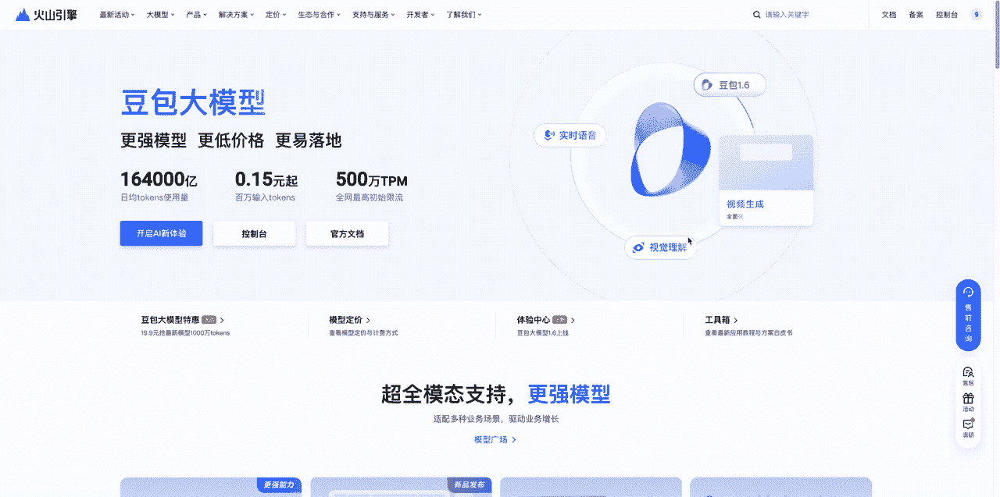
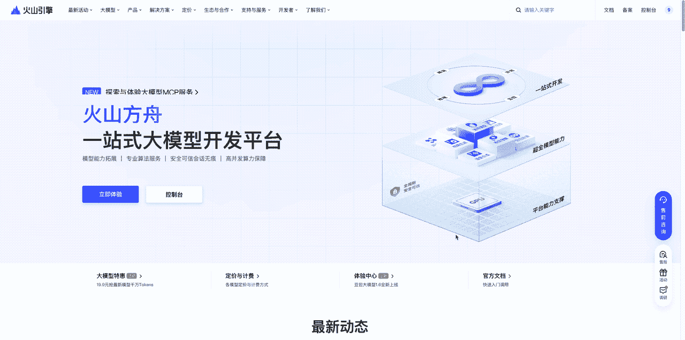
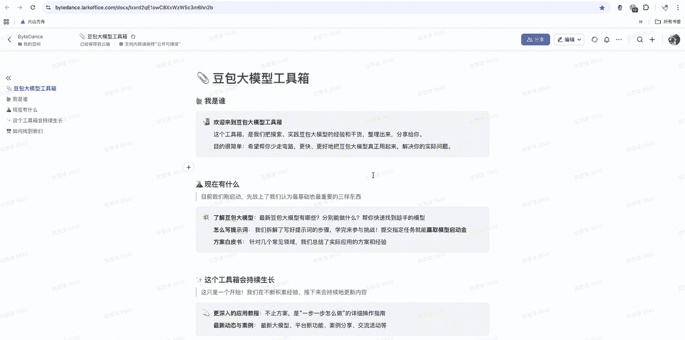
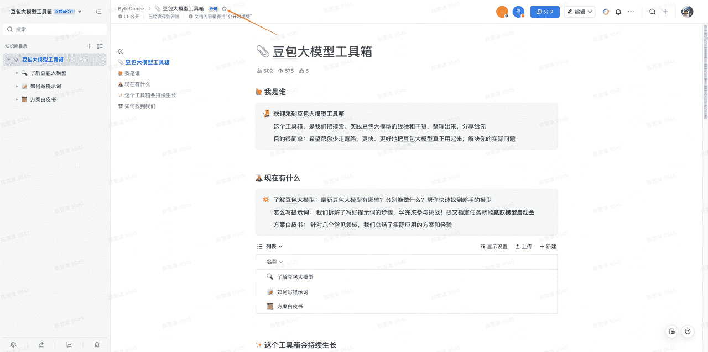

# 豆包大模型工具箱

> 来源：[https://gotoaiworld.feishu.cn/docx/Fi1ZdoWNaobwY7xWuKXcOnRTn7b](https://gotoaiworld.feishu.cn/docx/Fi1ZdoWNaobwY7xWuKXcOnRTn7b)

> **欢迎来到豆包大模型工具箱：**[**点击进入豆包大模型**](https://console.volcengine.com/ark/region:ark+cn-beijing/model?utm_campaign=2025H2&utm_content=gongjuxiang&utm_medium=xianshang&utm_source=LBM-zhyx&utm_term=dyjx_wendang&vendor=Bytedance&view=DEFAULT_VIEW)

> 这个工具箱，是我们把摸索、实践豆包大模型的经验和干货，整理出来，分享给你

> 目的很简单：希望帮你少走弯路，更快、更好地把豆包大模型真正用起来，解决你的实际问题

### 最新动态

> 点击蓝字，跳转至对应教程

[写好提示词](https://bytedance.larkoffice.com/wiki/NihcwEDmIibERLkED5sc514vn9e)** 上线！**

[豆包·角色扮演模型的n种玩法](https://bytedance.larkoffice.com/wiki/QHoxw31txiOVFukgVr3cCKi8ngg)** 上线！**

### 现在有什么

> 点击蓝字，跳转至对应教程

[前置准备](https://bytedance.larkoffice.com/wiki/GoXWw2CtuiDypHkt76McFtHknwg)** ： **应用豆包大模型，需要先完成哪些操作

[快来薅羊毛](https://bytedance.larkoffice.com/wiki/RjhOwWntJibVlLkyaHNc2n66nCb)** ：** 整理当前所有的福利活动，希望能帮助你更好地探索豆包大模型的可能性

[了解火山方舟大模型](https://bytedance.larkoffice.com/wiki/AxwJwyb7XiIP1GkQwd9ccC7dnMc)** ： **火山方舟最新大模型有哪些？分别能做什么？帮你快速找到趁手的模型

[豆包·角色扮演模型的n种玩法](https://bytedance.larkoffice.com/wiki/QHoxw31txiOVFukgVr3cCKi8ngg)** ： **如何让AI虚拟角色既有“灵魂”又能创造价值？来看看背后的故事

[写好提示词](https://bytedance.larkoffice.com/wiki/NihcwEDmIibERLkED5sc514vn9e)** ： ****我们拆解了写好**提示词的步骤，学完来参与挑战！提交指定任务就能赢取模型启动金

[方案白皮书](https://bytedance.larkoffice.com/wiki/K5cnwLPHgixTnkkQeWxcjJA6nQc)** ： **针对几个热门场景，我们总结了实际应用的方案和经验

### 这是个持续生长的工具箱

> 关注我们，这只是一个开始！我们在不断积累，接下来会持续地更新内容

> **更深入的应用教程**：不止方案，是“一步一步怎么做”的详细操作指南

> **最新动态与案例**： 最新大模型、平台新功能、案例分享、交流活动等

### 如何关注我们

```
https://bytedance.larkoffice.com/wiki/UPaRwNy8miqcXVkx7j5cNvgBnmg
```

✅ **强烈推荐，订阅更新通知**：[点击本链接，留下您的信息](https://www.volcengine.com/contact/doubaodigital?utm_campaign=digital__liuzi&utm_content=digital__liuzi&utm_medium=feishu&utm_source=lead_dp&utm_term=vg_feishu_doubaodigital__liuzi)，一旦更新，我们将会通过短信、邮件通知你

✅ **如果你是企业用户：**[点击本链接，留下您的信息](https://www.volcengine.com/contact/doubaodigital?utm_campaign=digital__liuzi&utm_content=digital__liuzi&utm_medium=feishu&utm_source=lead_dp&utm_term=vg_feishu_doubaodigital__liuzi)，将会有专人联系您，并提供专属服务

---

**🌐 火山引擎官网固定入口：**浏览器搜索豆包大模型或火山方舟，进入官网，找到工具箱入口，点击进入

**点击进入 👉 豆**[**包大模型**](https://www.volcengine.com/product/doubao)



**点击进入 👉 火**[**山方舟**](https://www.volcengine.com/product/ark)



---

📌 收**藏文档：**

+   如果你习惯用浏览器书签，点击浏览器的收藏/书签按钮 (⭐️)。下次直接从收藏夹点开就行



+   如果你习惯用飞书文档，点击左上角🌟收藏文档



### 意见征集中

<https://bytedance.larkoffice.com/share/base/form/shrcn9GHSbC0oMWOvaUE4yaXSux?iframeFrom=docx&ccm_open=iframe>