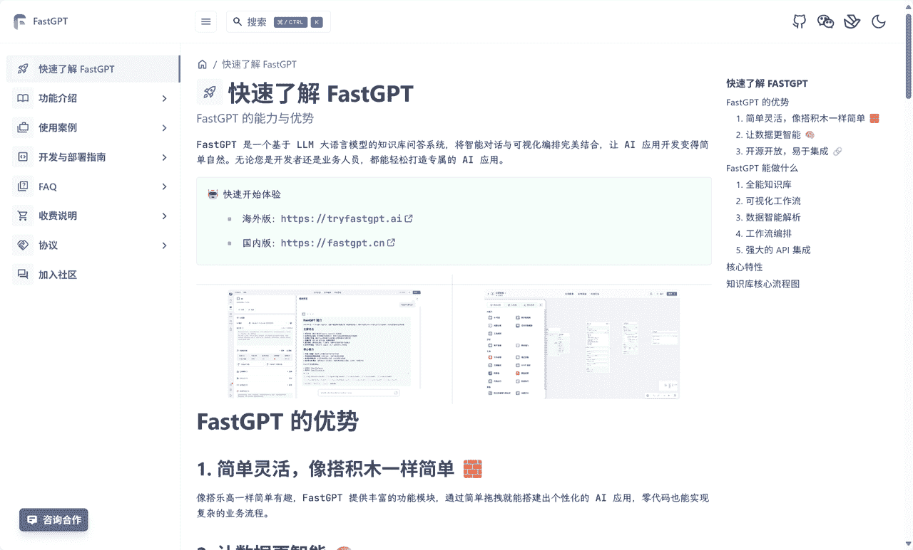

# FastGPT

> 来源：[https://gotoaiworld.feishu.cn/docx/Efp1dISato21JRxi2nicOwrfnKh](https://gotoaiworld.feishu.cn/docx/Efp1dISato21JRxi2nicOwrfnKh)

# 一. FastGPT 概述

> FastGPT 是由 Labring 团队开发的开源 AI 应用构建平台，基于大语言模型（LLM）和检索增强生成（RAG）技术，专注于零代码 / 低代码快速构建智能知识库与多模态交互系统。

FastGPT 是由 Labring 团队开发的开源 AI 应用构建平台，基于大语言模型（LLM）和检索增强生成（RAG）技术，专注于零代码 / 低代码快速构建智能知识库与多模态交互系统。其核心设计理念是模块化扩展与企业级安全，通过整合文档管理、模型调用、工作流编排和多模态处理能力，为开发者和企业提供从知识沉淀到智能交互的全链路解决方案。以下是其核心特性与技术细节的深度解析：

## 1、核心功能与技术架构

### 1.1 全流程 RAG 与多模态知识管理

+   无代码知识构建：支持直接上传 PDF、DOCX、Excel、Markdown 等 20+ 格式文档，或通过 URL 爬取网页内容，系统自动完成文本拆分、向量化和向量索引生成。例如，企业上传技术手册后，员工可通过自然语言查询设备故障解决方案，系统返回带引用来源的可信答案fastgpt.hzdfkj.cn。

+   混合检索机制：结合向量检索（语义相似度）和关键词检索（精确匹配），通过重排序算法（如 RRF 加权）提升召回准确率。用户提问时，系统从知识库中匹配最相关的文本片段作为上下文，显著降低大模型的幻觉问题。

+   多模态内容处理：支持图像（流程图、产品图）、音频（会议录音）、视频（操作演示）的智能解析。例如，上传产品拆解视频后，系统自动生成时间戳关联的文本摘要，支持 “第 3 分钟的操作步骤” 等精准查询。

### 1.2. 灵活的 LLM 与向量数据库集成

+   模型中立性：支持 OpenAI（GPT-4o）、Claude、Llama 3、Qwen 2.5 等主流模型，以及本地部署的开源模型（如通过 Ollama 运行的 Llama 3.3 70B）。用户可动态切换模型，例如开发阶段使用开源模型降低成本，生产环境切换至 GPT-4o 提升性能fastgpt.hzdfkj.cn。

+   向量数据库兼容：对接 PgVector、Milvus、Zilliz 等主流方案，支持混合部署（本地 + 云端）。例如，金融企业可将敏感数据存储于本地向量库，公开文档使用云端服务，通过权限隔离保障数据安全。

### 1.3. 可视化工作流与智能体开发

+   零代码流程设计：内置工作流引擎（基于 ReactFlow），通过拖拽节点（如文档内容提取、图片理解、表单收集）即可构建复杂业务逻辑。例如，用户上传合同文档后，系统自动提取关键条款并生成风险评估报告。

+   渐进式能力升级：从基础问答（RAG）到智能体（Agent），支持逐步扩展功能。例如，初始阶段可仅使用知识库问答，后续可添加数据库查询、API 调用等工具，实现自动化流程。

## 2、企业级特性与安全保障

### 2.1. 无缝集成与轻量化部署

+   多渠道接入：提供浮窗、全屏、移动端等嵌入方式，可快速集成到企业🛰️、钉钉、飞书等办公平台，或直接嵌入业务系统（如 CRM、OA）。例如，电商企业将 FastGPT 嵌入客服系统后，客户咨询时可自动调用知识库解答常见问题fastgpt.hzdfkj.cn。

+   多环境支持：支持 Docker 容器化部署，提供一键安装脚本和 Kubernetes 集群方案，满足从个人开发到企业级高可用扩展的需求。生产环境可通过 HTTPS 与 JWT 认证保障通信安全。

### 2.2. 数据安全与权限控制

+   本地数据主权：文档内容和向量索引默认存储于本地，大模型仅接收脱敏后的元数据（如表名、字段名），敏感数据不出域。例如，医疗企业可将患者病历存储于内网，LLM 仅访问匿名化的诊断指南。

+   细粒度权限管理：支持 IP 白名单、API 密钥鉴权，以及 LDAP、OAuth2 等单点登录协议。例如，金融企业可限制仅内部网络访问，并通过企业🛰️扫码登录实现身份验证。

## 3、典型应用场景

### 3.1. 智能客服与知识中台

+   企业知识库：将产品手册、售后指南等文档导入 FastGPT，客服人员通过自然语言提问即可获取标准答案，同时支持多轮对话和上下文理解。某电商平台使用后，客服响应效率提升 40%，问题解决率提高至 92%fastgpt.hzdfkj.cn。

+   跨模态支持：结合图片理解能力，用户上传设备故障照片后，系统自动识别问题并推荐维修步骤，实现 “图文结合” 的智能解答。

### 3.2. 办公自动化与流程优化

+   合同审核自动化：用户上传报销单后，系统自动识别金额、发票类型，并调用财务系统接口完成审批，整个流程无需人工干预fastgpt.hzdfkj.cn。

+   多模态报告生成：结合数据库查询函数，用户可直接通过自然语言查询业务数据（如 “2024 年 Q3 各地区销售额对比”），系统自动生成 SQL 并返回结果，同时支持可视化图表展示fastgpt.hzdfkj.cn。

### 3.3. 医疗与科研领域

+   临床决策支持：三甲医院将诊疗指南和药品库导入 FastGPT，医生查询指南时间从 15 分钟缩短至 20 秒，诊断符合率提升 12%。

+   文献智能问答：研究人员导入学术论文集后，可提问 “某基因在肺癌中的作用机制”，系统整合多篇文献内容生成综合回答，并标注引用来源。

### 4、技术生态与社区支持

### 4.1. 开源与商业化结合

+   社区版：遵循 Apache 2.0 协议，提供基础功能（如文档管理、模型对接、基础工作流），适合个人开发者和中小型企业快速验证需求。

+   专业版：提供多租户、性能监控、高级权限管理等企业级功能，支持私有化部署和定制开发，已服务金融、医疗等行业的 500+ 付费客户。

### 4.2. 活跃社区与完善文档

+   GitHub 生态：项目拥有超过 15k Star，社区贡献者来自全球技术团队，定期发布版本更新和新功能。例如，v1.10 LTS 版本新增支持 Qwen 2.5 深度思考模式和多语言切换（简体中文、英文）。

+   全链路文档：提供从安装指南、配置教程到 API 参考的完整文档，配套视频教程和技术博客帮助用户快速上手。

### 5、与同类工具的差异化优势

## 6、总结

FastGPT 通过自然语言交互和RAG 技术，重新定义了企业知识管理的方式。其开源特性降低了技术门槛，而企业级功能（如多租户支持、数据安全）则满足了生产环境需求。无论是作为个人数据分析工具，还是作为企业数据中台的核心组件，FastGPT 都展现了强大的灵活性和扩展性。随着 RAG 技术的普及和多模态模型的发展，它有望成为下一代智能应用的基础设施。

# 二、官网与社区资源

## 1.官方网站

https://www.fastgpt.cn/

## 2.GitHub 仓库

https://github.com/labring/FastGPT

## 3.文档中心

https://doc.fastgpt.io/

快速了解 FastGPT

