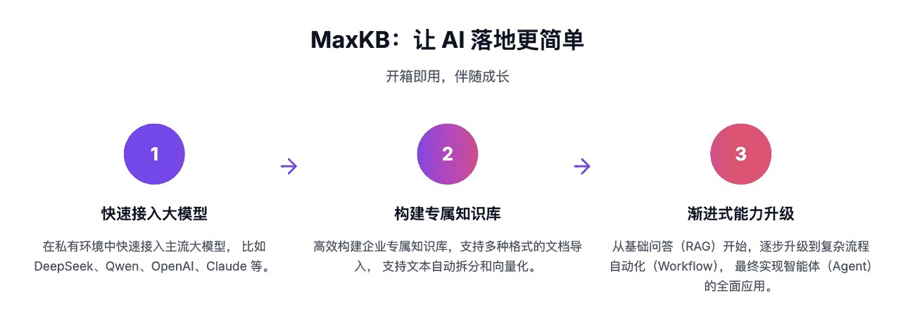
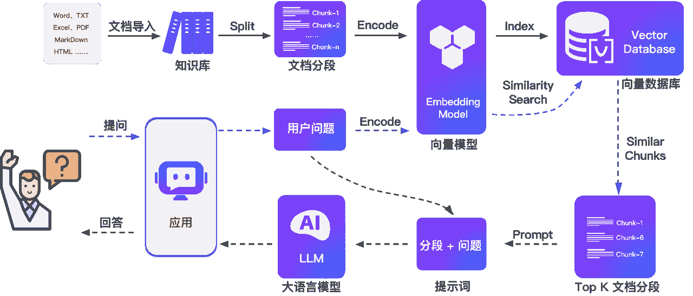

# MaxKB

> 来源：[https://gotoaiworld.feishu.cn/docx/UbAPdZgeLoFqJixOfG9cQOyLnkf](https://gotoaiworld.feishu.cn/docx/UbAPdZgeLoFqJixOfG9cQOyLnkf)

# 一、MaxKB

> MaxKB 是一款基于大语言模型（LLM）和检索增强生成（RAG）技术的开源知识库问答系统，专注于帮助企业和开发者快速构建智能问答能力。

MaxKB 是一款基于大语言模型（LLM）和检索增强生成（RAG）技术的开源知识库问答系统，专注于帮助企业和开发者快速构建智能问答能力。其核心设计理念是开箱即用、灵活扩展，通过整合文档管理、模型调用和工作流编排，为用户提供从知识沉淀到智能交互的一站式解决方案。以下是其核心能力与技术特性的详细解析：

MaxKB = Max Knowledge Brain，是一款强大易用的企业级智能体平台，致力于解决企业 AI 落地面临的技术门槛高、部署成本高、迭代周期长等问题，助力企业在人工智能时代赢得先机。

秉承“开箱即用，伴随成长”的设计理念，MaxKB支持企业快速接入主流大模型，高效构建专属知识库，并且提供从基础知识问答（RAG）、复杂业务流程自动化（Workflow，工作流）到智能体（Agent）的渐进式升级路径，有效赋能智能客服、智慧办公等多种应用场景。

**工作原理**[**¶**](https://maxkb.cn/docs/v2/#1)

**产品优势**[**¶**](https://maxkb.cn/docs/v2/#2)

+   **RAG 检索增强**
支持直接上传文档 / 自动爬取在线文档，支持文本自动拆分、向量化和 RAG（检索增强生成），有效减少大模型幻觉，智能问答交互体验好；

+   **灵活编排**
内置强大的工作流引擎、函数库和 MCP 工具调用能力，支持编排 AI 工作过程，满足复杂业务场景下的需求；

+   **无缝嵌入**
支持零编码快速嵌入到第三方业务系统，让已有系统快速拥有智能问答能力，提高用户满意度；

+   **模型中立**
支持对接各种大模型，包括本地私有大模型（Llama 3 / Qwen 2 等）、国内公共大模型（DeepSeek / SILICONFLOW / 通义千问 / 腾讯混元 / 字节豆包 / 百度千帆 / 智谱 AI / Kimi 等）和国外公共大模型（OpenAI / Azure OpenAI / Anthropic / Gemini 等）。

**界面展示**[**¶**](https://maxkb.cn/docs/v2/#3)

## 1、核心功能与技术架构

1.  RAG 驱动的智能问答

+   多模态知识整合：支持直接上传 PDF、DOCX、Markdown 等格式文档，或通过 URL 自动爬取在线内容，系统会自动对文本进行拆分、向量化处理，并构建向量索引。例如，企业可将技术手册、合同模板等资料上传，MaxKB 会自动生成可检索的知识库。

+   混合检索机制：结合向量检索（基于语义相似度）和全文检索（基于关键词匹配），通过重排序算法提升召回准确率。用户提问时，系统会从知识库中匹配最相关的文本片段作为上下文，显著降低大模型的幻觉问题。

1.  模型中立与多模态支持

+   广泛的模型兼容性：支持对接本地私有模型（如 Llama 3、Qwen 2）、国内公共模型（通义千问、智谱 AI）和国际模型（OpenAI、Claude），覆盖文本生成、语音识别、图片理解等多模态能力。例如，用户可选择通义千问进行文本生成，同时调用 Ollama 的图片理解模型处理上传的图表。

+   灵活的模型管理：允许为不同知识库或应用配置专属模型，支持动态切换和版本管理。例如，客服场景可使用通义千问，而技术支持场景可切换至本地部署的 DeepSeek-R1 模型。

1.  零代码工作流编排

+   可视化流程设计：内置工作流引擎，通过拖拽节点（如文档内容提取、图片理解、表单收集）即可构建复杂业务逻辑。例如，用户上传合同文档后，系统自动提取关键条款并生成风险评估报告。

+   渐进式能力升级：从基础问答（RAG）到智能体（Agent），支持逐步扩展功能。例如，初始阶段可仅使用知识库问答，后续可添加数据库查询、API 调用等工具，实现自动化流程maxkb.cn。

## 2、企业级特性与安全保障

1.  无缝集成与轻量化部署

+   零编码嵌入：提供多种嵌入方式（浮窗、全屏、移动端），可快速集成到企业🛰️、钉钉、飞书等办公平台，或直接嵌入业务系统（如 CRM、OA）。例如，电商企业将 MaxKB 嵌入客服系统后，客户咨询时可自动调用知识库解答常见问题。

+   多环境支持：支持 Docker 容器化部署，提供 1Panel 应用商店一键安装和阿里云市场镜像，满足从个人开发到企业集群的不同需求。生产环境可通过 Kubernetes 实现高可用扩展，支持 HTTPS 与 JWT 认证maxkb.cn。

1.  数据安全与权限控制

+   本地数据主权：文档内容和向量索引默认存储在本地，大模型仅接收脱敏后的元数据（如表名、字段名），敏感数据不出域。

+   细粒度权限管理：支持 IP 白名单、API 密钥鉴权，以及 LDAP、OAuth2 等单点登录协议。例如，金融企业可限制仅内部网络访问，并通过企业🛰️扫码登录实现身份验证maxkb.cn。

## 3、典型应用场景

1.  智能客服与知识中台

+   企业可将产品手册、售后指南等文档导入 MaxKB，客服人员通过自然语言提问即可获取标准答案，同时支持多轮对话和上下文理解。例如，某电商平台使用 MaxKB 后，客服响应效率提升 40%，问题解决率提高至 92%。

1.  办公自动化与流程优化

+   通过工作流编排实现合同审核、报销审批等流程自动化。例如，用户上传报销单后，系统自动识别金额、发票类型，并调用财务系统接口完成审批，整个流程无需人工干预。

1.  教育与学术研究

+   教育机构可构建课程知识库，学生通过自然语言提问获取知识点解析，系统还支持生成相关问题引导深入学习。例如，某高校使用 MaxKB 后，学生课后问题解答率从 60% 提升至 90%。

1.  复杂数据分析与决策支持

+   结合数据库查询函数，用户可直接通过自然语言查询业务数据（如 “2024 年 Q3 各地区销售额对比”），系统自动生成 SQL 并返回结果，同时支持可视化图表展示。

## 4、技术生态与社区支持

1.  开源与商业化结合

+   社区版：遵循 GPLv3 协议，提供基础功能（如文档管理、模型对接、基础工作流），适合个人开发者和中小型企业快速验证需求。

+   专业版：提供多租户、性能监控、高级权限管理等企业级功能，支持私有化部署和定制开发，已服务超过 1000 家付费客户maxkb.cn。

1.  活跃社区与完善文档

+   GitHub 生态：项目拥有超过 15k Star，社区贡献者来自全球技术团队，定期发布版本更新和新功能。例如，v1.10 LTS 版本新增支持 DeepSeek-R1 深度思考模式和多语言切换（简体中文、繁体中文、英文）。

+   全链路文档：提供从安装指南、配置教程到 API 参考的完整文档，配套视频教程和技术博客帮助用户快速上手maxkb.cn。

## 5、与同类工具的差异化优势

## 6、总结

MaxKB 通过自然语言交互和RAG 技术，重新定义了企业知识管理的方式。其开源特性降低了技术门槛，而企业级功能（如多租户支持、性能监控）则满足了生产环境需求。无论是作为个人数据分析工具，还是作为企业数据中台的核心组件，MaxKB 都展现了强大的灵活性和扩展性。随着 RAG 技术的普及和 LLM 能力的提升，它有望成为数据民主化进程中的关键工具之一。

# 二、案例展示

https://maxkb.cn/docs/v2/#4

MaxKB 自发布以来，日均安装下载超过 1000 次，被广泛应用于智能客服、企业内部知识库、学术研究与教育等场景，典型应用案例详情见如下链接：

+   MaxKB 应用案例：中国农业大学-小鹉哥

+   MaxKB 应用案例：东北财经大学-小银杏

+   MaxKB 应用案例：重庆交通大学-渝小交

+   [MaxKB 应用案例：广西大学](https://mp.weixin.qq.com/s/83N9a_wWDce7z1NLIropEAx)

+   MaxKB 应用案例：南京中医药大学

+   MaxKB 应用案例：高校行政管理AI小助手

+   [MaxKB 应用案例：中铁水务](https://mp.weixin.qq.com/s/voNAddbK2CJOrJJs1ewZ8g)

+   MaxKB 应用案例：解放军总医院

+   MaxKB 应用案例：中核西仪研究院-西仪睿答

+   MaxKB 应用案例：西安国际医院中心医院-国医小助

+   MaxKB 应用案例：深圳大学附属华南医院-医疗版“知识数据库助手”

+   MaxKB 应用案例：生物医药AI客服智能体验!

+   MaxKB 应用案例：把医疗行业知识转化为知识库问答助手！

+   MaxKB 应用案例：深圳福田公证处 AI 助手

+   MaxKB 应用案例：无锡市数据局

+   MaxKB 应用案例：广西质检院 AI小质

+   MaxKB 应用案例：深圳联交所-深小联AI助手

+   MaxKB 应用案例：安徽交易集团发布AI招标文件编审系统

+   MaxKB 应用案例：深圳通开启Deep Seek智能应用新篇章

+   MaxKB 应用案例："畅行南通"智能客服

+   [MaxKB 应用案例：济南地铁-借助 DeepSeek](https://mp.weixin.qq.com/s/eFlbTpQtx0gDrlOlb5onbA)全面接入！“AI+轨道”让市民出行更智能

+   [MaxKB 应用案例：广州港-借助 De](https://mp.weixin.qq.com/s/mZJx7bldKgL2wEQiORccWw)epSeek开源大模型 赋能港口设备管理

+   MaxKB 应用案例：四川航空-川航AI助手来报到！

+   MaxKB 应用案例：华莱士智能AI客服助手上线啦！

+   MaxKB 应用案例：会展AI智能客服体验

+   MaxKB 应用案例：孩子要上幼儿园了，AI 智能助手择校好帮手

+   MaxKB 应用案例：产品使用指南AI助手，新手小白也能轻松搞定！

+   [MaxKB 应用案例：苏州热工研](https://mp.weixin.qq.com/s/Ts5FQdnv7Tu9Jp7bvofCVA)究院有限公司-大宗材料方案制定和审查助手

+   MaxKB 应用案例：国核自仪系统工程有限公司-NuCON AI帮

+   [MaxKB 应用案例：中船动力人工智能](https://mp.weixin.qq.com/s/OGcEkjh9DzGO1Tkc9nr7qg)"智慧动力云助手"及首批数字员工正式上线

+   MaxKB 应用案例：南宁矿业集团智慧矿山AI助手

+   [MaxKB 应用案例：DeepSeek落地弘](https://mp.weixin.qq.com/s/Eczdx574MS5RMF7WfHN7_A)盛铜业：国产大模型点亮"黑灯工厂"新引擎

+   MaxKB 应用案例：拥抱智能时代！中国五矿以 “AI+”赋能企业发展

+   MaxKB 应用案例：DeepSeek赋能中冶武勘AI智能体

+   [MaxKB 应用案例：重磅！陕西广电网络“秦](https://mp.weixin.qq.com/s/ZKmEU_wWShK1YDomKJHQeA)岭云”平台实现DeepSeek本地化部署

+   MaxKB 应用案例：豫园股份-党群AI智能体—e家同智（内测版）来啦

+   [MaxKB 应用案例：粤海集团完成Dee](https://mp.weixin.qq.com/s/2JbVp0-kr9Hfp-0whH4cvg)pSeek私有化部署，助力集团智能化管理

+   [MaxKB 应用案例：建筑材料工业信息中心完成DeepSe](https://mp.weixin.qq.com/s/HThGSnND3qDF8ySEqiM4jw)ek本地化部署，推动行业数智化转型新发展

+   [MaxKB 应用案例：一起Deep](https://mp.weixin.qq.com/s/m67e-H7iQBg3d24NM82UjA)Seek！福建设计以AI大模型开启新篇章

+   MaxKB 应用案例：郑州海关上线 AI 审单智能体

# 三、官网与社区资源：

## 1.官方网站：

https://www.fit2cloud.com/maxkb/

## 2.GitHub 仓库：

https://github.com/1Panel-dev/MaxKB

## 3.文档中心：

https://maxkb.cn/docs/