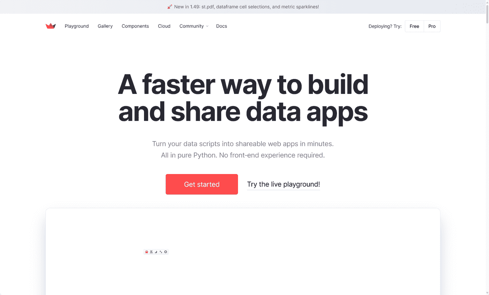

# Streamlit快速开发AI Web应用

> 来源：[https://gotoaiworld.feishu.cn/docx/OClvdHIndoWnrNxX8zjcruAjnSz](https://gotoaiworld.feishu.cn/docx/OClvdHIndoWnrNxX8zjcruAjnSz)

Streamlit 是一个 用于快速构建数据科学和机器学习应用的 Python 库，其核心定位是 “让数据科学家无需掌握复杂的前端开发知识（如 HTML、CSS、JavaScript），就能用纯 Python 代码在几分钟内搭建出交互式 Web 应用”。它由 Streamlit Inc. 于 2019 年推出，目前已成为数据领域快速原型开发、内部工具搭建和模型演示的主流工具之一。

https://streamlit.io/



## 一、核心定位与优势

Streamlit 的核心价值在于 **“降低数据应用的开发门槛”**，相比 Flask、Django 等传统 Web 框架，或 Dash（Plotly 旗下的数据分析框架），它的优势极为突出：

## 二、基本用法：5 分钟搭建第一个应用

Streamlit 的使用流程极为简单，以下是一个完整的入门示例：

### 1. 安装 Streamlit

通过 pip 直接安装：

bash

```
pip install streamlit
```

### 2. 编写第一个应用脚本（例如 app.py）

python

运行

```
import streamlit as st
import pandas as pd
import plotly.express as px

# 1. 设置页面标题和布局
st.set_page_config(page_title=&quot;我的第一个Streamlit应用&quot;, layout=&quot;wide&quot;)# 2. 添加文本和交互控件
st.title(&quot;📊 数据可视化演示&quot;)  # 标题
st.sidebar.header(&quot;参数设置&quot;)  # 侧边栏控件# 侧边栏滑块（用于控制数据量）
data_size = st.sidebar.slider(&quot;选择数据行数&quot;, min_value=10, max_value=1000, value=200)# 3. 加载并展示数据# 生成模拟数据（也可加载本地CSV：pd.read_csv(&quot;data.csv&quot;)）
df = pd.DataFrame({&quot;姓名&quot;: [f&quot;用户{i}&quot; for i in range(data_size)],&quot;年龄&quot;: pd.np.random.randint(18, 60, size=data_size),&quot;收入&quot;: pd.np.random.randint(5000, 30000, size=data_size),&quot;城市&quot;: pd.np.random.choice([&quot;北京&quot;, &quot;上海&quot;, &quot;广州&quot;, &quot;深圳&quot;], size=data_size)})# 展示原始数据（可折叠）with st.expander(&quot;查看原始数据&quot;):
    st.dataframe(df, use_container_width=True)# 4. 添加可视化图表
st.subheader(&quot;各城市收入分布&quot;)# 用Plotly生成箱线图，支持交互式操作（缩放、悬停显示详情）
fig = px.box(df, x=&quot;城市&quot;, y=&quot;收入&quot;, color=&quot;城市&quot;, title=&quot;城市收入箱线图&quot;)
st.plotly_chart(fig, use_container_width=True)# 5. 统计摘要
st.subheader(&quot;数据统计摘要&quot;)
st.write(f&quot;总数据量：{len(df)} 行&quot;)
st.write(&quot;各城市用户数量：&quot;)
st.table(df[&quot;城市&quot;].value_counts())
```

### 3. 运行应用

在终端执行以下命令，Streamlit 会自动启动本地服务器（默认端口 8501）：

bash

```
streamlit run app.py
```

此时打开浏览器访问 http://localhost:8501，即可看到交互式应用界面。

## 三、典型应用场景

Streamlit 并非为 “高并发、高定制化的生产级 Web 应用” 设计，而是聚焦于数据领域的快速迭代和内部使用，核心场景包括：

1.  数据探索仪表板
快速搭建个性化的数据分析页面，支持通过滑块、下拉框等控件筛选数据，实时更新图表（例如销售数据监控、用户行为分析）。

1.  机器学习模型演示
展示模型的预测效果：用户通过上传数据、输入参数，实时查看模型输出（例如图像分类、文本情感分析、房价预测模型演示）。

1.  快速原型验证
数据团队在项目初期快速验证业务逻辑，无需等待前端开发，直接向产品 / 业务方展示 demo。

1.  内部工具开发
搭建企业内部的轻量工具（例如数据清洗工具、报表自动生成工具、权限申请审批流程）。

1.  教学与分享
教师用 Streamlit 制作交互式教学案例（例如演示统计概念、算法原理），或在会议中实时展示数据分析过程。

## 四、关键功能模块

Streamlit 提供了丰富的内置组件，覆盖大多数数据应用需求：

## 五、部署方式

Streamlit 应用的部署极为灵活，以下是几种常见方式：

1.  Streamlit Community Cloud（推荐入门）
官方免费部署平台，支持直接关联 GitHub 仓库：只需将应用脚本推送到 GitHub，在平台上选择仓库和分支，即可自动部署并生成公共访问链接（例如 https://[你的应用名].streamlit.app）。
限制：免费版支持单应用，资源有限，适合演示和小流量场景。

1.  Docker 容器化部署
将应用打包为 Docker 镜像，部署到任何支持 Docker 的服务器（如 AWS EC2、阿里云 ECS、Kubernetes 集群）。
优势：环境一致性强，便于规模化管理。

1.  云平台 PaaS 部署
部署到 Heroku、AWS Elastic Beanstalk、Google App Engine 等 PaaS 平台，只需配置简单的启动脚本（如 Procfile）。

1.  本地服务器部署
直接在企业内部服务器上运行 streamlit run app.py --server.port=80，通过内网 IP 供团队访问。

## 六、优缺点分析

### 优点

+   开发效率极高：几分钟即可搭建可用的交互应用，远快于传统框架。

+   学习成本低：纯 Python 语法，数据科学家无需转型前端。

+   生态融合好：无缝对接 Pandas、Scikit-learn、Plotly 等数据科学工具栈。

+   社区活跃：官方文档完善，GitHub 上有大量开源示例（Streamlit Gallery），问题易获取解答。

### 缺点

+   定制化能力有限：默认样式和组件难以深度定制（如需复杂 UI 需开发自定义组件，需前端知识）。

+   性能瓶颈：高并发场景下（如千级以上同时在线）响应较慢，不适合面向公众的大规模应用。

+   状态管理简单：st.session_state 仅支持会话级状态，不支持跨会话的全局状态（需结合数据库或 Redis 补充）。

## 七、学习资源

1.  官方文档：[Streamlit Docs](https://docs.streamlit.io/)（最权威的教程，包含快速入门、API 详解、部署指南）。

1.  官方示例库：Streamlit Gallery（大量开源应用案例，可直接复制代码学习）。

1.  GitHub 仓库：streamlit/streamlit（源码和 issue 讨论）。

1.  社区扩展：Streamlit Components（第三方开发的扩展组件，如地图、日历、富文本编辑器等）。

## 总结

Streamlit 是数据科学家的 “Web 开发捷径”，它以 “牺牲部分定制化和性能” 为代价，换取了极致的开发效率。如果你的需求是快速搭建数据探索工具、模型演示 demo 或内部轻量应用，Streamlit 是目前最优选择之一；但如果需要开发高并发、高定制化的公众级应用，则更适合使用 Flask/Django 结合前端框架（如 React）的方案。