# 大模型资源中心

> 来源：[https://gotoaiworld.feishu.cn/docx/KCzYdOkwZoG1m9xzYEVc7rGNnte](https://gotoaiworld.feishu.cn/docx/KCzYdOkwZoG1m9xzYEVc7rGNnte)

# 一、技术社区

> 输入 @ 插入相关文档，介绍项目成立的背景

1.  ...

# 二、资源链接

> **目标**

## 1.1 互联网最大免费资源库-freemediaheckyeah

https://fmhy.xyz/

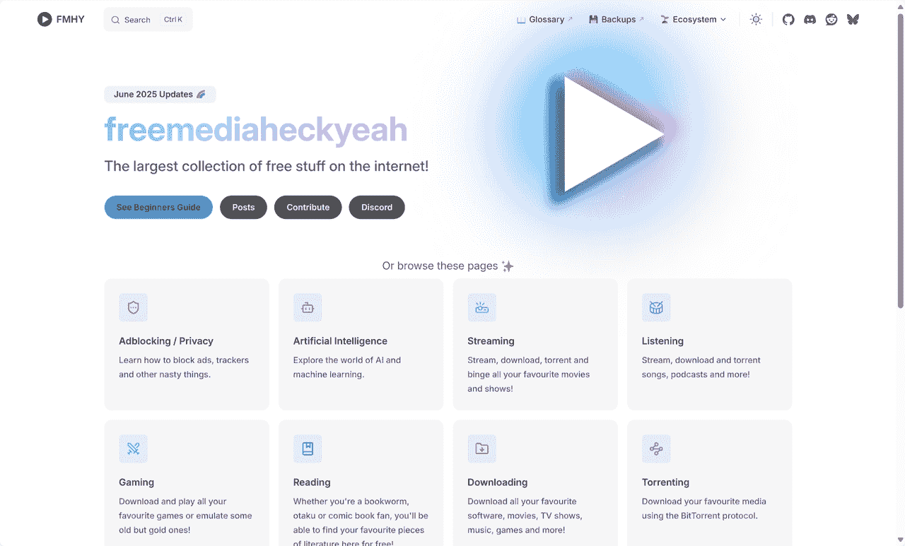

Freemediaheckyeah Post每日更新

https://fmhy.net/posts

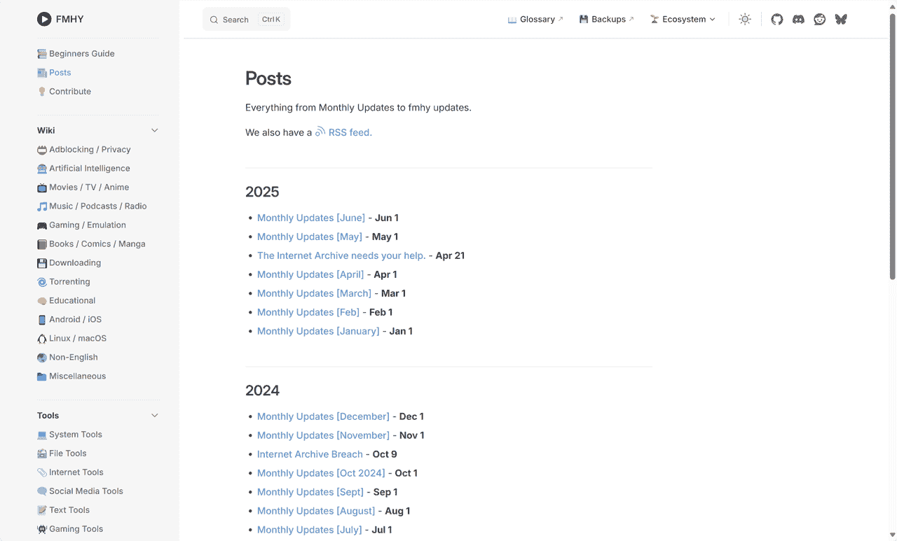

Freemediaheckyeah GitHub

https://github.com/fmhy/edit

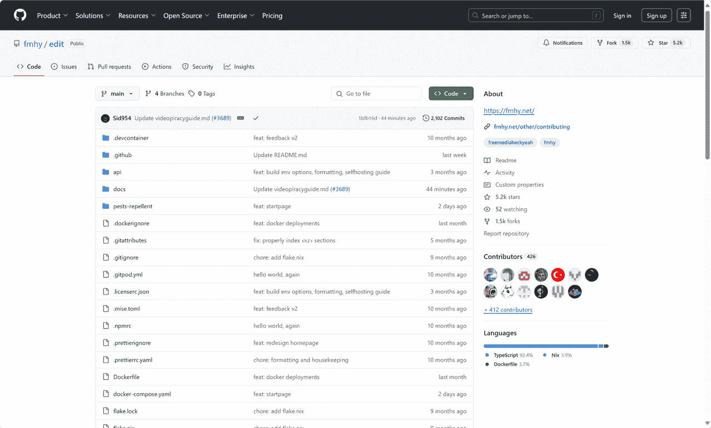

Artificial Intelligence

https://fmhy.net/ai

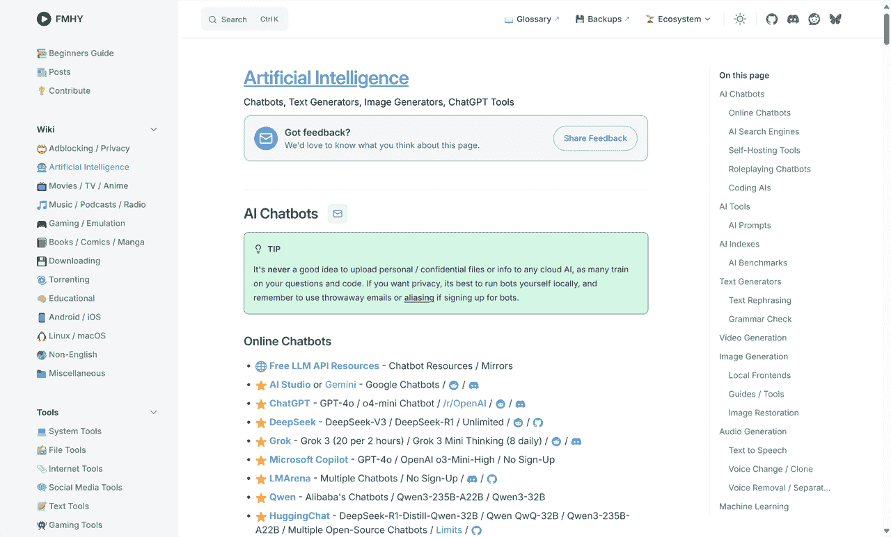

AGI 掘金知识库

[AGI 掘金知识库](https://agijuejin.feishu.cn/wiki/UvJPwhfkiitMzhkhEfycUnS9nAm)

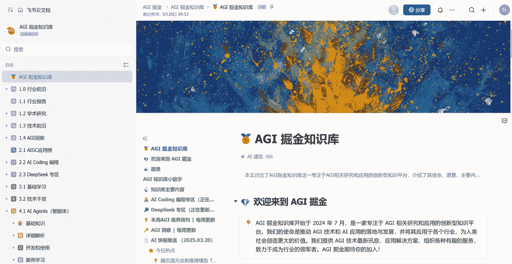

通往 AGI之路

[通往 AGI 之路](https://waytoagi.feishu.cn/wiki/QPe5w5g7UisbEkkow8XcDmOpn8e)

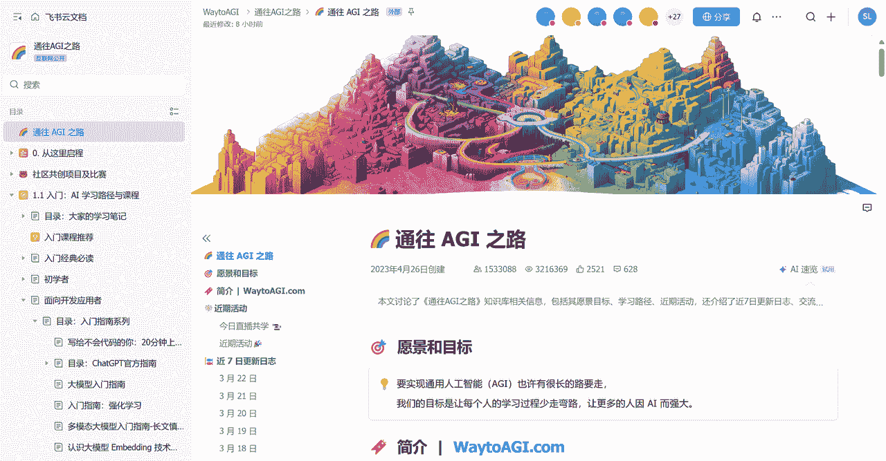

[AGI空间站](https://agispace.feishu.cn/wiki/Xs6HwsNyDi92O8kayXJclpcZnsd)

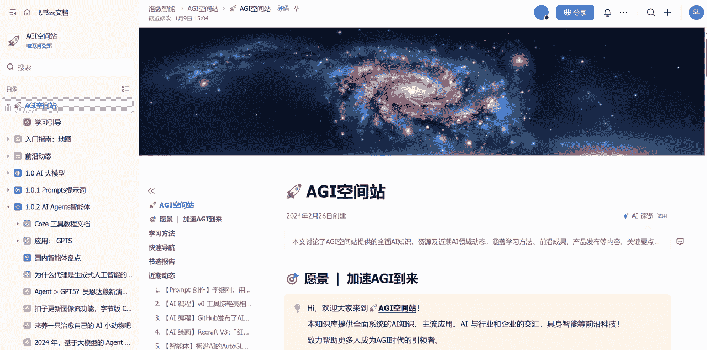

[大模型空间站](https://miracleplus.feishu.cn/wiki/LLQewHYx1ilmlpkxHUqc42L8nzf)

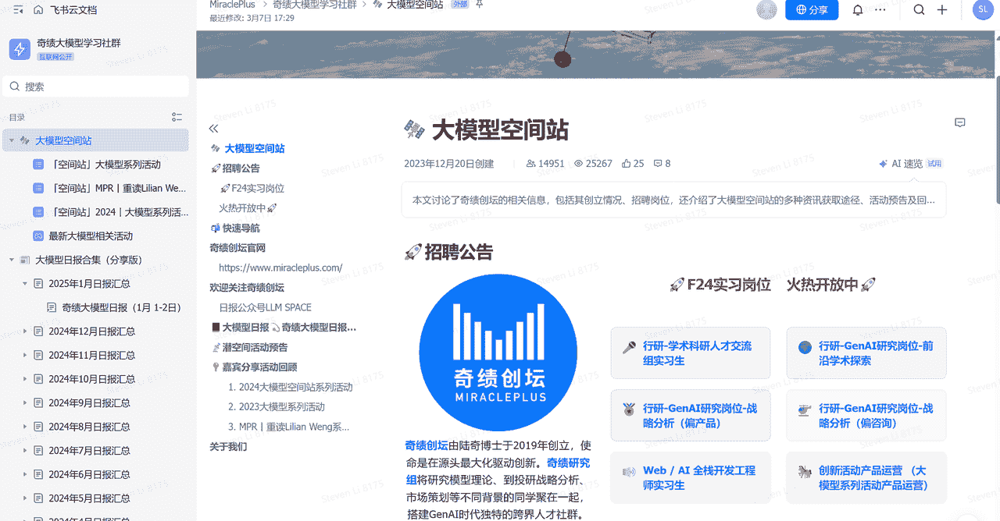

[OPEN 1+X AI通识课](https://datawhaler.feishu.cn/wiki/X9AVwtmvyi87bIkYpi2cNGlIn3v)

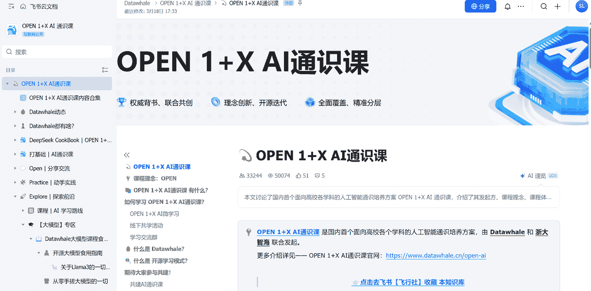

[一站式AI产品经理入门指南](https://v11enp9ok1h.feishu.cn/wiki/KiIvwdFOciiqqNkwKzTcmn88ndL)

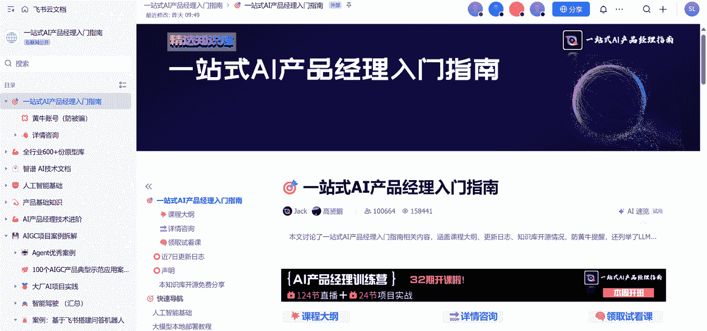

[玩赚 AI 实验室](https://yunyinghui.feishu.cn/wiki/WhelwZnxQi55mpkOzatc3Xran5b)

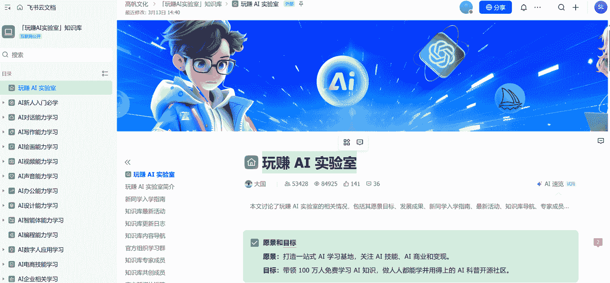