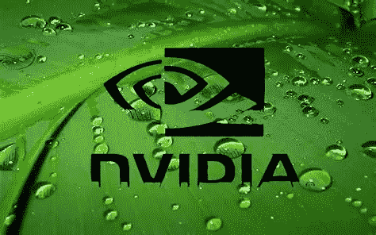

# 英伟达（NVIDIA）显卡芯片全景图谱

> 来源：[https://gotoaiworld.feishu.cn/docx/EWuwd5n4MoyVn6xZVMzccs9anah](https://gotoaiworld.feishu.cn/docx/EWuwd5n4MoyVn6xZVMzccs9anah)

> https://mp.weixin.qq.com/s/A0H-PsTiVLrAcTwbdQmV7w

英伟达（NVIDIA）的产品线庞杂繁复，从面向游戏玩家的GeForce RTX系列，到数据中心的H100、B200，再到Jetson、DRIVE等边缘智能平台，一般人很难以厘清其全貌。这篇文章将用通俗而专业的语言，一文打通英伟达显卡芯片体系，让你彻底读懂这个GPU帝国是如何运转的。

## 架构进化简史：英伟达“芯”力量的演进之路

一、消费级显卡矩阵：从玩家到轻AI开发者的入门之选

### GeForce系列：图形时代的主力军，GeForce是英伟达最为人熟知的产品线，主要针对游戏玩家和个人用户市场，特点是高图形性能、广泛兼容性和较高性价比。

#### ✅ GeForce RTX 40 系列（Ada Lovelace架构）

+   发布时间：2022年

+   核心亮点：引入第四代Tensor Core和第三代RT Core，支持DLSS 3.5，推理性能比上一代翻倍。

+   主流型号：RTX 4090、4080、4070 Ti、4070、4060 Ti、4060

+   适合用户：追求极致画质、4K光追、高帧率的发烧级玩家和创作者。

#### ✅ GeForce RTX 30 系列（Ampere架构）

+   发布时间：2020年

+   优点：DLSS 2.0性能优秀，Tensor Core与CUDA核心双线提升

+   热门型号：RTX 3090、3080、3070、3060 Ti、3060

+   用户评价：被誉为“史上最有性价比”的一代，仍是AI入门者的GPU首选。

#### ✅ GeForce GTX 16/10/9 系列

+   GTX 16：基于Turing架构，但不具备RT和Tensor核心（如GTX 1660 Ti）

+   GTX 10：Pascal架构，经典耐用（如GTX 1080 Ti）

+   适用人群：预算有限、非AI用途、休闲级游戏用户

> 📌 如果你是游戏玩家或视频制作者，GeForce RTX 30/40系依旧是主力选择；如果你是AI初学者，性价比高的RTX 3060/3070或更划算。

---

## 二、专业图形与工程计算：工作站专用显卡

### Quadro / RTX A系列：为创作者、工程师定制。工作站显卡专注于稳定性、精准度与专业软件兼容性，是影视渲染、建筑设计、CAD绘图、科研仿真的理想搭档。

#### **🔷 早期：Quadro 系列**

+   Quadro RTX 6000 / 8000（基于Turing）

+   提供ECC内存、双精度计算、认证驱动等

#### **🔷 当前：RTX A系列**

+   RTX A6000（基于Ampere架构）

+   核心特点：更强的显存（最高48GB GDDR6 ECC）、稳定支持Autodesk、Adobe、SolidWorks等专业软件

> ✅ 专业领域的用户首选A系列，不建议使用消费级RTX显卡替代，尽管后者性能不差，但稳定性与兼容性无法保证。

---

## 三、AI训练与数据中心GPU矩阵：英伟达的核心

###  1、H 系列（Hopper 架构）：AI训练旗舰

#### 💡 H100：当前AI训练的顶流

+   架构：Hopper，专为Transformer优化

+   技术亮点：Transformer Engine、第四代NVLink、HBM3高带宽内存

+   应用场景：GPT-4等大模型训练、科研计算、云端AI平台

+   性能：FP8训练高达700 TFLOPS

#### 💡 H200：推理增强版

+   核心升级：搭载HBM3e内存，推理吞吐量显著提升

+   使用场景：LLM推理部署、推荐系统、边缘AI推理加速

### 2、A 系列（Ampere 架构）：曾经的AI之王

#### 💡 A100：2020年旗舰AI训练卡

+   支持多实例GPU（MIG）、FP16/FP32混合精度

+   标配40/80GB HBM2e

+   应用：GPT-3训练、企业AI集群

#### 💡 A30/A40：中端推理选择

+   A30为推理优化，A40适合图形与AI混合任务

### 3、L 系列：AI推理与图形融合卡

#### 💡 L40/L40S

+   兼顾图形渲染和AI推理能力

+   部署场景：AI数字人、虚拟工厂、仿真建模

---

## 四、Blackwell 架构登场：AI超级算力新纪元

2024年GTC大会，黄仁勋发布了新一代Blackwell架构，为万亿参数级模型时代而生。

### 💥 B100 / B200：AI训练性能再翻倍

+   架构亮点：第五代NVLink、全新AI芯片堆叠设计、FP4精度引入

+   B200为双芯片封装设计，与GB200组合使用效果最佳

### ⚡ GB200 Grace Blackwell 超级芯片

+   CPU+GPU异构整合，具备900GB/s CPU-GPU带宽

+   专为AI超算和数据中心打造，具备极强吞吐与并发处理能力

---

## 五、边缘计算与自动驾驶GPU：小身材大智能

### 1、Jetson 系列：AI边缘开发者的福音

+   Jetson Nano：入门级，适合教育、原型开发

+   Jetson Xavier NX / AGX Xavier：适合智能机器人与工业应用

+   Jetson Orin：新一代旗舰，算力最高275 TOPS

> ⚙️ Jetson生态完备，拥有NVIDIA Isaac、DeepStream、Triton等边缘AI软件支持，适用于实际部署。

### 2、DRIVE 系列：自动驾驶大脑

+   DRIVE PX2：早期平台

+   DRIVE AGX Orin：2021年发布，算力高达254 TOPS

+   DRIVE Thor：整合Blackwell+下一代GPU，支持L5级自动驾驶

---

## 六、如何选购英伟达显卡？不同人群的建议方案

随着AI技术日趋复杂，未来的计算，不再是“通用CPU”的天下，而是“异构+专用+AI协同”的全新时代。无论是地球上的工厂、车载系统，还是云端的超大模型，都将越来越依赖类似GPU这样强大的加速芯片。