# AI大模型认证考试

> 来源：[https://gotoaiworld.feishu.cn/docx/Xy8qdtQTeoODRWxQXcDcu01dnEd](https://gotoaiworld.feishu.cn/docx/Xy8qdtQTeoODRWxQXcDcu01dnEd)

## 1.大模型厂商认证

### 1.1 Microsoft 全球AI技术专家认证

微软人工智能认证证书（英文名：Azure AI Fundamentals）是由微软官方最新研发的一项有关人工智能的认证证书。想要获得该证书，需通过`AI-900`测试或者`AI-102`。

Mastering the Azure AI Certification Path: Your Guide to Success

The Azure AI Certification Path

The Azure AI certification path consists of several key certifications that cater to different levels of expertise and career goals:

Microsoft Certified: Azure AI Fundamentals

This entry-level certification is ideal for individuals new to artificial intelligence and cloud services. It covers fundamental concepts such as machine learning, computer vision, natural language processing, and conversational AI workloads on Azure.

+ Exam: `AI-900`: Microsoft Azure AI Fundamentals

+ Skills Measured: Understanding of core AI concepts and services on Microsoft Azure

Microsoft Certified: Azure Data Scientist Associate

This certification is designed for data scientists who want to enhance their skills in building and deploying machine learning models on Azure. It focuses on using tools like Python, R, and the Microsoft Machine Learning platform.

+ Exam: `DP-100`: Designing and Implementing a Data Science Solution on Azure

+ Skills Measured: Data preparation, feature engineering, model training, evaluation, deployment, and maintenance

Microsoft Certified: Azure AI Engineer Associate

Aimed at professionals who design and implement AI solutions using cognitive services, machine learning pipelines, or conversational bots on Microsoft Azure. This certification validates your ability to integrate these components into existing systems.

+ Exam: `AI-102`: Designing and Implementing an Azure AI Solution

+ Skills Measured: Planning and managing an end-to-end solution using Cognitive Services APIs; implementing language understanding with LUIS; integrating bots with other systems; developing machine learning models using Python or R in an integrated development environment (IDE).

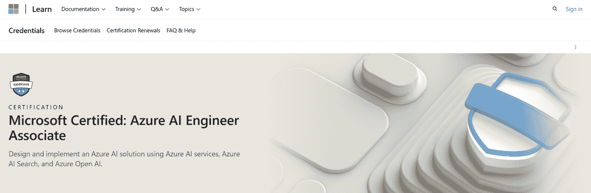

`https://learn.microsoft.com/en-us/credentials/certifications/azure-ai-engineer/?practice-assessment-type=certification`

微软AI人工智能证书分为两个等级：

#### Azure AI 初级:AI 900认证

Microsoft Certified: Azure AI Fundamentals

考试 `AI-900`

`https://learn.microsoft.com/zh-cn/credentials/certifications/azure-ai-fundamentals/?practice-assessment-type=c`

演示与开发 Microsoft Azure 的软件和服务相关的基本 AI 概念，以创建 AI 解决方案

如果你通过此认证，可能有资格获得[ACE 大学学分。有](https://learn.microsoft.com/zh-cn/credentials/certifications/college-credit)关详情，请参阅 ACE 大学学分认证考试。

#### Azure AI 中级:AI 102认证

Microsoft Certified: Azure AI Engineer Associate

考试 `AI-102`

`https://learn.microsoft.com/zh-cn/credentials/certifications/azure-ai-engineer/?practice-assessment-type=certification&WT.mc_id=certposter_poster-wwl`

使用 Azure AI 服务、Azure AI 搜索和 Azure Open AI 设计和实现 Azure AI 解决方案。

+ 计划和管理 Azure AI 解决方案

+ 实现生成式 AI 解决方案

+ 实现代理解决方案

+ 实现计算机视觉解决方案

+ 实现自然语言处理解决方案

+ 实现知识挖掘和信息提取解决方案

#### Microsoft Azure AI Certification poster 证书海报

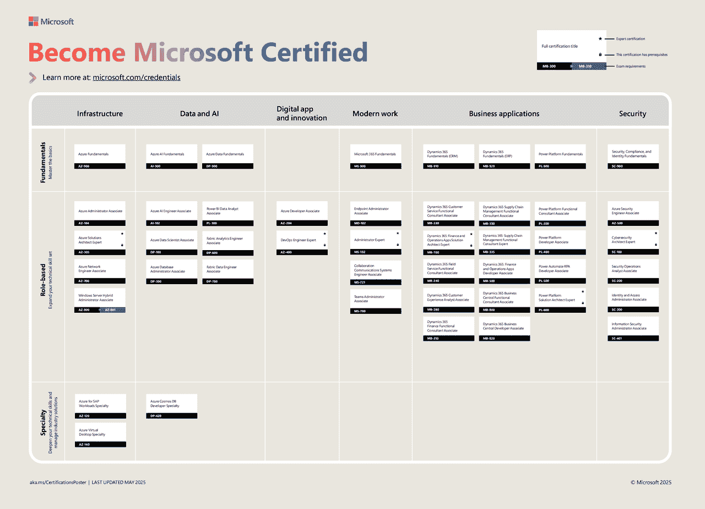

[Certification-Poster_en-us.pdf](https://internal-api-drive-stream.feishu.cn/space/api/box/stream/download/all/PkvxbkksSo1Nb8xCY2ychR0Pn2b)

`https://arch-center.azureedge.net/Credentials/Certification-Poster_en-us.pdf`

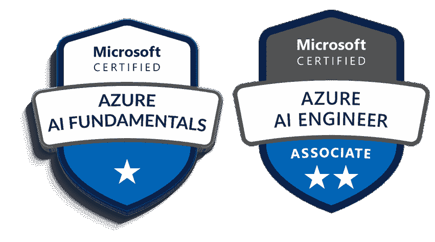

#### 更多微软Azure AI 认证

[Microsoft Azure AI Expert 认证课程](https://gotoaiworld.feishu.cn/wiki/VlKawuTuwiNlhxkPptqcA0VSn6g)

`https://microsoft-certificate.com/azure/azure-ai-certification-path/`

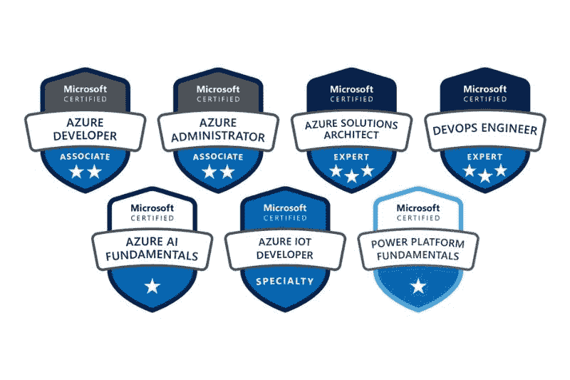

### 1.2 AWS 全球AI技术专家认证

#### AWS AI基础级认证

学习 AWS 云基础知识和核心概念。无需具备相关经验。

AWS Certified AI Practitioner

`AWS Certified AI Practitioner` 证书鉴定的是考生是否具备目前炙手可热的人工智能（AI）、机器学习（ML）、生成式人工智能概念及其相关领域应用场景的所需知识。增强您的竞争优势，为实现职业发展和增长收入打好基础。

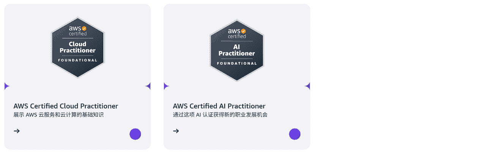

`https://aws.amazon.com/cn/certification/certified-ai-practitioner/`

#### AWS AI 助理级认证

验证 AWS 的核心技能。建议具有云或 IT 方面的经验。

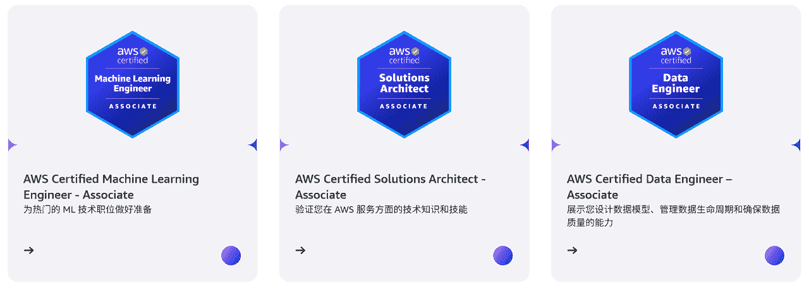

`https://aws.amazon.com/cn/certification/?nc2=h_mo`

#### AWS AI 专业级认证

掌握先进的 AWS 架构和解决方案。需要具有 2 年以上的 AWS 经验。

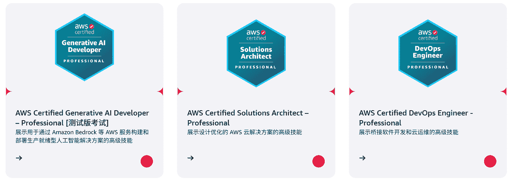

`https://aws.amazon.com/cn/certification/?nc2=h_mo`

#### AWS AI 专项级认证

展示特定 AWS 技术和服务方面的专业知识。

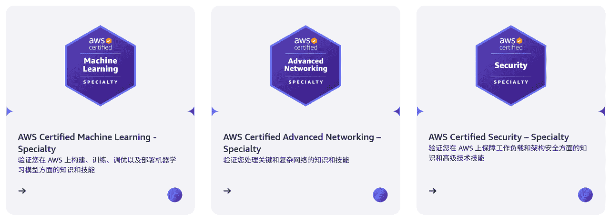

`https://aws.amazon.com/cn/certification/?nc2=h_mo`

#### 选择您的 AWS Ceritification 路径

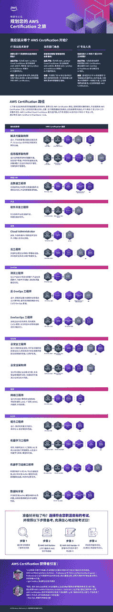

[AWS_certification_paths.pdf](https://internal-api-drive-stream.feishu.cn/space/api/box/stream/download/all/GkO2bySO3ocvmyxHGsRcysAjnTd)

### 1.3 NVIDIA 全球技术专家认证

#### NVIDIA 深度学习培训中心 (DLI)

`https://www.nvidia.cn/training/`

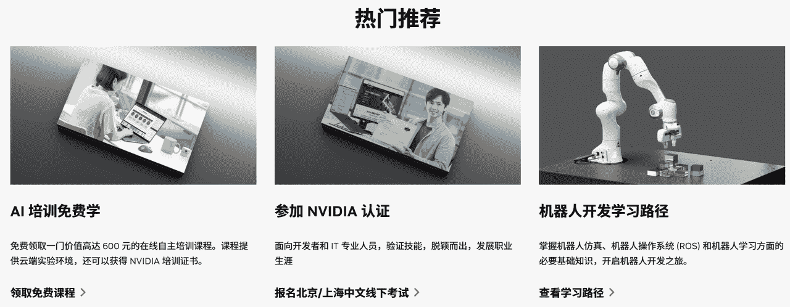

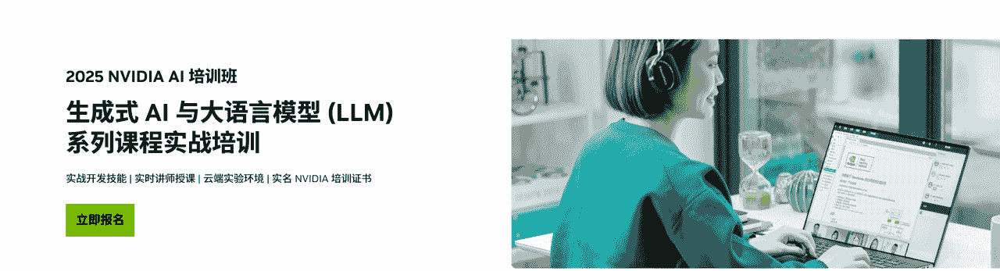

#### 面向开发者认证

##### `NVIDIA-Certified Associate: AI Infrastructure and Operations (NCA-AIIO)`

适用于 IT 专业人士和其他希望验证 AI 基础架构运维方面技能的人员的 Associate 级别认证。

##### `NVIDIA-Certified Professional: AI Infrastructure (NCP-AII)`

适用于 IT 专业人士的 Professional 级别认证，验证监控、排除故障和优化 AI 基础架构的能力。

##### `NVIDIA-Certified Professional: AI Operations (NCP-AIO)`

适用于 IT 专业人士的 Professional 级别认证，验证部署、管理和维护 AI 基础架构的能力。

##### `NVIDIA-Certified Professional: AI Networking (NCP-AIN)`

适用于 IT 专业人士的 Professional 级别认证，验证利用 NVIDIA 网络技术部署和配置环境的能力。

#### 面向 IT 专业人员认证

##### `NVIDIA-Certified Associate: Generative AI LLMs (NCA-GENL)`

适用于开发人员的 Associate 级别认证，验证生成式 AI 和大语言模型方面的技能。

##### `NVIDIA-Certified Associate: Multimodal Generative AI (NCA-GENM)`

适用于开发人员的 Associate 级别认证，验证多模态生成式 AI 方面的技能。

##### `NVIDIA-Certified Professional: Generative AI LLMs (NCP-GENL)`

适用于开发人员的 Professional 级别认证，验证设计、训练和微调前沿大语言模型的技能。

##### `NVIDIA-Certified Professional: Agentic AI (NCP-AAI)`

适用于开发人员的 Professional 级别认证，验证构建、开发、部署和治理先进代理式 AI 解决方案的技能。

##### `NVIDIA-Certified Professional: Accelerated Data Science (NCP-ADS)`

适用于开发人员的 Professional 级别认证，验证利用 GPU 加速工具和库进行数据科学工作流程方面的技能。

##### `NVIDIA-Certified Professional: OpenUSD Development (NCP-OUSD)`

适用于开发人员的 Professional 级别认证，验证使用 OpenUSD 构建、维护和优化 3D 内容创作工作流的能力。

`https://www.nvidia.cn/training/certification/`

### 1.4 IBM 全球认证AI技术专家认证

#### IBM Certified watsonx Generative AI Engineer - Associate

`https://www.ibm.com/training/certification/ibm-certified-watsonx-generative-ai-engineer-associate-C9007000`

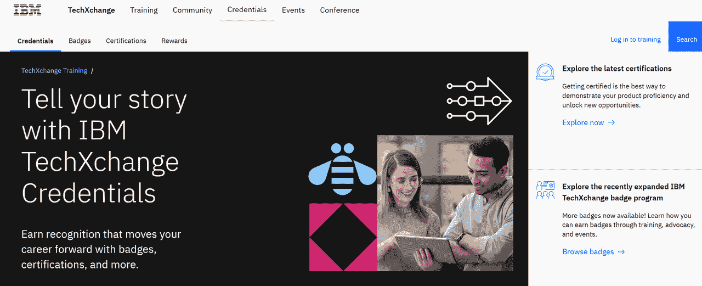

An Associate Generative AI Engineer is skilled in selecting, customizing, and prompting large language models. They can design and develop generative AI solutions using the `watsonx.ai` studio. This includes the ability to connect generative AI solutions to enterprise requirements and understand when various generative AI techniques and models are applicable to specific business problems.

Key concepts:

+ Generative AI architectures and use cases

+ Capabilities and limitations of large language models

+ Prompt engineering

+ Prompt tuning

+ Parameter-efficient fine tuning using InstructLab

+ Retrieval-augmented generation

+ Developing and deploying generative AI solutions

Associate level certifications test foundational level skills in either a product or solution area. These exams presume that a candidate has six months to a year of hands-on experience with the product or solution.

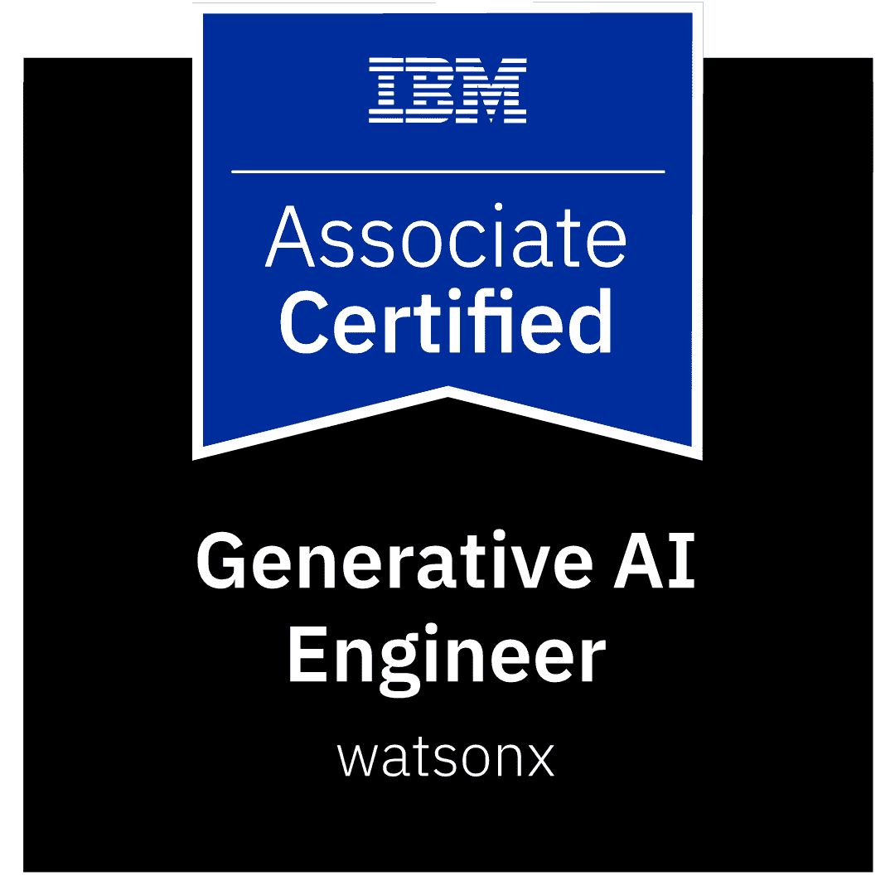

Exam `C1000-185`: IBM watsonx Generative AI Engineer v1 - Associate

### 1.5 阿里云AI技术专家认证

#### 阿里云大模型工程师ACA认证

阿里云大模型工程师ACA认证旨在培养非技术背景人员、无算法背景的工程技术人员和任何对大模型感兴趣的初学者，使之掌握大模型使用方法，利用大模型提升学习和工作效率，助力大模型在各个业务场景的落地。

`https://edu.aliyun.com/certification/aca05?spm=a2cwt.28380597.J_1564692210.18.5eef3487sFsdP4`

#### 阿里云大模型高级工程师ACP认证

阿里云大模型高级工程师ACP认证面向具备编程基础的生成式人工智能技术爱好者和应用开发者，培养针对复杂业务场景设计并实施大模型驱动的解决方案的能力

`https://edu.aliyun.com/certification/acp26?spm=a2cwt.28380597.J_1564692210.19.5eef3487sFsdP4`

#### 阿里云人工智能工程师ACA认证

# AI 认证体系

## 阿里云认证

### 阿里云大模型工程师ACA认证

阿里云大模型工程师ACA认证旨在培养非技术背景人员、无算法背景的工程技术人员和任何对大模型感兴趣的初学者，使之掌握大模型使用方法，利用大模型提升学习和工作效率，助力大模型在各个业务场景的落地。

https://edu.aliyun.com/certification/aca13?spm=a2cwt.28380597.J_1564692210.17.5eef3487sFsdP4

### 阿里云人工智能高级工程师ACP认证

阿里云人工智能高级工程师ACP认证是面向使用阿里云人工智能产品的算法研究、开发、应用、售前、架构等人员的专业技术认证，主要涉及机器学习和深度学习等通用知识，以及阿里云机器学习平台PAI、阿里云视觉智能产品等。

https://edu.aliyun.com/certification/acp10?spm=a2cwt.28380597.J_1564692210.20.5eef3487sFsdP4

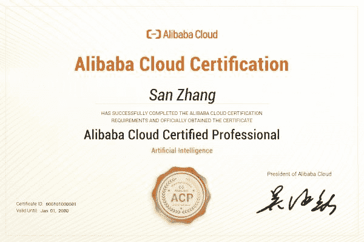

## 百度云AI技术专家认证

大模型产业人才认证旨在评估工程师在提示词运用与大模型应用开发等方面的专业能力，从而为企业和机构提供具备专业素养的大模型方向应用类工程师

工信部人才交流中心发布的《大模型技术与应用产业人才岗位能力要求》为指导，设置证书能力评估方向，查看完整标准内容

https://aistudio.baidu.com/certification?ad-from=81410

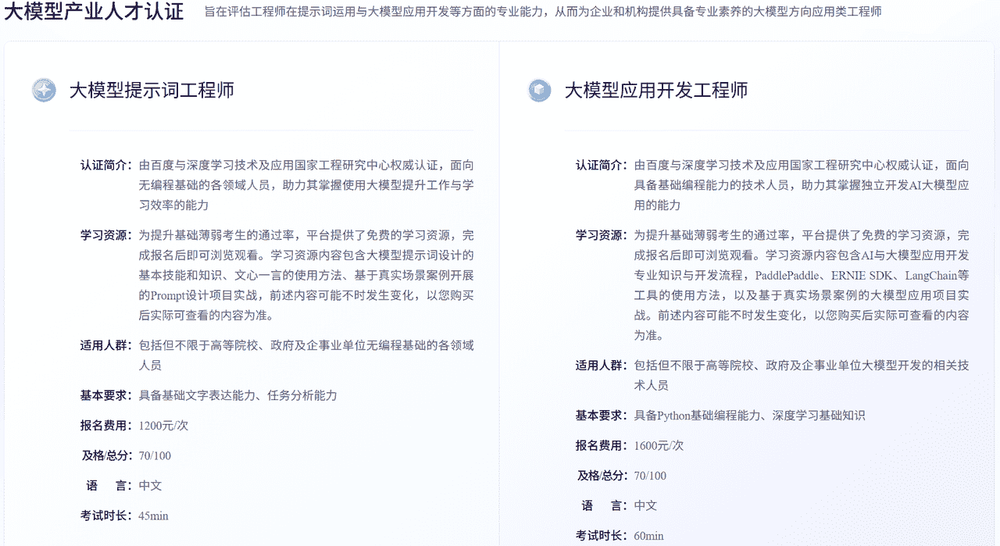

### 大模型提示词工程师

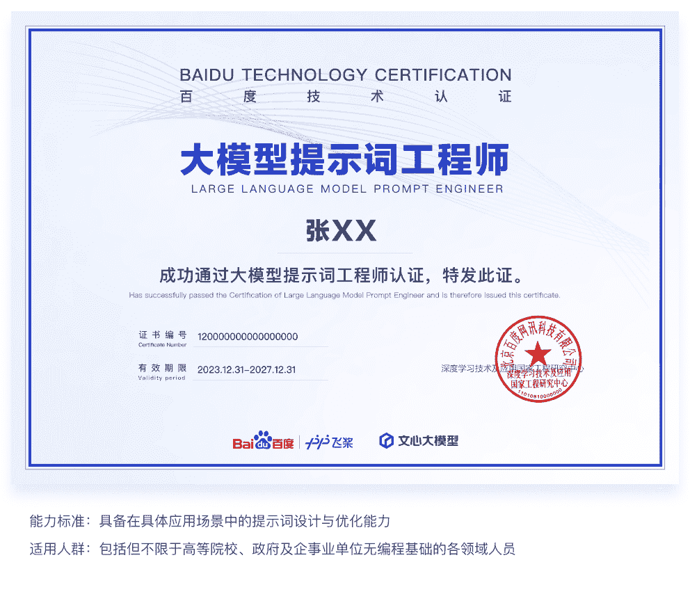

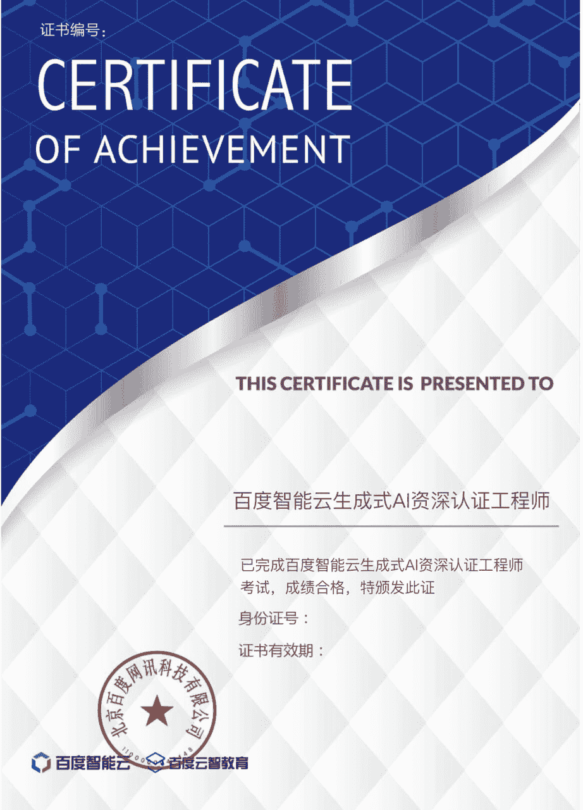

### 大模型应用开发工程师

https://aistudio.baidu.com/course/introduce/33172

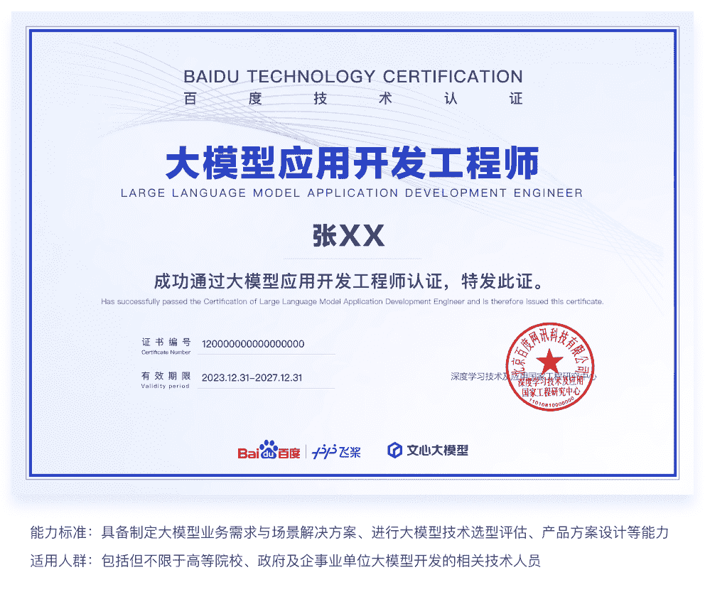

## 工信部AI认证

### AI 智能体运营工程师

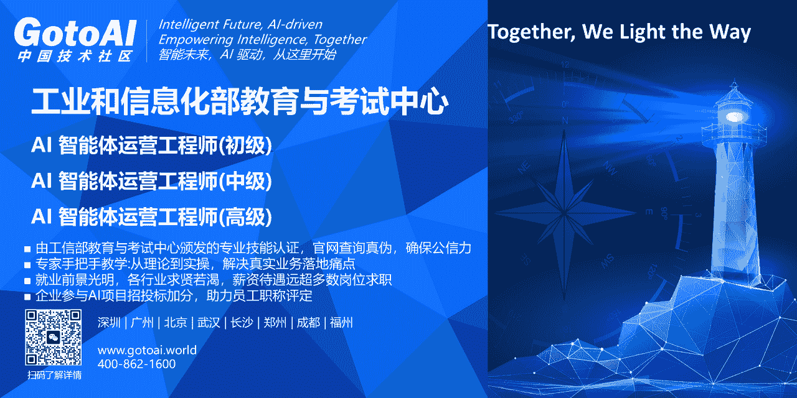

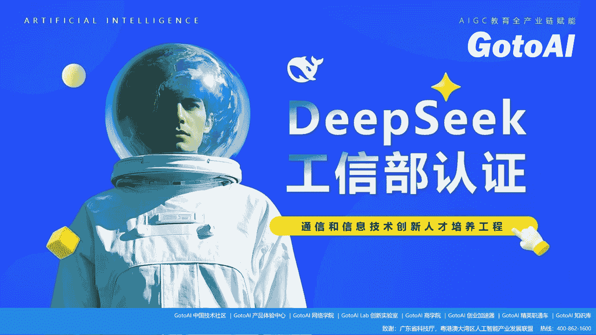

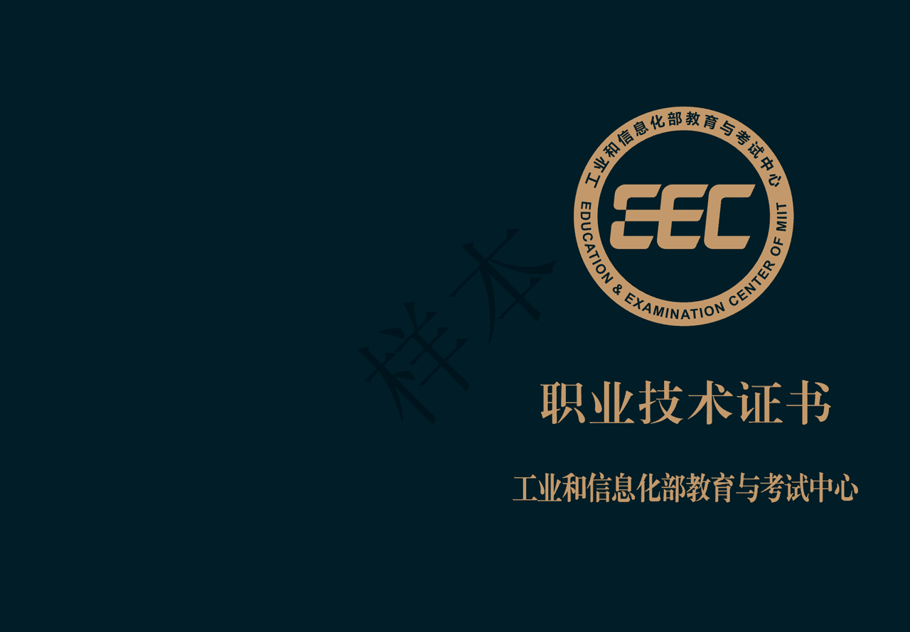

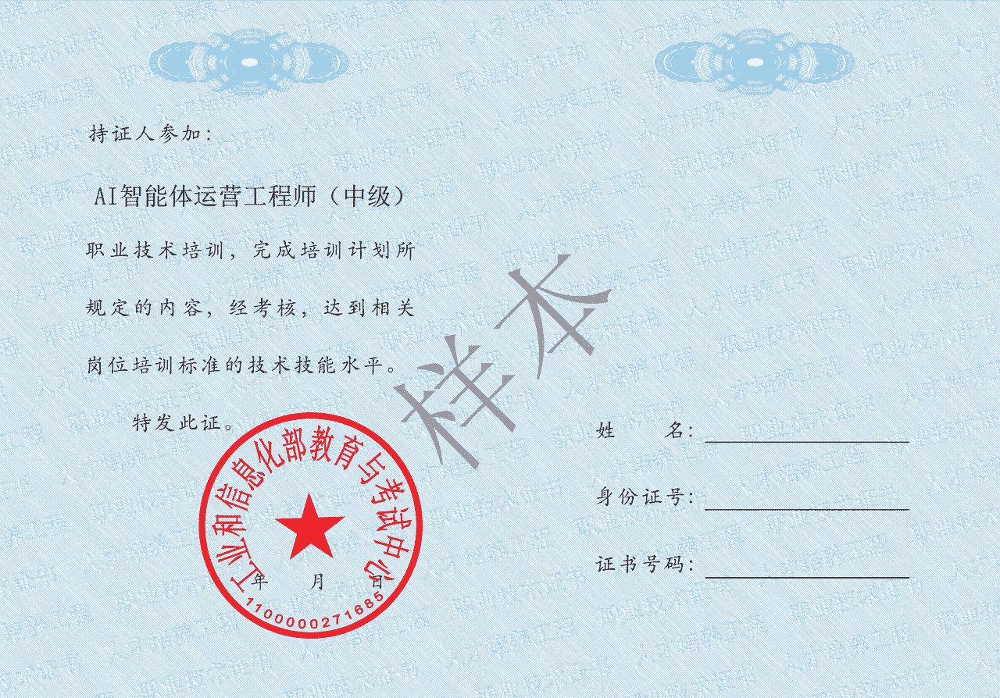

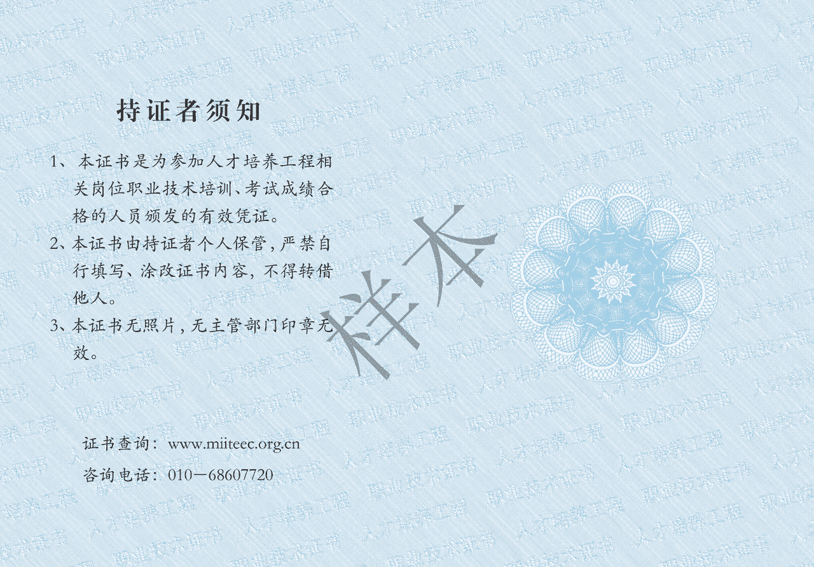

[AI智能体运营工程师（初级）考试题库](https://oas76xd8hm.feishu.cn/wiki/NF5RwtEfpi3QZ9ky1m2cjdhxnLa?from=from_copylink)（初级题库最终版）

[AI智能体运营工程师（中级）考试题库](https://w1l7bkrqiuj.feishu.cn/docx/S36xdy4euoXBORxUVU3c6SeDnph?from=from_copylink)（中级题库最终版）

[智能体运营工程师高级考核题库完整版](https://cbe85pxjd1.feishu.cn/docx/VjbLdbnR7okeHpxZO87clUwxnee?from=from_copylink)（高级题库最终版）

## 人社厅AI认证

《人工智能训练师》是经人力资源社会保障部门备案的用人单位和社会培训评价组织在备案职业(工种)范围内依据国家职业技能标准和备案的评价规范对劳动者进行职业技能等级认定， 对经认定合格者颁发职业技能等级证书。

### 人工智能训练师

《人工智能训练师》的职业技能等级分为5个等级，由低到高分别是五级至一级：五级、四级、三级、 二级、一级。

其中， 职业技能等级证书指的是全国通用的权威证书，无需年审，终身有效，一证一码，可在国家官方网站(人力资源社会保障部技能鉴定中心全国联网查询系统查询)联网查询。

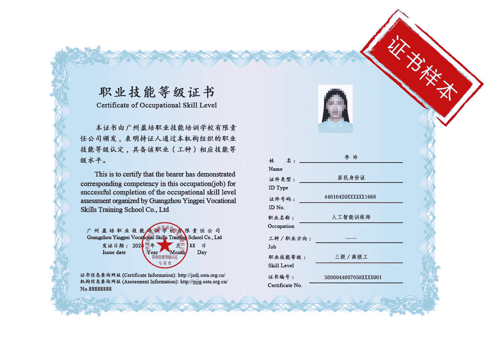

[火爆！AI+教育黄金赛道开启](https://gotoaiworld.feishu.cn/wiki/VgKVwMdiXijHhskepuLcJoY6noc)

## 4.GotoAI中国技术社区AI认证

### Microsoft AI Agent for Beginners

### Midjourney Al-Generated Art lmages for Beginners

### Coze 智能体开发工程师(初级)

### n8n 智能体与工作流开发工程师(初级)

### Dify 智能体与工作流开发工程师(初级)

### RAGFIoW RAG应用开发工程师(初级)

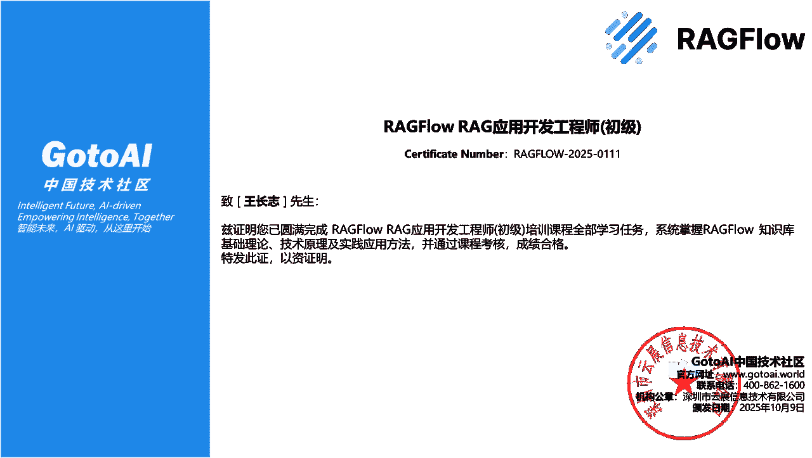

## 5.GotoAI 高级技术顾问/培训讲师

请参考：

[AI战略顾问及AI讲师团队](https://gotoaiworld.feishu.cn/wiki/CNkdwvVVqijRpRk7OVVcbCAznw3)

### 核心AI战略技术顾问

> GotoAI 技术社区核心技术骨干来自Microsoft, AWS, Googel, 阿里，腾讯，华为，字节跳动全球AI领域顶级厂商的技术咨询和服务团队以及国内最早的AI技术社区的布道者，包括：微软Semantic Kernel(SK)中文社区，LangChain中文社区，Prompt Engineering中文社区，ModelScope魔搭,Meta Llama中文，Hugging Face中文社区，AIGC技术社区

Steven Li

资深微软AI技术顾问/专家，微软认证AI架构师，微软MCT培训讲师，前埃森哲(中国)有限公司解决方案技术专家。国内最早接受美国OpenAI及Microsoft内部技术专家培训和通过微软全球Azure AI认证考试的AI大模架构师。专注于AI大模型技术研究，AI大模型应用开发，AI行业应用解决方案研究，AI工作坊和解决方案咨询服务。
