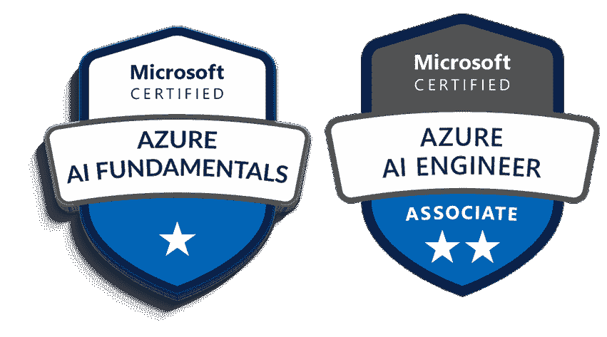
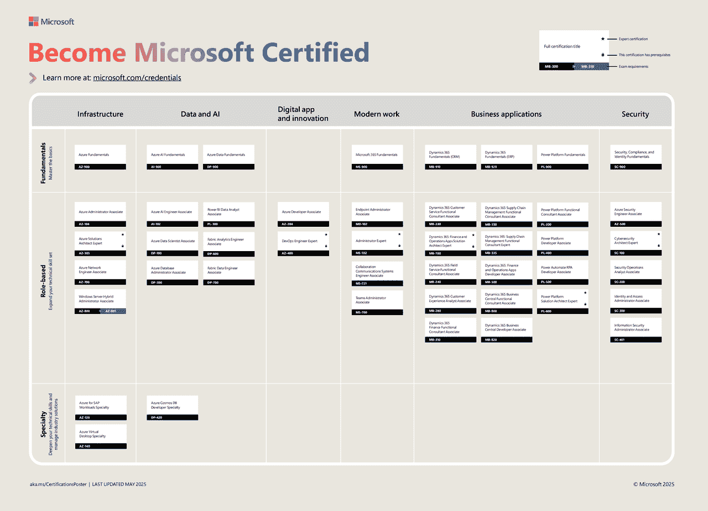
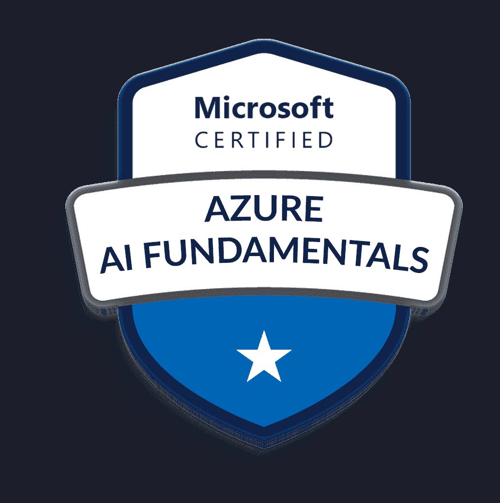
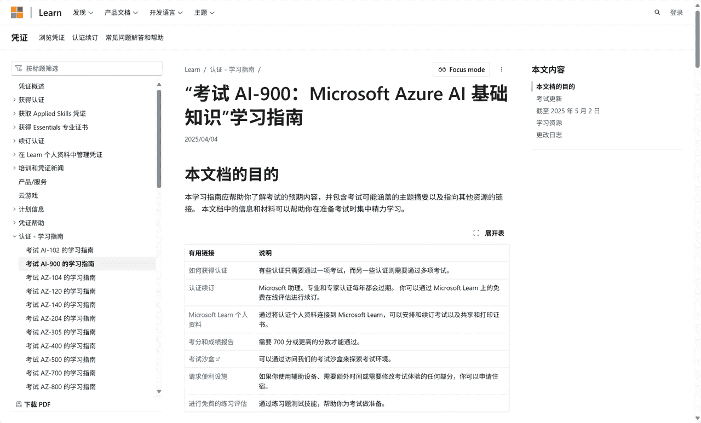
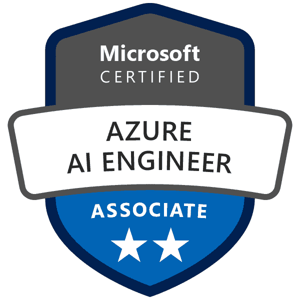
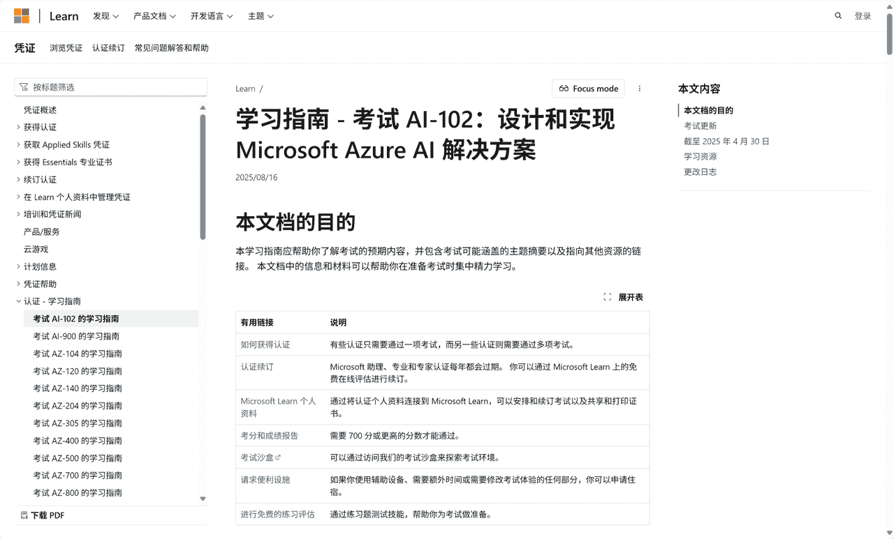
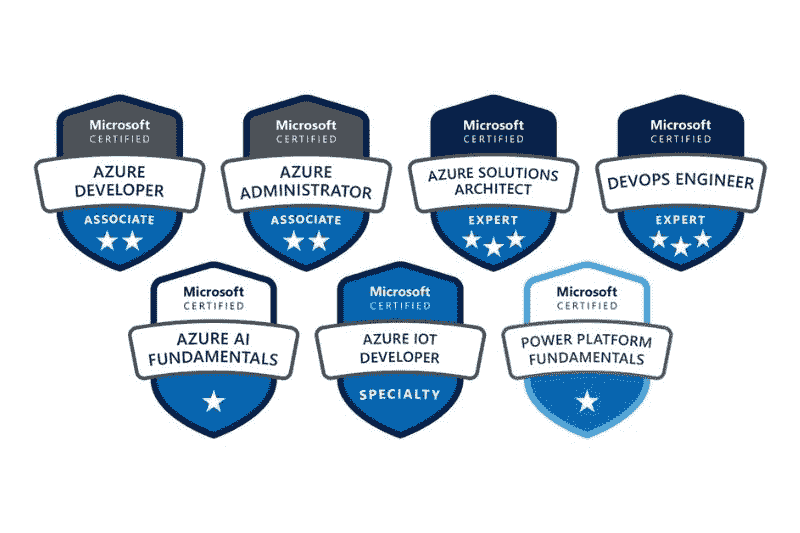

# Microsoft Azure AI Expert 认证课程

> 来源：[https://gotoaiworld.feishu.cn/docx/A9ecdLaN7oj2PwxyuaVc2szzn8f](https://gotoaiworld.feishu.cn/docx/A9ecdLaN7oj2PwxyuaVc2szzn8f)

# 一、微软AI认证与考试全景图

微软人工智能认证证书（英文名：Azure AI Fundamentals）是由微软官方最新研发的一项有关人工智能的认证证书。想要获得该证书，需通过AI-900测试或者AI-102。

微软AI人工智能证书分为两个等级：

初级：AI900认证

中级：AI102认证

## Microsoft Azure AI Certification poster 证书海报

[Certification-Poster_en-us.pdf](https://internal-api-drive-stream.feishu.cn/space/api/box/stream/download/all/Ro6gbERVHolwUEx58yXc5OE7nMh)

https://arch-center.azureedge.net/Credentials/Certification-Poster_en-us.pdf

## 2.Microsoft认证：Azure AI 基础知识

Microsoft Certified: Azure AI Fundamentals

考试 AI-900

https://learn.microsoft.com/zh-cn/credentials/certifications/azure-ai-fundamentals/?practice-assessment-type=certification&WT.mc_id=certposter_poster-wwl

https://learn.microsoft.com/zh-cn/credentials/certifications/resources/study-guides/ai-900

“考试 AI-900：Microsoft Azure AI 基础知识”学习指南

## 3.Microsoft认证：Azure AI 工程师助理

Microsoft Certified: Azure AI Engineer Associate

考试 AI-102

https://learn.microsoft.com/zh-cn/credentials/certifications/azure-ai-engineer/?practice-assessment-type=certification&WT.mc_id=certposter_poster-wwl

https://learn.microsoft.com/zh-cn/credentials/certifications/resources/study-guides/ai-102

学习指南 - 考试 AI-102：设计和实现 Microsoft Azure AI 解决方案

更多微软认证

# 一、微软AI认证与考试价值

## 1.微软Azure AI证书样本

https://arch-center.azureedge.net/Credentials/Certification-Poster_en-us.pdf

## 2.微软Azure AI证书价值

主要体现在以下几点：

+   **职业发展助力**

+   **增强专业可信度**：获得该证书能展示个人在人工智能概念和技术方面的专业能力，是对自身技能的有力证明，可提升在数据分析师、机器学习工程师、AI开发人员等岗位上的专业形象，在同行中脱颖而出，让雇主更直观地了解持证人的AI知识水平和应用能力。

+   **拓宽职业道路**：AI技术在各行业的应用日益广泛，拥有此证书可在不同领域和岗位间转换，增加职业选择机会。例如，系统管理员获得认证后可向AI工程师、云架构师、数据科学家等方向发展；网络管理员能借助认证知识优化网络性能和安全，拓展到AI相关的网络管理领域；销售 specialists能更好地理解AI技术在销售中的应用，如利用AI分析客户数据、预测销售趋势，从而开拓新的职业发展路径。

+   **提升薪资待遇**：根据行业报告，拥有Azure AI认证的工程师，平均薪资水平高于行业平均水平20%。在就业市场上，微软AI人工智能证书是衡量一个人是否具备AI技术能力的重要标准，拥有该证书的人才往往具有较高的竞争力，能够获得更好的职业发展和薪资待遇。

+   **学习提升价值**

+   **构建知识体系**：备考过程有助于学习者系统地掌握人工智能的基础知识，包括机器学习、计算机视觉、自然语言处理、语音识别等多个领域，以及Azure云计算平台上相关AI服务的应用，帮助建立起全面的AI知识架构，为深入学习和研究AI技术打下坚实基础。

+   **紧跟技术潮流**：AI领域发展迅速，通过准备认证考试，学习者需要不断关注最新的技术动态和行业趋势，保持对新技术的敏感度，从而促使持证人持续学习和更新知识，以适应AI行业的快速变化。

+   **行业认可优势**

+   **全球广泛认可**：微软认证在全世界90多个国家认可有效，是全球范围内具有较高知名度和权威性的IT认证之一。Azure AI Fundamentals作为微软官方认证的人工智能证书，在国际上受到广泛认可，具有较高的含金量，为持证人在全球范围内的职业发展提供了有力支持。

+   **企业招聘参考**：在企业招聘AI人才时，微软Azure AI认证是重要的参考标准之一。特别是AI-102认证，作为Azure AI领域的核心认证，专注于验证在Azure平台上设计和实施AI解决方案的核心能力，能让企业快速筛选出具备相关专业能力的人才，对于求职者来说，是进入知名企业和参与重要AI项目的敲门砖。