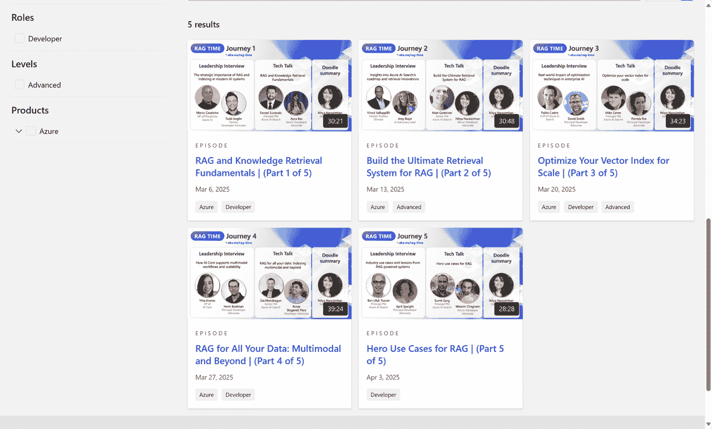

# RAG Time: AI Learning

> 来源：[https://gotoaiworld.feishu.cn/docx/FxF8dIz1OoMOSNxcjOWcZRYHnAf](https://gotoaiworld.feishu.cn/docx/FxF8dIz1OoMOSNxcjOWcZRYHnAf)

# 一、Introduction-RAG Time: AI Learning

> RAG Time is an AI learning series focused on Retrieval-Augmented Generation (RAG) and advanced retrieval techniques

RAG Time is an AI learning series focused on Retrieval-Augmented Generation (RAG) and advanced retrieval techniques. Each session features expert-led discussions, exclusive leadership interviews, and demos, while guiding developers to hands-on samples and more learning resources in the RAG Time GitHub repository for practical implementation. Topics cover indexing fundamentals, vector search, hybrid search, multimodal retrieval, and optimization strategies, with real.

https://learn.microsoft.com/en-us/shows/rag-time-ai-learning/

# 二、Video - RAG Time: AI Learning

https://learn.microsoft.com/en-us/shows/rag-time-ai-learning/