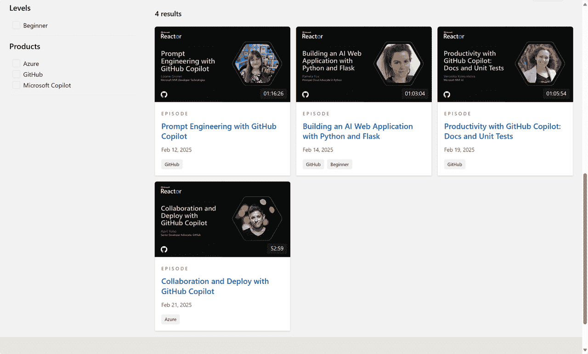

# GitHub Copilot Bootcamp

> 来源：[https://gotoaiworld.feishu.cn/docx/UG3qdb9reoYjssxpGEhcB8xXnBd](https://gotoaiworld.feishu.cn/docx/UG3qdb9reoYjssxpGEhcB8xXnBd)

# 一、Introduction-GitHub Copilot Bootcamp

The GitHub Copilot Bootcamp is a 4-part live class series designed to equip you with the tools and knowledge needed to supercharge your development productivity and fully leverage GitHub Copilot. In this bootcamp, youll learn how to streamline your workflow with GitHub Copilotmastering everything from crafting effective prompts to automating repetitive tasks like testing and documentation. Don't miss out on this opportunity to take your coding skills to the next level!

https://learn.microsoft.com/en-us/shows/github-copilot-bootcamp/

# 二、Video-GitHub Copilot Bootcamp

https://learn.microsoft.com/en-us/shows/github-copilot-bootcamp/