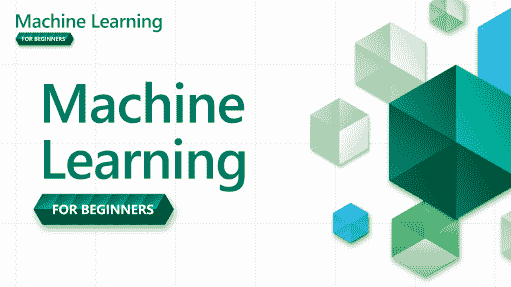

# ML-For-Beginners

> 来源：[https://gotoaiworld.feishu.cn/docx/Ar46d0iV2oSFfoxAd4WcP46snFf](https://gotoaiworld.feishu.cn/docx/Ar46d0iV2oSFfoxAd4WcP46snFf)

# 一、Introduction-Machine Learning for Beginners - A Curriculum

> 🌍 Travel around the world as we explore Machine Learning by means of world cultures 🌍

Cloud Advocates at Microsoft are pleased to offer a 12-week, 26-lesson curriculum all about Machine Learning. In this curriculum, you wi[ll learn about what](https://aka.ms/ds4beginners) is sometimes called classic machine learning, using primarily Scikit-learn as a library and avoiding deep learning, which is covered in our AI for Beginners' curriculum. Pair these lessons with our 'Data Science for Beginners' curriculum, as well!

Travel with us around the world as we apply these classic techniques to data from many areas of the world. Each lesson includes pre- and post-lesson quizzes, written instructions to complete the lesson, a solution, an assignment, and more. Our project-based pedagogy allows you to learn while building, a proven way for new skills to 'stick'.

✍️ Hearty thanks to our authors Jen Looper, Stephen Howell, Francesca Lazzeri, Tomomi Imura, Cassie Breviu, Dmitry Soshnikov, Chris Noring, Anirban Mukherjee, Ornella Altunyan, Ruth Yakubu and Amy Boyd

🎨 Thanks as well to our illustrators Tomomi Imura, Dasani Madipalli, and Jen Looper

🙏 Special thanks 🙏 to our Microsoft Student Ambassador authors, reviewers, and content contributors, notably Rishit Dagli, Muhammad Sakib Khan Inan, Rohan Raj, Alexandru Petrescu, Abhishek Jaiswal, Nawrin Tabassum, Ioan Samuila, and Snigdha Agarwal

🤩 Extra gratitude to Microsoft Student Ambassadors Eric Wanjau, Jasleen Sondhi, and Vidushi Gupta for our R lessons!

https://github.com/microsoft/ML-For-Beginners?WT.mc_id=academic-105485-koreyst

## Getting Started

Follow these steps:

1.  Fork the Repository: Click on the "Fork" button at the top-right corner of this page.

1.  Clone the Repository: git clone https://github.com/microsoft/ML-For-Beginners.git

> [find all additional resources for this ](https://learn.microsoft.com/en-us/collections/qrqzamz1nn2wx3?WT.mc_id=academic-77952-bethanycheum)course in our Microsoft Learn collection

[Students](https://aka.ms/student-page), to use this curriculum, fork the entire repo to your own GitHub account and complete the exercises on your own or with a group:

+   Start with a pre-lecture quiz.

+   Read the lecture and complete the activities, pausing and reflecting at each knowledge check.

+   Try to create the projects by comprehending the lessons rather than running the solution code; however that code is available in the /solution folders in each project-oriented lesson.

+   Take the post-lecture quiz.

+   Complete the challenge.

+   Complete the assignment.

+   After completing a lesson group, visit the Discussion Board and "learn out loud" by filling out the appropriate PAT rubric. A 'PAT' is a Progress Assessment Tool that is a rubric you fill out to further your learning. You can also react to other PATs so we can learn together.

> For further study, we recomm[end following t](https://docs.microsoft.com/en-us/users/jenlooper-2911/collections/k7o7tg1gp306q4?WT.mc_id=academic-77952-leestott)hese Microsoft Learn modules and learning paths.

Teachers, we have included some suggestions on how to use this curriculum.

---

## Video walkthroughs

Some of the lessons are available as short form vide[o](https://aka.ms/ml-beginners-videos). You can find all these in-line in the lessons, or on the ML for Beginners playlist on the Microsoft Developer YouTube channel by clicking the image below.

---

## Meet the Team

Gif by [Mohit Jaisal](https://linkedin.com/in/mohitjaisal)

> 🎥 Click the image above for a video about the project and the folks who created it!

---

## Pedagogy

We have chosen two pedagogical tenets while building this curriculum: ensuring that it is hands-on project-based and that it includes frequent quizzes. In addition, this curriculum has a common theme to give it cohesion.

By ensuring that the content aligns with projects, the process is made more engaging for students and retention of concepts will be augmented. In addition, a low-stakes quiz before a class sets the intention of the student towards learning a topic, while a second quiz after class ensures further retention. This curriculum was designed to be flexible and fun and can be taken in whole or in part. The projects start small and become increasingly complex by the end of the 12-week cycle. This curriculum also includes a postscript on real-world applications of ML, which can be used as extra credit or as a basis for discussion.

> Find our [Code of Conduct](https://github.com/microsoft/ML-For-Beginners/blob/main/CODE_OF_CONDUCT.md), [Contributing](https://github.com/microsoft/ML-For-Beginners/blob/main/CONTRIBUTING.md), and [Translation](https://github.com/microsoft/ML-For-Beginners/blob/main/TRANSLATIONS.md) guidelines. We welcome your constructive feedback!

## Each lesson includes

+   optional sketchnote

+   optional supplemental video

+   video walkthrough (some lessons only)

+   pre-lecture warmup quiz

+   written lesson

+   for project-based lessons, step-by-step guides on how to build the project

+   knowledge checks

+   a challenge

+   supplemental reading

+   assignment

+   post-lecture quiz

> A note about languages: These lessons are primarily written in Python, but many are also available in R. To complete an R lesson, go to the /solution folder and look for R lessons. They include an .rmd extension that represents an R Markdown file which can be simply defined as an embedding of code chunks (of R or other languages) and a YAML header (that guides how to format outputs such as PDF) in a Markdown document. As such, it serves as an exemplary authoring framework for data science since it allows you to combine your code, its output, and your thoughts by allowing you to write them down in Markdown. Moreover, R Markdown documents can be rendered to output formats such as PDF, HTML, or Word.

> A note about quizzes: All quizz[es are containe](https://github.com/microsoft/ML-For-Beginners/blob/main/quiz-app)d in Quiz App folder, for 52 total quizzes of three questions each. They are linked from within the lessons but the quiz app can be run locally; follow the instruction in the quiz-app folder to locally host or deploy to Azure.

> [find all additional resources for this ](https://learn.microsoft.com/en-us/collections/qrqzamz1nn2wx3?WT.mc_id=academic-77952-bethanycheum)course in our Microsoft Learn collection

## Offline access

You can run this documentati[on offl](https://docsify.js.org/#/)[ine by using Do](https://docsify.js.org/#/quickstart)csify. Fork this repo, install Docsify on your local machine, and then in the root folder of this repo, type docsify serve. The website will be served on port 3000 on your localhost: localhost:3000.

## PDFs

Find a pdf of the cu[rric](https://microsoft.github.io/ML-For-Beginners/pdf/readme.pdf)ulum with links here.

## Help Wanted

Would you like to contribute a [tran](https://github.com/microsoft/ML-For-Beginners/issues)slation? Please read our translation guidelines and add a templated issue to manage the workload here.

## 🎒 Other Courses

Our team produces other courses! Check out:

+   Generative AI for Beginners

+   Generative AI for Beginners .NET

+   Generative AI with JavaScript

+   Generative AI with Java

+   AI for Beginners

+   Data Science for Beginners

+   ML for Beginners

+   Cybersecurity for Beginners

+   Web Dev for Beginners

+   IoT for Beginners

+   XR Development for Beginners

+   [Mastering GitHub Copilot fo](https://github.com/microsoft/Mastering-GitHub-Copilot-for-Paired-Programming)r Paired Programming

+   [Mastering GitHub Copilot fo](https://github.com/microsoft/mastering-github-copilot-for-dotnet-csharp-developers)r C#/.NET Developers

+   Choose Your Own Copilot Adventure

# 二、Video ML-For-Beginners

https://github.com/microsoft/ML-For-Beginners?WT.mc_id=academic-105485-koreyst