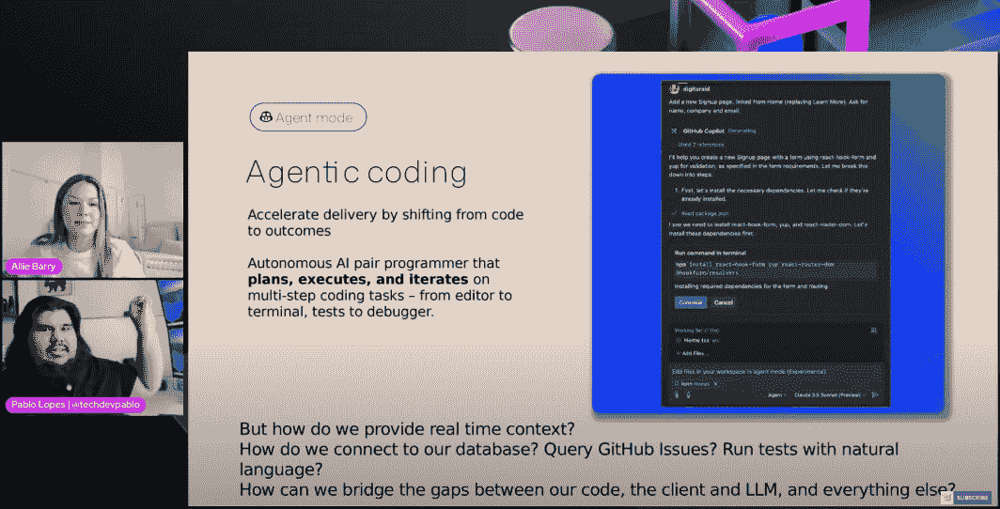
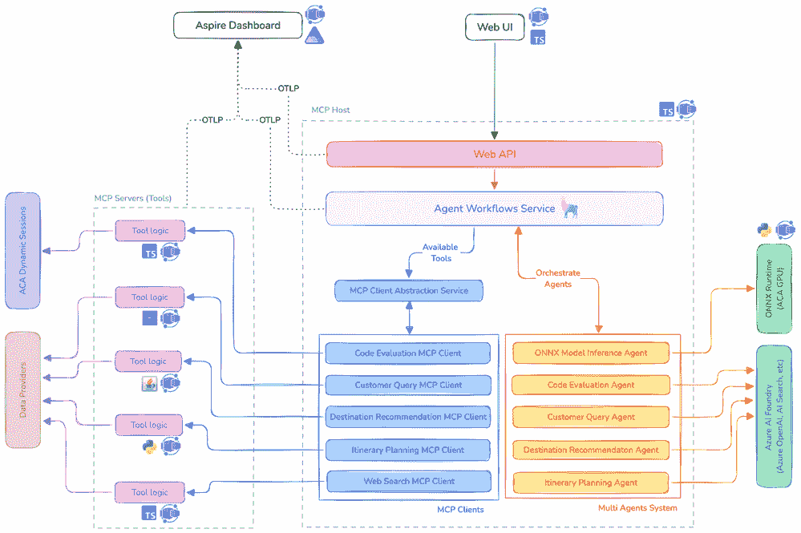
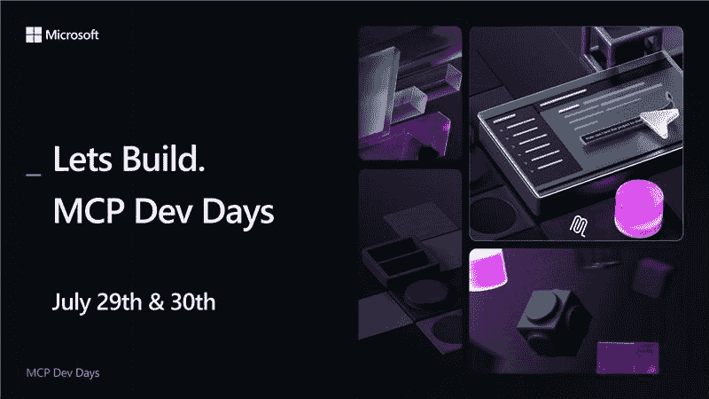

# MCP for Beginners

> 来源：[https://gotoaiworld.feishu.cn/docx/TKm0dV7shoEzACx0HqMcPNXXnig](https://gotoaiworld.feishu.cn/docx/TKm0dV7shoEzACx0HqMcPNXXnig)

# 一、Introduction-MCP for Beginners

> Let’s Learn MCP Series Recap: 8 Languages, 4 Code Bases, Full Resources

The Model Context Protocol (MCP) has quickly established itself as the go-to standard for seamlessly connecting AI agents with a variety of external tools and services. In just a few months, it has become a prominent topic at developer events and forums, gaining adoption from companies of all sizes. To meet the rapid pace of advancements, we ran a series of beginner-friendly training events on MCP. If you didn’t catch these events live, don’t worry! They’re all linked below for you to watch at your own pace.

In these training sessions, our presenters ran through…

What is MCP?

Let’s Learn MCP Series Recap: 8 Languages, 4 Code Bases, Full Resources.

# AI Repo of the Week: MCP for Beginners

[DanWahlin](https://techcommunity.microsoft.com/users/danwahlin/803709)

Microsoft

May 23, 2025

## **Introduction**

Welcome to this week’s spotlight in our AI Repo of the Week series—introducing the MCP for Beginners course, a fantastic starting point for AI developers and enthusiasts eager to navigate the world of Model Context Protocol (MCP). This open-source GitHub repository offers an in-depth exploration of MCP, an interface designed to extend the capabilities of AI models by integrating them with external tools, APIs, and data sources. Whether you’re new to MCP or looking to strengthen your understanding, this comprehensive resource is a perfect fit.

The repository provides practical lessons and examples that guide developers through creating MCP servers in multiple programming environments, including C#, Python, Java, and TypeScript. A primary goal is to demystify the process of building scalable AI applications by employing standardized protocols. Here’s a quick overview of what you can expect from this repository.

## Key Features & Learning Journey

Getting Started with MCP

The “MCP for Beginners” repository kicks off with an introduction to the Model Context Protocol, setting the stage by explaining why a standardized approach matters for scalable AI applications. Users can quickly get their hands dirty with step-by-step lessons designed to implement basic server functionality. This practical approach ensures that you not only learn the MCP theory but also see it in action. The repository is structured to facilitate a smooth learning curve, with each section building on the previous one. Here are a few of the key features you’ll learn about:

+   Core Concepts Explained : In-depth exploration of the core concepts of MCP, including client-server architecture, key protocol components, and messaging patterns.

+   First Server Setup : Begin by creating your first MCP server. You’ll explore how to utilize tools like the inspector to test and debug your setups.

+   Client Development : Progress to building a client that can interact with the MCP server. Special attention is given to enhancing client capabilities using Large Language Models (LLMs).

+   Advanced Server Integration : Learn to operate MCP servers in various environments, including consumption via GitHub Copilot Agent and Visual Studio Code.

Here’s the complete MCP curriculum structure:

+   Introduction to MCP Overview of the Model Context Protocol and its significance in AI pipelines, including what is the Model Context Protocol, why standardization matters and practical use cases and benefits.

+   Core Concepts Explained In-depth exploration of the core concepts of MCP, including client-server architecture, key protocol components, and messaging patterns.

+   [Security in MCP](https://github.com/microsoft/mcp-for-beginners/blob/main/02-Security/README.md) Identifying security threats within MCP-based systems, techniques and best practices for securing implementations.

+   Getting Started with MCP Environment setup and configuration, creating basic MCP servers and clients, integrating MCP with existing applications.

+   [First server](https://github.com/microsoft/mcp-for-beginners/blob/main/03-GettingStarted/01-first-server/README.md) Setting up a basic server using the MCP protocol, understanding the server-client interaction, and testing the server.

+   [First client](https://github.com/microsoft/mcp-for-beginners/blob/main/03-GettingStarted/02-client/README.md) Setting up a basic client using the MCP protocol, understanding the client-server interaction, and testing the client.

+   [Client with LLM](https://github.com/microsoft/mcp-for-beginners/blob/main/03-GettingStarted/03-llm-client/README.md) Setting up a client using the MCP protocol with a Large Language Model (LLM).

+   [Consuming a server wit](https://github.com/microsoft/mcp-for-beginners/blob/main/03-GettingStarted/04-vscode/README.md)h Visual Studio Code Setting up Visual Studio Code to consume servers using the MCP protocol.

+   Creating a server using SSE SSE helps expose a server to the internet. This section will help you create a server using SSE.

+   [Use AI Toolkit](https://github.com/microsoft/mcp-for-beginners/blob/main/03-GettingStarted/06-aitk/README.md) AI Toolkit is a great tool that will help you manage your AI and MCP workflow.

+   Testing your server Testing is an important part of the development process. This section will help you test using several different tools.

+   Deploy your server How do you go from local development to production? This section will help you develop and deploy your server.

+   Practical Implementation Using SDKs across different languages, debugging, testing, and validation, crafting reusable prompt templates and workflows.

+   Advanced Topics in MCP Multi-modal AI workflows and extensibility, secure scaling strategies, MCP in enterprise ecosystems.

+   Community Contributions How to contribute code and docs, collaborating via GitHub, community-driven enhancements and feedback.

+   Insights from Early Adoption Real-world implementations and what worked, building and deploying MCP-based solutions, trends and future roadmap.

+   Best Practices for MCP Performance tuning and optimization, designing fault-tolerant MCP systems, testing and resilience strategies.

+   MCP Case Studies Deep-dives into MCP solution architectures, deployment blueprints and integration tips, annotated diagrams and project walkthroughs.

## Practical Implementation

Throughout the curriculum, you’ll explore key MCP concepts alongside diverse, hands-on samples that demonstrate practical applications in multiple programming languages. For example, a simple calculator server illustrates how MCP principles can be applied to build API endpoints for operations like addition, subtraction, multiplication, and division, complete with type safety and error handling.

## Advanced Concepts and Case Study

In addition to covering MCP fundamentals, the course will also walk you through more advanced topics as well. This includes learning about multi-modal integrations, highlighting how AI models can expand beyond text-only capabilities to include data types like images and audio. You’ll also learn about scalable MCP architectures, security, performance optimization, and more.

The course also walks you through an Azure AI Travel Agents case study that demonstrates using MCP in an AI agents scenario.

## **Conclusion**

MCP for Beginners is a great resource for anyone journeying into the realm of AI and MCP development. It provides developers with the necessary knowledge and tools to create flexible and scalable AI applications that can integrate with a variety of data sources.

Dive[ into the reposito](https://github.com/microsoft/mcp-for-beginners)ry, experiment with the provided examples and tools, and quickly get up-to-speed on what MCP is and how you can begin using it. Visit the MCP for Beginners repository on GitHub, star it, and help drive forward the mission of better, standardized AI integrations.

## Additional AI Courses

In addition to the MCP for Beginners course, check out the following courses as well:

+   AI Agents For Beginners

+   [Generative AI for ](https://github.com/microsoft/Generative-AI-for-beginners-dotnet?WT.mc_id=academic-105485-koreyst)Beginners using .NET

+   [Generative AI for Beginn](https://github.com/microsoft/generative-ai-with-javascript)ers using JavaScript

+   Generative AI for Beginners

+   ML for Beginners

+   Data Science for Beginners

+   AI for Beginners

+   [Mastering GitHub Copilot for A](https://aka.ms/GitHubCopilotAI?WT.mc_id=academic-105485-koreyst)I Paired Programming

+   [Mastering GitHub Copilot fo](https://github.com/microsoft/mastering-github-copilot-for-dotnet-csharp-developers?WT.mc_id=academic-105485-koreyst)r C#/.NET Developers

+   Choose Your Own Copilot Adventure

# 二、Video-MCP for Beginners

## Sessions

In total, we ran the training 18 times to reach developers using different programming languages.