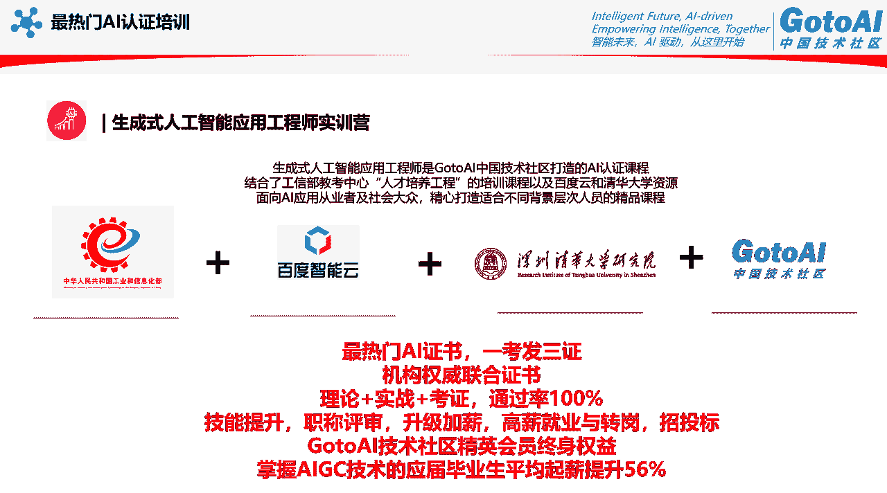
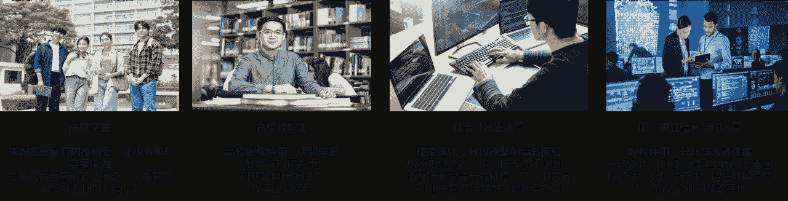
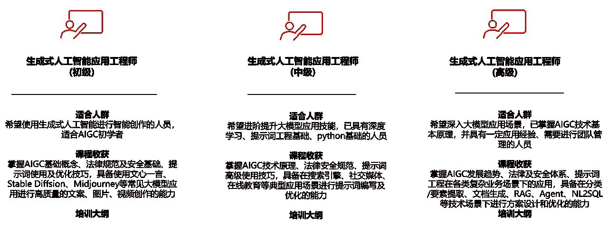
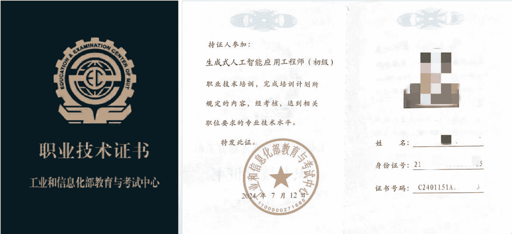
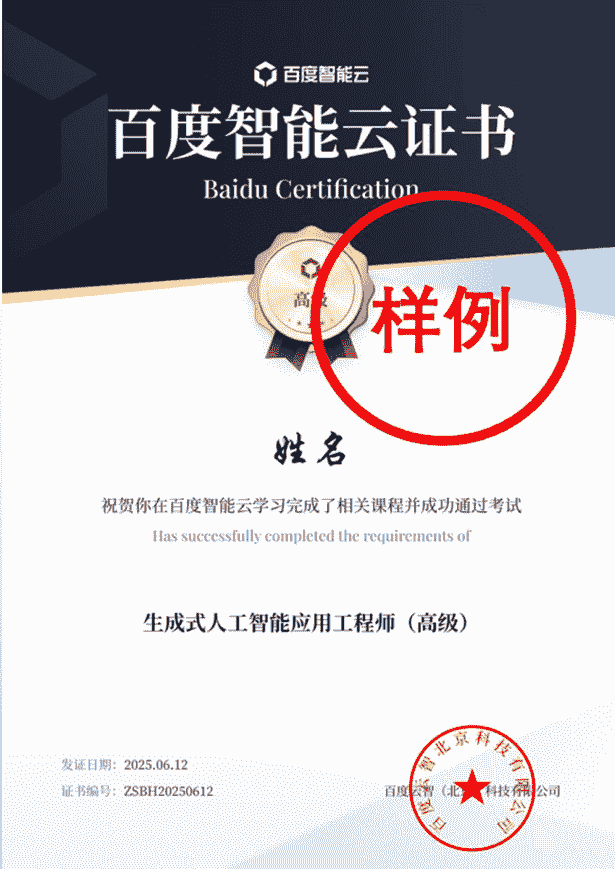
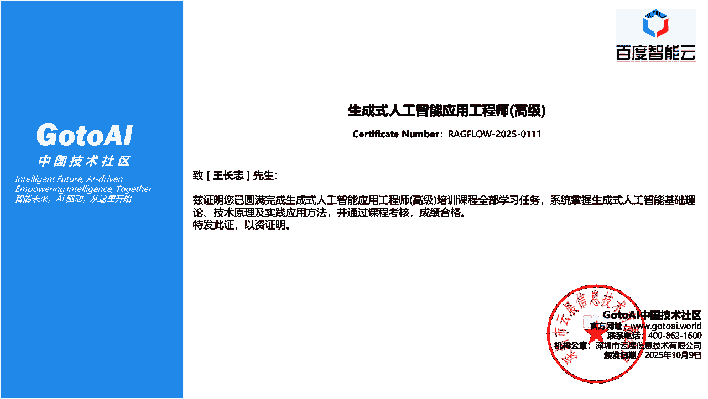
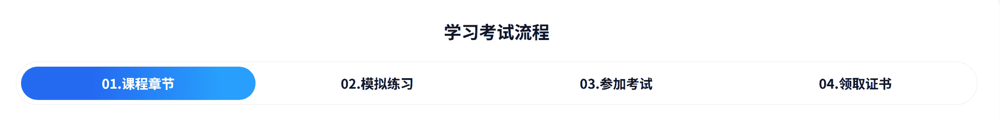
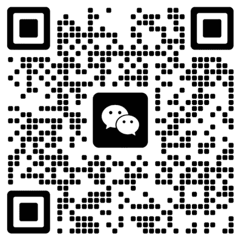

# 工信部人工智能应用工程师认证培训

> 来源：[https://gotoaiworld.feishu.cn/docx/B6oDdGvrJoMJSxxNE9ucUbP9nrb](https://gotoaiworld.feishu.cn/docx/B6oDdGvrJoMJSxxNE9ucUbP9nrb)

# 一、工信部人工智能应用工程师认证培训概览

# 二、证书样本

### 工信部

### 百度云

### GotoAI中国技术社区

# 二、生成式人工智能应用工程师(初级)

### 适合人群

希望使用生成式人工智能进行智能创作的人员，适合AIGC初学者

### 课程收获

掌握AIGC基础概念、法律规范及安全基础、提示词使用及优化技巧，具备使用文心一言、Stable Diffsion、Midjourney等常见大模型应用进行高质量的文案、图片、视频创作的能力

## 第一章、生成式人工智能概述

+   1.1 生成式人工智能背景介绍

+   1.2 生成式人工智能技术原理和发展

+   1.3 Transformer 模型简介

+   1.4 百度文心一言架构与简介

+   1.5 chatgpt 模型架构与简介

## 第二章、职业道德

+   2.1 生成式人工智能的法律、伦理和版权

+   2.2 生成式人工智能工程的伦理原则

+   2.3 人工智能的规范与标准

## 第三章、数据安全基础

+   3.1 生成式人工智能数据安全概述

+   3.2 生成式人工智能安全风险

+   3.3 大语言模型提示注入攻击安全风险

+   3.4 实际案例分析

## 第四章、提示词工程（共 5 课时）

+   4.1 提示词工程课程概述

+   4.2 提示词工程课程概述

+   4.3 提示词训练与优化技巧

+   4.4 训练个性化的优质提示词（含实训）

+   4.5 识别生成式人工智能答案的真伪

## 第五章、文案创作

+   5.1 课程概述

+   5.2 文案创作基础

+   5.3 使用生成式人工智能生成宣传文案

+   5.4 使用生成式人工智能生成产品描述（含实训）

+   5.5 使用生成式人工智能生成短视频文案

+   5.6 使用生成式人工智能生成 PPT

## 第六章、图像创作

+   6.1 Diffusion Models 模型制作拼图（含实训）

+   6.2 DALLE 模型制作 AI 图像

+   6.3 Stable Diffusion 模型图像混合与参数设置

+   6.4 Midjourney 模型与图像混合

+   6.5 生成式人工智能图像模型演练与工作流程（含实训）

+   6.6 DALL·E、Midjourney、Diffusion Models、Stable

+   6.7 项目实践：通过 Midjourney 训练电商商家独有的 AI 模特

## 第七章、视频创作

+   7.1 VideoGPT 模型制作视频

+   7.2 Video+Diffusion+Models 模型制作视频

+   7.3 通过 AI 模特制作宣传视频

## 第八章、应用实验

+   8.1 闲聊对话实验

+   8.2 问答实验

+   8.3 客服实验（含实训）

+   8.4 创意实验

+   8.5 其他实验

## 第九章、项目实训

+   9.1 人工智能创作：诗歌、散文与音乐生成（含实训）

+   9.2 个性化推荐：新闻、商品与广告推荐

+   9.3 短视频制作

+   9.4 教学辅助：备课、出题、论文创作

+   9.5 职业规划：学习计划、简历、论文创作

## 第十章、零基础速通 DeepSeek

## 第十一章、解析 MCP：AI 领域的” 万能插头 “

# 三、生成式人工智能应用工程师(中级)

### 适合人群

希望进阶提升大模型应用技能，已具有深度学习、提示词工程基础、python基础的人员

### 课程收获

掌握AIGC技术原理、法律安全规范、提示词高级使用技巧，具备在搜索引擎、社交媒体、在线教育等典型应用场景进行提示词编写及优化的能力

## 第一章、生成式人工智能概述

+   1.1 生成式人工智能背景介绍

+   1.2 生成式人工智能技术原理和发展

+   1.3 transformer 模型简介

+   1.4 百度文心一言架构与简介

+   1.5 ChatGPT 模型架构与简介

## 第二章、职业道德

+   2.1 生成式人工智能的法律、伦理和版权

+   2.2 人工智能治理原则

## 第三章、数据安全基础

+   3.1 物理安全技术

+   3.2 信息安全技术

## 第四章、提示词工程

+   4.1 提示词工程技术简介

+   4.2 提示技术的分类（含实训）

+   4.3 工具与模型库

## 第五章、提示词的生成与优化

+   5.1 自然语言处理技术与生成式人工智能应用

+   5.2 提示词的自动生成（含实训）

+   5.3 提示词的优化与调整

## 第六章、提示词的常用生成器与工具

+   6.1 提示词生成器的分类与特点

+   6.2 常用的提示词生成器与工具介绍

## 第七章、应用实验

+   7.1 机器学习库文本分类应用

+   7.2 深度学习库文本生成应用

+   7.3 模型选择和调参（含实训）

+   7.4 RAG 原理与流程

+   7.5 实战构建一个 RAG 应用

## 第八章、项目实训

+   8.1 提示词工程的应用场景（含实训）

## 第九章、零基础速通 DeepSeek

## 第十章、解析 MCP：AI 领域的 “万能插头”

# 四、生成式人工智能应用工程师(高级)

### 适合人群

希望深入大模型应用场景，已掌握AIGC技术基本原理，并具有一定应用经验、需要进行团队管理的人员

### 课程收获

掌握AIGC发展趋势、法律及安全体系、提示词工程在各类复杂业务场景下的应用，具备在分类/要素提取、文档生成、RAG、Agent、NL2SQL等技术场景下进行方案设计和优化的能力

## 第一章 生成式人工智能概述

+   1.1 生成式人工智能背景介绍

+   1.2 ChatGPT 模型架构与简介

## 第二章 职业道德

+   2.1 互联网信息服务深度合成管理规定

+   2.2 人工智能伦理规范

## 第三章 数据安全基础

+   3.1 数据安全管理体系

+   3.2 数据安全合规性与审计

## 第四章 提示词工程应用场景

+   4.1 个性化推荐系统实现（含实训）

+   4.2 社交媒体中的提示词工程

+   4.3 在线教育中的提示词工程

+   4.4 智能客服中的提示词工程

+   4.5 其他领域中的提示词工程应用场景分析

## 第五章 提示词工程中的技术应用

+   5.1 分类和要素提取中的提示词优化

+   5.2 文档生成中的提示词优化

+   5.3 RAG 中的提示词优化

+   5.4 Agent 中的提示词优化（含实训）

+   5.5 NL2SQL 中的提示词优化（含实训）

## 第六章 提示词工程的创新应用

+   6.1 提示词工程的创新方向

+   6.2 提示词工程的跨领域应用

+   6.3 提示词工程的未来展望

## 第七章 提示词工程安全与合规

+   7.1 提示词工程中的数据安全

+   7.2 提示词工程中的合规要求

+   7.3 提示词工程中的隐私保护

## 第八章 项目实训

+   8.1 大模型应用研发项目需求分析（含实训）

+   8.2 大模型应用研发项目开发流程及技巧

+   8.3 大模型应用研发项目应用分析

+   8.4 大模型应用项目成果展示与评估

## 第九章 提示词工程团队的组织结构

+   9.1 大模型应用研发团队的组织结构

+   9.2 大模型应用研发团队的人员招聘与培训

+   9.3 大模型应用研发团队的绩效考核与激励

## 第十章 零基础速通 DeepSeek

## 第十一章 解析 MCP：AI 领域的 “万能插头”

# 五、咨询与报名

[报名链接](https://gotoaiworld.feishu.cn/share/base/form/shrcnIz1yE5iNisqW4RilT9V6Zf)

扫码报名

电话：400-862-1600

邮件：booming@gotoai.world

扫码：

