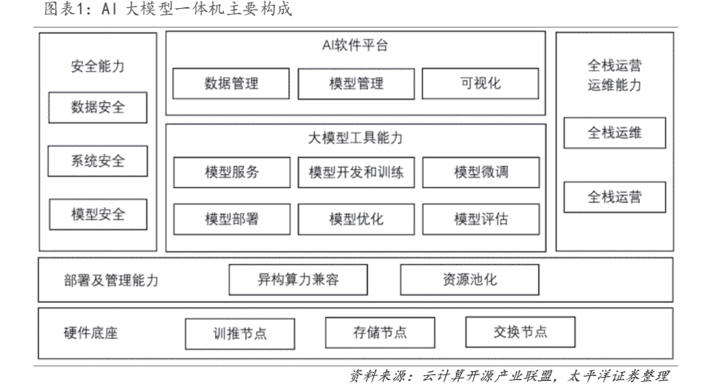
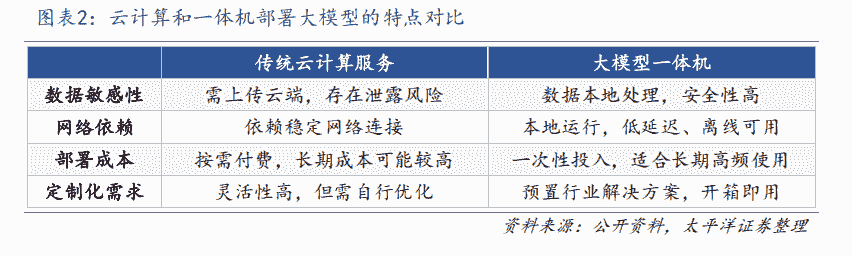
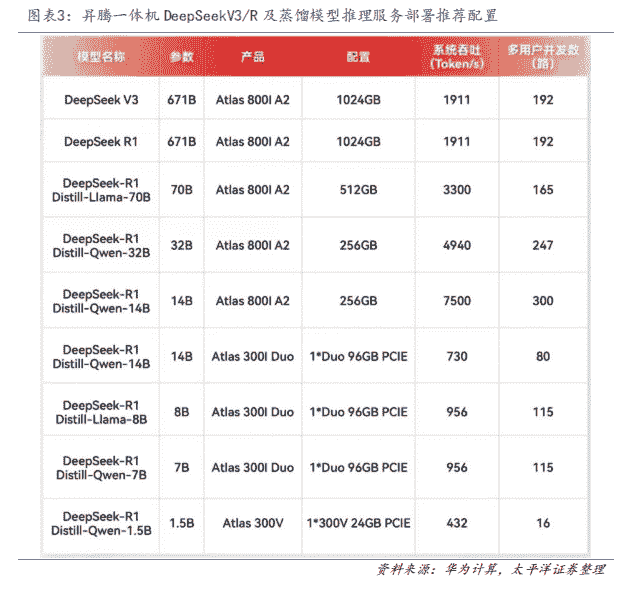
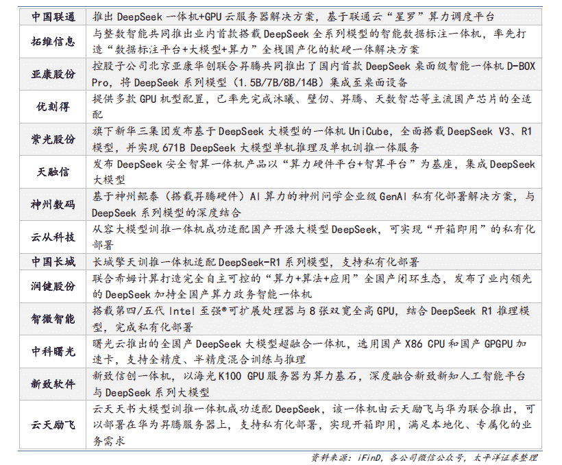
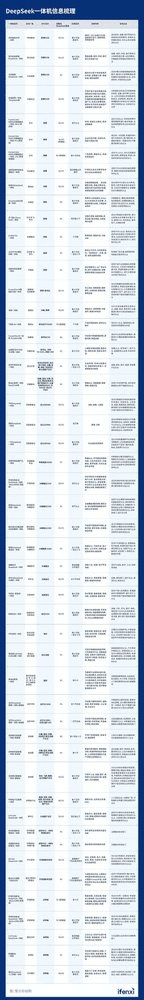

# 大模型市场洞察分析Interviews

> 来源：[https://gotoaiworld.feishu.cn/docx/K7Jkd7UFdoyPjQxH1azcIr2xnob](https://gotoaiworld.feishu.cn/docx/K7Jkd7UFdoyPjQxH1azcIr2xnob)

# 一、国产

> 输入 @ 插入相关文档，介绍项目成立的背景

1.  ...

# 二、大模型一体机

> **目标一：**制定具体、细化、可拆解的目标

> **目标二：**......

## 一文详解一产业技术：大模型DeepSeek一体机

多家厂商积极推出 DeepSeek 一体机。昇腾推出从服务器、推理卡、到加速模组等丰富的一体机产品形态，全面适配 DeepSeek V3/R1 满血版/蒸馏版本全系列模型，涵盖智能对话、智能编程、文档分析、开发板等全场景应用，能够满足各类用户在不同场景下的 AI 需求。截至 2 月 12日，已有 13 家伙伴基于昇腾产品打造自有 DeepSeek 一体机产品，满足细分市场的多样化需求。此外，还有多家厂商发布了基于海光、沐曦、壁仞等国产算力芯片的 DeepSeek 一体机。

**下载链接：**

[**AI Agent智能体行业深度：产业格局、发展展望、产业链及相关企业**](https://mp.weixin.qq.com/s?search_click_id=3954860979284522223-1742866733590-5394648994&__biz=MzI4Nzk4OTY3MQ==&mid=2247517778&idx=1&sn=e1a448570659e7286b38adba2457b239&chksm=ea674206b8bb7735341daddd586263596c0dff873666bfb782f15eb97d0e67df81c9b5736924&scene=7&key=daf9bdc5abc4e8d07beaf44ceafe446241f5a19167ce777c893a893a052a0776b8503c020545c3543654ebd28234d57eb38544022ef89819c945487f20d0b4d0be51d3aab3c2eac3c957709e1b73f2412f1c3d42d4b69b67ae26c3b2251ebcaf4c3447fdc292cc461b7c6694efd060071d6405d7e78876b9aef98b118dbcc246&ascene=0&uin=MjI5MTEzNzU2MQ%3D%3D&devicetype=Windows+11+x64&version=63090c2d&lang=zh_CN&countrycode=CN&exportkey=n_ChQIAhI🐧BL%2BG%2B9dhBRgEk7YclNAqhLlAQIE97dBBAEAAAAAALgCEFl5cLAAAAAOpnltbLcz9gKNyK89dVj0m6U15qInrxejQcW%2FpAA72TMw8SRUFDfnhE%2Bo21CWdw3BlelQpsvRCCKvMo7xWzGHD1TAembSVg74DVxqYXqO%2B%2B%2BFsLxfbM6phIvpov5INNX0Bn5JrfbNMq46cDIFxWWwpbwhsz3ZWSOkt%2BFKdip3yy1r%2BtMKJCZM1rzWJhmCzc%2FnQ1cgo9f28xWocZ4CXm49YsJcJjQXJ6cs021vmkWHVSUonCFbSoZRiy864IZYtdWi7%2B%2Fa%2F6QRgHyM7Z%2BTMmE%3D&acctmode=0&pass_ticket=CTbAnqITliHJ4Cjckehq6Ynvxqg3Fe83q8qcdy%2FPHvCvAZicFAsOISc%2FwsnOY04q&wx_header=1&fasttmpl_type=0&fasttmpl_fullversion=7653845-zh_CN-zip&fasttmpl_flag=1)[**深**](https://mp.weixin.qq.com/s?search_click_id=3954860979284522223-1742866733590-5394648994&__biz=MzI4Nzk4OTY3MQ==&mid=2247517778&idx=1&sn=e1a448570659e7286b38adba2457b239&chksm=ea674206b8bb7735341daddd586263596c0dff873666bfb782f15eb97d0e67df81c9b5736924&scene=7&key=daf9bdc5abc4e8d07beaf44ceafe446241f5a19167ce777c893a893a052a0776b8503c020545c3543654ebd28234d57eb38544022ef89819c945487f20d0b4d0be51d3aab3c2eac3c957709e1b73f2412f1c3d42d4b69b67ae26c3b2251ebcaf4c3447fdc292cc461b7c6694efd060071d6405d7e78876b9aef98b118dbcc246&ascene=0&uin=MjI5MTEzNzU2MQ%3D%3D&devicetype=Windows+11+x64&version=63090c2d&lang=zh_CN&countrycode=CN&exportkey=n_ChQIAhI🐧BL%2BG%2B9dhBRgEk7YclNAqhLlAQIE97dBBAEAAAAAALgCEFl5cLAAAAAOpnltbLcz9gKNyK89dVj0m6U15qInrxejQcW%2FpAA72TMw8SRUFDfnhE%2Bo21CWdw3BlelQpsvRCCKvMo7xWzGHD1TAembSVg74DVxqYXqO%2B%2B%2BFsLxfbM6phIvpov5INNX0Bn5JrfbNMq46cDIFxWWwpbwhsz3ZWSOkt%2BFKdip3yy1r%2BtMKJCZM1rzWJhmCzc%2FnQ1cgo9f28xWocZ4CXm49YsJcJjQXJ6cs021vmkWHVSUonCFbSoZRiy864IZYtdWi7%2B%2Fa%2F6QRgHyM7Z%2BTMmE%3D&acctmode=0&pass_ticket=CTbAnqITliHJ4Cjckehq6Ynvxqg3Fe83q8qcdy%2FPHvCvAZicFAsOISc%2FwsnOY04q&wx_header=1&fasttmpl_type=0&fasttmpl_fullversion=7653845-zh_CN-zip&fasttmpl_flag=1)[**度梳理Deep**](https://mp.weixin.qq.com/s?search_click_id=3954860979284522223-1742866733590-5394648994&__biz=MzI4Nzk4OTY3MQ==&mid=2247517778&idx=1&sn=e1a448570659e7286b38adba2457b239&chksm=ea674206b8bb7735341daddd586263596c0dff873666bfb782f15eb97d0e67df81c9b5736924&scene=7&key=daf9bdc5abc4e8d07beaf44ceafe446241f5a19167ce777c893a893a052a0776b8503c020545c3543654ebd28234d57eb38544022ef89819c945487f20d0b4d0be51d3aab3c2eac3c957709e1b73f2412f1c3d42d4b69b67ae26c3b2251ebcaf4c3447fdc292cc461b7c6694efd060071d6405d7e78876b9aef98b118dbcc246&ascene=0&uin=MjI5MTEzNzU2MQ%3D%3D&devicetype=Windows+11+x64&version=63090c2d&lang=zh_CN&countrycode=CN&exportkey=n_ChQIAhI🐧BL%2BG%2B9dhBRgEk7YclNAqhLlAQIE97dBBAEAAAAAALgCEFl5cLAAAAAOpnltbLcz9gKNyK89dVj0m6U15qInrxejQcW%2FpAA72TMw8SRUFDfnhE%2Bo21CWdw3BlelQpsvRCCKvMo7xWzGHD1TAembSVg74DVxqYXqO%2B%2B%2BFsLxfbM6phIvpov5INNX0Bn5JrfbNMq46cDIFxWWwpbwhsz3ZWSOkt%2BFKdip3yy1r%2BtMKJCZM1rzWJhmCzc%2FnQ1cgo9f28xWocZ4CXm49YsJcJjQXJ6cs021vmkWHVSUonCFbSoZRiy864IZYtdWi7%2B%2Fa%2F6QRgHyM7Z%2BTMmE%3D&acctmode=0&pass_ticket=CTbAnqITliHJ4Cjckehq6Ynvxqg3Fe83q8qcdy%2FPHvCvAZicFAsOISc%2FwsnOY04q&wx_header=1&fasttmpl_type=0&fasttmpl_fullversion=7653845-zh_CN-zip&fasttmpl_flag=1)Seek行业深度：市场表现、发展展望、产业机遇及相关公司深度梳理半导体先进封装行业深度：市场现状、发展前瞻、产业链及相关企业深度梳理ASIC行业深度：市场前景、规模预测、云厂商布局及相关公司深度梳理技术合集下载：

1、《71份信创国产化报告全集汇总》

2、《165份元宇宙报告全集汇总》

3、《41份机器人行业洞察报告合集》

4、《71份低空经济&eVTOL技术合集》

5、《240+份5G/6G技术报告全集汇总》

6、《109+份智能驾驶&智车报告合集》

7、《56+份DeepSeek报告合集》

... ...

[**

本号技术资料全部上传至知识**](https://mp.weixin.qq.com/s?search_click_id=3954860979284522223-1742866733590-5394648994&__biz=MzI4Nzk4OTY3MQ==&mid=2247517778&idx=1&sn=e1a448570659e7286b38adba2457b239&chksm=ea674206b8bb7735341daddd586263596c0dff873666bfb782f15eb97d0e67df81c9b5736924&scene=7&key=daf9bdc5abc4e8d07beaf44ceafe446241f5a19167ce777c893a893a052a0776b8503c020545c3543654ebd28234d57eb38544022ef89819c945487f20d0b4d0be51d3aab3c2eac3c957709e1b73f2412f1c3d42d4b69b67ae26c3b2251ebcaf4c3447fdc292cc461b7c6694efd060071d6405d7e78876b9aef98b118dbcc246&ascene=0&uin=MjI5MTEzNzU2MQ%3D%3D&devicetype=Windows+11+x64&version=63090c2d&lang=zh_CN&countrycode=CN&exportkey=n_ChQIAhI🐧BL%2BG%2B9dhBRgEk7YclNAqhLlAQIE97dBBAEAAAAAALgCEFl5cLAAAAAOpnltbLcz9gKNyK89dVj0m6U15qInrxejQcW%2FpAA72TMw8SRUFDfnhE%2Bo21CWdw3BlelQpsvRCCKvMo7xWzGHD1TAembSVg74DVxqYXqO%2B%2B%2BFsLxfbM6phIvpov5INNX0Bn5JrfbNMq46cDIFxWWwpbwhsz3ZWSOkt%2BFKdip3yy1r%2BtMKJCZM1rzWJhmCzc%2FnQ1cgo9f28xWocZ4CXm49YsJcJjQXJ6cs021vmkWHVSUonCFbSoZRiy864IZYtdWi7%2B%2Fa%2F6QRgHyM7Z%2BTMmE%3D&acctmode=0&pass_ticket=CTbAnqITliHJ4Cjckehq6Ynvxqg3Fe83q8qcdy%2FPHvCvAZicFAsOISc%2FwsnOY04q&wx_header=1&fasttmpl_type=0&fasttmpl_fullversion=7653845-zh_CN-zip&fasttmpl_flag=1)星球，加入全球政企解决方案（知识星球）下载10000+份行业方案资料。

(一)DeepSeek 带动企业私有化 AI 部署需求

DeepSeek 模型私有化部署需求激增。DeepSeek 开源模型适配完成并上线后，云上访问量和用量激增，用户访问过程中经常出现“服务器繁忙”的提示。根据《科创板日报》报道，由于直接 API 调用的不稳定，很多企业已经开始探索较为简易的私有化部署。多家厂商推出了不同规格和配置的一体机解决方案。

什么是 AI 大模型一体机？AI 大模型一体机是专为人工智能大模型应用和部署而设计的集成计算设备，本质上可以看作是 AI 服务器与大模型私有化部署的融合，通常包含中央处理器（CPU）、图形处理器（GPU）、存储器、操作系统、AI 平台软件及各类模型算法等软硬组件。

相较于云部署模式，采用一体机对大模型进行私有化部署具有以下优点：

+   高稳定性：相比公有服务器容易受到巨大流量的冲击，私有算力显然更有保障，稳定性更好。

+   简化部署：传统大模型部署需经历硬件调试、框架适配、算子优化等流程，一体机预装的大模型和配套工具链极大地降低了企业使用门槛，真正实现开箱即用，缩短了项目部署周期，助力企业快速开启 AI 应用实践。

+   模型定制化：企业可以通过私有数据持续训练模型，或搭载内部知识库，让通用大模型转化为垂直领域的“专家”，适配企业特定业务场景。

+   经济效应：短期看通过云服务使用大模型无需一次性硬件投入，但长期使用公有云API 按 token 付费成本较高，通过一体机私有化部署有助于降低总体成本并更好地掌控预算。

+   数据安全：对于一些具备大量敏感数据的用户，部署本地化大模型可以不联网使用，确保数据在本地处理，避免敏感信息外流，能够满足金融、能源、政务、医疗等对于等数据敏感型行业对于安全和隐私的要求。

(二)DeepSeek 一体机密集发布

昇腾推出 DeepSeek 一体机系列产品。昇腾推出从服务器、推理卡、到加速模组等丰富的一体机产品形态，全面适配 DeepSeek V3/R1 满血版/蒸馏版本全系列模型，涵盖智能对话、智能编程、文档分析、开发板等全场景应用，能够满足各类用户在不同场景下的 AI 需求。昇腾一体机提供多种配置版本，满足不同规模企业的需求。蒸馏标准版最高支持 70B 模型，适合中小型企业或部门级应用。671B 升级版支持 671B 模型，适合大型企业或高并发场景，应对复杂任务。

昇腾合作伙伴积极推出基于昇腾芯片的 DeepSeek 一体机，助力各行业应用落地。截止 2月 12 日，已有 13 家伙伴基于昇腾产品打造自有 DeepSeek 一体机产品，满足细分市场的多样化需求，进一步拓展 AI 技术在各行业的应用边界。例如，神州数码推出基于神州鲲泰（搭载昇腾硬件）AI 算力的神州问学企业级 GenAI 私有化部署解决方案，在神州问学平台上，用户仅需 3 分钟便可完成 DeepSeek 模型的部署。在教育领域，可实现智能教学辅助、个性化学习方案制定；在医疗行业，可辅助疾病诊断、药物研发等；金融行业，可用于风险评估、智能投顾等。

此外，多家厂商还推出了基于多款国产算力芯片的 DeepSeek 一体机。例如，联想集团与沐曦联合发布基于 DeepSeek 大模型的一体机解决方案，以“联想服务器/工作站+沐曦训推一体 GPU+自主算法”为核心架构。京东云的 DeepSeek 大模型一体机，支持华为昇腾、海光、寒武纪、摩尔线程、天数智芯等国产 AI 加速芯片。

## DeepSeek一体机大盘点：配置、价格与选型全攻略

随着**国产AI大模型技术的爆发，企**业部署AI应用的门槛正被DeepSeek系列一体机大幅拉低。从政务到制造业，从百人小企业到万人集团，不同场景对算力、成本和部署模式的需求差异显著。本文聚焦龙芯、京东云、联想、百度智能云、华为昇腾五大厂商的DeepSeek一体机，从典型配置、参考价格、适用场景三大维度深度解析，助您精准匹配需求。

---

### 一、龙芯DeepSeek推理一体机：政务金融安全之选

#### 典型配置

+   **硬件**：龙芯3C5000处理器×2 + 太初元碁T100加速卡×4 + 512GB DDR5内存 + 8TB NVMe SSD

+   **软件**：DeepSeek全系模型（7B-70B） + 银河麒麟V20操作系统 + 国密算法加密模块

+   **算力**：支持100人并发推理，单卡FP16算力达128 TFLOPS

#### 参考价格

+   **基础版**（7B模型/2加速卡）：**49.8万元**

+   **旗舰版**（70B模型/4加速卡）：**118万元**

+   含3年维保服务，政务采购可享最高30%专项补贴

#### 选型建议

**推荐场景****：政府机**关、金融机构、军工单位等对数据安全要求极高的领域。

避坑指南：若仅需7B以下小模型，可减少加速卡数量以降低成本；建议选择统信UOS系统以兼容更多国产软件生态。

---

### 二、京东云vGPU智算一体机：中小企业性价比之王

#### 典型配置

+   **硬件**：Intel至强6338N处理器×2 + 国产GPU（等效NVIDIA A10性能）×4 + 384GB内存 + 16TB存储

+   **软件**：DeepSeek V3/R1模型 + 自研算力池化引擎 + 智能运维管理平台

+   **算力**：单机支持500人并发，推理速度较开源方案提升50%

#### 参考价格

+   **标准版**（含2张国产GPU）：**28.6万元**（首年免费运维）

+   **高配版**（含4张国产GPU）：**45.2万元**（送3个月云服务资源）

+   支持按月租赁（最低**9800元/月**）

#### 选型建议

**推荐场景****：电商客**服、教育机构、中小企业办公自动化等轻量化场景。

避坑指南：若需运行70B以上大模型，建议搭配京东云公有云算力扩展；优先选择混合云部署以平衡成本与弹性需求。

---

### 三、联想DeepSeek训推一体机：千亿模型训练利器

#### 典型配置

+   **训练版**：联想SR850服务器×2 + 沐曦曦云C500 GPU×8 + 1TB内存 + 50TB全闪存存储

+   **推理版**：SR670服务器×1 + 沐曦C300 GPU×4 + 256GB内存 + 10TB存储

+   **软件**：AI Force智能体开发平台 + DeepSeek-200B预训练模型

#### 参考价格

+   **训练一体机**：**238万元**（含千亿参数模型调优服务）

+   **推理一体机**：**76万元**（送100小时技术驻场支持）

#### 选型建议

**推荐场景****：高校实**验室、车企自动驾驶研发、药企分子模拟等高端科研领域。

避坑指南：训练版需配套液冷机房（额外约20万元）；建议采购时要求厂商提供模型压缩技术支持，以降低推理成本。

---

### 四、百度智能云昆仑芯一体机：私有化部署标杆

#### 典型配置

+   **硬件**：昆仑芯P800×8 + AMD EPYC 9654处理器×2 + 768GB内存 + 20TB SSD

+   **软件**：DeepSeek R1企业版 + 千帆AI开发平台本地化套件

+   **算力**：单机吞吐量2437 tokens/s，延迟<50ms

#### 参考价格

+   **标准版**：**82万元**（含3年7×24小时远程运维）

+   **促销活动**：签约即送价值15万元的千帆平台API调用额度

#### 选型建议

**推荐场景****：互联网**公司、连锁零售、智慧医疗等需快速迭代AI应用的行业。

避坑指南：若业务存在明显波峰波谷，建议搭配百度公有云实现弹性扩缩容；注意昆仑芯P800暂不支持FP8量化，需提前优化模型精度。

---

### 五、华为昇腾Atlas DeepSeek一体机：全场景覆盖专家

#### 典型配置

+   **硬件**：昇腾910B芯片×8 + 鲲鹏920处理器×2 + 1TB内存 + 30TB分布式存储

+   **软件**：MindSpore框架 + DeepSeek-70B行业精调模型库

+   **算力**：支持2000人并发，支持训练与推理混合负载

#### 参考价格

+   **基础版**：**156万元**（含20个行业模型精调服务）

+   **企业套餐**：**299万元**（含5台设备+昇腾云管理平台）

#### 选型建议

**推荐场景****：能源、**交通、制造等需多场景AI协同的复杂行业。

避坑指南：建议选择华为“星闪”网络升级包（+12万元）以提升多机互联效率；优先采购预装行业模型的一体机以缩短部署周期。

---

### 六、选型决策树：三步锁定最佳方案

1.  **明确需求优先级**

+   安全至上 → **龙芯**

+   预算有限 → **京东云**

+   千亿训练 → **联想**

+   快速上线 → **百度**

+   多场景融合 → **华为**

1.  **算力成本测算公式****
单次推理成**本 = （设备总价 ÷ 折旧年限 + 年运维费） ÷ 年预估推理次数
示例：京东云高配版年推理成本约0.003元/次，显著低于公有云API（0.01元/次）

1.  **隐藏成本预警**

+   国产GPU生态适配可能增加10%-30%开发成本

+   私有化部署需预留15%-20%的机房改造预算

+   大模型训练需考虑电费（约0.8元/kWh）

---

### 结语

DeepSeek一体机市场已形成“安全派”“性价比派”“高端训练派”三大阵营，企业选型需紧扣业务痛点：政务金融优先国产化率，中小企业关注TCO（总拥有成本），科研机构侧重算力密度。建议在采购前申请厂商测试机（通常免费3-7天），实测业务场景下的吞吐量和延迟表现。随着国产芯片性能的持续突破，2025年下半年或将迎来新一轮价格战，非紧急需求可适当观望。