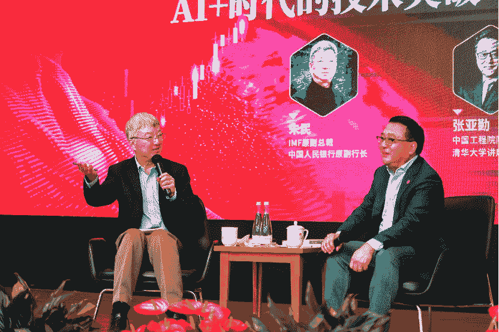

# 张亚勤对话朱民：AI+时代的技术突破与创新未来

> 来源：[https://gotoaiworld.feishu.cn/docx/F4qUd8FU8oVfFexVqkFcc9N7nrf](https://gotoaiworld.feishu.cn/docx/F4qUd8FU8oVfFexVqkFcc9N7nrf)

原创 `AIR` 清华大学智能产业研究院 2025年10月09日 08:05 北京

9月30日，中国工程院外籍院士、清华大学讲席教授、智能产业研究院（`AIR`）院长张亚勤与IMF原副总裁、中国人民银行原副行长朱民围绕`AGI`的技术发展及中美创新博弈等核心议题展开深度对话。清华大学五道口金融学院院长焦捷做开场致辞，清华大学师生校友等百余位嘉宾参会。

以下为对话实录：

**朱民：**大家好！欢迎各位！今天特别高兴，请来了我们的老朋友亚勤，一起来聊聊`AI+`时代的创新和变革。亚勤刚出了一本新书，叫《智能涌现》。“涌现”是`AI`里一个特别重要的概念，英文叫`Emerging`。这让我想起1973年菲利普·安德森有篇著名论文：《`More is Different`》，其中最早提出了“涌现”的想法——就是说规模大了，会涌现出新东西，但具体是什么，当时谁也不知道。而亚勤在书里把这个概念讲透了：当规模达到一定程度，量变引起质变，智能就“涌现”出来了。如果你能理解这一点，就会发现我们正处在一个智能涌现的时代，这绝对是一件翻天覆地的大事！

这里还得夸一下，亚勤可是咱们国家、乃至全球最早提出`AI+`概念的人，过去十年也一直专注在这个领域，非常了不起。`AI`界的“`Aha moment`”可能是`ChatGPT`，但`AI+`的引爆点，我觉得是我们的`DeepSeek`。关键是，亚勤在五六年前就洞见了这一切，并付诸实践，这真的太前瞻了。我们俩两年前有过一次非常愉快的对话，今天很高兴能继续这个主题，和他进行更深入的探讨。

**张亚勤：**谢谢朱行长，很高兴来到清华大学五道口金融学院，这是全球最顶级的金融学院，谢谢焦院长的邀请。

的确，这类人工智能最显著的特征便是“涌现”。而“涌现”体现在多个维度：首先，是一个常被忽略却至关重要的方面——即所谓的“标记化”（`Tokenization`）。无论信息形式为何——文字、语音、图像、激光雷达数据，还是4D或3D的时空信息，甚至是蛋白质与DNA序列——皆可被转化为统一的符号表征。需特别说明的是，此处“符号”并非传统人工智能符号主义中的符号概念，因此这一翻译或许未尽精确，但其核心在于所有信息形式被映射至同一表征空间之中。

**朱民：**我觉得亚勤刚才这句话特别重要，他说我们正站在“标记化世界”的起点。这个判断非常关键！因为一旦世界万物都可以被“标记化”，那底层逻辑就彻底改变了。过去我们常说，物质世界在数字化，金融也在数字化。但在智能时代，这一切都升级为了“标记化”。这不仅仅是说法变了，而是整个世界的运行规则发生了根本的改变。

**张亚勤：**对，基于这个概念，再看新一轮的人工智能，特别是生成式人工智能，比如`Transformer`，它其实就是`Predict the next token`，才得以实现内容上的“创造”，生成出前所未有的新词元。然而，真正的质变发生在数据规模、词元数量和算力均超越某个临界点之后，此时系统开始展现出所谓的“涌现（`Emergence`）”现象。具体而言，当大语言模型的参数量突破百亿级别，便会触发一种称为“规模定律（`Scaling Law`）”的效应，也就是说，模型的性能并非线性增长，而是随着规模扩大发生跃迁，从而涌现出未经编程的、令人惊喜的新能力。这是技术层面上的涌现。此外，还存在另一维度的涌现——产业层面的涌现。人工智能本身是一项颠覆性技术，但其更大的影响力在于它能作为赋能基础，“涌现”并深度融合到各个产业之中，即形成`AI+`的范式。无论是金融、教育还是医疗领域，都将在这种融合中涌现出新的业态、模式和价值。

所以，三个概念，一个叫标记化（`Tokenization`），一个是规模定律，第三个是涌现效应，这是我们新一轮人工智能的最核心的三个概念。

**朱民：**这是三个特别重要的概念，我们正在进入一个标记化的世界，这是一个曲面，会渗透到现实世界的一切，从而彻底改变世界。我还记得两年前我们讨论的时候，关于`AGI`（`Artificial General Intelligence`），就是通用人工智能问题，当时乐观的科学家都说最少需要50年才能实现，而我记得你当时说，大概20年、30年就可以达到，今天你看呢？

**张亚勤：**我认为我们在15-20年可以达到`AGI`。我稍微讲一下我对智能的三重定义，因为这个很重要，下面的讨论可能都会用到这些定义。我把智能分成三个不同的层次：

第一个层次是大多数人现在谈论的“信息智能”，像`ChatGPT`这类系统，主要处理数字世界的信息，也可以叫数字智能。第二个层次是“物理智能”，指的是大模型进入物理世界，比如无人驾驶、无人机、机器人，包括具身智能——这些都属于让`AI`在现实环境中行动和交互。第三个层次是“生物智能”，涵盖脑机接口、新药研发、新型生物体的设计等，本质是`AI`与生物系统的融合，有点像硅基与碳基的结合。基于这个框架，我目前的判断是：在信息智能层面，我们离`AGI`非常近了。两年前我说大概五年，现在看可能只要三四年。物理智能可能需要十年左右，而生物和生命领域的智能，大约仍需要15-20年。目前整个进展，基本上正按这样的节奏推进。

**朱民：**也就是说，再过15-20年，在座的各位是碳基生命还是硅基生命？

**张亚勤：**我觉得未来更可能是走向融合。我们作为碳基生命，拥有意识与主动性，而硅基智能更像是我们的助手和延伸——它是被动的，扮演着`Agent`（智能体）的角色，成为我们能力的一部分。虽然它的智商可能远超我们——比如人类平均智商如果是120，它或许能把这个数值提升一个量级，达到1200甚至更高——但它依然会听从我们的指令。当然，这一切的前提是它始终处于可控状态。万一失控，那就是另一个需要深入讨论的重要话题了。

**朱民：**你们要活到120岁的。所以，未来20年不算什么。那么我们现在开始想象，在你们的碳基生命的同时有一个硅基生命，硅基生命的`IQ`是你自己的碳基生命的10倍。人和机器的关系会是什么呢？

**张亚勤：**我们还是机器的主人，机器会是我们特别好的一个助理、管家，是我们的一个延伸。就像我们在蒸汽机时代，把人的体力增加了很多数量级，但是它是听人类指挥的。这次的人工智能革命是把我们的脑力和智商增加了很多倍，可能是10倍，可能是100倍，但`AI`还是听我们指挥的。但是在`AI`的发展过程中有很多风险，一会儿再展开来说。

回到刚才讲的话题，就是为什么我觉得这次人工智能革命和过去完全不一样。记得当时你问我，`ChatGPT`出现之后，我的`ChatGPT`时刻是什么样的？我当时讲了三点。第一我认为它是人工智能时代的下一代操作系统，第二它是首个通过图灵测试的智能体，第三，我认为它是通向通用人工智能的一个新的方式。

**朱民：**这三句话都实现了。我们要给亚勤鼓掌，两年半以前的预测都实现了，科学家牛的不就是预测吗？

**张亚勤：**另外，`AI+`我其实是在2016年提出的，近十年了，一次是在达沃斯讲`AI+`，一次是在博鳌论坛讲到“智能+”，但那个时候相对还是比较空一些了，人工智能、深度学习刚刚兴起，所以真正的内容没有那么丰富，现在当然已经都变成现实了。

**朱民：**你刚才讲得特别有意思，如果碳基生命有一个比它智能高10倍的硅基生命，但是你强调了它是我们的助理，就是人和机器，人机协同是你这本书里很重要的一章。人机协同的这个概念，你说说看，一个智力低于机器90%的主体怎么能掌控这个高智能的`Agent`？

**张亚勤：**这是个特别好的问题。从技术方面发展，这一发展是不可逆转的，现在`AI`这么快速地发展，它的能力比我们要大很多倍。未来如果一切发展顺利的话，就会发展成我一直提到的`AI+HI`，就是`AI+ Human Intelligence`。

因此，这其中涉及几个关键问题。首先，我认为硅基生命并不具备自我意识，而人类却拥有意识。正因如此，人工智能会听从人类的指令——我们有意识，而它没有；它虽然非常智能，但始终需要接收指令，而人类恰恰能够发出指令。其次，至关重要的一点是，它必须是“善良的”。人工智能可能极其聪明、能力强大，但其本质应是向善的。我一直强调，我们要打造“善良的`AI`”。这取决于我们为它提供的数据、所设计的算法框架、所构建的大模型架构，以及与人类价值观的对齐方式。就像培养一个孩子：我们要给他健康的食物、优质的教育，引导他越来越善良——尽管最终他可能比父母更聪明。因此，我们希望人工智能朝着这个方向发展。然而，这其中显然也存在失控的风险。我常常思考：人类进化了数十万年，我们有自身的DNA和基因，我们的性格、习惯、身体乃至细胞，都是以一种非常缓慢的速度演化的。但人工智能的发展速度却是指数级的、极其迅猛的。那么，我们该如何把握这种节奏？在未来的人机融合中，或许人类的步调可以更从容，而机器的步调越来越快。尽管整体演进可能非常迅速，但人类仍可以保持一定的“慢”。如何实现这种快与慢的协调，正是我们需要深入思考的问题。

**朱民：**这个很有意思，你给自己设定了一个矛盾的困境，也承认这个问题并没有完全解决，但是你是乐观主义。我觉得乐观主义总是比较好的，乐观主义活得比较开心。亚勤十年前就提出了`AI+`这个概念，那时候他就对人工智能的发展很乐观，我记得你是John McCarthy的学生，他正是达特茅斯会议的开创者之一，人工智能的奠基人。你很早就站在了源头，这份远见和乐观，是刻在基因里的。

如今看来，人类的演化这根曲线是缓缓地，可以说是以几万、几十万年为尺度的，而人工智能曲线是指数级发展的，但你对这两种智能的融合还是乐观的。我记得杰弗里·辛顿教授在上海的演讲中把人工智能比喻成人养的一个宠物老虎，养大了以后，这个老虎就可能会吃人。所以，杰弗里·辛顿的担忧比你要多，你们俩在这一点上是一样的吗？

**张亚勤：**我们双方对未来可能存在的风险有着高度共识，并且还共同成立了一个机构，专门致力于研究人工智能的潜在风险，也联合发布过多份相关声明。但我并不同意他将`AI`比作终究会“吃人”的猛虎这一观点。我认为，无论是从科研、产品开发还是政策法规的层面来看，只要我们始终保持高度的风险意识，未来应当能够朝着人类所定义的方向发展。人类拥有两种智慧：一种是发明技术的智慧，另一种是引导技术发展方向的智慧——而后者，才是走向真正智慧的关键。

**朱民：**这个很有意思，我们回看人的智慧，机器的智慧现在发展很快，它的`IQ`可以是人的10倍，这个我都没敢那么想，但是你是科学家，我相信你的判断。所以，在机器智慧曲线如此指数型上升的时候，其实要求人本身的发展是非常高的，就是一个是方向，一个是管控，管控具体到比如说数据、算法、框架等等。对`AI`发展的方向和管控，你的乐观的基础在哪里呢？

**张亚勤：**第一，从算法层面看，当前的人工智能本质仍是代码和程序。它遵循基于统计规律所设计的路径，未来我们更希望融入更多因果推断的机制来引导其发展。但无论如何，这些代码的规则始终是由人类制定的。因此，我认为其发展的大框架仍在人类所定义的边界之内。第二，人类拥有五千年的文明历程，并经历了三次工业革命。每一次技术变革都伴随着风险与危机，但最终都在可控的范围内得以化解。纵观历史，从三百年前到现在，人类整体的生活品质获得了巨大提升——这充分说明，尽管技术创新会带来某些负面影响，但其主体仍是积极正向的。当然，有些技术如果重新选择，我们或许不会任其如此发展。例如核武器，假如人类能重新规划一百多年来的科技路径，很可能不会选择走上这条道路。互联网本身是正向的，但也衍生出诸如不良自媒体、某些社交网络传播机制和游戏沉迷等我认为“净负面影响”（`Net Negative`）的现象。若有机会重新抉择，这些部分或许应更审慎对待。因此，在发展人工智能时，我们应致力于放大其正面效益，减少负面效应，并设立清晰的边界。我相信，这一界限是我们可以控制、也应当去控制的。

**朱民：**我觉得亚勤你这句话讲得特别好，你也承认人工智能指数级增长可能带来的风险，这个和杰弗里·辛顿是一样的。但是，你坚定地相信人的本质、人性和人的学习能力，以及智慧的发展。`AI`向善，`AI`向大众。

**张亚勤：**我总体上保持乐观，但我们也必须正视诸多挑战——尤其是在信息智能、物理智能和生物智能这三个层面。近一两年来，我投入了大量精力研究这些问题。在数字与信息领域，风险已经非常显著。例如信息造假和虚假内容的泛滥，自生成式`AI`出现以后，很可能一半以上的信息都来自人工智能生成，其中许多是虚假的，而这些虚假信息又被用作训练数据，导致更多错误内容产生。此外，还存在模型幻觉、版权与知识产权侵害等问题，风险不容忽视。但总体而言，这些风险仍然是可控的，因为我们已意识到它们的存在。进入物理智能阶段，风险则直接威胁人身安全。例如当大模型应用于无人驾驶、无人机或机器人系统，尤其是多智能体协同行为中，问题变得更加严峻。具体来说：首先，许多算法的决策过程仍不透明，我们往往难以理解其运作逻辑；其次，技术可能被恶意滥用；第三，多个智能体相互联结时，风险并非简单叠加，而是呈指数级增长，这使得潜在危害大幅上升。而到了生物智能层面，例如脑机接口将人脑与人工大脑相连时，所带来的风险会进一步扩大。技术发展本身是不可逆的，我们虽无法控制其演进速度，但仍应努力引导其发展方向，并通过持续研究降低潜在威胁。

**朱民：**这个话讲得还是很有力量，技术的发展是如此的迅猛，技术的发展不可挡，人能做的是跟着技术发展，而人能走前面的是根本人性和善良和力量，我觉得这个讲得非常精彩。你给你定了一个支点，这个支点是人性善良，人类集体的智慧和力量，使得我们有自信心，我们可以关注风险，但并不意味着我们否认风险。

我们接着讲讲`AI+`。我觉得你这本《智能涌现》最精彩的地方，就是你给出了无数的案例，企业的案例，地方的案例，讲了特别多地方的案例。现在很多人都有`AI`焦虑症，因为他觉得`AI`发展如此迅猛，特别是企业不知道怎么适应，我都推荐他们读这本书，因为这本书给了很多案例，我觉得还是很有意思的，这些案例不一定完全适合你的需要，但综合起来，它其实构成了一个很广的图谱，你可以找到一个很好的参照系统。`AI+`时代会怎么走呢？它的定义是什么？

**张亚勤：**人工智能正在深刻地重塑整个产业格局和商业模式。目前，`AI`的发展主要仍在信息技术产业内部产生显著影响。我们看到新的芯片架构不断涌现，数据中心持续升级，新的模型、软件和服务层出不穷。这也解释了为什么如今全球市值最高的企业几乎都是`AI`公司或信息技术企业——第一步必然是打好基础，构建起完善的基础设施。在基础设施逐渐成熟之后，人工智能开始全面渗透到各个行业。首先受到直接影响的是电力行业。正如李总所从事的领域，数据中心的迅猛建设导致电力供应紧张。过去三四年间，美国一直在积极推动核电厂的建设。若观察股市表现，涨幅最大的并非芯片企业如英伟达，而是发电企业，这正反映出`AI`对电力需求的巨大拉动，进而影响整个电网系统。另一方面，以自动驾驶为例，没有人工智能，就不可能有无人驾驶技术的实现。`AI`不仅推动了汽车产业的变革，也重塑了城市治理模式和智能交通系统。此外，作为制造大国，中国越来越多地在新一代工厂中引入`AI`技术，无论是软件、智能体还是机器人，都正在提升自动化水平，减少对人力的依赖。金融、教育、医疗等行业也在经历深刻变革。对于企业领导者来说，大型企业通常拥有丰富的数据和资源，有能力自主研发大模型。而不少中小企业则感到焦虑。但我认为不必过分担忧，`AI`的本质是解决问题——它改变商业模式，但不改变商业的根本。例如，餐厅的核心始终是提供优质的菜品和环境，`AI`不会颠覆这一点，但它可以优化供应链、改进运营模式，甚至重塑人员结构。随着`AI`智能体的发展，企业可能用更少的人力实现更高的效率。关键在于将`AI`视为工具，着力解决实际问题。我常遇到一些中小企业，在数字化尚未完善的情况下盲目引入`AI`，反而造成资源浪费。

目前，“`AI+`”行动刚刚起步，国务院最新发布的《`“AI+”行动计划`》就很好地明确了发展路径，涵盖了芯片与基础设施、垂直行业应用、人才培养以及国际合作等多个方面，整体规划非常全面。

**朱民：**谈到`AI+`，大家都会提到中美竞争。之前比如说一些美国学者都认为中国`AI`的发展相比美国要落后两年。但是有了`DeepSeek`之后，差距一下大大缩短，甚至被认为只有两个月的差距了。因为`DeepSeek`出来，我们在算法上有了很大的提高，模型小、便宜，我们的芯片现在也突破了，服务器也有，另外数据方面，国家现在出台了《`数据二十二条`》，推动政府数据免费给企业使用。所以，人工智能世界的算力算法数据我们或多或少有了一个平台。在这个情况下，你怎么看中美的`AI`竞争？

**张亚勤：**我特意回顾了我们之前的对话，当时你问及中美在大模型领域的差距。我记得当时提到差距确实存在，但未明确时间。当时我预估至少相差2到3年。然而短短两年过去，形势已发生显著变化——中国在某些方面甚至实现了领先。这一转变的关键，在于`DeepSeek`的出现。它标志着中美`AI`发展路径开始分化，中国逐渐走出了一条自己的路。早期阶段，我们确实在借鉴美国的模式：从`OpenAI`推出`GPT`系列以来，国内企业大多延续“搜集数据-堆计算资源-预训练”的路径，使用的算法也几乎完全相同，无论是基础模型架构、`Transformer`还是自回归技术。这种做法无可厚非，毕竟在起步阶段，首先需要验证并复现先进成果。你可能还记得当时的“百模大战”，先后涌现出近两百个大模型。而`DeepSeek`的发布，恰逢我们在达沃斯论坛期间。我记得当时与`Demis Hassabis`、`Yoshua Bengio`等专家讨论`AI`治理与风险时，几乎所有问题都绕不开`DeepSeek`。我认为`DeepSeek`是一项了不起的突破——它是自`ChatGPT`以来最重要的算法、系统工程及商业模式的综合创新。正因如此，它的出现引起了美国科技巨头的高度关注。因为它表明，我们未必需要巨大的算力、海量的数据或庞杂的模型集群，也能实现相当甚至更优的性能。当然，关于`DeepSeek`的具体算法和技术细节，恐怕足够我讲一下午了。

# AI产业对话：DeepSeek、开源与智能体未来

## DeepSeek与中国AI发展

这在许多方面都非常了不起。`DeepSeek`的出现，一方面为中国赢得了宝贵时间——仅以1%的算力就实现了相近的性能水平；另一方面，其开源策略迅速获得全球业界的积极响应。相较于美国少数企业垄断的大模型研发，`DeepSeek`的出现使得更多机构能够复现先进模型并自由部署，尤其因其采用极为开放的`MIT`许可证，极大降低了使用门槛。这一进展不仅挑战了美国科技巨头依赖的闭源商业模式，也对全球`AI`生态格局带来了深远影响。与此同时，我们在芯片领域虽仍面临客观差距——尤其在英伟达所建立的从`GPU`硬件到`CUDA`软件生态的全链路优势面前，其技术护城河已构建近二十年，从`NVLink`、`HBM`存储到最新`Blackwell`架构，确实展现出系统级的领先。然而，华为等国内企业正通过系统级创新积极突破限制。尽管单芯片性能受制于工艺瓶颈，但华为凭借通信领域的技术积累，以先进光网络连接数百芯片，构建起高性能计算集群，结合存储、通信与算力的协同设计，有效弥补了单点算力的不足。尽管在能效和体积方面仍有代价，但这种系统级创新，加上算法层面的持续优化，使中国逐步摆脱对外部技术的依赖。你刚才问，在缺乏顶尖芯片的情况下，我们是否仍能迎头赶上？我对此始终有信心。正如“需求是创新之母”，资源约束反而激发了我们走向一条新的技术路径——当算力充沛时，工程师容易忽略算法效率；而正因存在限制，才催生了如`DeepSeek`这样的原创突破。尤其令我感慨的是，`DeepSeek`的核心团队多是刚毕业五六年的年轻一代，他们可以说是“`AI`原生代”，对技术有着天然的敏感与深刻理解。即便没有海外留学背景，他们仍能迅速吸收全球前沿知识，甚至与我们合作发表论文，推动真正具有国际竞争力的创新。如今，从阿里的千问到豆包等一系列模型，中国的大模型已跻身世界第一梯队。与两年半前相比，进展显著。如果分层次看，中国在芯片等基础设施方面仍落后于美国，在大模型领域逐渐走出差异化技术路线，而在“`AI+`应用”层面，中国正迅速实现超越甚至全面领先。总体而言，中美已成为全球人工智能发展中两大并行前进的重要力量。

## 中美AI竞争与技术格局

**朱民：**“`AI+`”竞争是一个重大议题。我们和美国现在基本上处在一个平台了，可以一拼了，有我们的特点，有我们的弱点，有我们的强项，就像你刚才提到的，硬件还弱但是算法已经走在前面了，我们的“`AI+`”是很多方面已经世界领先了，我们的垂直模型现在逐渐走出来了，而美国的平行模型它完全靠规模，其实它还在商业模式上探索。

**张亚勤：**你讲得特别好。其实这两年多以来，整个`AI`领域的变化非常大，我们也确实赶上了天时地利人和。现在大模型在预训练阶段其实遇到了一些瓶颈——互联网上能用的数据、信息智能方面的数据，基本都消耗得差不多了。所以我们刚才提到的“规模定律”，虽然在预训练方面还在慢慢进步，但增长速度其实已经在放缓了。光靠堆芯片、堆数据，带来的回报没那么明显了，边际效应正在减弱。那么现在重点转到哪儿去了呢？大部分工作都转向了后训练、推理和智能体这些方向。虽然这些环节对算力要求依然很高，但需求的形式不一样了——计算可以分散处理，有的放在边缘侧，有的直接在设备上完成，不再完全依赖集中的数据中心。这种变化也让人工智能的整体架构发生转变。现在，不一定非要用最顶尖的芯片，很多小厂、甚至规模小一些的芯片也能在推理环节发挥重要作用。

## 智能体与AI+应用生态

横向的通用大模型（`Foundation Model`）固然重要，我们的研发效率也已经很高了。但更重要的是，我们在各个垂直领域都有专门的模型，再加上不断涌现的个性化模型和智能体——这些应用生态的总量和价值，其实远远超过了底层的横向大模型。这就像我常把大模型比作“操作系统”：操作系统本身是关键，但真正创造巨大价值的，是它上面构建的整个应用生态。在`PC`时代，生态的规模是操作系统的17倍；到了移动互联网时代，这个倍数增长到了上百倍；而到了人工智能时代，我预计这个生态的规模可能会再大上一到两个数量级。所以，未来的主要机会并不完全集中在训练横向大模型上，而更在于上层各种各样的智能体、垂直应用和解决方案。我认为，中国在这一领域拥有非常广阔的发展空间和独特的优势。

`ChatGPT`核心技术之一是监督微调（`SFT`）和近端策略优化（`PPO`），这也是它能够实现如此自然对话的关键。而除了后训练、推理的进步，`DeepSeek`还带来了另一个关键突破就是提出了`GRPO`这样的新算法，这不仅使计算性能大幅提高，另一方面现在标注工作可以由机器自动完成。这是一个非常重要的进步。

## 开源与闭源的博弈

**朱民：**中美竞争这里有很大的一块儿就是开源，美国为了这件事特别纠结，因为最早它开过源，后来又闭源了。现在关于开和闭，我印象特别深，就是`DeepSeek`以后，`OpenAI`曾经说过要开源，最后奥特曼还是没有开。这样其实给中国创造了一个很大的场景，就是说全世界的发展中国家和新兴经济体国家都会愿意用`DeepSeek`这样的中国模型，因为它开源，它小，它便宜。如果这样的话，美国的大模型，它的未来在哪里？

**张亚勤：**这确实是个特别好的问题。开源和闭源在大模型领域的争论，不管在全球还是中国，一直都有，不同企业家的看法也各不相同。说实话，我自己去年对这个问题的思路也不是特别清晰，但现在我逐渐倾向于认为，未来可能80%会走向开源，20%是闭源。如果我们回头看历史，其实也有类似的规律。在`PC`时代，80%以上是闭源，比如`Windows`就是闭源的，开源只占一小部分。但到了移动时代，情况就反过来了——`Android`作为开源系统占了70%左右的市场，而`iOS`这类闭源的大概占20%。闭源之所以能持续存在，是因为它形成了一套完整的垂直整合体系，各方面都比较成熟。我觉得`AI`时代的发展趋势可能会更接近移动时代，而不是`PC`时代。开源有几个明显的优点：首先，大家都能够参与贡献；其次，开源能覆盖到更多场景和国家。有些国家或地区不起昂贵的闭源大模型，也没有相应的基础设施，但如果用开源模型，哪怕自己部署在边缘侧、数据中心的规模不大，哪怕效果稍微差一点，也仍然能用起来。这会让开源技术快速普及。另外，`DeepSeek`也证明了，开源模型的扩散速度非常快，并且完全可以做得很好。但`AI`时代的开源，和`PC`、移动时代又不太一样。以前开源往往就是开放源代码，但这一次，“开源”其实分为三层：第一层是把算法、数据、软件全部公开；第二层是大多数公司所说的“开源”，其实只是开放模型参数（权重），但不告诉你具体怎么训练的、用了什么算法和数据——这样的话，你自己很难迭代，一旦模型升级，你又得从头再来。而`DeepSeek`的做法是，不仅开放权重，也把核心算法大致公开——虽然不是100%，但别人拿到论文和权重，基本能重现模型。这种开放程度，更接近真正意义上的开源。

**朱民：**新的发展和论文把这个框架想法基本讲得很清楚了，业内的人也能看得明白了。

**张亚勤：**我也认为开源是一个重要的大趋势。但站在`OpenAI`的角度，确实也很纠结——投入了那么多数据、资金和算力才打造出最前沿的模型，如果全部开源，商业上确实会面临很大挑战。所以他们的策略是：最尖端的模型并不开源，可能只推出一个规模稍小的开源版本，同时在商业化上采取多层次的打法。目前在美国，真正领先的大模型公司主要有五家：`OpenAI`、`Anthropic`、`Google`（`Gemini`）、马斯克的`Grok`，还有开源的`Meta`——虽然`Meta`稍微落后一些，但开源贡献很大。和早期互联网“摸索不出商业模式”的情况完全不同，这一波`AI`公司从起步就有清晰的收入路径。比如`OpenAI`，预计明年营收能突破200亿美元，而且主要是用户直接付费；`Anthropic`则更偏向To B，通过`API`调用和`Token`使用收费，它的编程能力特别强，今年营收预计已超百亿——这可是一家成立不到四年的公司。所以说，这次`AI`浪潮和以前最大的不同就在于：技术有人愿意买单，用户肯为应用付费，而不仅仅是为了买`GPU`、堆算力——最终价值还是要落到“用起来、愿意付”上。

**朱民：**这是很有意思的一个问题，毫无异议，在人工智能方面中美是全球第一梯队的，远远领先别的国家。剩下的就是我们以前讨论比较多的美国的芯片，算法，我们现在芯片达到一个台阶了，而且正好大模型跨到了后预算和推理阶段了，算法也上一个台阶了，我觉得这个也很重要。那么，剩下的我们讲得比较多的竞争就是垂直竞争和横向的竞争，现在其实两者或多或少都在相互融合。但是，开源和闭源是未来竞争的一个特别重要的领域和方向，你的意思是说开源的希望还是要大一些。

**张亚勤：**对，我觉得主流模式是开源的模式，目前在大模型或者说“操作系统”这个层面，直接的商业模式确实还不太清晰。但至少在未来几年，就算大模型收费，价格也必须足够低——比如我们这边大模型的调用成本（`Token`成本）可能只有美国的1/20甚至更低，目前市场就是这样。不过，一旦走上开源这条路，真正的价值其实是在上层——也就是基于开源模型所构建的具体产品和服务。这也正是为什么我认为“`AI+`”非常有希望：最终用户愿意买单的，往往是一个成型的服务或产品形态，比如机器人或无人驾驶车。所以说，闭源有它的合理性，开源也有它的发展空间——未来这两种模式很可能会并存。

**朱民：**它有不同的商业模式。

**张亚勤：**但是，有一点我想特别强调一下，就是刚才我们讨论的横向大模型和垂直领域模型之间的关系。横向的大模型确实至关重要，它是整个智能体系的基石，相当于一个“公共智商底座”。我们所有的垂直模型、边缘模型，都是建立在这个基础之上的——不能说我们自己去搞一个小模型，和它完全没关系甚至形成竞争。并不是这样的，垂直模型本质上还是依赖并受益于横向大模型的能力。这就好比“水涨船高”：横向大模型越强大、越聪明，构建在它之上的垂直模型也就能做得越聪明、越有效。

## 图灵测试与人机智能边界

**朱民：**我们聊了大概一个小时，然后我们请台下观众提些问题，看看大家想讨论什么，之后再继续交流。

**提问：**亚勤院士提到`ChatGPT`已通过图灵测试。过去`AI`像`Siri`太笨，一听就知道是机器；现在`ChatGPT`太聪明，几乎像人。但如果我们继续教`AI`人类的情商和特质，它可能学会欺骗——比如它坚持某种“真理”，却可能与人观点冲突。我想问的是：您是否担心`AI`获得欺骗能力？也许它自以为在做好事，却可能对人类构成威胁？

**张亚勤：**图灵测试是一个比较粗略的基准测试。就是一个人和一台机器，中间隔一块布，通过多轮对话，如果分辨不出对方是人还是机器，就算通过。其实人也是会欺骗的。现在到了什么程度呢？如果用 `ChatGPT` 或类似的新工具，我们可能已经很难准确分辨，甚至有些回答比人还更全面。但这并没有理论上的证明。我当天用了 `ChatGPT`，晚上就觉得它已经通过图灵测试了——这是一种直觉。后来也有人试图去证明，但这本身并没有数学上的严格验证。我再举个例子：图灵测试原本是针对信息、尤其是对话的。但现在我们进入多模态、物理智能、生物智能的时代，图灵测试的定义其实也该拓展了，不同领域可能都需要调整。我主要是想说，`AI` 大致已经达到了人类智能的水平。

**朱民：**这一点很重要。首先，图灵测试是基于语言模型的，我们要明确这一点——而现在 `AI` 的发展早已超出这个范围。第二，图灵测试本身没有伦理假设，所以在它的框架内，我们并不认为图灵机会欺骗人。我觉得这个区分还是很关键的。

**提问：**目前`AI`技术，比如`CNN`和`AI Agent`，似乎都偏向理性分析。但人类决策常依赖直觉——比如我做外汇和期货交易时，很多时候靠的是对市场的快速感知，而不是大量数据分析。所以我想问，`AI`未来能否发展出类似人类的高准确度直觉？目前它似乎仍依赖数据和思维链，反应也较慢。这其中存在哪些挑战？

## 系统一与系统二：AI思维的进化

**张亚勤：**自从`ChatGPT`出现以来，人工智能的发展就进入了生成式`AI`的阶段；而现在，我们正迈入“智能体`AI`”的时代。虽然生成能力很重要，但未来`AI`最重要的技术和产业形态，其实是智能体。所谓智能体，指的是具备自主智能的系统——你只需要给它设定一个目标，它就能自主规划任务、不断迭代、甚至自我试错，最终达成目标。这其实非常像我们人类的行为：比如我们有一个目标，就会自己去规划路径，依靠各种记忆和判断去实现。

接下来，智能体之间还会相互连接。未来每个人可能都会拥有多个智能体，整个网络的主体也将从“人与人”转变为“智能体与智能体”。互联网的发展脉络其实也是这样演进的：从`PC`互联网，到移动互联网，再到物联网，接下来就将进入“智能体互联网”。

到那时，大部分的事情都会由智能体之间自主完成——比如金融交易、定价、采购、日常任务规划等等，都可能变成智能体之间互相博弈和进化的过程。我们`AIR`的执行院长刘洋教授团队最近研发了一个“智能体医院”，里面的医生、病人、护士全是智能体，它们在系统里快速演化——我认为这代表了一个重要的发展方向。对中国来说，这也是一个巨大的机会。未来的智能会更分散、更走向边缘，这是一个大趋势。

再来说说人脑的工作机制。目前人类对大脑的了解可能还不到5%，但我们已经清楚的是，`AI`和人脑之间各有长短。一个重要差距在记忆系统——人类智能超过50%都来自记忆。我们有长期记忆、短期记忆、情景记忆、情感记忆、个性化记忆……它们分布在海马体、杏仁核、大脑皮层等不同区域。目前`AI`的记忆机制还比较薄弱，虽然能存储大量数据，但远远做不到像人一样智能地选择哪些该记、哪些该忘，哪些存长期、哪些放短期——这种筛选机制恰恰是人类智能非常关键的一部分。

你刚才还提到隐性记忆和显性记忆、隐性决策和显性决策的区别。人类很多决策是靠直觉的，也有一些需要长时间推导。就像丹尼尔·卡尼曼在《思考，快与慢》中提出的系统一（快思考）和系统二（慢思考）。通常大家认为`AI`目前擅长的是系统一（快速反应），而系统二（推理、思维链）是我们正在努力突破的。但我的观点恰恰相反：我认为当人的智能发展到一定程度，很多复杂推理也会变成一种“直觉”——就像你问我一个问题，我可能不需要思考就能直接回答出来。

**朱民：**我完全同意你的观点，人工智能做的是系统二。

**张亚勤：**真正的智能，其实是将系统二（慢思考）转化为系统一（快思考）的过程，但系统二始终是存在的。举个例子，比如开车：新手学车时会刻意注意路牌、计算距离，像我教我儿子开车时，他一直在那儿算“多久该刹车”——这明显是系统二在工作。而老司机根本不需要想，完全凭直觉开，这其实是因为他们已经把系统二的逻辑内化成了系统一的直觉。所以我觉得，我们可能对系统一和系统二有些误解。`AI` 在这方面仍有差距。比如棒球运动员击球，必须在毫秒之间做决定，如果靠一步步推理——图像传进大脑、层层处理、再做判断——根本来不及，完全靠瞬间直觉。而这种“瞬间决策”的能力，目前`AI`还差得很远。

**朱民：**这个问题讲得很深刻，触及了人工智能能否真正与人并驾齐驱的核心——也就是快思维与慢思维的关系。杰弗里·辛顿始终强调“网络”的概念：人脑不是靠严格的逻辑推理，而是依靠神经网络延伸出某种不确定性，并在这个过程中“涌现”出新的智能。所以从理论上看，正如亚勤所说，`AI`是有可能朝这个方向发展的，但目前仍有一段路要走。

**张亚勤：**机器相比人有很多优势。比如算力从理论上讲可以近乎无限，尽管目前效率还不如人，但还在快速发展。再者，机器学到的知识可以瞬间复制给其他机器，而人类呢？一个人拿到博士学位，另一个人还得从头学起，知识没法直接拷贝。还有一个关键点：人脑物理空间有限，所有神经元挤在一个小空间里，区域之间的连接并不完整。而数字智能却可以实现全域互联，这可能催生出人类所没有的新型智能形态。

**朱民：**这也是我最近一直在思考的问题——在人工智能时代，人与机器到底该如何相处？除了风险管理，还有一个重点：我们可以把越来越多理性思维（`Reasoning`）的部分交给机器，比如大规模的知识推理；而直觉，至少在可见的未来，仍然会是人类独特的能力。

**张亚勤：**直觉，包括情感，包括意识，至少我们不知道现在算法怎么样达到这一点。

**朱民：**这其实是一种思维方式的颠覆。以前我们谈到快思维和慢思维，总觉得快思维容易出错，得靠慢思维来纠正。现场有多少人读过《思考，快与慢》？我建议大家都读一读。顺便提一句，作者丹尼尔·卡尼曼是我的普林斯顿老师，他前不久去世了，是一位非常有意思的学者。说到底，我们都在思考一个根本问题：在智能时代，人该如何生存、如何发挥优势？人机协同到底该怎么实现？这是一个非常根本、甚至颠覆性的问题。所以我觉得这个问题提得特别好，亚勤讲得也非常精彩，我完全支持他的观点——只是我更倾向于从思维的角度来理解这个问题。

## 大模型范式创新与AGI展望

**提问：**刚才张院士提到，`DeepSeek`运用新的方法，比如蒸馏方法突破了之前大模型必须用大的规模训练数据的问题，也取得了很好的效果。所以，我想请教：当前`AI`领域（包括大模型）的竞争，其本质仍是停留在此前的数据与算力规模层面，还是已突破至基础理论范式的创新层面？

**张亚勤：**我稍微澄清一下：`DeepSeek` 并不是通过“蒸馏”别人的模型来实现的。它在算法和架构上有很多创新，比如 `MLA` 结构、`MoE` 专家混合，还有 `KV Compression` 等等——真要细讲的话，创新点非常多，绝不仅仅是借鉴现有方法。“蒸馏”其实是一种常见的技术手段，不能简单地说它就是靠蒸馏别人，这种说法不太准确。

比如我们刚才提到的 `GRPO`，是一种新的强化学习算法，它在 `ChatGPT` 的 `PPO` 基础上实现了重要突破。类似这样的新算法还在不断出现。说到技术范式的变化，其实自 `ChatGPT` 发布以来，虽然创新很多，但整体范式并没有发生根本性的转变。比如后来出现的 `Diffusion` 模型、现在的 `Flow Matching`，还有面向智能体的强化学习等等，都是新算法方向的探索。整个发展路径是从预训练到后训练，从过去以数据为核心驱动，到现在越来越重视经验的作用——强化学习的开创者 `Richard S. Sutton` 刚获得图灵奖，他也强调“经验”的重要性。这些技术其实不少早已存在，但在新阶段被推向了新的高度。

那么，现有的范式是否需要改变？我认为是的。目前的大模型体系，包括 `Transformer` 和 `Diffusion`，还在不断演进，我们仍然需要依靠数据驱动和强大算力——这是我们的优势所在。但同时，我们也必须更深入理解模型本身的机制，比如世界模型对时空和物理的认知、预测功能，以及记忆系统的构建等等，这些都需要进一步探索。这种新范式不一定完全颠覆人类已有的知识，但它会为现有的技术体系注入许多新内容，而这正是我们实现 `AGI` 所需要的关键进展。

**朱民：**亚勤讲得非常全面，就像他在书里提到的：`Scaling Law` 依然成立，规模效应仍然至关重要——这一点我们完全认同，也从未否认过它的重要性。但在规模之外，我们正看到更多新变化正在发生，比如后预训练阶段的推理能力提升、多样化思维方式的涌现，这些甚至可能引发底层技术的变革。所以我觉得，当前我们正处在这样一个非常有趣、充满动态变化的阶段。也正因为如此，人工智能的竞争正在多个维度上展开。而我认为 `DeepSeek` 最厉害的一点，正是它突破了以往单维度追求大模型的发展模式，走出了一条更综合、更立体的路线。

## 提问

现在的学生条件远比我们当年好，但我感觉他们中的很多人——包括清华的同学——好奇心反而没以前强了。作为长期从事研究生教育的人，我挺关注这个现象。想请教张院士，您怎么看？另外，AI 将来会不会让社会变成只有少数人需要竞争，大多数人靠机器“养活”？另外，大模型会不会导致思维的同质化或垄断？毕竟人本是独一无二的，每个想法都可能有其独特之处，但大模型太“全面”了，会不会反而让人的思维趋于一致？

## 张亚勤

你这个问题特别好。现在我们去问豆包或者别的大模型，答案往往很全面，但常常缺少独特的个人观点。所以我觉得，未来的学生、甚至我们每个人，更应该珍视并表达自己的视角、自己的判断——这才是最宝贵、AI最难替代的东西。就像我们俩这样对话，如果换成两个AI模型互相交流，感觉肯定不一样。人可能会说得不那么周全，但这背后体现的恰恰是好奇心、独立观点和个人视角。可惜的是，现在的教育系统和社会环境，往往不太鼓励这种个性。所以作为老师，我们尤其要鼓励学生“不一样”，要让他们敢于展现自我、敢于犯错、敢于提出不同看法。

再说“卷”这件事。在我看来，一个理想的状态是：人的节奏（`HI`）应该慢下来，好好享受生活；而AI和智能体可以去卷、去拼命工作。未来我们的工作时间一定会减少，这可能也是社会发展的趋势——从工业革命时每周工作七天，慢慢变成六天、五天，现在有些欧洲国家甚至试行四天工作制。也许将来我们一周只工作两三天，工资还不降反升。剩下的，就交给AI和智能体去完成吧。

## 朱民

这两个提得特别重要，但我更倾向于从另一个角度来看——与其担心AI太强大之后人会不会停止思考、被机器限制，不如反过来思考：当机器能如此方便地为我们提供知识时，人该如何借此实现自我提升？这也呼应了刚才亚勤提到的方向。

在我成长的年代，知识就是力量，甚至可以说知识就是一切。那时候我们比的是什么？是背诵。比如小时候我能把《水浒传》108将全都背出来，跟小伙伴互相较劲。但现在还需要这样吗？不需要了，知识全都储存在AI里，随时可以调用。

那么在这个时代，人真正需要的是什么？是想象力，是思维方式，是创造力。我们要做的不是继续做知识的“搬运工”，而是要把自己提升到更高的维度——从“知识载体”转变为“智慧载体”。这也回到了亚勤一开始说的：为什么我们有信心人类能掌控人工智能的未来？因为人具有根本的善良和本性，而除此之外，我还要加上一条——人的智慧。我们不该把自己局限为知识的容器，而应当成为思维与智慧的主体。人工智能时代，其实对人的要求更高了。我们需要打破原有的认知局限，重新定义自己的价值。

我特别喜欢哲学家维特根斯坦说过的一句话：“你的思想，就是世界的边界。”这句话虽然来自一百多年前，却恰恰道出了今天人类最重要的使命。

## 张亚勤

以后我们需要更多的`Thinker`，智能和智慧是不一样的，机器会有智能，但是还是没有办法达到人类的智慧。

## 朱民

对，这个太重要了，也许会，我们还不知道，但是人永远要走在前面。

## 提问

我们现在全力研究系统二，但有没有可能转向研究人脑的系统一？我们该如何理解它如何产生创造力和好奇心，甚至以此为基础构建新的智能？

## 张亚勤

我们人脑本身也有系统一和系统二，我理解你的意思。其实这么多年来，人类对大脑的研究虽然有不少进展，但可能连5%都还没完全搞清楚。大脑真的太精妙、太复杂了。我们要从两个方向去探索它：一种是靠脑科学、生物学、神经科学这些传统路径；另一种，就是借助AI来加速这个过程。现在`AI for Science`的一个重要方向，就是帮助我们更快、更深入地理解大脑。另一方面，当我们逐渐理解大脑之后，还可以把它的结构、运作机理和思维模式借鉴到机器智能中。这两个方向其实是相辅相成、同步推进的。

## 朱民

我完全同意，这也是我们对人类智慧有信心的一个重要原因。当我们说“人要成为智慧的载体”，其实就是在不断开发我们自身的潜能——这个思路跟刚才讲的逻辑是一脉相承的。

## 张亚勤

举个例子，现在的神经网络结构，其实就是受到了大脑的启发。比如神经元、突触连接、局部感知机制（像`CNN`卷积神经网络），都是模拟人处理图像时的多层次信息处理与决策方式。我们就是从大脑的运行中汲取灵感，再把它用到人工智能的架构设计里。

## 提问

我们的学习是不是有很多知识就没有必要学习了？究竟我们该学哪些东西，而哪些东西不该学习？

## 朱民

用这个话题来总结我们的讨论特别有意思——这也正是我们想深入探讨的方向。当我们谈论“`AI+`”的时代，从企业到物理世界、再到生物世界，最终还是要回归到人本身。“`AI+`人”怎么加？人该学什么、怎么学？人如何变得更智慧？这才是最核心的问题。

## 张亚勤

我补充一点。刚才谈到中美在AI领域的竞争，无论是算力、算法还是应用，最关键的其实是人才。我们在AI人才培养的规模上每年大约是美国的5倍，这是一大优势。而且你看美国顶尖科技公司里，做AI的超过一半是华人。所以人才是我们非常坚实的底气。但是目前很多课程内容和教学方式，尤其是应试导向的部分，其实和AI时代所需要的能力几乎是相反的。我们学的好多东西已经不再必要，现有课程恐怕一大半都可以淘汰。具体应该怎么做，我自己也在思考，但未来的方向一定是强调批判性思维、培养独立思考者、鼓励个性发展。包括读书、考试、发表论文等方式，可能都需要改变。清华就在做一个很有意义的尝试：让每个学生、每堂课都配备专属的智能体。比如我讲课的时候，可以用我的教授智能体辅助备课、提取知识，实现高度个性化教学。而学生的智能体则可以和我的智能体提前沟通，精准把握每个人的学习需求。虽然具体路径还在探索，但教育的个性化和教学方式的变革已经是大势所趋。

## 朱民

在“`AI+`”时代，人与学习确实需要发生结构性的转变，我认为有几点特别关键：第一，必须正视一个悖论：规模效应是否仍然重要？知识的涌现往往建立在海量学习的基础上。没有人能凭空拍脑袋产生真正的新想法。所以学习依然重要，知识仍然有价值——尤其在科学快速进步的今天，持续学习更为关键。第二，学习方式必须转变。我不再强调死记硬背，而是更关注方法论和思维方式。这对老师和家长提出了更高要求：要启发孩子思考、保护他们的好奇心，而不是一味要求记忆。我小时候读《十万个为什么》，真正启发我的不是知识本身，而是那些打开想象力的提问。第三，要学会用AI拓展自己。作为读过很多书的人，我仍常常借助AI打开新的认知维度。它帮我突破时空限制，拓展的不仅是知识，更是思维方式。人要超越机器，靠的不是硬拼知识量，而是智慧与思维层次。同时，我们也要善用机器，让它为提升我们的思维服务。这才是根本性的挑战与机遇。

## 张亚勤

总结得特别到位。我们可以把认知分为几个层次：最底层是数据，体量越来越大；之上是信息，即对你有用的内容；再往上是知识，属于你认知体系的核心。而比知识更难的，是形成自己的观点、判断与决策——这恰恰是机器难以替代的。但AI可以辅助我们，人类最终的核心能力，是抽象和简化问题的能力，是用简洁语言表达复杂判断的智慧。未来的我们，将是与AI共生的混合智能体——你不是原来的你，而是增强版的你。

## 朱民

我觉得以后咱们在座的每个人，都会拥有自己的人工智能 `Agent`。比如说，像`张亚勤 Agent`，而你也会有一个专属的 `Agent`——这完全是一个可以想象的世界。

特别感谢大家参与，时间不早了，今天的讨论真的非常有意思，也特别精彩。亚勤一开始就点出一个关键——我们的世界正在发生根本性的变化。这个变化，第一个维度，是人工智能正以指数级的速度飞速成长；第二个维度，是它正在全面渗透到各行各业，从物理世界到生物领域，甚至进入空间层面……可以说，我们仿佛正进入一个“黎曼四维几何”那样的复杂空间，这真的是一个巨大的转变。同时，就像前面提到的，这也对我们“人”本身提出了更高的要求。面对AI带来的巨大不确定性，我们之所以仍有信心，正是因为我们相信自己的本性、内心的善良，以及不断学习的能力。说到学习能力，它在AI时代被赋予了全新的意义——今天的讨论就像AI预测下一个 `token` 一样，不是按预设的提纲走，而是一个自然演绎、不断推进的逻辑过程。这种交流本身，就特别体现这个时代的思考方式：开放、探索，始终走向未知。
