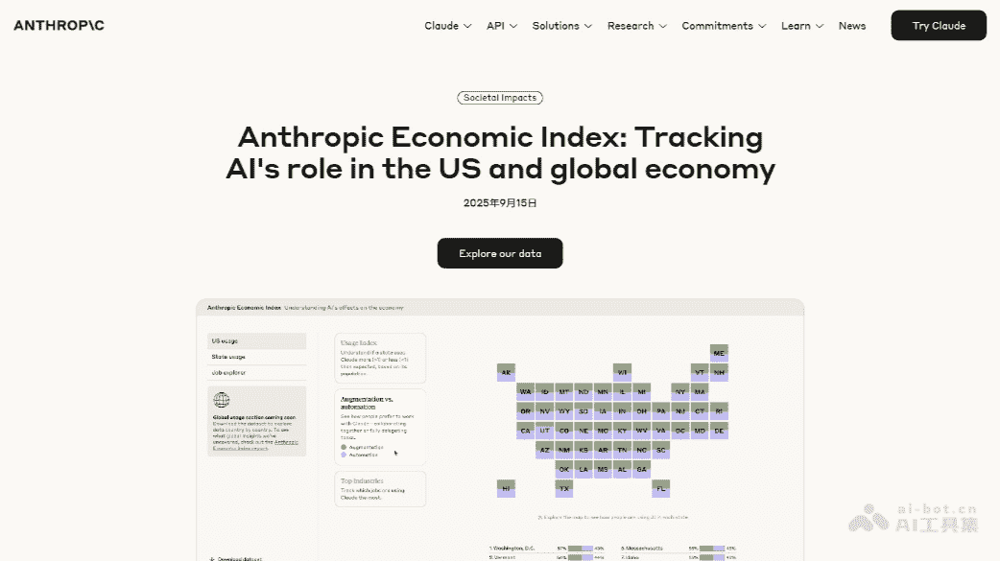
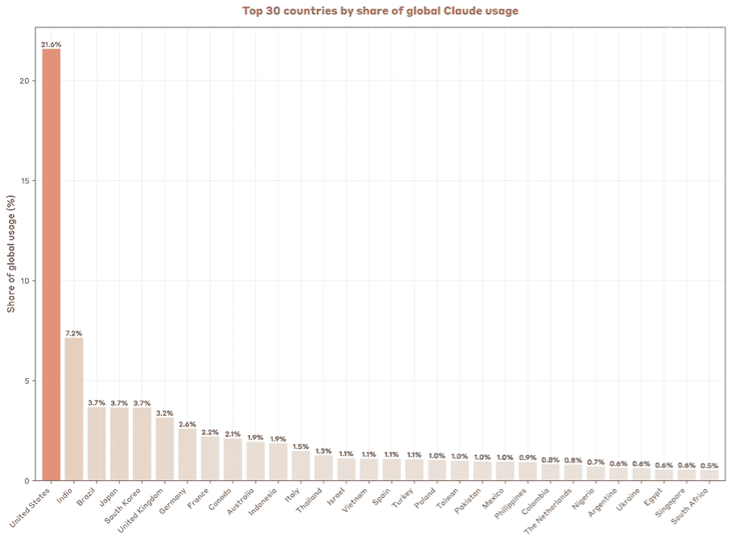
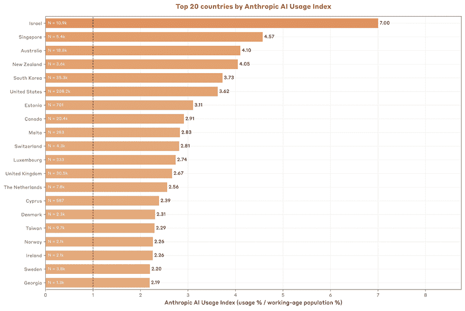
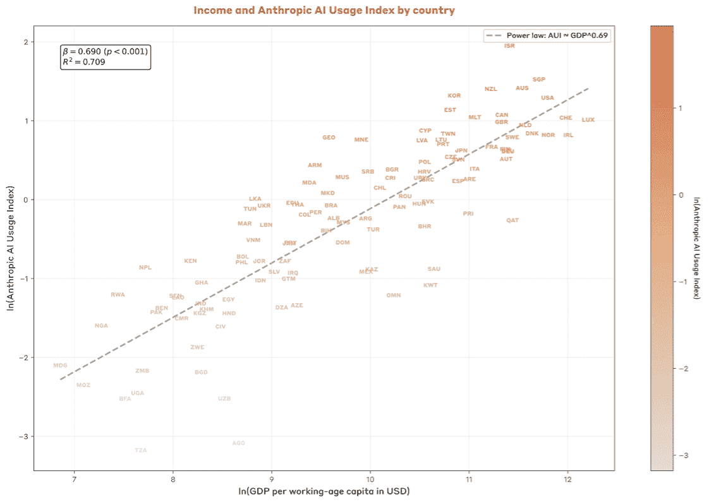
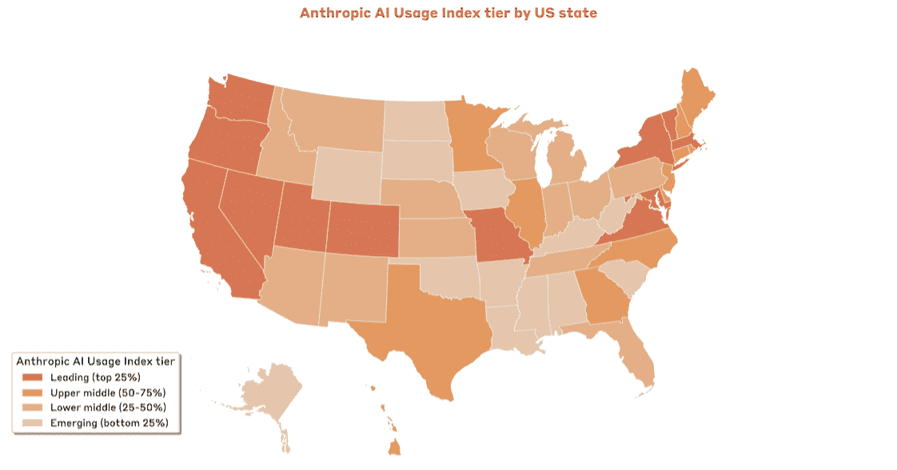
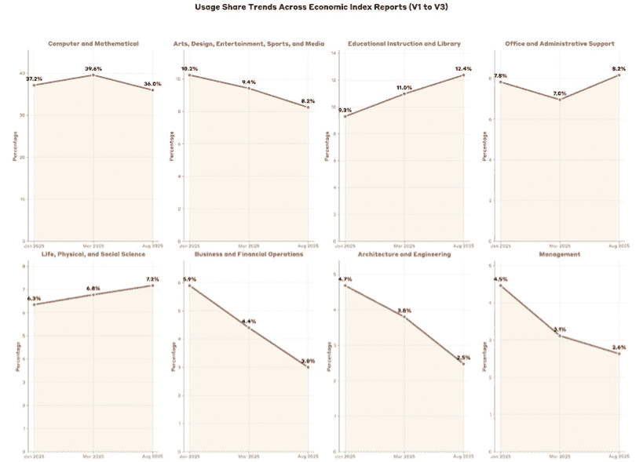
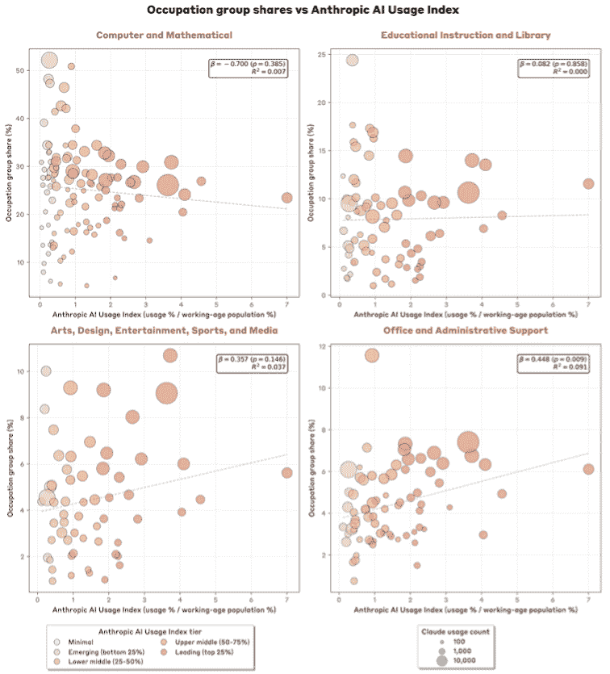
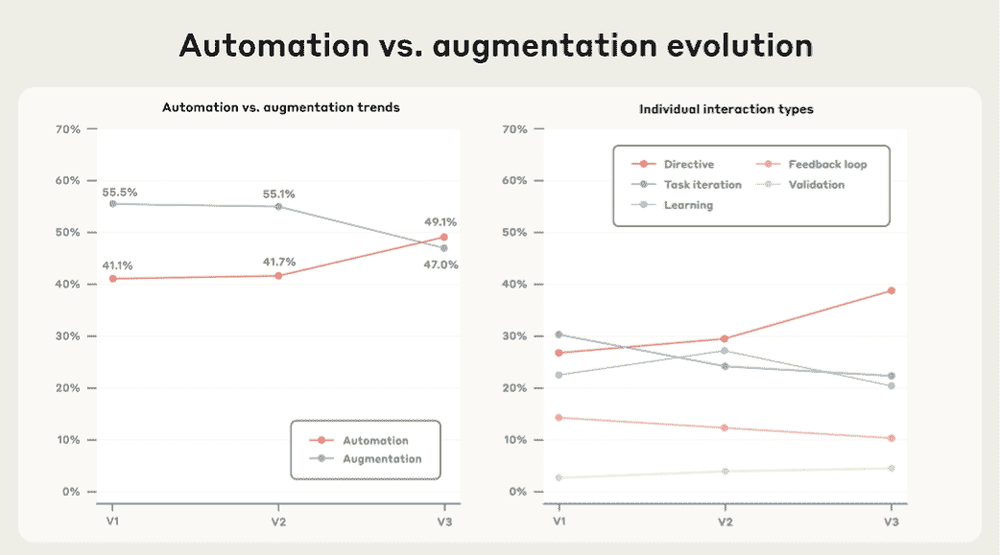
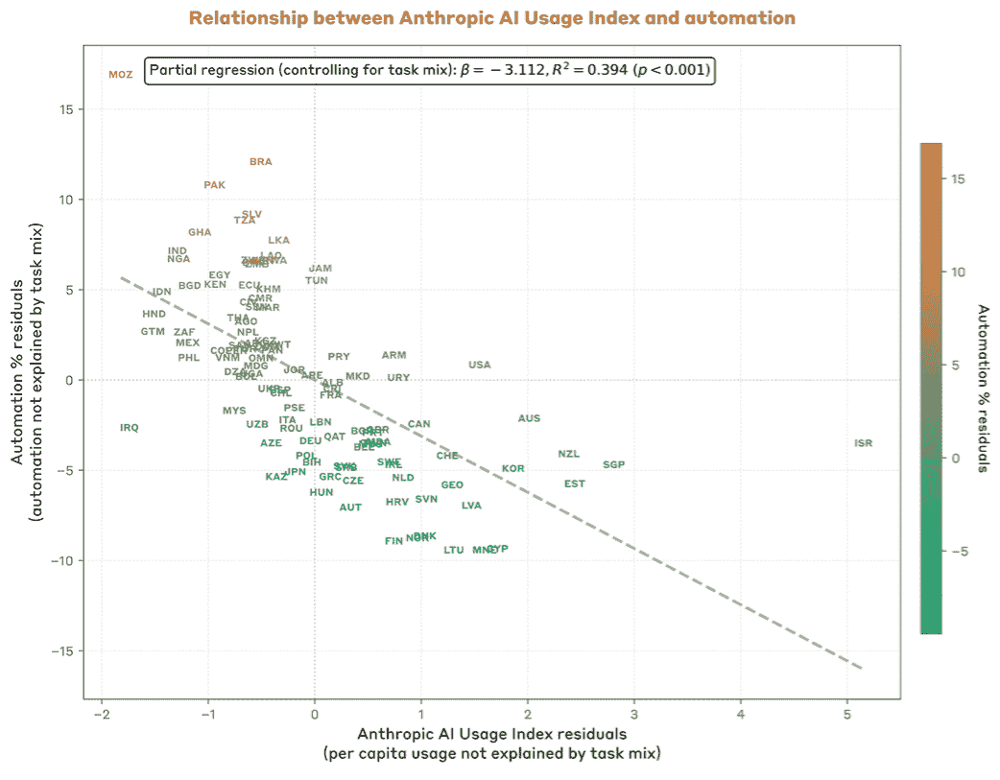
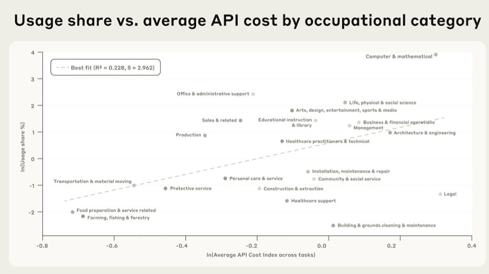

# Anthropic最新报告《人类经济指数：追踪AI在美国及全球经济中的作用》

> 来源：[https://gotoaiworld.feishu.cn/docx/UBO1dodsxotwjcxZhhZcUh1AnLg](https://gotoaiworld.feishu.cn/docx/UBO1dodsxotwjcxZhhZcUh1AnLg)

《人类经济指数：追踪AI在美国及全球经济中的作用》主要研究AI（特别是Claude）在全球和美国各州的使用情况。报告发现，美国的Claude使用量远超其他国家，印度、巴西、日本和韩国紧随其后。在国家层面，Claude的使用与人均GDP呈正相关，高收入国家更倾向于使用Claude进行知识工作而非单纯的编程。在美国，各州的AI使用因经济结构不同而异，例如华盛顿特区更常用于文档编辑，加州更偏重编程任务。报告发现，随着时间推移，Claude的自动化任务比例从27%上升到39%，表明用户对AI的信任度在增加。

夏威夷的旅行规划、马萨诸塞州的科学研究、印度的网页应用开发——表面上看，三者似乎毫无关联。事实上，Claude在这些地方的用途最为广泛。

这并不意味着这些是Claude最热门的用途：软件工程仍在全球几乎所有州和国家占据绝对主导地位。所谓“最为广泛”指的是：马萨诸塞州用户寻求科研帮助的概率远高于其他地区，巴西用户对语言类任务格外热衷——他们用Claude进行翻译和语言学习的频率是全球平均水平的六倍。

这些发现来自我们第三期《[Anthropic经济指数](https://www.anthropic.com/research/anthropic-economic-index-september-2025-report)》报告。本期报告中，我们进一步追踪AI技术如何重塑工作与经济格局的早期趋势，重点分析Claude在不同维度的应用差异：

+   **美国各州对比**：首次详细评估AI使用率的州际差异。发现各州经济结构直接影响人均Claude使用量，且最高使用率的州并非以编程任务为主。

+   **跨国对比**：新分析显示国家收入水平与Claude使用强度高度相关，低收入国家用户更倾向于用AI自动化工作任务。

+   **时间演变**：对比2[024年12月-20](https://www.anthropic.com/news/anthropic-economic-index-insights-from-claude-sonnet-3-7)25年1月与2025年2月-3月数据发现，“指令型自动化”任务占比从27%激增至39%，表明AI承担的责任（及用户信任度）快速提升。

+   **企业用户**[：新增Anthro](https://ai-bot.cn/sites/460.html)pic第一方API客户匿名数据（覆盖Claude.ai之外的用户），首次揭示企业使用模式：API用户自动化任务倾向显著高于消费者，预示劳动力市场或将迎来重大变革。

[以下是报告](https://www.anthropic.com/economic-index)[核心摘要。我们同步](https://ai-bot.cn/sites/460.html)推出了交互式网站，可自主查询全美各州及所有追踪职业的Claude.ai使用趋势，观察所在地或相关行业的AI应用情况。若需深度研究，我们完全公开本期及往期经济指数数据集。

## 地域分析

本次指数新增地理维度数据，揭示Claude在全球各国及美国各州的应用特征。

#### **跨国模式**

美国Claude使用量遥遥领先，印度位居第二，巴西、日本、韩国使用份额相近。

考虑到各国人口规模差异，我们采用“AnthropicAI使用指数（AUI）”校正分析：AUI>1代表该国人均使用量高于其劳动年龄人口预期水平。

数据显示，技术先进的小型经济体（如以色列、新加坡）在 Claude 采用率方面相对于劳动年龄人口处于领先地位。收入可能是关键因素：人均GDP与AUI指数呈现强相关性（人均GDP每增1%，AUI增0.7%）。这符合逻辑——Claude高使用国通常具备完善互联网基础设施及知识型经济主导的产业特征。也引发经济分化担忧：历史表明，电气化、内燃机等通用技术推动经济增长，也加剧了全球生活水平差距。若AI效益集中于高收入国家，可能重现类似的经济分化效应。

#### **美国州际模式**

人均GDP与Claude使用量的正相关性在美国州级层面同样成立，且相关性更强（人均GDP每增1%，人均使用量增1.8%）。但收入解释力低于跨国数据，表明存在其他影响因素。

我们推测各州经济结构是主要因素。美国最高的 AUI 是哥伦比亚特区（3.82），其中 Claude 最频繁的使用是编辑文档和搜索信息，及与华盛顿特区知识工作相关的其他任务。同样，与编码相关的任务在加利福尼亚州（AUI 总体排名第三的州）。

即使夏威夷等低使用率州，旅游相关任务使用[频率也达全](https://www.anthropic.com/economic-index)美平均值的两倍，更多数据可通过交互式网站探索。

## Claude 的使用趋势

自 2024 年 12 月以来，我们一直在追踪人们如何使用 Claude。我们用一种保护隐私的分类方法，将匿名对话记录按 O*NET（美国政府数据库，用于对工作及相关任务进行分类）定义的任务组进行分类。通过这种方式，我们能分析自去年以来人们分配给 Claude 的任务发生了怎样的变化，及人们选择合作的方式（他们选择对 Claude 的工作进行多少监督和投入）也发生了怎样的变化。

#### **任务类型**

自 2024 年 12 月以来，Claude 的计算机和数学用途在我们的类别中占据主导地位，约占对话的 37-40%。

但情况已发生很大变化。在过去的九个月里，我们看到“知识密集型”领域持续增长。例如，教育指导任务增加40%以上（占所有对话的比例从9%上升到13%），与物理和社会科学相关的任务比例增加三分之一（从6%上升到8%）。与此同时，传统商业任务的相对频率有所下降：与管理相关的任务占所有对话的比例从5%下降到3%，与商业和金融运营相关的任务比例减少一半，从6%降至3%。（当然，从绝对值来看，每个类别的对话数量仍然显著增加。）

整体趋势显示，随国家人均GDP提高，Claude应用从计算机/数学任务向教育、艺术设计、行政支持、科学研究等多元化场景迁移。软件开发仍是所有国家的最高频应用，美国各州亦呈现类似规律，尽管我们的样本量限制更详细地探究任务组合如何随采用率的变化而变化的能力。

#### **交互模式**

**正如我****们之**前所提到的，我们将AI应用分为自动化（AI最小化人工干预直接产出）与增强（人机协作），我们进一步将自动化细分为指令性对话和反馈循环交互，其中指令性对话涉及极少的人机交互，而在反馈循环任务中，人类将现实世界的结果反馈给模型。我们还将增强细分为学习（请求信息或解释）、任务迭代（与 Claude 协作）和验证（请求反馈）。

2024年12月以来，指令型对话占比从27%骤增至39%，其他模式（尤其学习、任务迭代、反馈循环）小幅下降，推动自动化总量（49.1%）首次超越增强（47%）。表明AI正快速获得用户信任，承担更复杂工作的自主权提升。

模型能力升级可能是主因（2024 年 12 月，我们首次收集经济指数数据时，Claude 的最新版本是 Sonnet 3.6）。随着模型越来越善于预测用户需求、生成高质量的结果，用户可能会更愿意在第一次尝试时就信任模型的输出。

反常现象是：高使用率国家倾向增强模式，低使用率国家更偏好自动化，在控制相关任务组合的情况下，人均使用量每增1%，自动化率降低约3%。原因尚不明确，可能与各国早期使用者文化差异或经济因素相关。

## 企业应用

使用与Claude.ai对话相同的隐私保护方法，我们从 Anthropic 的第一方 API 客户子集中抽样交互，这是一项开创性的分析。 API 客户往往是企业和开发人员，他们使用 Claude 的方式与通过Claude.ai访问 Claude 的人非常不同：他们按令牌付费，不是按固定的月度订阅，且能通过自己的程序发出请求。

这些客户对 Claude 的使用尤其集中在编码和管理任务上：我们示例中 44% 的 API 流量映射到计算机或数学任务，而Claude.ai上这一比例为 36%。（实际上，大约 5% 的 API 流量专门用于开发和评估人工智能系统。）与教育职业相关的对话比例（API 中为 4%，Claude.ai上为 12%）及艺术和娱乐相关的对话比例（API 中为 5%，Claude.ai上为 8%）相对较小，抵消了差异。

最后，考虑到 API 使用的付费方式，探究任务成本差异（由消耗的代币数量差异引起）是否会影响企业选择“购买”哪些任务。发现任务成本与使用频率呈正相关：成本较高的任务类别往往使用频率更高，如下图所示。表明，模型的基本功能及产生的经济价值对企业而言比完成任务本身的成本更为重要。

## 结论

经济指数旨在实证评估AI对就业与经济的影响初期表现，我们发现，AI应用呈现显著不均衡性：高收入国家用户更倾向使用Claude，更追求协作而非自动化，应用场景超越编程范畴。在美国州级使用量与当地主导产业紧密关联（从科技到旅游业），且企业比消费者更愿赋予Claude自主权。

尤其值得注意的是，过去九个月Claude.ai指令型自动化对话占比急剧上升。用户仍在探索与AI的协作边界——我们仍在集体界定对AI工具的信任阈值与责任分配。但目前趋势表明，人类正越来越适应AI代理工作。我们将持续追踪这一演变，观察随模型能力提升用户行为是否趋于稳定。

欢迎访问Anthropic经济指数专题网站探索交互式数据可视化（涵盖国家、州、职业维度），我们将持续更新数据供公众追踪AI对经济与就业的影响路径。

## 开放数据

与以往的报告一样，本期同步发布完整数据集，其中包括地理数据、任务级使用模式、按任务划分的自动化/增强功能细分以及 API 使用情况概览。数据可在经济指数网站下载。

## 报告官方网站

+   **报告官网**：https://www.anthropic.com/research/economic-index-geography

+   **交互式网站**：https://www.anthropic.com/economic-index