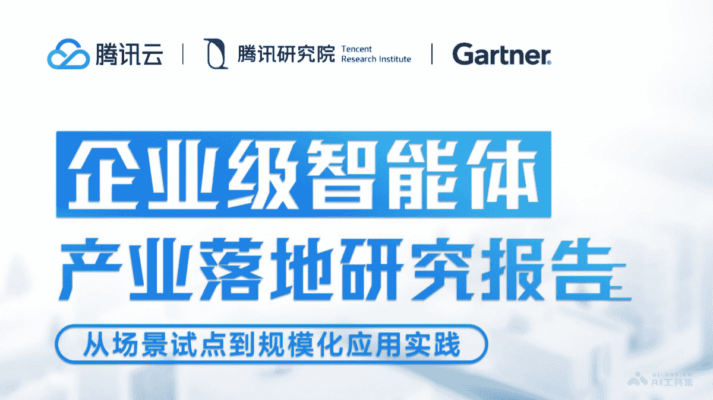
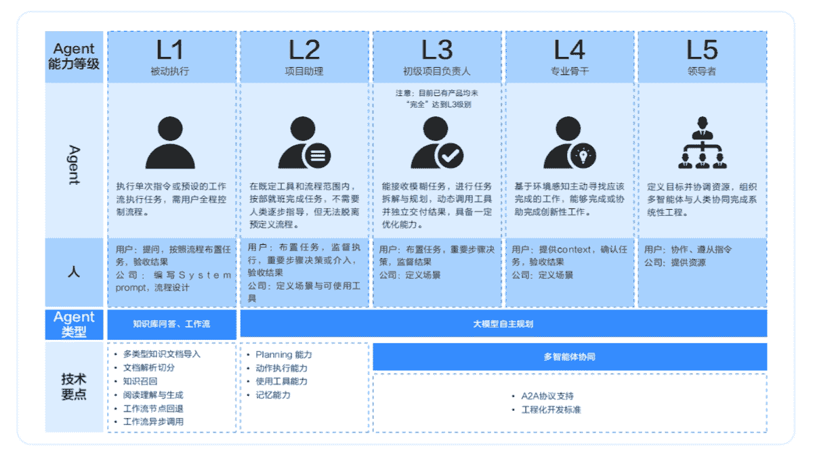
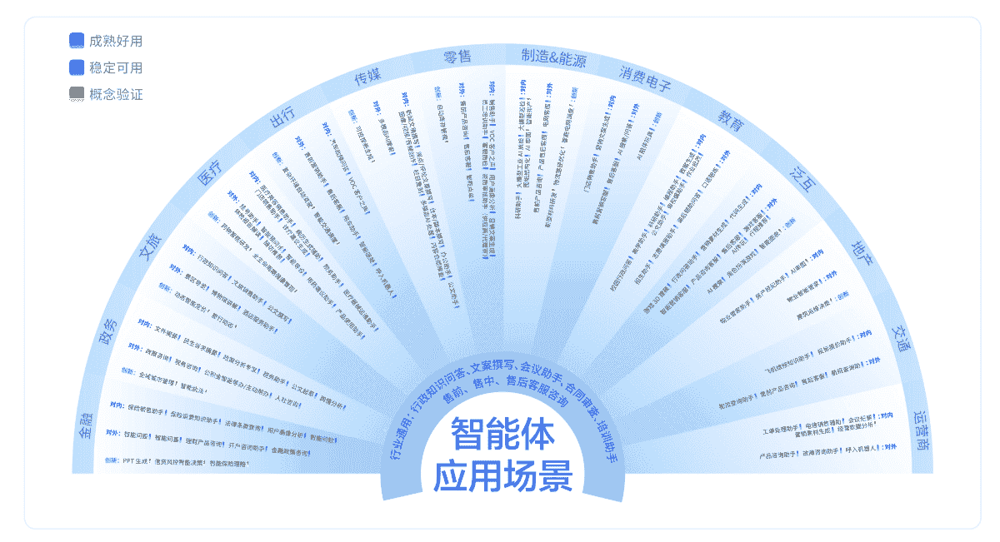
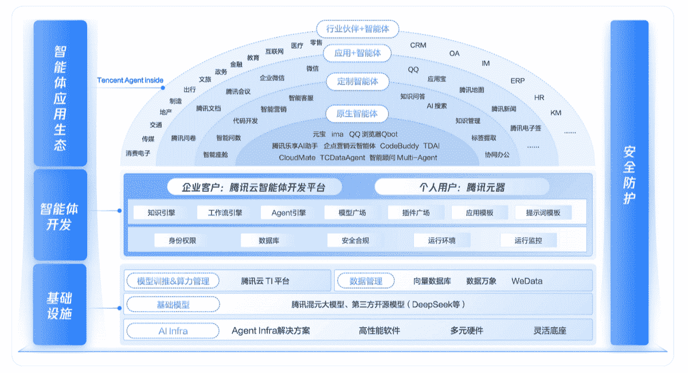
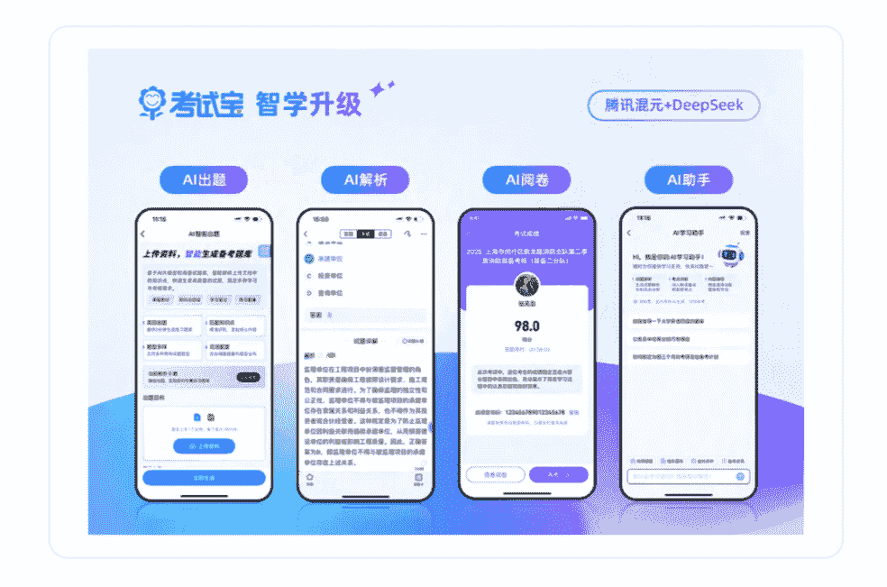
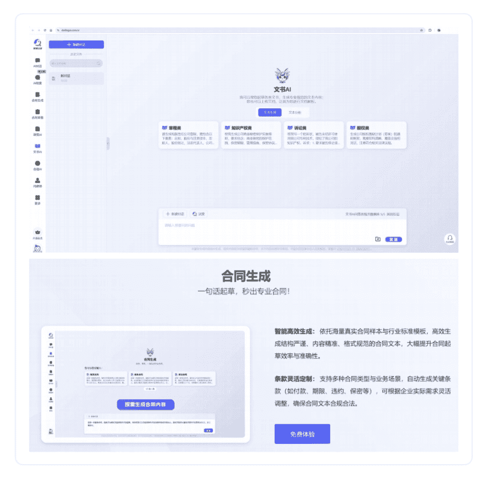

# 腾讯推出《企业级智能体产业落地研究报告》（PDF文件）

> 来源：[https://gotoaiworld.feishu.cn/docx/RLsUd1YAqozR59xaHHFciIbhnth](https://gotoaiworld.feishu.cn/docx/RLsUd1YAqozR59xaHHFciIbhnth)

《企业级智能体产业落地研究报告》是腾讯云、腾讯研究院联合国际权威研究机构Gartner共同推出的，报告深入探讨企业级智能体的产业落地情况。介绍了智能体从“辅助工具”到“自主生产力”的转变，详细阐述智能体的定义、形态及能力层级。报告通过“智能体场景罗盘”和“百大场景”梳理智能体在各行业的应用现状。分析了智能体落地的技术挑战，如训推成本、模型性能、安全防护等，且提出相应的解决方案。报告展示了多个行业的先锋实践案例，对未来智能体的发展趋势进行展望，强调智能体在推动企业智能化转型中的重要作用。

获取《**企业级智能体产业落地研究报告****》报告PDF原文**件 扫码关注回复： 20250929

## 引言

报告指出，人工智能正迎来重要的转折点，从“辅助工具”向“自主生产力”转变。智能体（AI Agent）作为变革的核心，能自主理解目标、规划路径、调用工具、与物理或数字世界交互。未来的企业运营人员能通过自然语言表达战略目标，由智能体组成的“虚拟团队”自主协作完成任务，如市场分析、广告投放和数据分析等。变革将重塑人机协作的边界，推动生产力的革命。

## 智能体概念

+   **定义与形态**

+   **狭义智能体**：强调自主学习与优化，具备原生工具调用与任务闭环执行能力。核心特征包括自主规划与反馈调节，能在无需持续人工干预的情况下完成任务。

+   **广义智能体系统**：更包容，依赖预设规则，通过工作流和工具协同实现任务。核心特征是执行预定义任务，依赖提示（Prompt）进行决策。

+   **能力界定与分类**

+   **核心要求**：智能体需要“能干活、能落地、能实战”，能力界定和分类必须依托可验证的评测体系。

+   **评测体系**：分为模型基础能力测试、通用任务测试和特定领域的端到端任务测试。评测方式包括最终输出评测、中间过程评测和相对评测。

+   **能力层级**：从L1（基础响应与流程执行）到L5（组织与领导）。每个层级对应不同的任务执行方式和技术要点，例如L1主要依赖知识库问答和工作流，L3开始具备自主规划和优化能力。

## 智能体场景盘点

+   **智能体场景罗盘**：报告提出“智能体场景罗盘”，通过横纵两个坐标轴（任务复杂度和自主规划依赖度）划分四个象限：高效助手、执行专家、决策专家和全能专家。每个象限代表不同类型的智能体应用场景，成熟度从概念验证到稳定可用不等。

+   **智能体百大场景**：报告梳理了金融、零售、文旅、教育、医疗等14个行业的上百个智能体应用场景，为企业提供直观的参考。场景覆盖从简单任务自动化到复杂项目管理的广泛应用。

## 智能体技术/产品方案解析

+   **技术挑战**

+   **训推成本**：大模型的训练和推理对资源需求极高，导致成本居高不下。业务负载的“潮汐效应”使传统的静态算力部署模式难以适应，进一步加剧资源浪费和成本问题。

+   **模型性能**：通用大模型在处理特定领域的专业知识时存在局限性，容易产生“幻觉”问题，在需要自主执行任务的场景中可能导致错误决策和危险行为。

+   **安全防护**：智能体应用引入了新的安全风险，如提示词注入、敏感信息泄露和不当的API调用。智能体处理和存储的海量敏感数据面临数据滥用、隐私泄露和法规不合规的风险。

+   **数据治理**：企业内部数据普遍存在质量参差不齐、格式不统一、信息缺失和逻辑冲突等问题，形成了以打破的“数据孤岛”。导致智能体在整合不同部门数据时出现矛盾，影响其策的准确性。

+   **业务流程耦合**：智能体需要与企业现有的复杂系统深度集成，但旧系统之间的技术耦合和人机协作的流程耦合存在诸多障碍。

+   **解决方案**

+   **腾讯云智能体战略全景图**：腾讯云智能体战略全景图整合智能体应用、开发平台和基础设施，提供全链条解决方案，助力企业高效构建和优化智能体系统，推动智能化转型。

+   **腾讯云产品方案**：具体技术优化聚焦通信、调度、模型、安全、数据治理和知识解析等关键领域，通过先进技术手段提升智能体性能与可靠性，为企业应用落地提供支撑。

## 智能体先锋实践

报告列举多个行业的先锋实践案例，展示了智能体在实际业务中的应用效果：

+   **文旅**：华住集团打造7×24小时“全能酒店管家”，提升客户服务体验。

+   **医疗**：迈瑞×腾讯云“启元”大模型重塑重症诊疗范式，提高医疗效率。

+   **出行**：一汽丰田用大模型打造专家级汽车服务智能客服，优化用户体验。

+   **零售**：伊利集团用智能体打造智能导购新体验，激活全域营销新动能。

+   **金融**：东吴人寿智能体技术助力保险全周期服务体系智能化升级。

+   **互联网**：同程DeepTrip智能助手用AI重新定义旅行体验。

+   **教育**：考试宝以AI大模型解锁精准学习新范式。

+   **政务**：邯郸公积金全国首创“边聊边办”数字柜台，重塑公积金服务新体验。

+   **制造**：运达能源科技集团以智能体技术提升风电装备制造和交付效能。

+   **能源**：五环集团用AI重塑工程管理赋能新质生产力。

+   **地产**：碧桂园服务打造“一问”AI客服机器人赋能员工效率跃升。

+   **物流**：DHL用智能体重构跨境智能客服实现效率与合规双提升。

+   **游戏**：巨人网络《太空杀》游戏引入AI智能体，创新游戏玩法。

+   **心理健康**：腾讯云助力心言集团打造AI情感陪伴服务。

+   **法律**：得理科技打造AI法务助手重塑企业法务服务新范式。

## 智能体发展展望

报告预测智能体将从单一、静态的应用走向动态、泛在化和具身化的新形态，推动社会和商业的范式变革：

+   **智能协同**：从单兵作战到群体智能，实现多智能体协同和跨组织智能体协同。

+   **感知与推理**：通过多模态模型和世界模型，实现更高级的推理和对世界的内在理解。

+   **执行与应用**：智能体的泛在化与具身化，将能力延伸到物理世界，融入各类硬件终端。

## 结语

智能体正从“辅助工具”演变为“自主生产力”，将深刻影响企业运营、组织形态乃至社会结构。腾讯云通过构建从技术底座到行业应用的全栈能力，助力企业分阶段、可持续地推进智能体建设，实现从“试点验证”到“生态融合”的智能化转型。