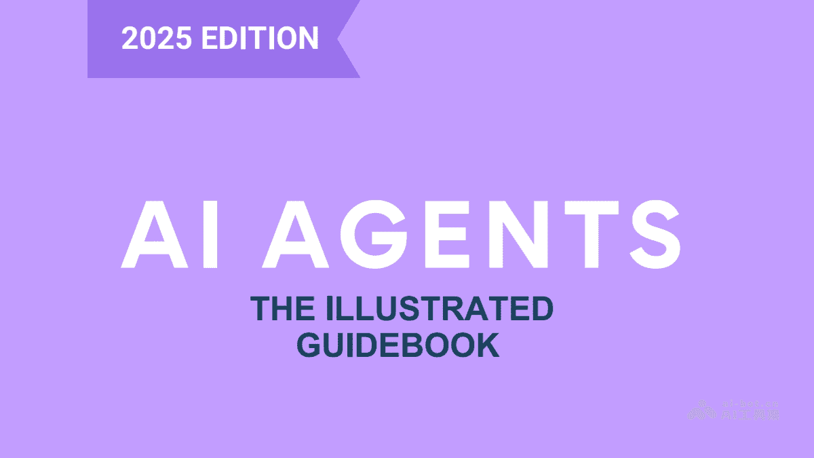
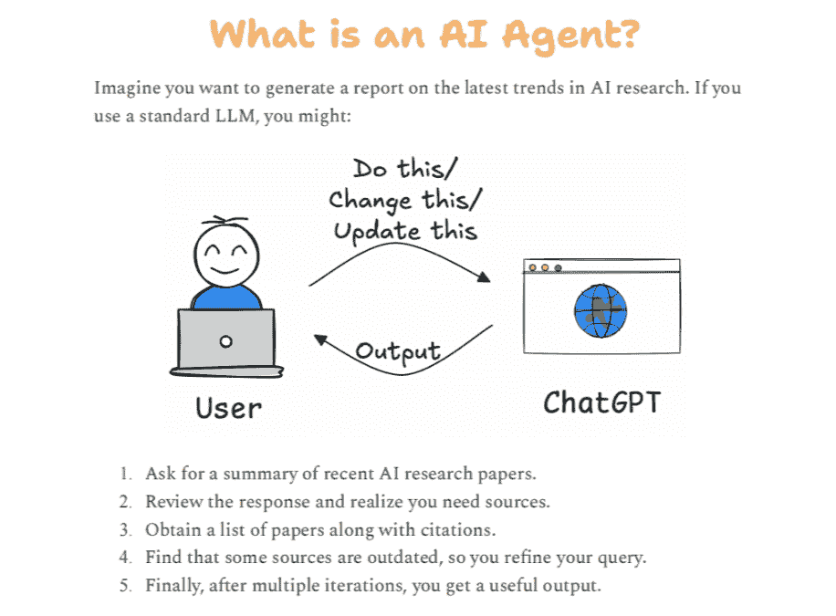
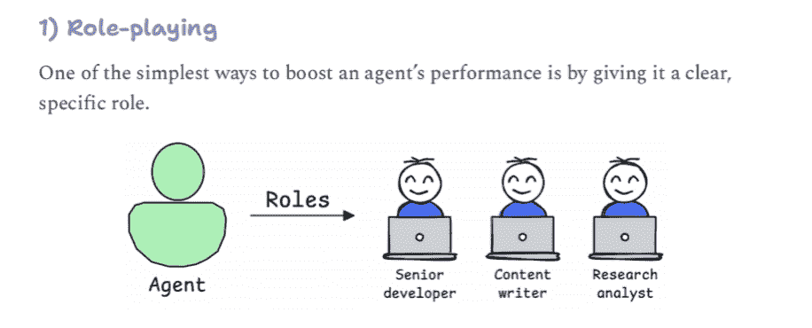
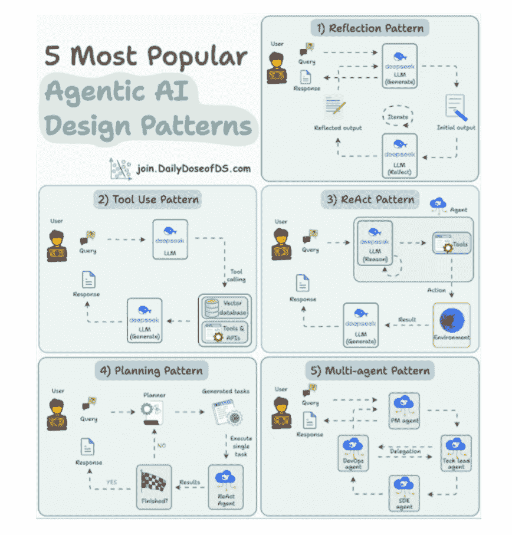
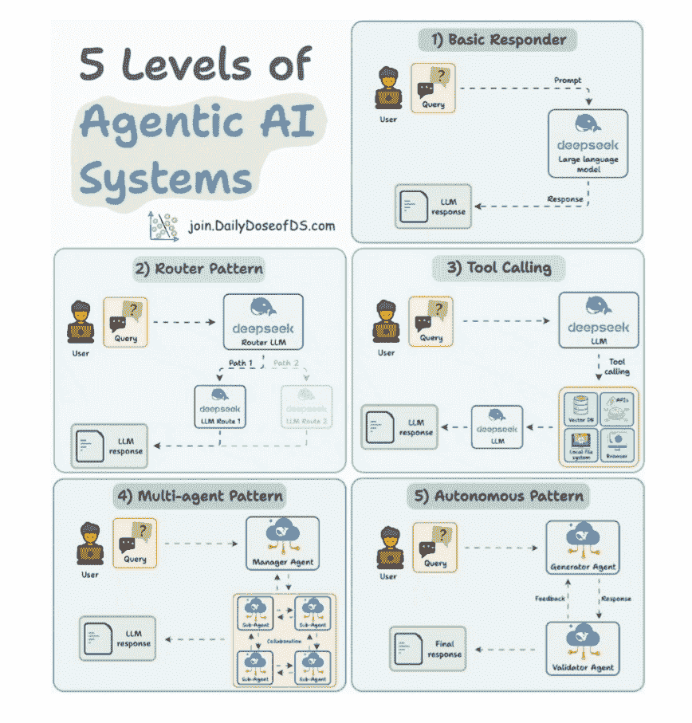
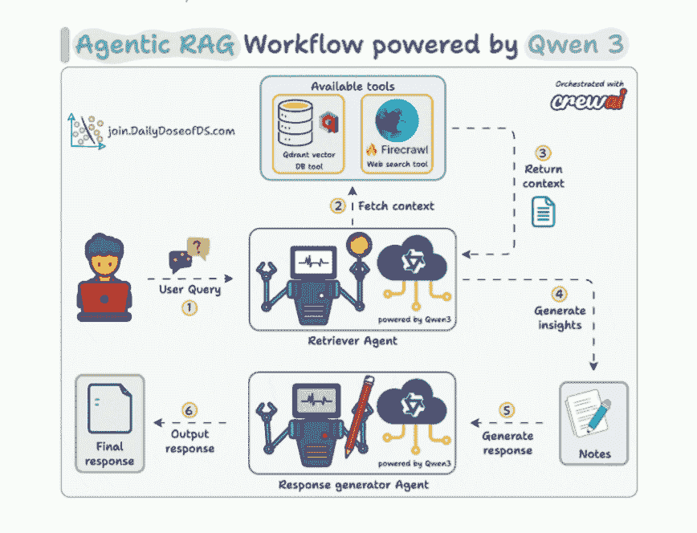

# 《AI Agents图解指南》全景技术报告

> 来源：[https://gotoaiworld.feishu.cn/docx/VNWWdyUJJobephx8ClKcSGUknZf](https://gotoaiworld.feishu.cn/docx/VNWWdyUJJobephx8ClKcSGUknZf)

《AI Agents图解指南》是Avi Chawla和Akshay Pachaar编写的，能帮助读者理解和构建AI Agents。详细介绍AI Agents的定义、与LLM和RAG的区别，及构建AI Agents的六个基本要素（角色扮演、专注任务、工具使用、合作、护栏和记忆）。探讨了AI Agents的五个设计模式和五个层次，提供多个实际项目案例，如Agentic RAG、语音RAG Agent、多Agent航班搜索等，涵盖技术栈、工作流程和代码示例。本指南是AI领域从业者的实用手册，适合希望深入了解和应用AI Agents的读者。

## AI Agents简介

+   **定义**：AI Agents是能自主推理、思考、规划、从相关来源提取信息、采取行动，在必要时自我纠正的自主系统。

+   与LLM（大型语言模型）和RAG（检索增强型生成）的区别：

+   **LLM**：像GPT-4这样的模型，基于大量文本数据训练，能够推理、生成和总结，但仅限于其训练数据。

+   **RAG**：通过检索外部文档（如向量数据库、搜索引擎等），将它们作为上下文输入到LLM中，增强LLM的能力。

+   **AI Agents**：在LLM的基础上增加自主性，决定采取哪些步骤，例如调用工具、搜索网络、总结或存储信息。

## 构建AI Agents的六个基本要素

+   角色扮演（Role-playing）：为AI Agents分配清晰、具体的角色，提高其性能。例如，将AI定义为“高级合同律师”使其回答更具法律精确性。

+   专注/任务（Focus/Tasks）：专注于特定任务可以减少幻觉（hallucinations）提高性能。使用多个专门的Agent，避免让一个AI Agent做太多事情，。

+   **工具（Tools）**：AI Agents通过使用工具变得更智能。工具支持Agent搜索网络、从API和数据库中检索结构化信息、执行代码等。

+   **合作（Cooperation）**：多Agent系统通过合作和交换反馈效果最好。例如，在金融分析系统中，一个Agent收集数据，另一个评估风险，第三个制定策略，第四个撰写报告。

+   **护栏（Guardrails）**：限制Agent的行为，确保保持在正确的轨道上。例如，限制工具使用、设置验证检查点、建立回退机制等。

+   **记忆（Memory）**：记忆是AI Agents的关键组成部分，支持Agent记住过去的互动，随着时间的推移改进，创建更连贯的对话。

## AI Agents的五个设计模式

+   反思模式（Reflection Pattern）：AI审查自己的工作，发现错误并迭代，直到产生最终响应。

+   工具使用模式（Tool Use Pattern）：AI通过查询向量数据库、执行Python脚本、调用API等方式获取更多信息。

+   ReAct（Reason and Act）模式：Agent在生成输出后进行反思，并使用工具与世界互动。它在思考、行动和观察之间循环，直到找到解决方案。

+   规划模式（Planning Pattern）：AI创建路线图，细分任务并概述目标，更有效地解决问题。

+   多Agent模式（Multi-Agent Pattern）：多个Agent协同工作，每个Agent都有特定的角色和任务，共同完成最终结果。

## 五级智能体系统

+   基本响应者（Basic Responder）：人类指导整个流程，LLM只是接收输入并产生输出的通用响应者。

+   路由器模式（Router Pattern）：人类定义流程中存在的路径/函数，LLM决定能采取哪条路径。

+   工具调用（Tool Calling）：人类定义LLM可以访问的工具集，LLM决定何时使用它们及使用哪些参数。

+   多Agent模式（Multi-Agent Pattern）：管理Agent协调多个子Agent，决定下一步行动。

+   自主模式（Autonomous Pattern）：LLM独立生成和执行新代码，有效地作为一个独立的AI开发者。

## 12个AI Agents项目案例

+   **Agentic RAG**：构建具有动态从不同来源获取上下文能力的RAG管道。

+   **语音RAG Agent**：构建一个实时语音交互的AI应用。

+   **多Agent航班搜索**：解析自然语言查询并从Kayak获取实时结果的航班搜索管道。

+   **金融分析师**：从Cursor或Claude获取、分析并生成股票市场趋势洞察的AI Agent。

+   **品牌监控系统**：抓取网络提及并产生关于公司的洞察的多Agent品牌监控应用。

+   **多Agent酒店查找器**：解析旅行查询，从Kayak获取实时航班和酒店数据，并总结最佳选项。

+   **多Agent深度研究者**：构建一个100%本地化的ChatGPT深度研究功能替代品。

+   **具有人类记忆的AI Agent**：构建具有人类记忆的AI Agent，以解决生产中的问题。

+   **多Agent书籍撰写者**：构建一个从3-5个单词的书籍主题生成20,000字书籍的Agentic工作流。

+   **多Agent内容创作系统**：构建一个将任何URL转换为社交媒体帖子并通过Typefully自动安排的Agentic工作流。

+   **文档撰写流程**：构建一个从GitHub仓库URL生成完整项目文档的Agentic工作流。

+   **新闻生成器**：构建一个将用户查询转换为精心撰写的新闻文章的AI新闻生成器。

