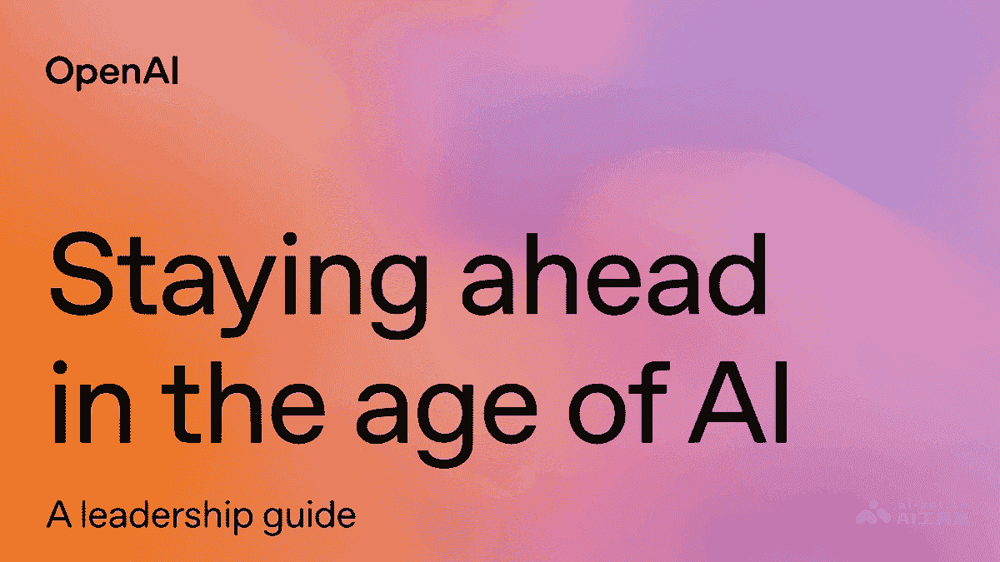
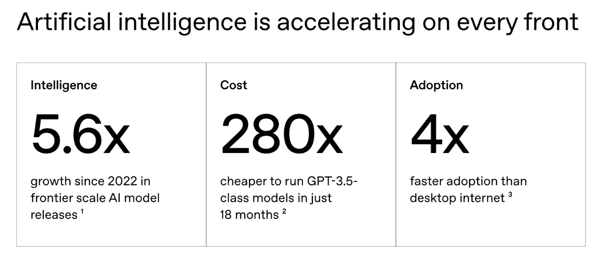
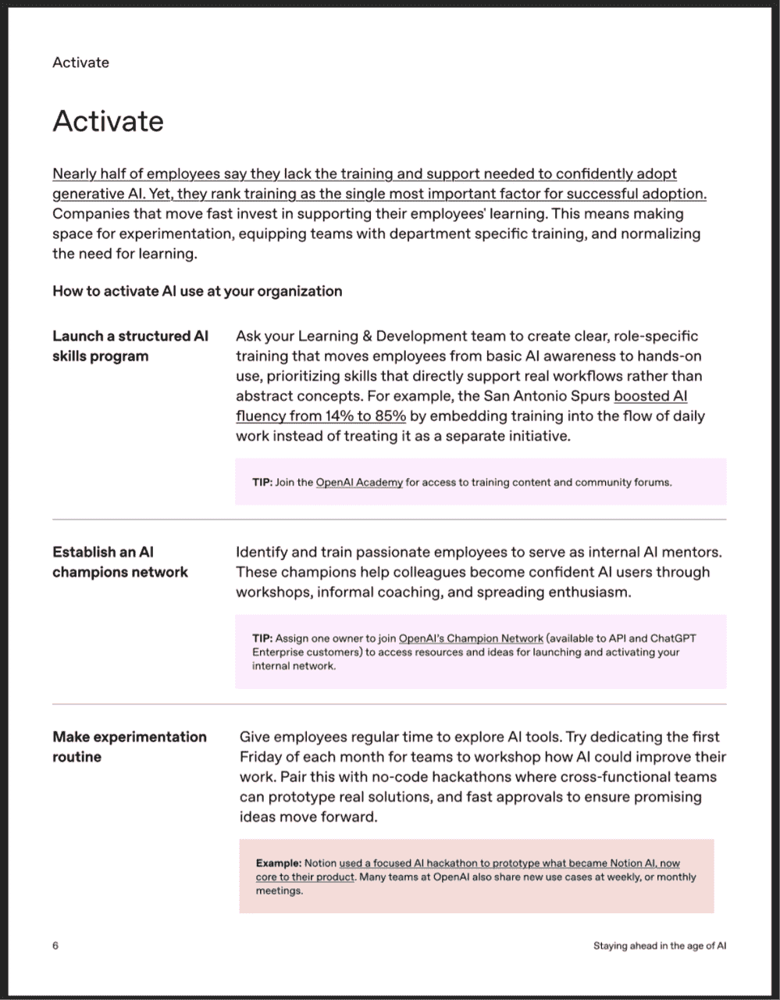
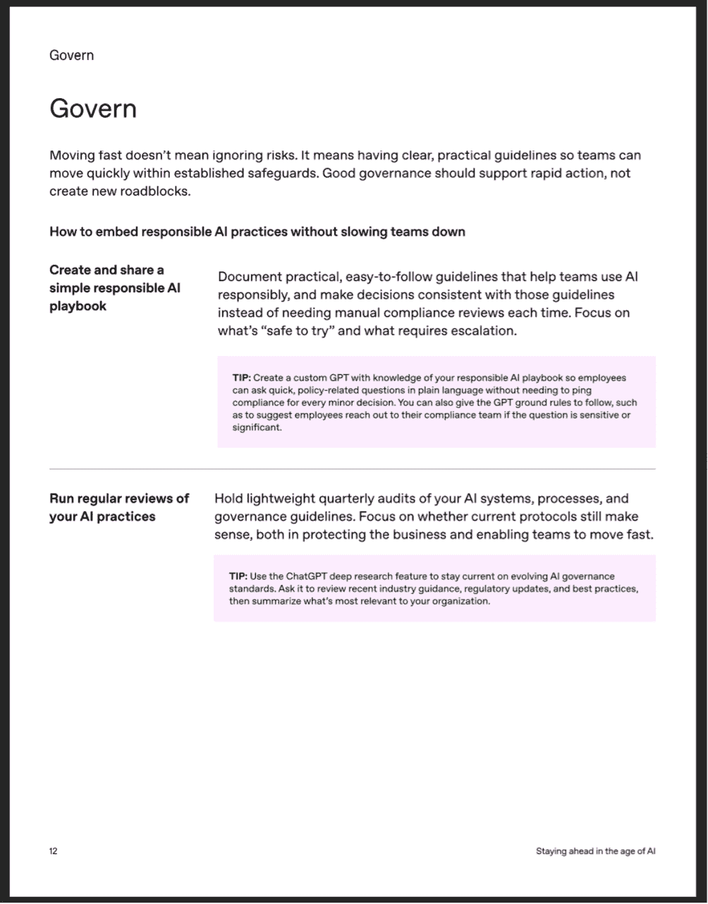

# OpenAI发布AI领导力指南《在AI时代保持领先》

> 来源：[https://gotoaiworld.feishu.cn/docx/XN3Ad7AKYooLiexrlydc1vnInkd](https://gotoaiworld.feishu.cn/docx/XN3Ad7AKYooLiexrlydc1vnInkd)

Staying ahead in the age of AI》是OpenAI推出的AI领导力指南，能帮助企业领导者在AI时代保持竞争优势。指南指出AI技术发展迅猛，模型发布速度、成本降低和企业采用速度都远超以往。报告基于OpenAI与多家公司的合作经验，提出五个核心原则：对齐（Align）、激活（Activate）、放大（Amplify）、加速（Accelerate）和治理（Govern）。原则涵盖从战略制定到员工培训、从成功案例分享到项目快速推进及负责任的AI使用等多个方面，为企业在AI浪潮中脱颖而出提供清晰的行动框架和实践建议。

## 背景

OpenAI 指出目前AI发展态势：

+   顶级 AI 大模型的发布数量多5.6 倍。

+   就在一年半的时间里，GPT – 3.5 级别模型的成本，降低了 280 倍。

+   AI 普及的速度，比当年普及电脑上网快了整整 4 倍。

现实情况呈现出一种分裂态势，波士顿咨询发现，行动快的公司，收入增长已经是同行的 1.5 倍，麦肯锡的调查显示，有将近一半的员工觉得自己没人教、没人带，不敢、不会用 AI 工具。AI 创造了机会，也带来焦虑。OpenAI基于与Estée Lauder、Notion、San Antonio Spurs、BBVA等公司的合作经验，总结出五个核心原则。

## 五个核心原则

#### Align（对齐）：统一思想，凝聚共识

+   **高管讲故事** ：公司的管理层必须亲自站出来，用大白话跟所有员工讲清楚，为什么 AI 对公司的未来这么重要。是竞争对手已经全用上了？还是客户的要求变了？或者以前的赚钱方法不好使了？员工们听到一个想得很明白的 “为什么”，心里就有底了。

+   **设定全公司 AI 目标** ：光有想法还不够，得有个大家都能看懂的目标。目标有很多种，比如开发新用法、看使用频率、鼓励多尝试等。关键是，要把目标写进公司的计划和 KPI 考核里，在全员大会、公司周报里反复说。

+   **领导带头用** ：领导带头用，主要是为给大家 “祛魅”，让大家知道 AI 并不神秘。当员工看见财务总监都在用 AI 分析市场、看客户数据，员工心里的怀疑和害怕就会少很多。

+   **部门负责人具体落实** ：部门负责人要经常跟自己的团队开小会，在会上别讲虚的战略，聊点实在的。比如 “我们部门能用 AI 做这几件事”，“大家觉得还有哪些地方能用上？”

#### Activate（激活）：赋能员工，激发动力

+   **搞一套正经的 AI 培训** ：公司的人力资源部门应该牵头，设计一套跟岗位工作相匹配的培训课程。课程的目标是让员工从听懂 AI 是什么，变成能在自己的工作里熟练地用起来。

+   **找一批 “AI 积极分子”** ：公司里总有一批人，自己就对 AI 特别感兴趣。要把这些人找出来，更深入的培训，让他们成为公司内部的 “AI 老师”。

+   **让 “试一试” 变成常态** ：创新都是试出来的。公司必须给员工创造可以放心试错的环境。比如，留出固定的时间，像每个月第一个周五是 “AI Friday”，大家放下手里的活，专门研究怎么用 AI 改进工作；搞点小型比赛，组织不需要写代码的 Hackthon，让不同部门的人组队，用现成的工具快速把 AI 的想法做成个样品。

+   **把 AI 贡献和升职加薪挂钩** ：公司要把 AI 用得好不好，明确地跟员工的绩效和发展联系起来。比如在制定工作目标的时候，给不同岗位的人加上 AI 相关的任务；在提拔人、发奖金的时候，特意说说这个人在 AI 方面的贡献。

#### Amplify（放大）：共享经验，扩散成果

+   **建一个统一的 AI 知识库** ：找个大家都能方便访问的地方，比如内部的共享文档系统，把所有跟 AI 有关的东西都放在那里。知识库里有培训材料和视频、各种比赛的日程和成果、公司用 AI 的规矩和安全手册、好用的案例和 Prompt 模板等。

+   **坚持分享成功的故事** ：影响力是通过故事传播的。公司需要像做外宣公关一样，在内部不停地讲 AI 的成功案例。形式有很多种，比如定期的 AI 简报、内部的分享会、全员会议的固定环节等。

+   **搞一些活跃的内部社群** ：光有正式的知识库还不够，需要有地方让大家随便聊。在公司的聊天软件里建一些 AI 交流群，或成立一个跨部门 “AI 小组”，让大家能随时交流想法。

+   **在团队内部也要多表扬** ：除公司层面的宣传，各个团队的经理要经常在自己的部门会议上，表扬在 AI 上做得好的事情。来自直属领导的肯定，信号作用很强。

#### Accelerate（加速）：优化流程，快速迭代

+   **让大家能方便地用到工具和数据** ：系统基础设施跟不上，是现在很多公司用 AI 的大问题。越来越多的公司开始给员工更大的权力，让员工自己去推荐和挑选觉得好用的 AI 工具，提高生产力速度就快多了。

+   建立一套清晰的 AI 项目申请和评估流程 ：公司需要设计一个简单、透明的流程。让团队很方便地提交 AI 项目的想法，很快得到反馈，且清楚地知道公司是怎么评估想法的。

+   成立一个能拍板的跨部门 “AI 委员会” ：为打破部门之间的墙，公司需要一个有足够权力的跨部门领导小组。领导小组由高管牵头，成员来自技术、法务、业务、数据部门，主要工作不是管事，而是 “通路”。

+   **让会赚钱的团队有钱继续花** ：最直接的办法，就是奖励。如果哪个团队用 AI 给公司省钱，或提高效率，把省下来的资源，拿出一部分还给这个团队，让员工有钱有时间去做更多新的尝试。

#### Govern（治理）：规范发展，稳健前行

+   写一本简单易懂的 “AI 安全手册” ：公司要把复杂的规定，变成一套普通员工能看懂、能执行的行动指南。手册的核心，是要说清楚，哪些事是能放心试的，哪些事是需要向上报告的。大家在处理大部分日常工作时，不用每次都去找法务或者合规部门，效率自然就高了。

+   **定期检查和更新 AI 的规矩** ：管理的规矩不能一成不变。公司每个季度都搞一次小规模的检查，看看当前的系统、流程和规矩还合不合适。检查的时候要从两个方面看，一方面规矩有没有保护好公司，另一方面是有没有不小心把创新的速度给拖慢了。

## **总结**

整个指南的核心思想，就是用好 AI，技术问题在其次，关键是组织和文化的问题。OpenAI 推出的这套行动指南，是一套完整的公司变革方法论。描述了一个理想的 “AI 公司” 应该是什么样子。从上层到下级，目标一致；从个人到团队，技能匹配；从个例到体系，经验共享；从想法到落地，流程顺畅；从创新到运营，风险可控。一个企业，想要在 AI 变革中胜出，不能仅仅把 AI 当作又一个新工具，要真正把 AI 当作一种全新的工作方式。