# a16z发布第五版《全球前100名Gen AI消费级应用》榜单

> 来源：[https://gotoaiworld.feishu.cn/docx/I5bWdgurHoDHa3xXIvKcFLOdnnc](https://gotoaiworld.feishu.cn/docx/I5bWdgurHoDHa3xXIvKcFLOdnnc)

a16z第五版《全球前100名Gen AI消费级应用》榜单发布。总结了过去两年半生成式AI应用的发展，包括中国AI应用的强势崛起，如多款应用跻身榜单前列且大量出海；谷歌AI产品矩阵的逐渐形成，多款产品上榜且增长迅速；通用LLM助手竞争加剧，ChatGPT虽仍领先但差距在缩小；Vibe Coding赛道兴起，用户粘性高且带动周边工具发展；榜单生态趋于稳定，新上榜应用数量变化体现这一点；及通用聊天助手、创意工具、AI陪伴三类产品在榜单中主导等趋势。

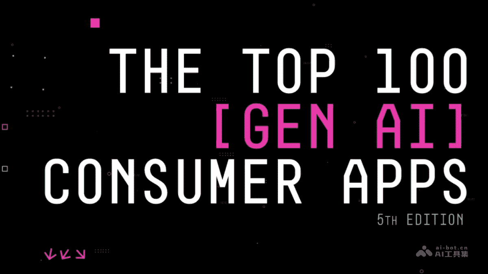

Andreessen Horowitz（ a16z ）第五版《全球前100名Gen AI消费级应用》榜单出炉。

+   **网页端50强**

+   **移动端50强**

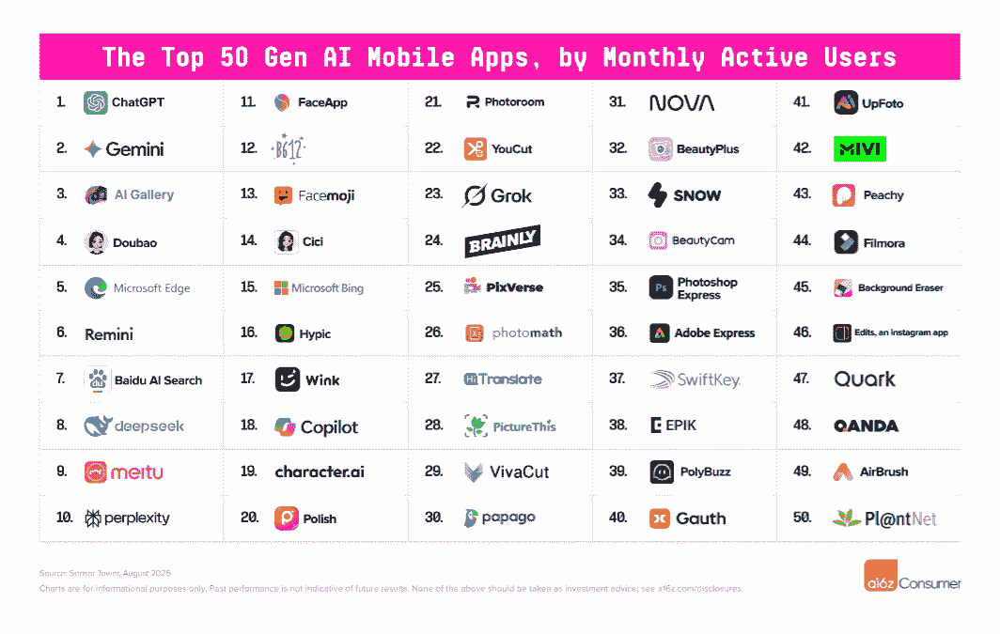

这是第五版《全球前100名Gen AI消费级应用》榜单，横跨两年半的用户日常AI使用行为数据。从生态来看趋势逐渐趋于稳固。

Web端新上榜应用仅11款，较上期（17款）显著减少。

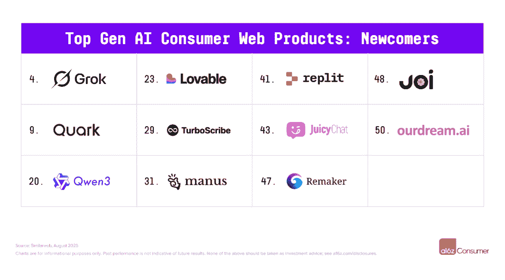

移动端因应用商店严打“ChatGPT套壳应用”，为新玩家腾出空间，新进入者数量（14位）略高于Web端。

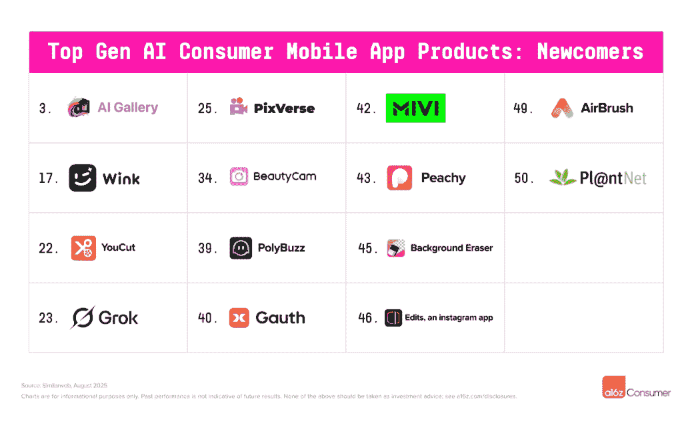

## 谷歌全面出击

谷歌共计4款产品强势入围Web端Top 50：

+   [**Gemini**](https://ai-bot.cn/sites/736.html)：网页端排名第2，其Web流量约为ChatGPT的12%，但在移动端的差距大幅缩小（MAU约为后者一半），尤其在Android端占据绝对优势。

+   [**AI Studio**](https://ai-bot.cn/sites/61081.html)（第10名）：面向开发者的Gemini模型沙盒平台，首次亮相即冲入前十，彰显谷歌强大的开发者生态号召力。

+   [**NotebookLM**](https://ai-bot.cn/sites/21562.html)（第13名）：从Google Labs独立后，凭借其扎实的AI笔记助手定位，用户规模持续稳健增长。

+   **Google Labs**[（第39名](https://ai-bot.cn/veo-3/)）：作为消[费者体验谷](https://ai-bot.cn/doppl/)歌前沿[AI（如Veo](https://ai-bot.cn/project-mariner/) 3视频模型、Doppl试衣、Mariner智能体浏览器）的主站，在Veo 3发布后流量单月暴涨13%。

## ChatGPT领先，Grok和Meta AI奋力追赶

在通用助手战场上，ChatGPT虽仍领先，但Grok和Meta AI正奋力追赶。

+   [**Grok**](https://ai-bot.cn/sites/5368.html)**（Web第4，移动第23）**：凭借Grok 4模型发布与“动漫AI伴侣”等出圈功能，移动端MAU从零激增至超2000万，展现出强大的产品与流量爆发力。

+   [**Meta AI**](https://ai-bot.cn/sites/11358.html)**（Web第46）**：表现相对平淡，因隐私争议导致增长乏力，未能进入移动Top 50。

+   [**DeepSeek**](https://ai-bot.cn/sites/54501.html)** 与 **[**Claude**](https://ai-bot.cn/sites/460.html)：移动端增速放缓，DeepSeek 较峰[值下滑 22%，网页](https://ai-bot.cn/perplexity-ai/)端跌幅更超 40%；Perplexity 和 Claude 仍在稳步增长。

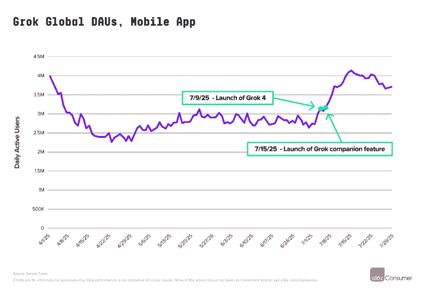

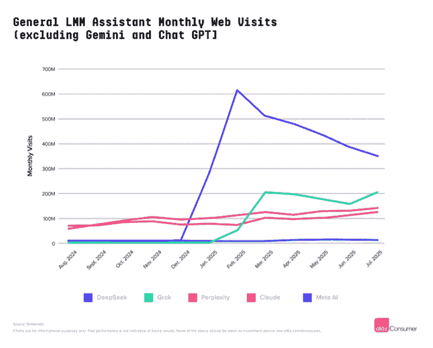

## **中国力量崛起**

中国已成为全球AI应用版图中不可忽视的一极，其影响力呈现双重路径：

+   **本土巨头主导内需市场**[：三](https://ai-bot.cn/sites/15309.html)款[主要](https://ai-bot.cn/sites/4189.html)服[务中国用](https://ai-bot.cn/sites/53747.html)户的应用跻身Web端Top 20（夸克、豆包、Kimi）。凭借语言、文化和合规优势，在庞大的内需市场中占据主导地位。

+   **新锐玩家“出海”征服全球**：更值得关注的现象是“中国开发，全球使用”。榜单中另有约7款中国背景的应用，其绝大多数用户[来自海外，](https://ai-bot.cn/kling-ai/)甚[至部分应用在](https://ai-bot.cn/hailuo-ai/)中国境内无法使[用。它们精准](https://ai-bot.cn/seaart-ai-overseas/)切入[全球性需求，在视频生](https://ai-bot.cn/sites/305.html)成（如Kling[、Hailu](https://ai-bot.cn/sites/1632.html)o）、图像编辑（SeaArt, Cutout Pro）、生产力工具（Monica） 等垂直领域展现出极强的竞争力。

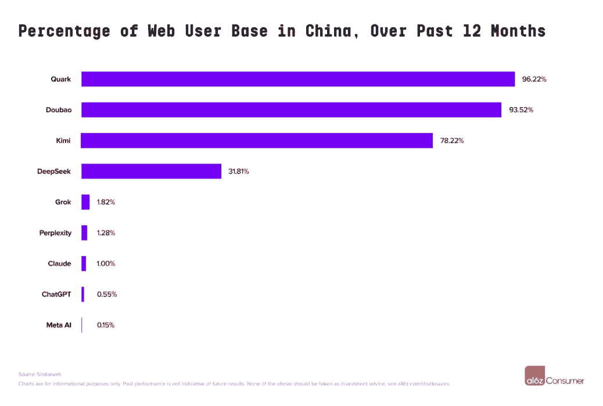

## Vibe Coding从概念走向成熟

Vibe Coding（低代码/自然语言生成[应用）从](https://ai-bot.cn/bolt%E2%80%A4new/)不温不火走向[核心赛道。继上](https://ai-bot.cn/sites/60798.html)次[仅有Bolt](https://ai-bot.cn/replit-agent/)上榜后，本次Lovable和Replit两款主流平台双双强势入围主榜单。

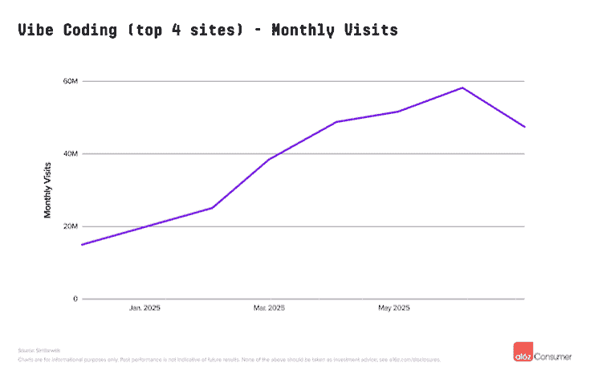

数据显示，头部平台的美国用户群展现出超100%的月度收入留存率，意味着用户持续增加付费，生态健康度极高。

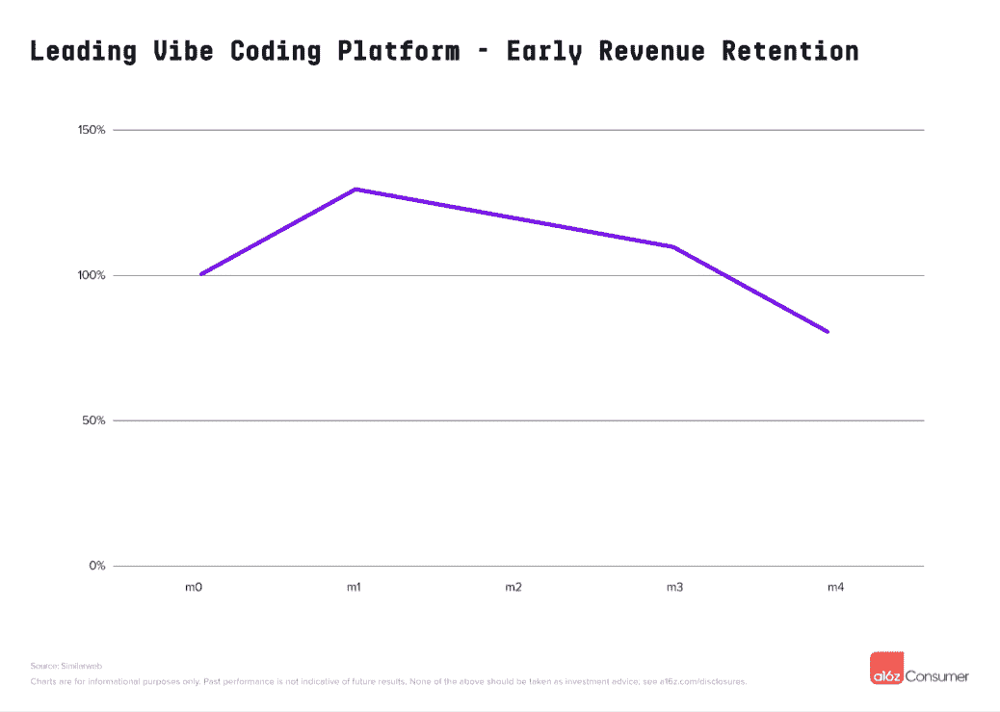

它们不仅自身成功，更带动了整个技术栈的繁荣（如数据库服务商Supabase流量随之飙升），一个崭新的开发者生态正在形成。

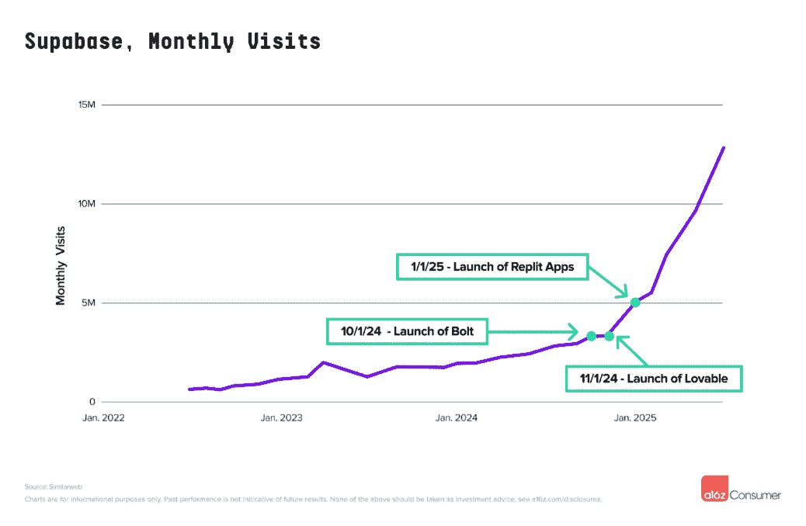

## 全明星阵营，14家公司五期联榜

在五期榜单中始终屹立不倒的14家“全明星”公司，横跨通用助手、陪伴、图像生成、视频编辑、语音合成、生产力工具等多个赛道。

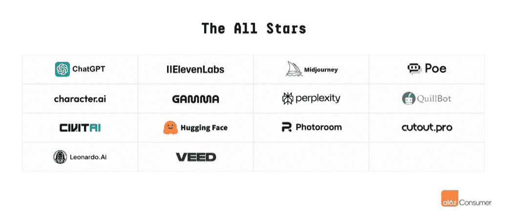

在这14家中，仅5家拥有自研模型，其余9家通过调用API、集成开源模型或采用聚合模式获得成功，为创业者提供多元化的成功路径。

值得注意的是，14家公司仅来自5个国家（美、英、澳、中、法），且其中12家已获得风险投资。

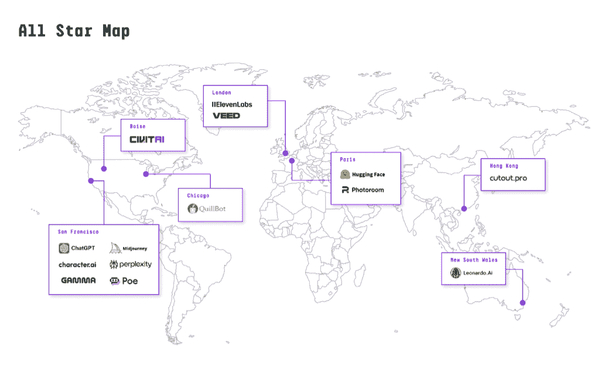

如不计入首期榜单，另有五家公司也能入选“全明星”，包括：[Claude和De](https://ai-bot.cn/janitor-ai/)epAI（[通用辅助）、Ja](https://ai-bot.cn/sites/695.html)nitorAI[（陪伴）](https://ai-bot.cn/sites/6968.html)、Pixelcut（图像编辑）和Suno（音乐生成）。