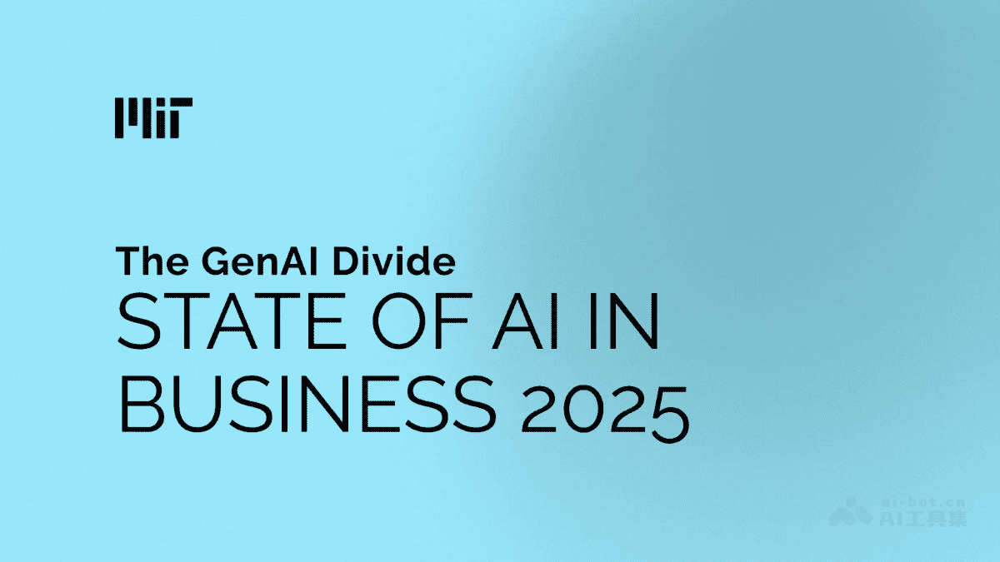
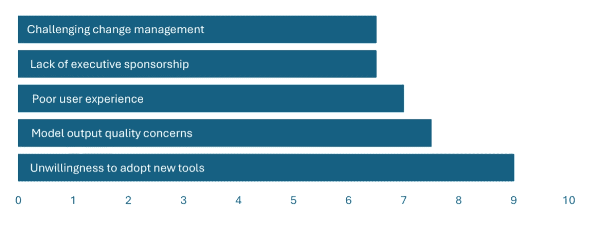
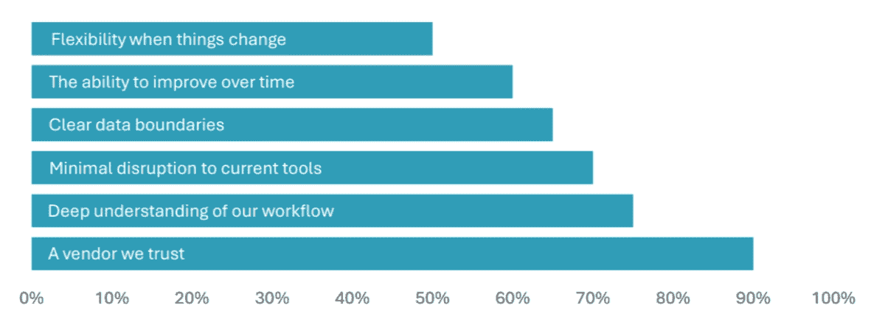

# MIT《生成式AI鸿沟：2025年商业人工智能现状》

> 来源：[https://gotoaiworld.feishu.cn/docx/WvGAd3MCDo8JmRxG8WfcZdudnAP](https://gotoaiworld.feishu.cn/docx/WvGAd3MCDo8JmRxG8WfcZdudnAP)

MIT《生成式AI鸿沟：2025年商业人工智能现状》报告，基于对300多个AI项目、52个组织访谈和153位高管的调查，揭示一个核心矛盾：企业对生成式AI（GenAI）抱有极高热情并投入巨资，绝大多数（95%）都无法将其转化为真正的业务价值和转型。 普遍失败与少数显著成功之间的巨大落差，被报告定义为 “GenAI鸿沟”（The GenAI Divide）。报告系统地剖析了鸿沟的成因、表现，为组织（买家）和供应商（构建者）如何跨越这条鸿沟提供清晰的路线图。

## ** GenAI鸿沟的现状**

+   **高采用、低转型**：像ChatGPT这样的工具被广泛试用，但能深度融入核心业务流程、引发真正变革的企业级应用寥寥无几。大多数行业并未出现预期的结构性颠覆。

+   **试点到生产的巨大落差**：企业定制化的AI工具从试点到全面部署的成功率极低（仅5%），绝大部分项目停滞不前。

+   **投资错配**：大部分资金流向了容易看见的前台功能（如营销），真正的投资回报（ROI）却隐藏在后台运营的自动化中（如财务、采购）。

+   **“影子AI”的盛行**：90%的员工私下用个人AI工具完成工作，效果和满意度远高于企业官方采购的系统，暴露了正式项目的失败。

## **GenAI鸿沟的根本原因**

报告认为，鸿沟的根源不是技术、数据或法规，是“学习差距”。

+   现有的企业AI工具大多无法学习和适应。它们没有记忆，不能从反馈中改进，无法融入具体的工作流程，每次都需要人工重新引导，显得非常“笨拙”。

+   用户需要的是能积累知识、持续进化的智能伙伴，不是每次都要从头教起的工具。这种能力的缺失，是导致大多数项目无法规模化的核心障碍。

## 跨越GenAI鸿沟的解决方案

**对于AI供应商（构建者）**：

+   **聚焦深度而非广度**：不要做万能工具，专注于解决某个狭窄但高价值的业务痛点，并做深度定制。

+   **构建“有记忆”的系统**：开发具备持续学习能力和记忆功能的Agentic AI（代理型AI），让系统越用越聪明。

+   **借助信任渠道**：通过合作伙伴、系统集成商和行业推荐来建立信任，比单纯推销产品功能更有效。

**对于企业（买家）**：

+   **转变采购思路**：不要像买软件一样买AI，应像采购业务服务一样，要求供应商深度定制并对业务结果负责。

+   **赋能一线业务团队**：让最懂业务的部门主导AI项目选型和落地，不是由中央IT部门包办。

+   **瞄准真实ROI**：将投资重点转向后台职能的自动化，关注如何替代外部外包成本和代理费用，不是减少内部员工。

## 未来展望

+   **Agentic AI和代理网络**：报告预测，AI的下一波演进将是 Agentic Web（代理网络，一个由众多能自主发现、协商和协作的AI系统组成的互联生态，将从根本上改变企业运作的方式。

+   **跨越GenAI鸿沟的窗口**：跨越GenAI鸿沟的窗口正在关闭。成功不再属于拥有最先进模型的公司，是属于能构建出最能学习、最懂业务的系统的组织。企业必须停止购买“愚蠢”的静态工具，转而选择能共同进化的智能伙伴。