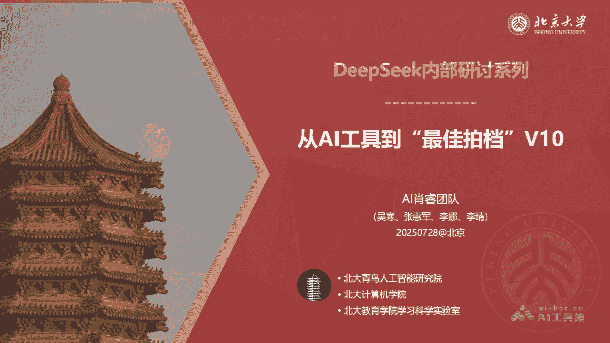
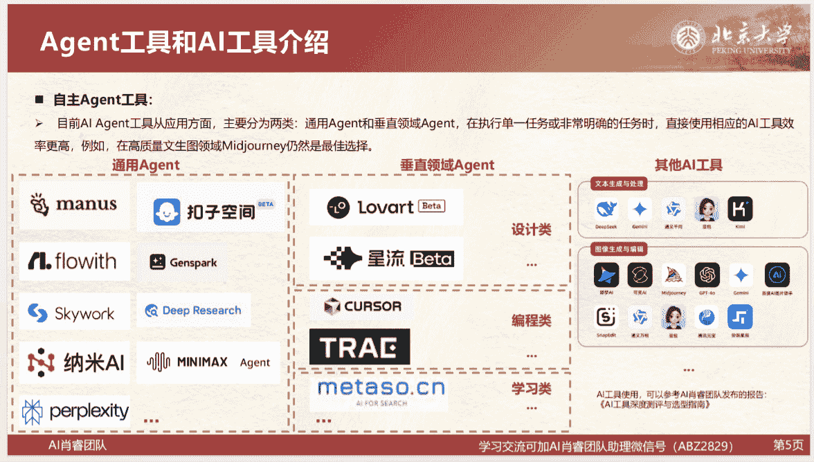
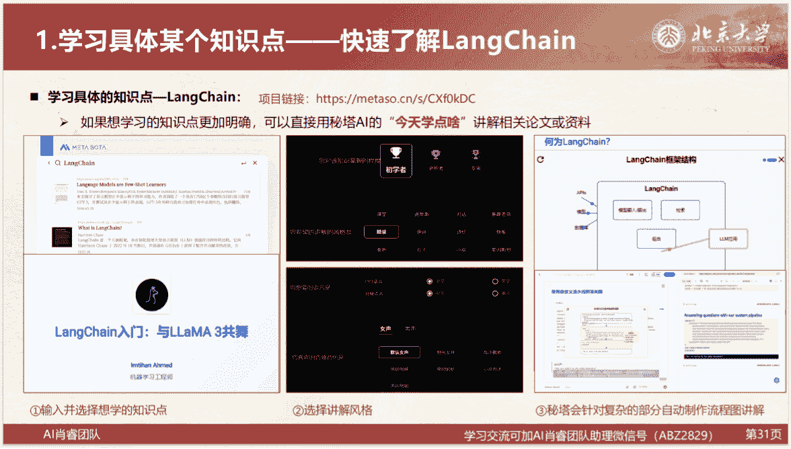
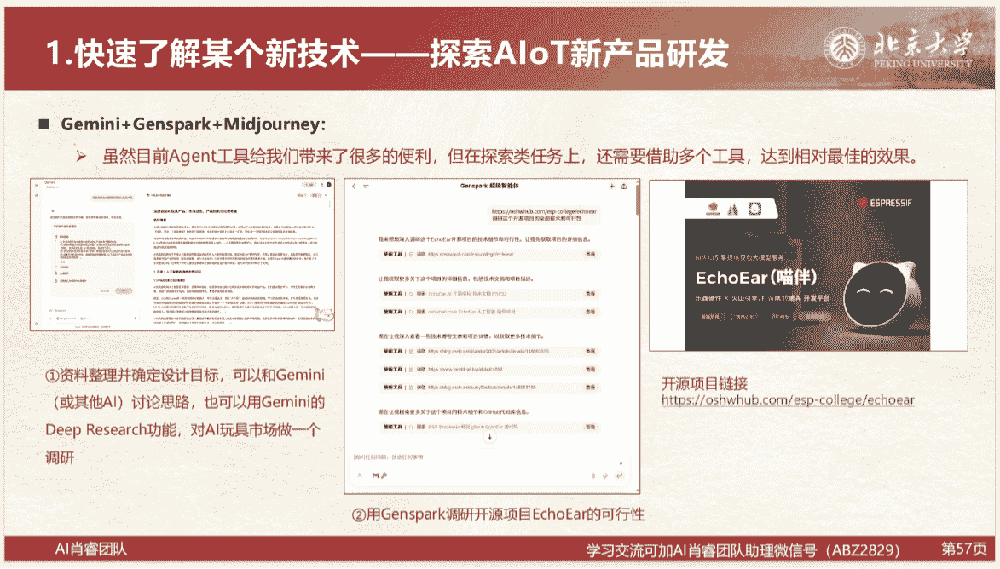
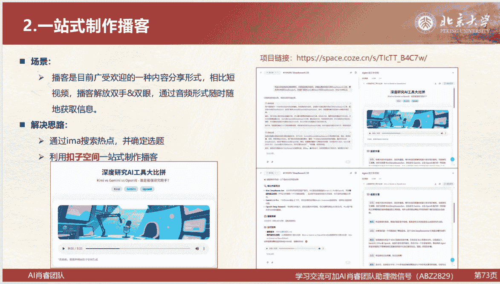
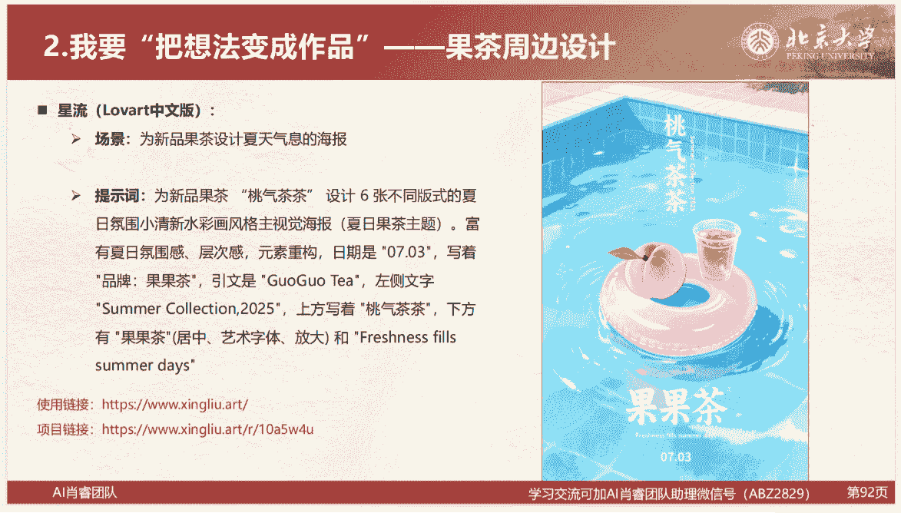

# 北京大学《从AI工具到“最佳拍档”V10》

> 来源：[https://gotoaiworld.feishu.cn/docx/DOaid6nNco6TkBxtoPwcW9JVn2f](https://gotoaiworld.feishu.cn/docx/DOaid6nNco6TkBxtoPwcW9JVn2f)

《从AI工具到“最佳拍档”V10》是北京大学AI肖睿团队编写的，系统介[绍了如何将](https://ai-bot.cn/manus/)各[类AI工具协同](https://ai-bot.cn/skywork/)应[用在实际场景。报](https://ai-bot.cn/genspark/)告[首先对1](https://ai-bot.cn/coze-space/)[1款](https://ai-bot.cn/sites/4189.html)主[流AI Agent，Man](https://ai-bot.cn/minimax-agent/)u[s、Sk](https://ai-bot.cn/sites/53747.html)y[work、Gensp](https://ai-bot.cn/perplexity-ai/)a[rk、扣](https://ai-bot.cn/namiso/)子空间（低代码开发）、秘塔AI（学术搜索）、豆包、MiniMax-Agent、KIMI、Perplexity、纳米AI和Deep Research，进行分类和功能解析，通过五大核心场景展开：知识学习（文献综述、知识梳理）、行业分析（新技术研究、商机挖掘）、内容创作（👸号、播客制作）、产品测评（数码产品对比）和创意设计（品牌IP开发）。每个场景都提供具体案例，对比不同工具的优势，给出”工具组合使用”的实战策略。报告强调AI已从单一工具进化为任务导向的”智能伙伴”，关键在于根据需求选择适配工具组合，通过详细评分表帮助读者快速选择最佳方案。

## AI工具全景概览

+   **工具分类与定位**：介绍了通用Agent（如Manus、Skywork）和垂直领域Agent（如DeepResearch、Lovart）的分类，及它们在不同场景中的适用性。

+   **核心功能对比**：对比自主执行和交互辅助两种模式，介绍多模态能力（文本、图像、音频）和适用场景（研究、办公、创作）。

## 知识探索与深度研究

+   **学习具体知识点**：通过KIMI和秘塔AI快速理解BERT、LangChain论文和界面设计理论，基于互动课程和解析功能提升学习效率。

+   **构建知识系统**：用KIMI和秘塔AI制定Python学习路径，用COZE空间生成初中数学知识点的思维导图，帮助系统化学习。

+   **学术研究支持**：用豆包、秘塔AI和Genspark生成文献综述和调研报告，对比不同工具的输出效果，选择最适合的工具。

## 行业洞察与时机分析

+   **新技术探索**：用Gemini、Genspark和Midjourney进行AIoT产品研发和Agent构建方式研究，生成需求梳理、技术调研和产品设计图。

+   **行业快速入门**：用Manus生成低空经济的政策与盈利模型清单，用Gemini和Genspark制定跨境电商选品策略，快速了解行业机会。

+   **热点事件解读**：用Genspark和MiniMax进行Labubu潮玩爆火分析和热点事件趋势洞察，生成深度报告和趋势分析。

## 内容创作与媒体制作

+   **自动化内容生产**：用AIWriteX和Cursor实现👸号日更内容的自动化生成，用扣子空间生成播客脚本和音频，实现一站式播客制作。

+   **测评与教程**：用豆包、Genspark和MiniMax生成数码产品横向测评报告，用Genspark生成📕美食教程的图文和视频脚本。

## Part 05: 创意设计与成果转化

+   **品牌与营销设计**：用Genspark生成咖啡新品预热的PPT方案，用星流（Lovart）生成果茶品牌的海报和3D模型，提升品牌形象。

+   **知识成果转化**：用纳米AI快速解读《长安荔枝》，输出思维导图和口播稿，用AI工具将笔记转化为PPT、演讲稿或摘要，实现知识的多形态输出。

