# MIT公开课《如何用AI做任何事》

> 来源：[https://gotoaiworld.feishu.cn/docx/OpHUdTo1LoC8LrxnxfccQef3nCc](https://gotoaiworld.feishu.cn/docx/OpHUdTo1LoC8LrxnxfccQef3nCc)

《如何用AI做任何事》是麻省理工学院推出的前沿课程，深入探索人工智能技术及在多种真实世界数据模态中的应用。课程聚焦现代深度学习和基础模型，涵盖从语言到视觉、音频、传感器、医疗数据等多模态内容。通过讲座、阅读、讨论和研究项目，学生将培养批判性思维，了解 AI 的最新技术成就，并掌握多模态 AI 的原理。课程注重理论学习，强调实践应用，鼓励学生在多领域中创新和探索 AI 的无限可能。

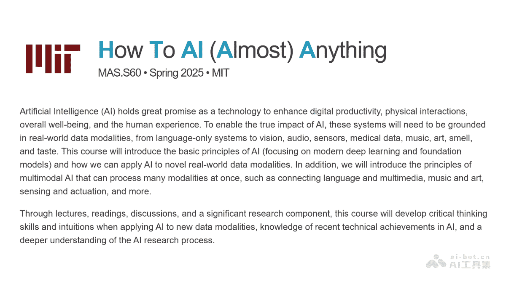

## 课程内容

**课程介绍**

课程由麻省理工学院的Paul Liang教授主讲，培养学生在多模态智能和人工智能领域的研究与应用能力。课程内容分为四个模块：AI基础、多模态AI基础、大型模型与现代AI、交互式AI。每个模块涵盖多个主题，如数据结构、多模态融合、大型语言模型、人机交互等。课程要求学生完成阅读作业、参与讨论，并开展一个高质量的研究项目，最终用提案、中期和最终报告及展示评估学习成果。

课程的评分标准包括阅读作业（40%）和研究项目（60%）。学生需要在每周的讨论中担任不同角色，如阅读领头人、讨论总结者等，提升批判性和创造性思维能力。课程提供了丰富的角色扮演任务，帮助学生从不同角度理解和应用AI技术。

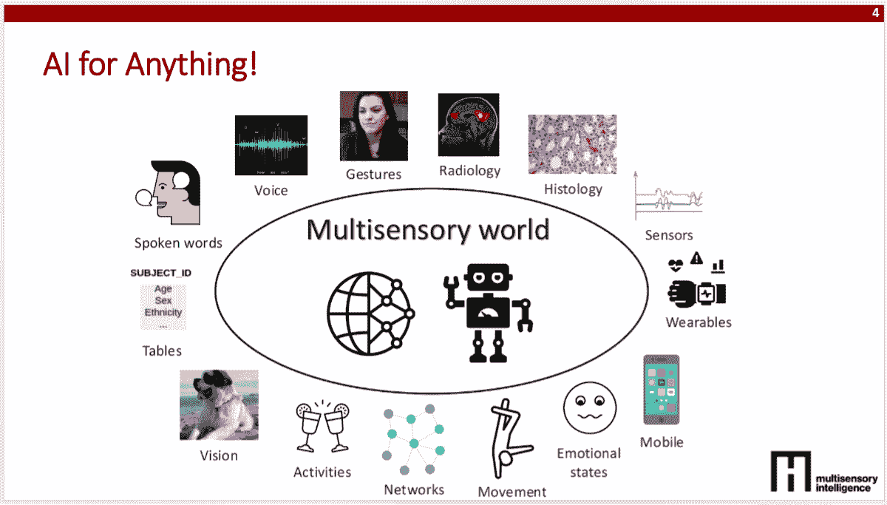

**如何进行AI研究**

指导学生如何生成研究想法、阅读论文、执行研究计划及撰写研究论文。课程详细介绍了研究过程的各个环节，包括自下而上的发现和自上而下的设计方法，强调科学问题和假设的重要性，提供多种研究方向的示例，如多模态AI、传感器数据处理、AI推理、交互式智能体、具身AI、社会智能AI、人机交互以及伦理与安全等。课程介绍了文献综述的方法、测试研究想法的步骤及撰写论文的结构和要点。

课程提供丰富的资源链接和工具建议，帮助学生在研究过程中获取支持。且文件列出本周的作业安排，包括项目偏好表的提交及下周课程的主题预告。课程为学生提供全面的AI研究入门指南，涵盖从理论到实践的各个方面。

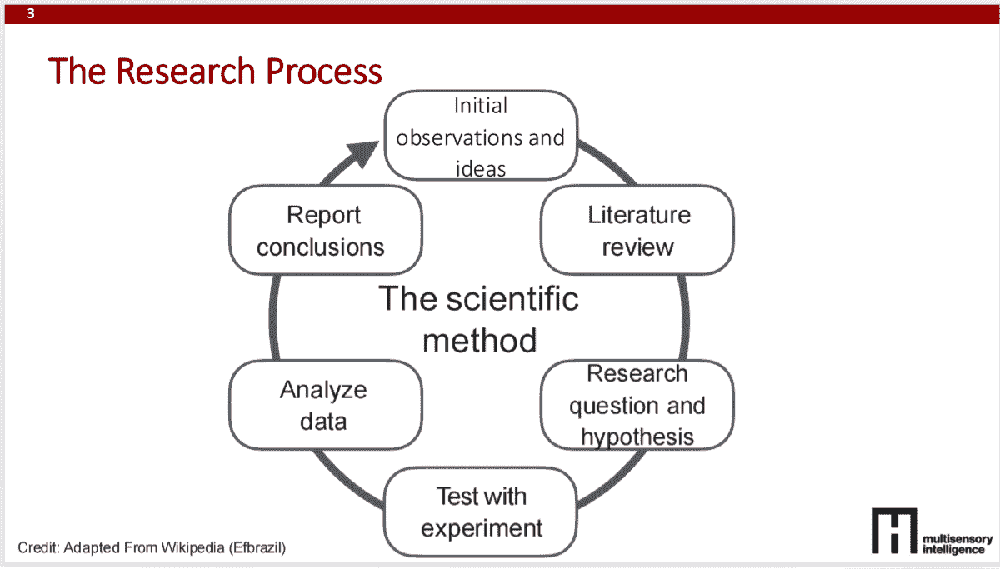

**数据、结构与学习**

课程主要介绍不同数据模态（如视觉、语言、音频、传感器数据、表格数据、图数据和集合数据）的特点、结构及常见的学习目标。课程详细探讨每种模态的数据表示、分布、粒度、结构、信息含量、噪声和相关性，讨论了监督学习、无监督学习、强化学习等多种学习范式及其在多模态和多任务学习中的应用。课程强调数据预处理、可视化和模型选择的重要性，及如何通过训练、验证和测试数据来评估模型的泛化能力。

课程最后总结了本周的作业安排，包括项目偏好表的提交、项目提案的准备和展示，及下周关于机器学习工具的可选教程。为学生提供数据处理和机器学习的基础知识，帮助他们在AI研究中更好地理解和应用不同模态的数据。

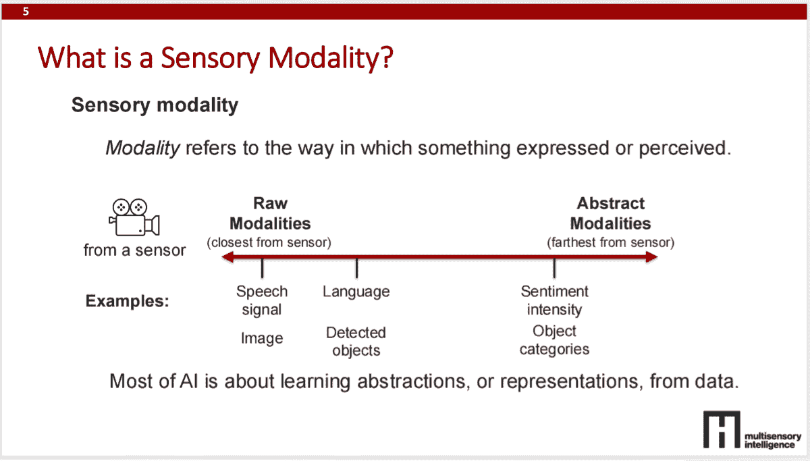

**实用AI工具**

课程主要围绕PyTorch和Hugging Face工具，为学生提供使用这些工具进行AI开发和调试的实用指南。课程介绍了Hugging Face的主要功能，包括transformers和datasets库，工具与PyTorch无缝集成，提供强大的预训练模型和数据加载功能。课程提到与PyTorch常配合使用的bitsandbytes和flash-attn库，能优化模型的性能和内存使用。课程阐述了AI开发时的调试技巧，包括如何与数据建立紧密联系、设置端到端的骨架模型、通过过拟合诊断错误、通过正则化改善泛化能力、调整超参数及榨取最后的性能提升。

课程提供关于如何设计新数据的机器学习模型的建议，强调从简单模型开始逐步增加复杂性的方法。总结调试模型时的关键步骤，如检查输入数据和标签的正确性、观察训练损失、处理过拟合和欠拟合等问题。能帮助学生在AI开发过程中避免常见陷阱，提高模型的可靠性和性能。

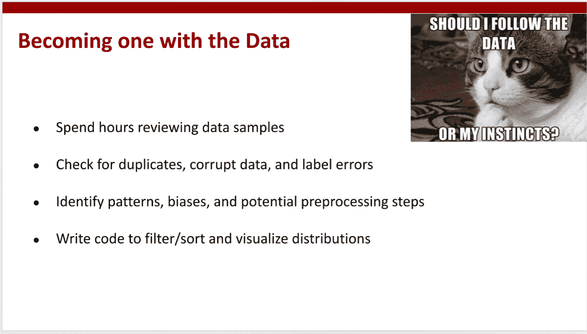

**模型架构**

课程介绍了不同数据模态（如序列数据、空间数据、集合数据和图数据）的模型架构设计原则和方法。课程内容包括如何根据数据的特性选择合适的模型架构，例如时间序列数据的循环神经网络（RNN）、卷积神经网络（CNN）用于空间数据处理，及图神经网络（GNN）用于图数据处理。讨论如何通过参数共享和信息聚合实现数据的不变性和等变性，及如何根据数据的语义信息、粒度、结构、信息含量、噪声和相关性来设计模型。

课程最后总结了本周的作业安排，包括项目提案的提交和阅读讨论的准备。课程为学生提供模型架构设计的系统性指导，帮助他们在AI研究中更好地理解和应用不同类型的模型架构。

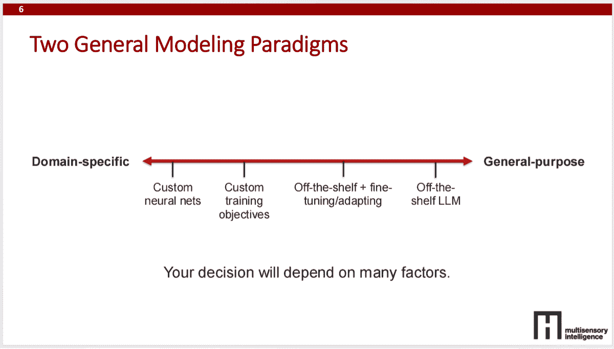

**多模态AI与对齐**

课程深入探讨多模态AI的核心概念，包括数据的异构性、模态间的连接性和交互性。课程内容涵盖多模态研究的历史阶段，从行为时代到深度学习时代，再到如今的基础模型时代。介绍了多模态任务的多样性，如语言与视觉的结合、情感分析、视频事件识别等，探讨多模态对齐的挑战，包括离散对齐和连续对齐的方法，及如何通过对比学习实现模态间的对齐。

课程详细介绍了多模态AI的六个核心挑战：表示学习、对齐、推理、生成、迁移和量化。特别提到CLIP模型在语言和视觉任务中的应用，及如何通过对比学习来学习共享和独特的模态信息。最后总结了本周的作业安排，包括阅读讨论和项目进展的反馈。课程为学生提供多模态AI领域的全面概述，帮助他们理解多模态数据的复杂性及如何通过模型设计和学习方法解决挑战。

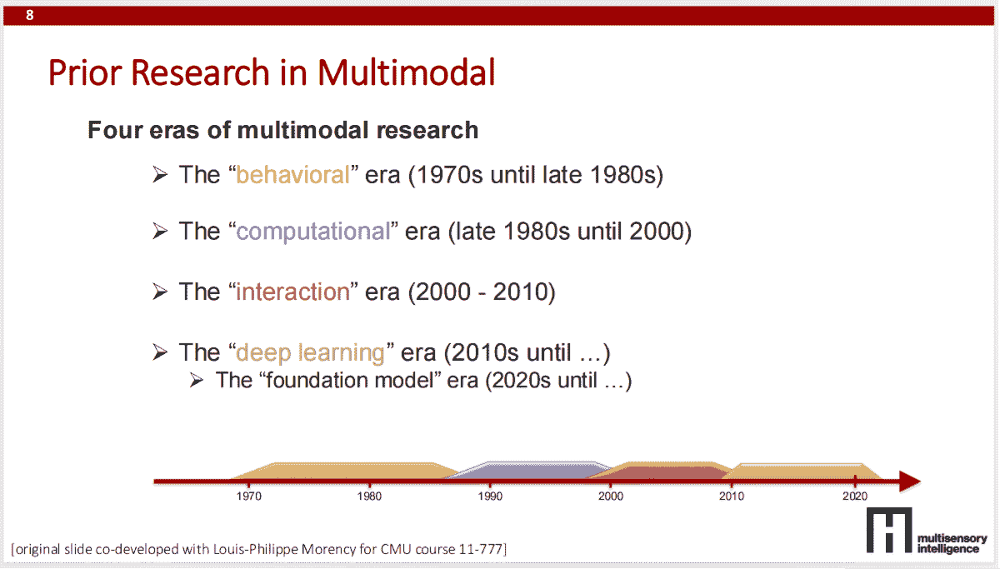

**多模态融合**

课程深入探讨多模态融合的核心概念和技术，包括早期融合、中期融合和晚期融合，及加性融合、乘性融合、张量融合、低秩融合和门控融合等多种方法。课程内容涵盖从简单的线性融合到复杂的非线性融合技术，及如何通过动态融合策略来优化多模态数据的表示和学习过程。讨论了多模态融合中的优化挑战，例如如何平衡不同模态的过拟合和泛化能力，及如何通过对比学习和多模态表示学习解决实际任务中的问题。

课程介绍了多模态融合在实际应用中的挑战，例如如何处理模态间的异构性、如何避免单一模态的偏差对融合结果的影响，及如何通过动态融合和架构搜索提高模型的性能。课程最后总结了本周的作业安排，包括阅读讨论和项目进展的反馈，帮助学生更好地理解和应用多模态融合技术。

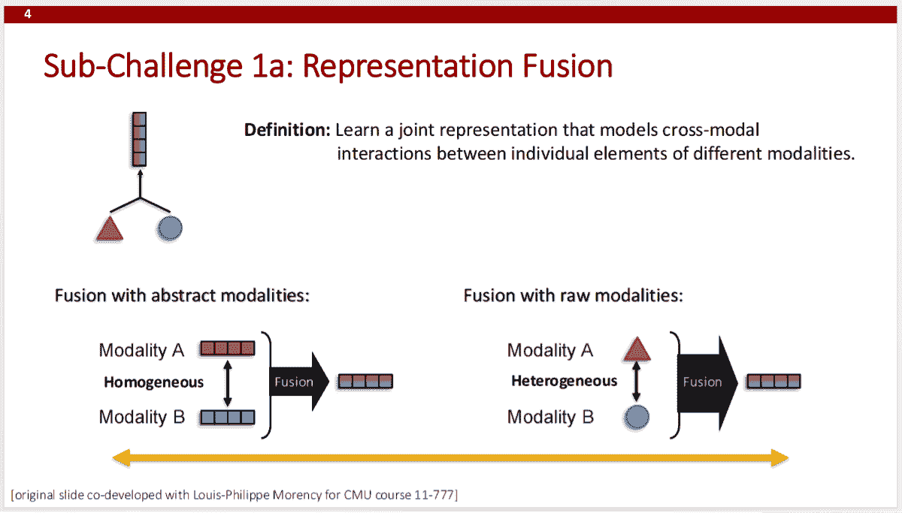

**跨模态学习**

课程深入探讨了跨模态学习的基本概念和技术，包括通过融合、对齐和翻译实现模态间的知识迁移。课程内容涵盖多模态学习中的多种迁移策略，如预训练模型的迁移、协同学习和模型诱导等。特别提到高模态多模态变换器（HighMMT）模型，能在部分可观测模态之间进行知识迁移，适用多种模态和任务的多任务学习和迁移学习。

课程讨论了跨模态学习中的开放性挑战，例如低资源模态的学习、超越语言和视觉模态的应用、复杂数据和模型训练的挑战及模型的可解释性。文件最后总结了本周的作业安排，包括阅读讨论和项目进展的反馈，帮助学生更好地理解和应用跨模态学习技术。

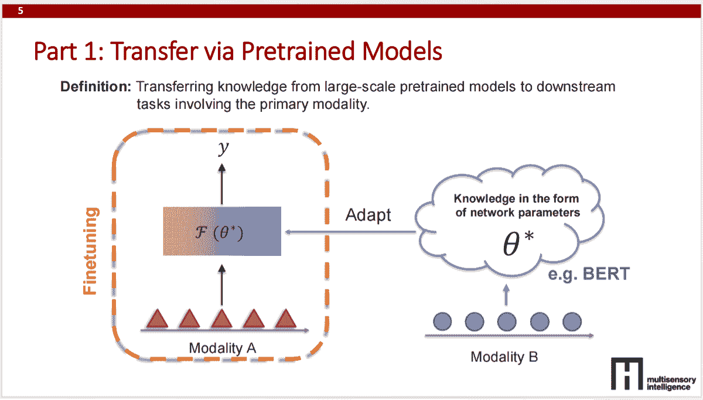

**大型基础模型**

课程详细介绍了大型语言模型（LLMs）的发展历程、预训练方法、架构类型、指令微调和偏好调整，及高效的训练和推理技术。课程内容涵盖从循环神经网络（RNNs）到Transformer架构的演变，及如何通过无监督学习在大规模文本数据上进行预训练。探讨了如何通过指令微调和偏好调整优化模型的性能，及如何通过LoRA（低秩适配）和量化等技术提高训练效率和推理速度。

课程讨论了大型语言模型的未来发展方向，包括如何教会模型进行推理、如何扩展多模态LLMs以涵盖更多模态，及如何在实际应用中评估和部署这些模型。课程最后提供了本周的作业安排，包括中期报告的提交和项目资源申请表的填写，帮助学生更好地理解和应用大型基础模型的技术。

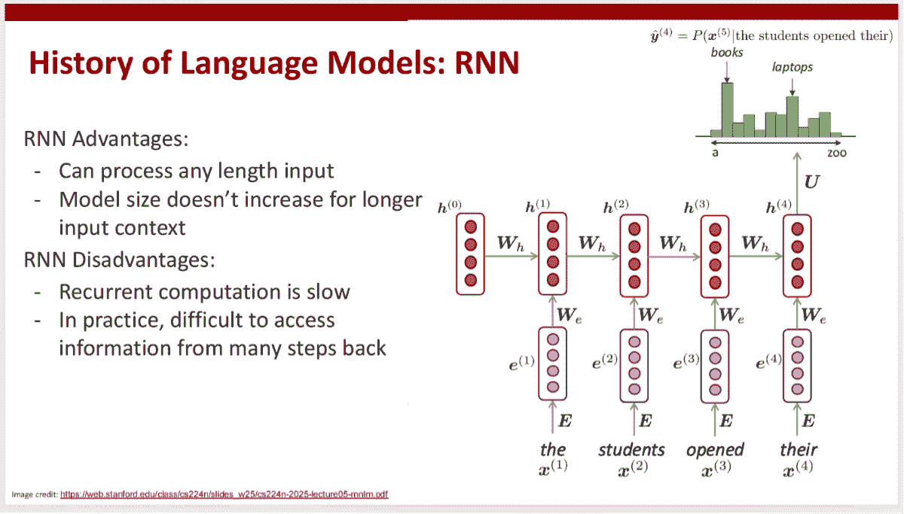

**大型多模态模型**

课程详细介绍了大型多模态模型的基础知识、预训练方法、如何将大型语言模型（LLMs）适应为多模态LLMs，及从文本到多模态生成的最新进展。课程内容涵盖多模态基础模型的表示方法、多模态Transformer架构、跨模态注意力机制，及如何通过指令微调和偏好调整优化多模态模型的性能。课程探讨了如何通过前缀调整和适配器层实现多模态条件生成，及如何通过大规模预训练数据集和多模态指令微调数据集提升模型的泛化能力。

课程讨论了多模态模型的未来发展方向，包括原生多模态模型的设计、多模态混合专家模型（MoE）的应用，及如何将多模态模型应用在时间序列数据等实际场景。课程最后安排了本周的作业安排，包括阅读讨论和项目进展的反馈，帮助学生更好地理解和应用大型多模态模型的技术。

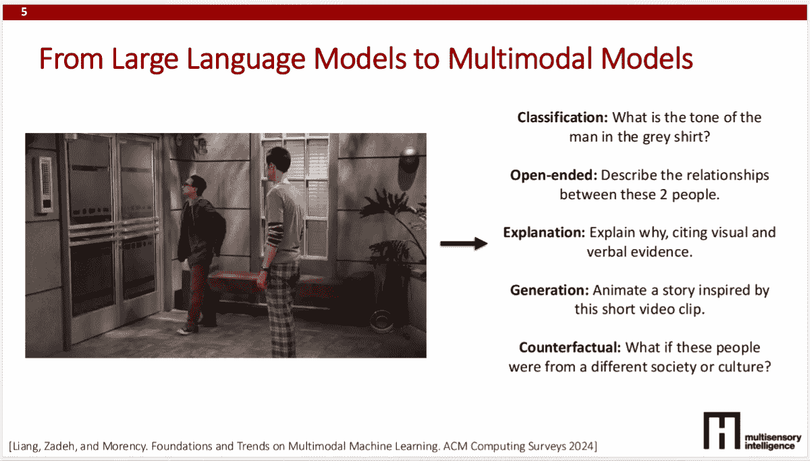

**现代生成式AI**

课程详细介绍了生成式AI的核心概念、当前技术的发展状态、条件生成的方法、模型架构及训练这些模型的技巧。课程内容涵盖从变分自编码器（VAE）到扩散模型和流匹配模型的多种生成式模型，探讨了模型的训练目标、噪声处理方式、采样速度以及优缺点。课程介绍了如何通过条件向量场和损失函数优化生成过程，及如何通过特定的架构设计提高模型的性能。

课程还讨论了生成式AI的评估指标，如Fréchet Inception Distance（FID）、CLIP Score、精确度/召回率和美学评分，帮助评估生成内容的质量和多样性。课程最后安排了本周的作业安排，包括阅读任务和项目进展的反馈，帮助学生更好地理解和应用生成式AI的技术。

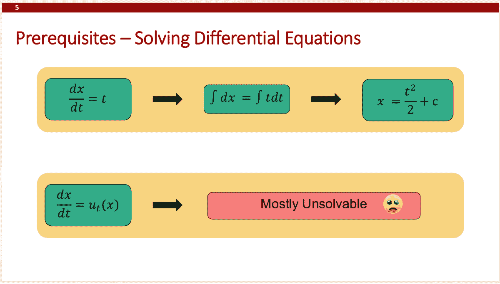

**强化学习与交互**

课程详细介绍强化学习的基础知识、现代强化学习在大型语言模型（LLMs）对齐和推理中的应用，及交互式LLM代理的设计和实现。课程内容涵盖强化学习的基本概念，如马尔可夫决策过程（MDP）、策略学习、模型基与策略基方法的对比，及如何通过策略梯度方法（如REINFORCE和PPO）优化策略。课程探讨了如何通过人类反馈进行强化学习，包括奖励模型的训练和偏好优化技术。

课程深入探讨了强化学习在实际应用中的挑战，如奖励函数的设计、模型的探索与利用平衡，及如何通过直接偏好优化（DPO）和组化策略优化（GRPO）等方法提高模型的性能和效率。课程最后安排了本周的作业安排，包括最终项目报告的提交和项目展示的准备，帮助学生更好地理解和应用强化学习的技术。

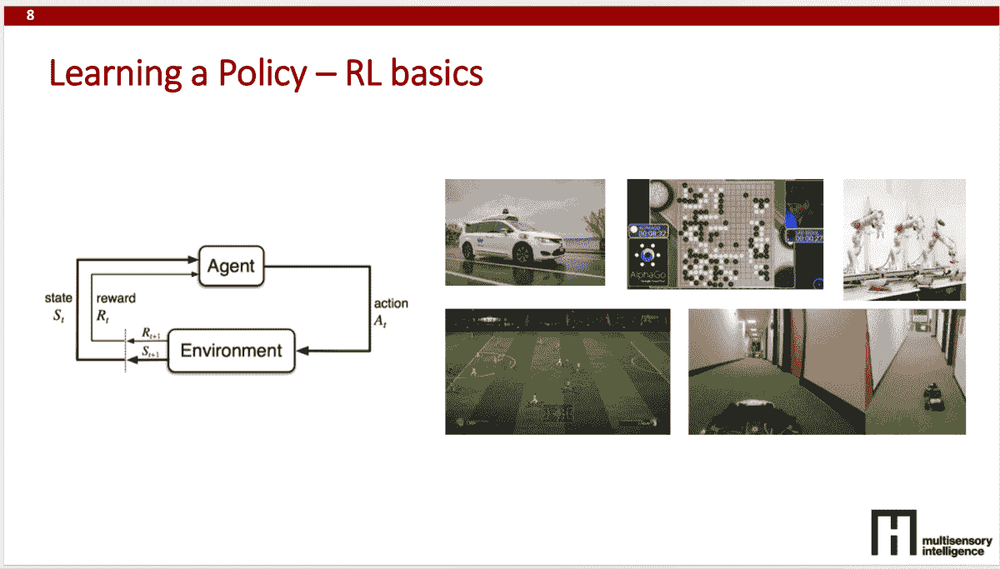

**最新发展方向**

课程探讨了多模态推理、AI代理、人机交互以及伦理与安全等前沿领域。课程内容包括多模态基础模型的表示方法、如何将大型语言模型适应为多模态文本生成模型、如何实现文本和图像生成，及如何通过人机交互提升模型的可信度和安全性。特别提到“Interactive Sketchpad”系统，一个用于协作和视觉问题解决的多模态辅导系统，能通过视觉推理和代码执行增强问题解决的有效性。

课程讨论了多模态模型在教育中的应用，例如通过视觉推理帮助学生理解抽象的几何概念。介绍多模态模型在安全和伦理方面的挑战，包括如何量化模型的不足、预测和控制模型行为，及如何解决模型中的偏见和不公平性。课程最后总结了本周的作业安排，包括最终项目报告的提交和课程反馈的收集。

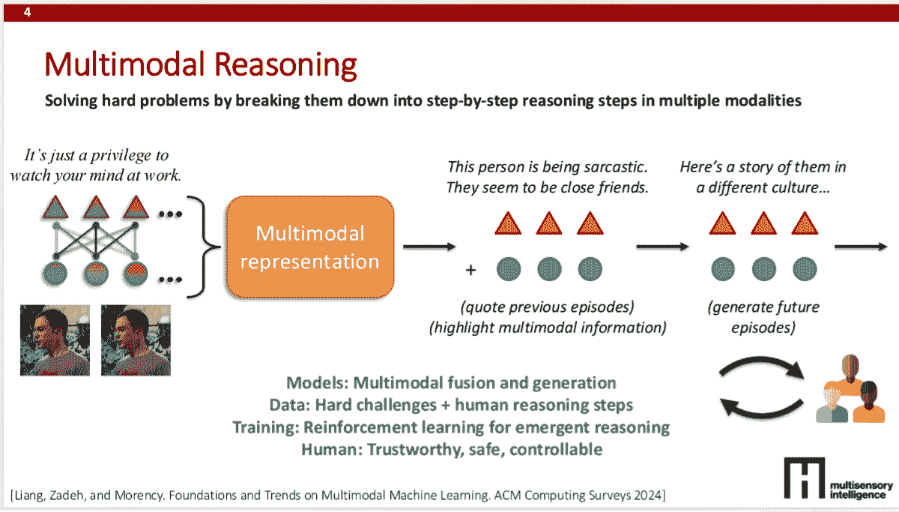

## 课程的项目地址

+   **项目官网**：https://mit-mi.github.io/how2ai-course/spring2025/

+   **GitHub仓库**：https://github.com/MIT-MI/how2ai-course

## 课程的应用场景

+   **医疗健康**：基于AI处理医疗影像和病历数据，开发辅助诊断系统，提高疾病检测和治疗的准确性和效率。

+   **智能交通**：基于AI技术分析交通摄像头视频和传感器数据，实现自动驾驶辅助系统和交通流量优化。

+   **艺术与创意设计**：借助AI生成音乐、绘画等创意内容，将语言描述转化为视觉或音频作品，为艺术家和设计师提供创作工具。

+   **智能教育**：开发AI驱动的个性化学习系统，通过分析学生行为和反馈，提供定制化的学习路径和教学内容。

+   **环境保护**：用AI处理卫星图像和环境传感器数据，监测环境变化，预测自然灾害，支持生态保护和可持续发展。