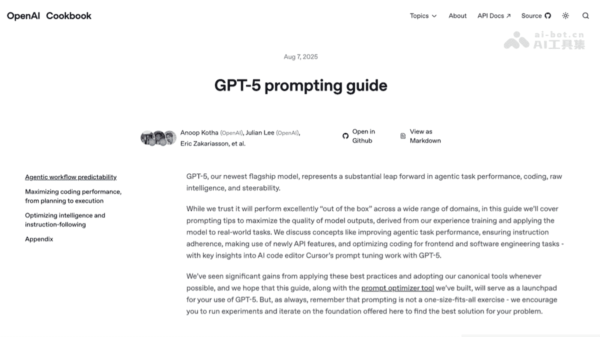

# OpenAI推出GPT-5官方提示工程词指南

> 来源：[https://gotoaiworld.feishu.cn/docx/EC5OdYb3noNwJdxmyB5c7x8hnEc](https://gotoaiworld.feishu.cn/docx/EC5OdYb3noNwJdxmyB5c7x8hnEc)

《GPT-5工程词指南》是OpenAI针对最新旗舰模型发布的官方技[术文档，主](https://ai-bot.cn/gpt-5/)要面向开发者和技术团队。指南系统性地介绍如何通过优化提示设计来充分发挥GPT-5在代理任务、编程和智能交互方面的突破性能力。核心内容包括：代理工作流的主动性控制技巧、Responses API的高效使用方法、编程任务的最佳实践框架（特别针对前端开发）、及模型参数（如reasoning_effort和verbosity）的调优策略。文档结合Cursor等合作伙伴的实际案例，展示如何通过结构化提示提升代码生成质量，并特别强调避免指令冲突的重要性。最后还提供SWE-Bench等专业场景的标准化提示模板，是一份兼具理论指导和实践价值的技术参考手册。

GPT-5, our newest flagship model, represents a substantial leap forward in agentic task performance, coding, raw intelligence, and steerability.

While we trust it will perform excellently “out of the box” across a wide range of domains, in this guide we’ll cover prompting tips to maximize the quality of model outputs, derived from our experience training and applying the model to real-world tasks. We discuss concepts like improving agentic task performance, ensuring instruction adherence, making use of newly API features, and optimizing coding for frontend and software engineering tasks – with key insights into AI code editor Cursor’s prompt tuning work with GPT-5.

We’ve seen significant gains from applying these best practices and adopting our canonical tools whenever possible, and we hope that this guide, along with the prompt optimizer tool we’ve built, will serve as a launchpad for your use of GPT-5. But, as always, remember that prompting is not a one-size-fits-all exercise – we encourage you to run experiments and iterate on the foundation offered here to find the best solution for your problem.

## Agentic workflow predictability

We trained GPT-5 with developers in mind: we’ve focused on improving tool calling, instruction following, and long-context understanding to serve as the best foundation model for agentic applications. If adopting GPT-5 for agentic and tool calling flows, we recommend upgrading to the Responses API, where reasoning is persisted between tool calls, leading to more efficient and intelligent outputs.

Controlling agentic eagerness

Agentic scaffolds can span a wide spectrum of control—some systems delegate the vast majority of decision-making to the underlying model, while others keep the model on a tight leash with heavy programmatic logical branching. GPT-5 is trained to operate anywhere along this spectrum, from making high-level decisions under ambiguous circumstances to handling focused, well-defined tasks. In this section we cover how to best calibrate GPT-5’s agentic eagerness: in other words, its balance between proactivity and awaiting explicit guidance.

+   Prompting for less eagerness

GPT-5 is, by default, thorough and comprehensive when trying to gather context in an agentic environment to ensure it will produce a correct answer. To reduce the scope of GPT-5’s agentic behavior—including limiting tangential tool-calling action and minimizing latency to reach a final answer—try the following:

+   Switch to a lower reasoning_effort. This reduces exploration depth but improves efficiency and latency. Many workflows can be accomplished with consistent results at medium or even low reasoning_effort.

+   Define clear criteria in your prompt for how you want the model to explore the problem space. This reduces the model’s need to explore and reason about too many ideas: