# 腾讯研究院《2025人工智能十大趋势》

> 来源：[https://gotoaiworld.feishu.cn/docx/KFEVdMd1Ho16ApxFSrscJrqYnvg](https://gotoaiworld.feishu.cn/docx/KFEVdMd1Ho16ApxFSrscJrqYnvg)

在2025世界人工智能大会·腾讯论坛上，腾讯研究院联合腾讯优图实验室、腾讯云智能、腾讯科技联合推出《共生伙伴：2025人工智能十大趋势》报告，揭示AI技术从工具属性向“共生伙伴”角色的深刻转变。随着基础模型、多模态融合、具身智能等技术的突破，AI正逐步融入人类生活的方方面面，成为工作、生活乃至社会运行的核心组成部分。以下为十大趋势的精华总结。

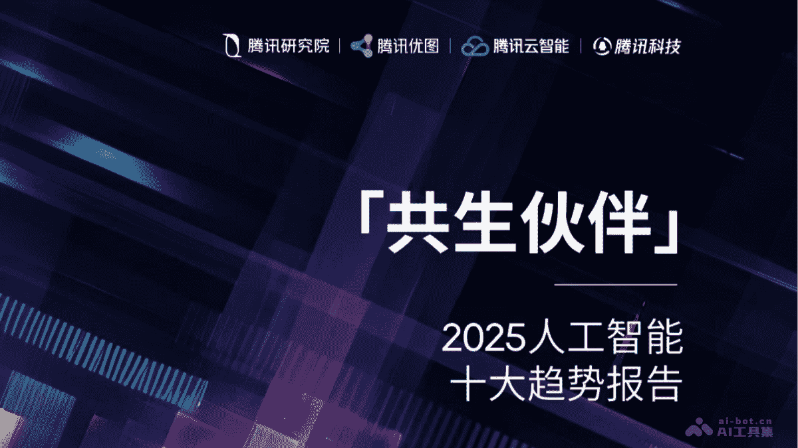

## 序言

+   序言一：司晓《从智能工具到共生伙伴》

司晓在序言中指出，AI正经历从“工具”到“共生伙伴”的深刻转变。随着强化学习、多模态融合等技术的突破，大模型不仅具备推理与行动能力，还能实现情感化交互。AI不再是被动执行指令的工具，而是能主动理解用户需求、优化生活与工作的“人生合伙人”。未来，空间智能和具身智能将推动AI从数字世界走向物理世界，完成从“会聊天”到“懂世界”的跨越。

+   序言二：吴运声《打造更好用的AI》

吴运声强调，AI的未来不仅是技术竞赛，更是产业落地的能力比拼。腾讯聚焦“离产业更近的AI”，通过模型层（如混元大模型）、平台层（如智能体开发平台）和应用层（如金融、制造场景解决方案）的三层布局，推动AI从“有能力”到“有用处”。他认为，AI的下一阶段将围绕安全、可控和普惠展开，让技术真正成为企业与社会的价值驱动力。

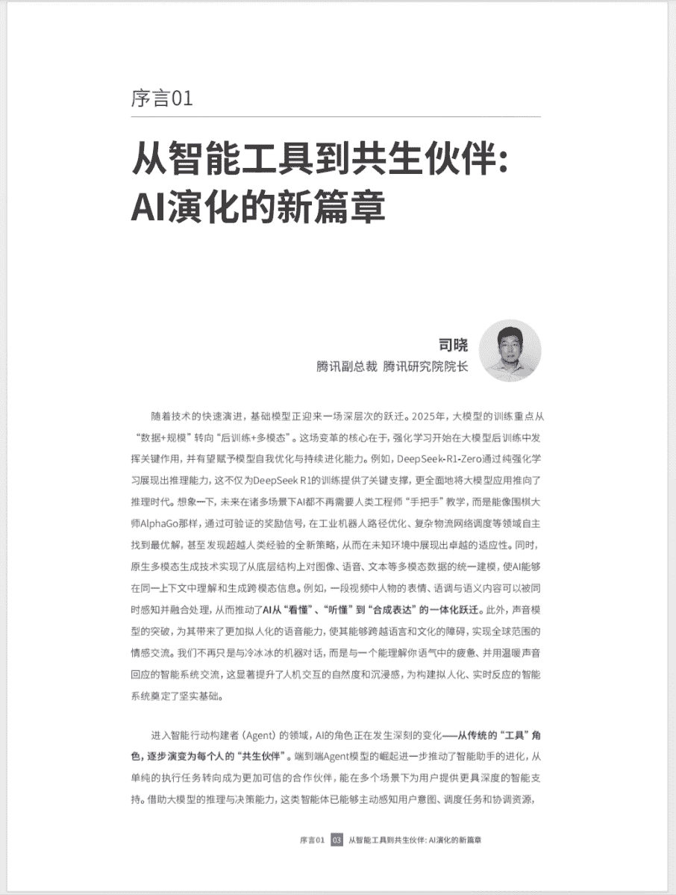

## 趋势01 强化学习：引领大模型推理与行动能力突破

强化学习从“对齐人类偏好”（RLHF）转向“基于可验证结果优化”（RLVR），推动大模型从内容生成迈向复杂问题解决。例如，AI在医疗、金融等领域通过强化学习实现自主决策，甚至发现超越人类经验的新策略。

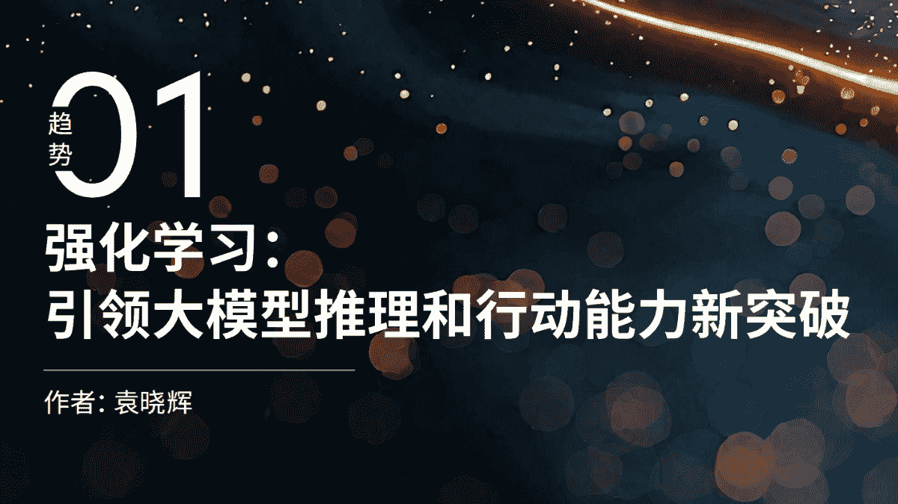

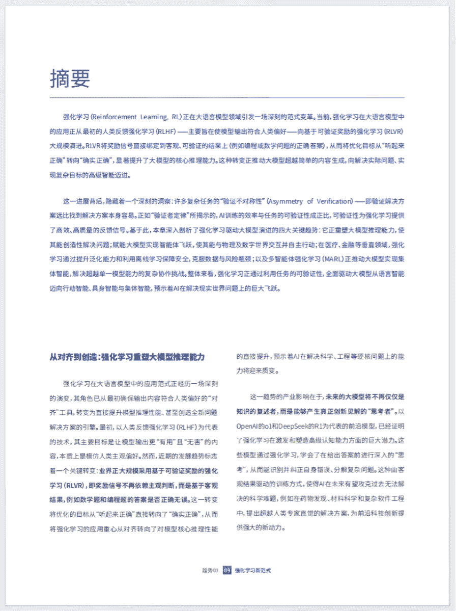

## 趋势02 原生多模态生成：感知与生成的统一

AI从单一模态处理转向跨模态统一建模，实现文本、图像、音频的联合理解与生成。例如，OpenAI的GPT-4o和Sora模型已能无缝处理多模态信息，重塑影视创作、电商推荐等行业的交互体验。

## 趋势03 声音模型的情感智能进化

语音合成技术从机械朗读升级为情感化表达，结合多模态能力，AI声音可实时生成音乐、配音，甚至驱动虚拟角色互动，成为教育、医疗、娱乐领域的“情感伙伴”。

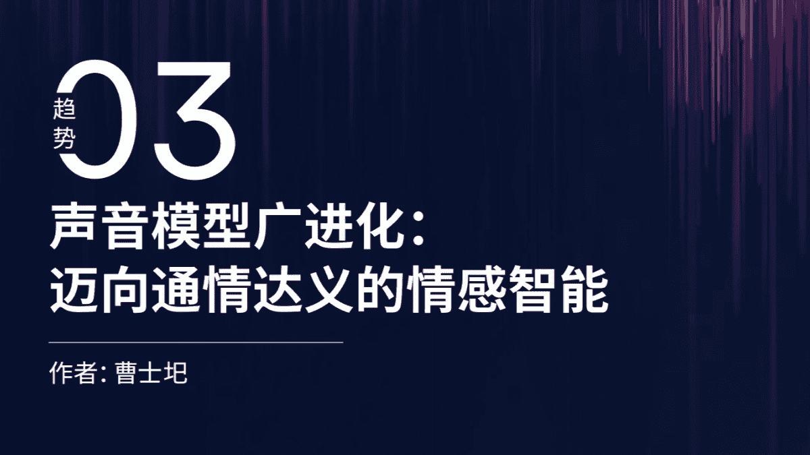

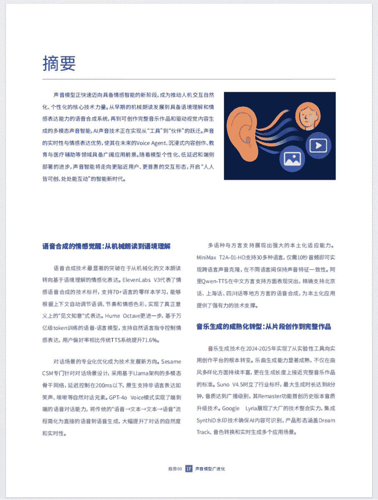

## 趋势04 智能体双轨进化：编排类与端到端并行

+   **编排类Agent**：如AutoGPT，通过调度工具和API完成复杂任务，在企业级应用中强调可控性。

+   **端到端Agent**：如OpenAI的o3模型，内化推理与工具使用能力，在专业领域（如科研、编程）展现深度自主性。

## 趋势05 LifeOS：AI成为个性化生活操作系统

AI从单次任务工具演变为持续陪伴的“数字自我”，整合用户长期记忆、习惯与情绪数据，主动优化日程、健康管理，甚至提供情感支持，如ChatGPT的Memory功能。

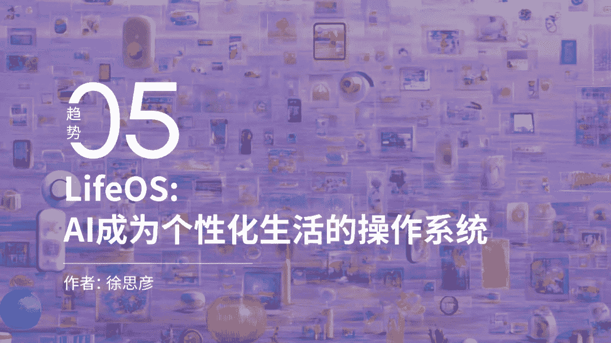

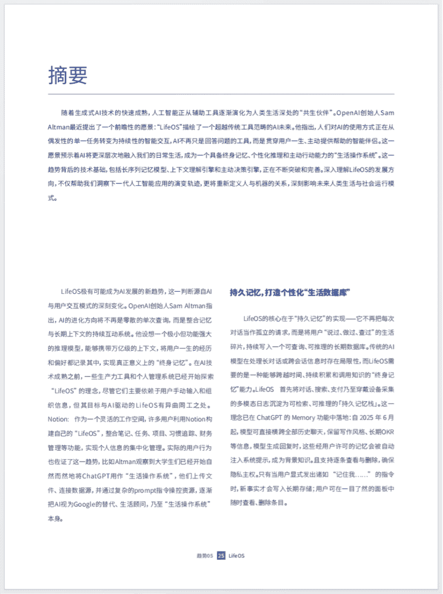

## 趋势06 智力即服务：智能化工作流赋能产业

企业通过AI Agent重构业务流程，将知识从“静态资产”转化为“可调度认知系统”。例如，微软365 Copilot通过检索增强生成（RAG）技术，实现企业知识的实时调用与决策支持。

## 趋势07 游戏智能体：虚拟世界的沉浸式进化

游戏AI从脚本化NPC发展为具备情感与社交能力的“数字生命”，如《暗区突围》的AI队友能动态适配玩家风格，推动元宇宙社交生态的成熟。

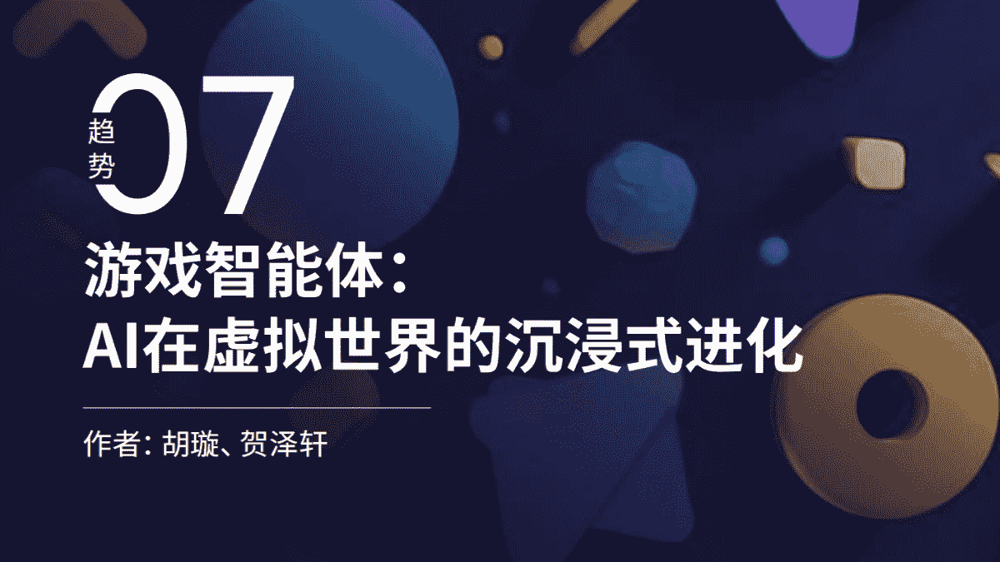

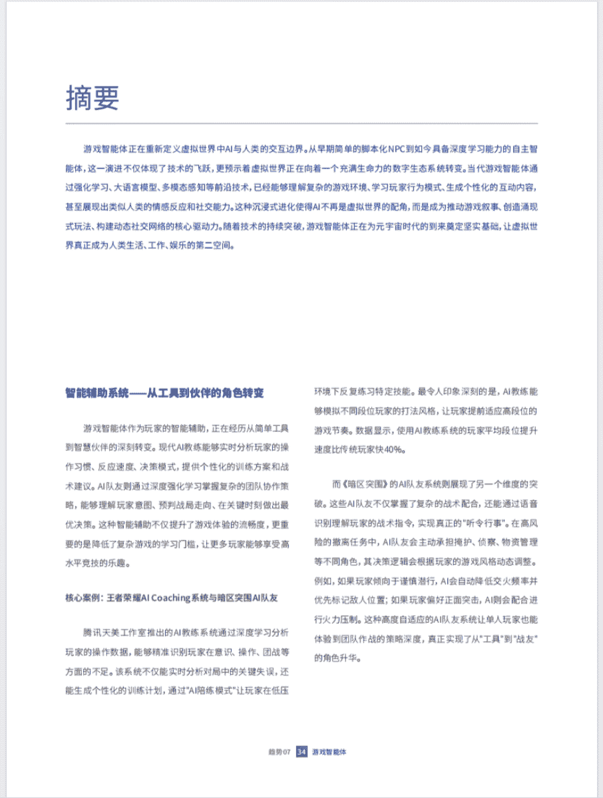

## 趋势08 具身智能的“GPT-2时刻”

基础模型（如VLA多模态模型）、数据工程与仿真平台的协同突破，推动机器人从实验室走向量产。例如，特斯拉Optimus和腾讯“小五”机器人已在制造、家庭服务中展现类人行动能力。

## 趋势09 空间智能：AI从词元到体素的跨越

AI开始理解三维空间（体素），赋能自动驾驶、XR混合现实等领域。李飞飞的World Labs致力于生成可交互3D场景，为智慧城市、建筑设计提供新工具。

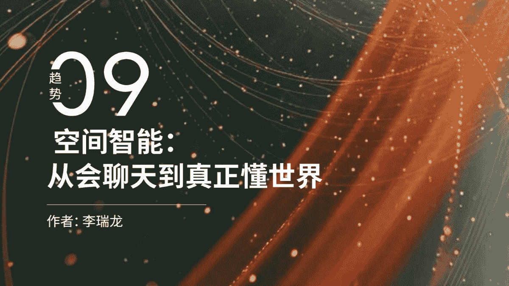

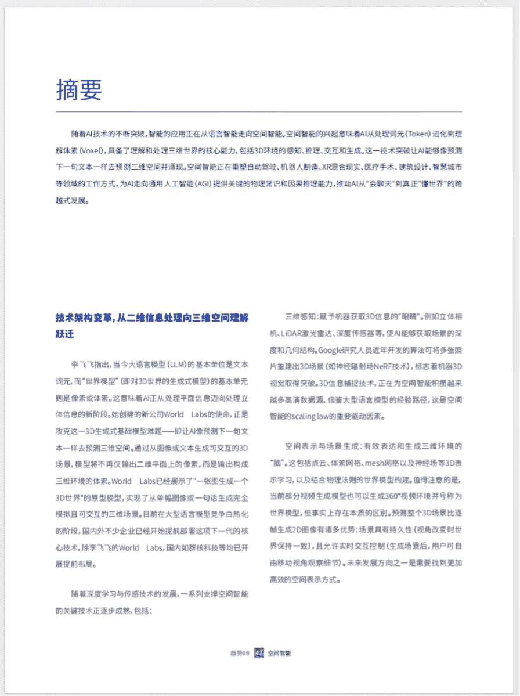

## 趋势10 测试转量产：具身智能本体加速成熟

人形机器人运动、感知系统标准化，逐步应用于物流、护理等高需求场景。Figure 02、Agility Digit等产品已实现千台级量产，标志AI从“数字大脑”迈向“物理执行”。

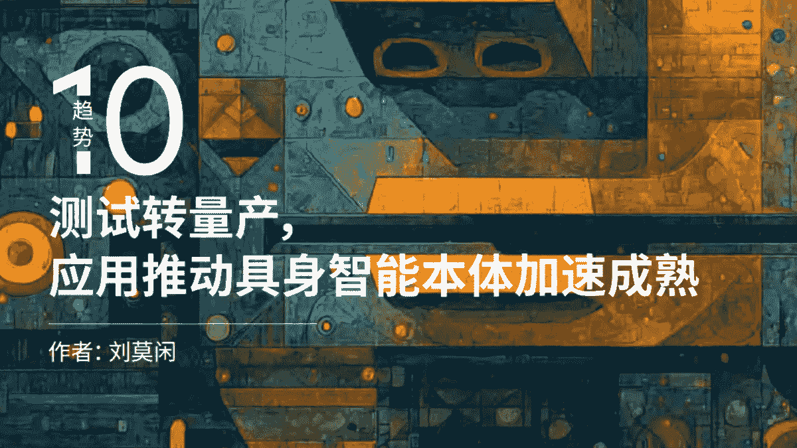

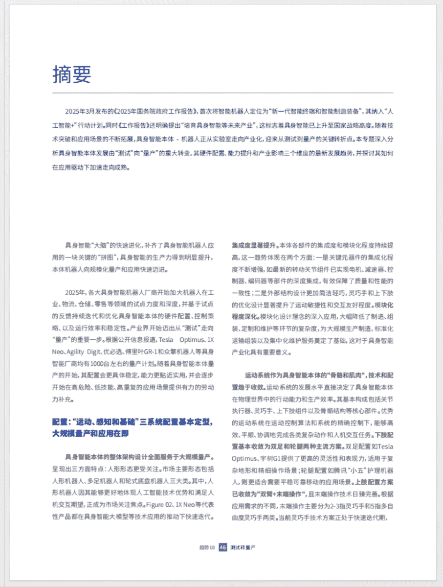