# 阿里《AI Agent开发新范式》合集

> 来源：[https://gotoaiworld.feishu.cn/docx/SVbrd3GdoouZVQxByv1cREJDnDb](https://gotoaiworld.feishu.cn/docx/SVbrd3GdoouZVQxByv1cREJDnDb)

阿里《AI应用（AI Agent）开发新范式》是关于AI应用开发的指导性文档。详细介绍AI Agent（智能代理）的开发模式、架构设计、核心组件及与大语言模型（LLM）的结合方式。文档强调AI Agent从传统工具向智能伙伴的进化，基于LLM的推理能力和工具调用实现复杂任务的自动化执行。文章探讨了企业级MCP服务的构建、AI应用的开发路径选择、及云原生技术在AI应用中的应用。《AI应用（AI Agent）开发新范式》提供函数计算、云原生API网关等技术在AI Agent开发中的最佳实践，帮助企业开发者更好地理解和应用AI技术，推动业务智能化转型。

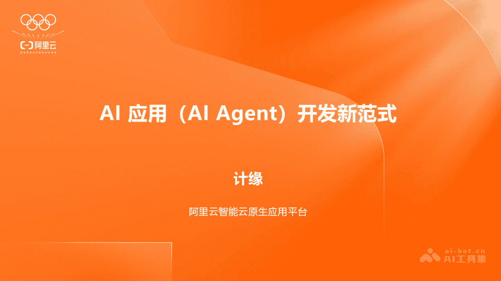

## **AI 应用概述**

+   **从“工具”到“智能伙伴”的进化**：AI应用从被动执行命令的工具进化为能与环境交互、理解意图并自我改进的智能伙伴。

+   AI Agent + LLM的双引擎模式：LLM作为“大脑”负责思考，AI Agent作为“手脚”负责执行，二者协同工作。

+   **企业能力的核心MCP服务**：MCP服务规范了多者协同关系，解决了构建AI Agent技能系统的痛点，实现快速对接。

+   构建AI应用的两种路径：全新开发vs.存量改造：全新开发适合颠覆性创新，存量改造适合在现有业务中嵌入AI能力。

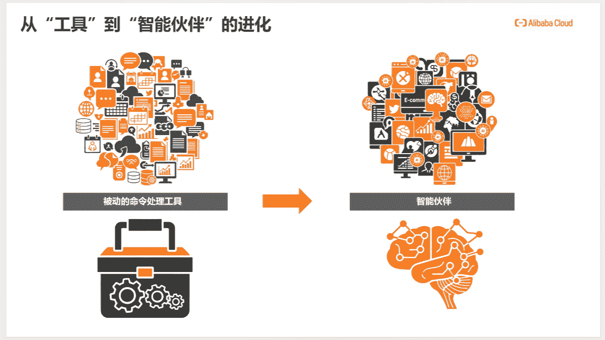

## **AI Agent 概述**

+   **什么是AI Agent**：AI Agent 是智能系统，通过大语言模型推理、执行行动并不断自省纠错，能解决复杂问题。

+   **AI应用的核心组件**：AI Agent由LLM推理、工具执行和自省循环构成，能解决复杂问题。

+   AI Agent的推理模式ReAct模式：AI Agent通过分析、推理、行动、观察和自省完成任务。

+   AI Agent的构建模式与AI Agent类型：构建模式包括编码式和低代码式，类型包括辅助基模、独立产品和辅助现存业务。

+   **构建AI Agent的核心问题**：如何构建企业级MCP管理体系和选择合适的运行时是关键。

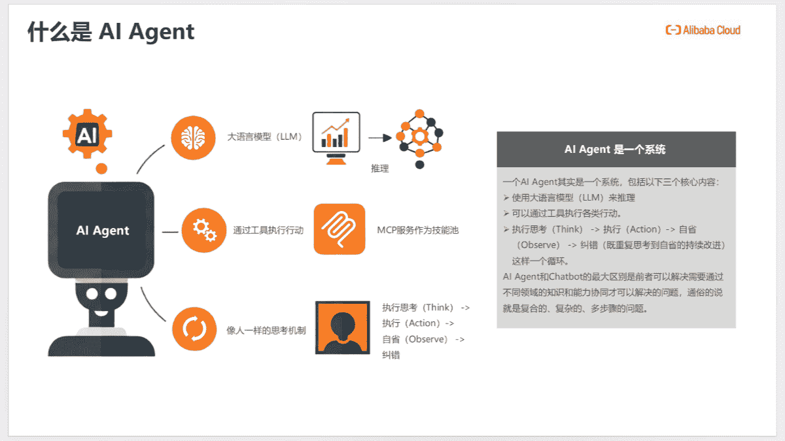

## 函数计算FC概述

+   **阿里云函数计算FC是什么**：函数计算是事件驱动的全托管计算服务，用户无需管理基础设施，按需使用资源。

+   **函数计算FC是云产品的连接器**：通过事件驱动模型，函数计算可以连接多种云产品，实现自动化流程。

+   **函数计算FC触发器类型**：支持双向集成、单向集成和云产品事件触发器，满足不同业务需求。

+   函数计算FC是云产品之间的粘合剂：提供多种云产品的原生触发器，帮助用户快速构建联动流程。

+   **客户案例**：展示了函数计算在不同业务场景中的应用案例。

+   **函数计算FC应用场景**：介绍了函数计算在HTTP应用、内容处理、大数据、游戏、AI等场景中的具体应用。

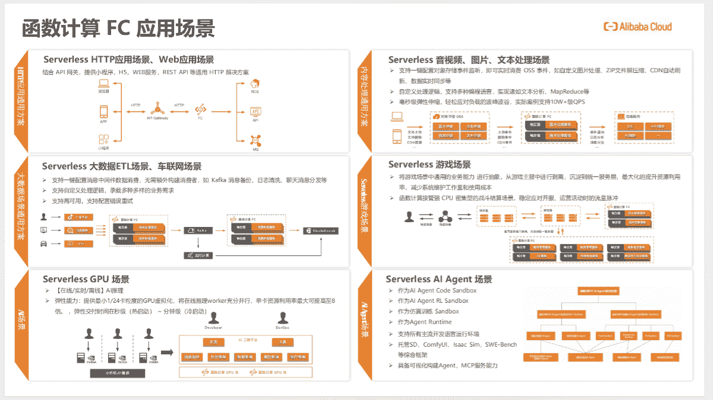

## 函数计算FC作为AI Agent运行时

+   函数计算FC支撑AI Agent方案拓扑图：展示了函数计算作为AI Agent运行时的整体架构。

+   函数计算作为计算资源运行AI Agent–编码式：函数计算提供高弹性、强安全的运行环境，支持多种语言和框架。

+   **两种类型**：运行在函数计算上的AI Agent包括用户自定义和使用框架开发的两种类型。

+   **优势和特点**：函数计算支持触发器机制、按请求扩缩、动态挂载存储等，提升资源利用率和灵活性。

+   函数计算构建Chat Al Agent：解决了执行环境交互、依赖包不确定性和文件信息路径不确定性等问题。

+   函数计算FC + CloudFlow可视化构建AI Agent：通过可视化工具快速构建AI Agent，支持多种调度方案。

+   **AIStudio控制台**：提供了可视化构建AI Agent的平台，支持项目管理、流程编排等功能。

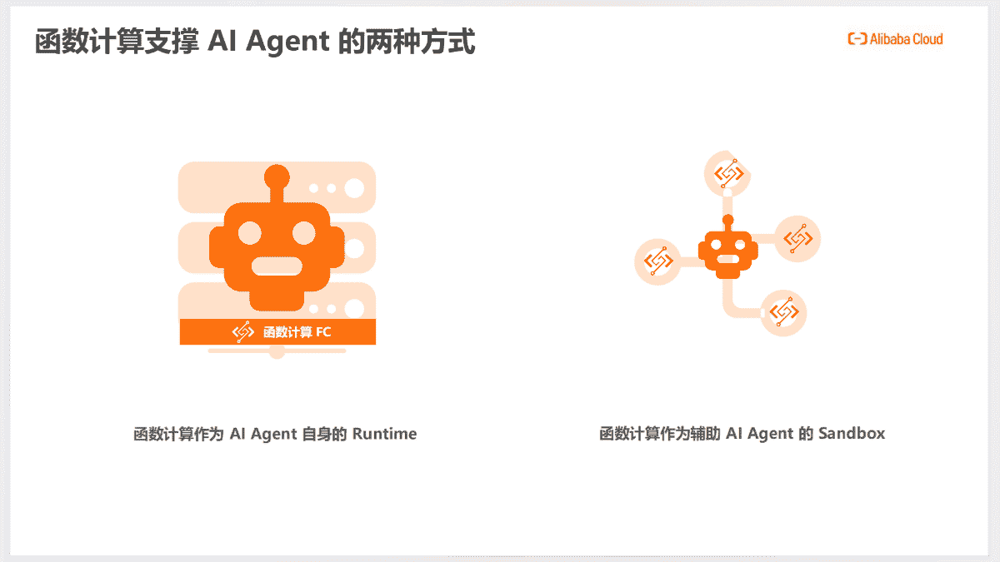

## 函数计算FC作为AI Agent Sandbox

+   AI Agent的Sandbox场景：介绍了Code Sandbox、Browser Use Sandbox、RL Sandbox和Sim Sandbox等不同场景。

+   **Code Sandbox**：用于协助训练基模的Coding能力，支持实时运行展示用户编码类任务。

+   Code Sandbox on FC优势：支持多种编程语言运行环境，提供硬件指标和多线程执行能力。

+   Browser Use Sandbox：用于联网搜索和辅助数据采集，支持Session/Cookie亲和性和基于内存扩容。

+   Browser Use Sandbox on FC优势：支持会话亲和性，优化冷启动，解决时延问题。

+   **RL Sandbox**：用于对LLM或AI Agent算法进行定向强化学习。

+   RL Sandbox on FC优势：提供安全性、高效率与可复现性，支持GPU计算资源。

+   **Sim Sandbox**：用于具身智能仿真训练，支持多种GPU卡型。

+   Sim Sandbox on FC优势：支持Isaac Sim/Isaac Lab环境，具备异步任务管理和仿真训练能力。

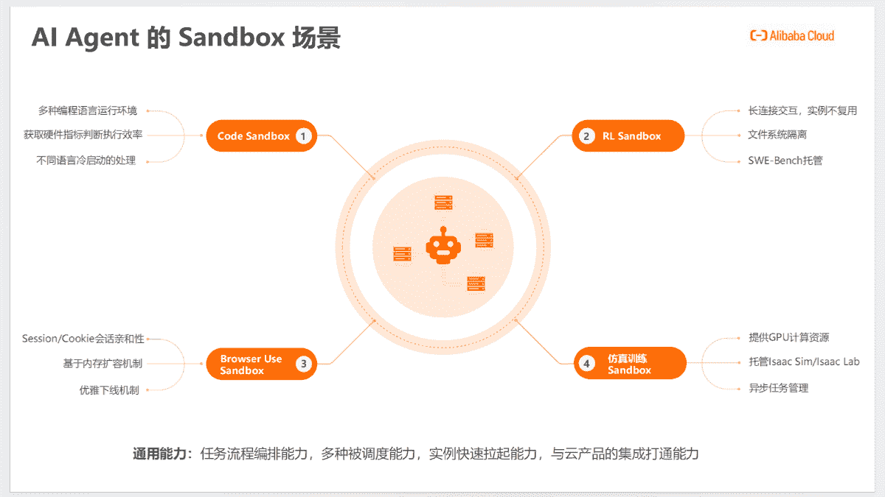

## 云原生API网关&AI网关介绍

+   **云原生API网关简介**：云原生API网关集成了多种网关功能，支持统一东西南北向流量管理。

+   云原生API网关在应用架构的核心作用–链接生态：作为流量网关和API网关，连接不同应用和服务。

+   **云原生API网关–流量网关**：提供安全防护、流量防护、服务治理等功能，保障流量稳定。

+   **云原生API网关–API网关**：支持API First开发模式，提供API防护、货币化等功能。

+   **云原生API网关–内部实践**：在阿里集团内部的实践案例，展示了其稳定性和性能。

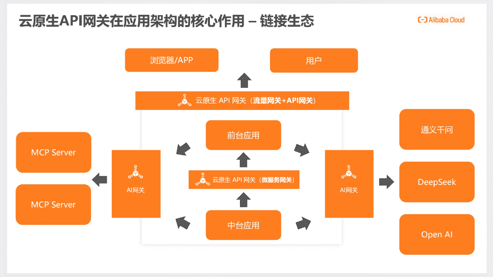

## AI网关代理LLM最佳实践

+   LLM生产项目中客户必然遇到的问题：客户在LLM生产项目中面临硬件成本高、模型幻觉、单一模型风险、合规审计、性能瓶颈及API Key配额限制等多方面挑战。

+   **AI网关代理LLMs方案**：通过AI网关实现多模型路由、切换、限流降级等功能。

+   云原生API网关代理LLMs方案的核心收益：解决了成本平衡、模型幻觉、多模型切换等问题。

+   **AI网关代理LLM最佳实践**：提供了消费者管理、模型服务高可用、闭源模型QPS/Token限制等问题的解决方案。

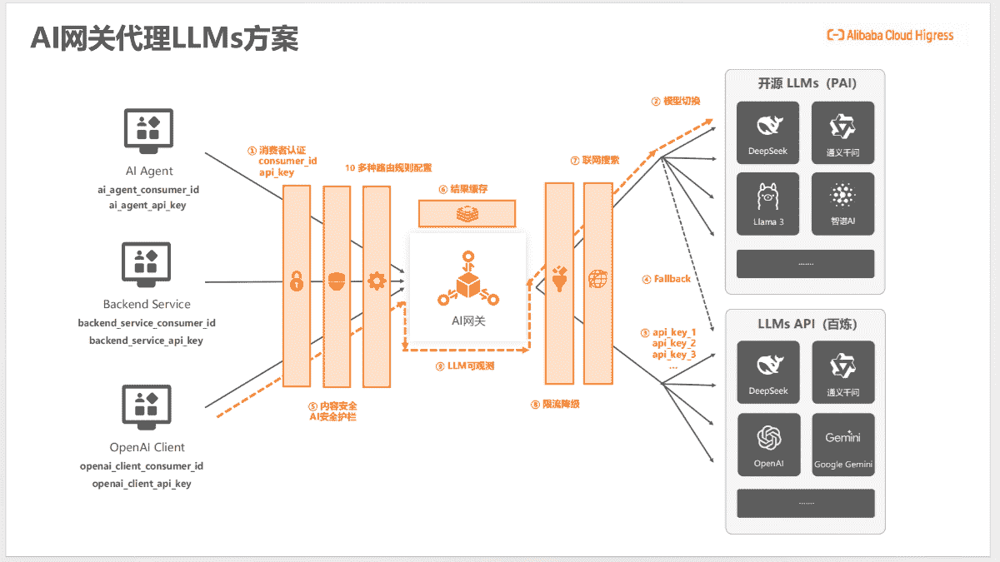

### MCP概述

+   **MCP是什么**：MCP是一种标准化协议，用于连接LLM和外部数据源及工具。

+   **标准化**：MCP通过标准化LLM访问外部数据的方式，简化了不同数据源和工具的集成。

+   **模块化**：MCP促进了模块化设计，允许独立开发和维护不同组件。

+   **可扩展性**：MCP使得添加新数据源或工具变得简单，无需大幅修改现有系统。

+   **安全性**：MCP提供结构化的访问模式，确保数据交互安全且受控。

+   **MCP协议的运作机制**：描述了用户输入、LLM推理、Client/Agent调用MCP Server等过程。

+   MCP和Function Calling之间的区别：MCP是通用协议层标准，Function Calling是大模型厂商提供的专有能力。

+   **MCP的本质和挑战**：MCP的本质是系统提示词和协同关系的结合，面临系统提示词管理、安全性、现存业务转换等挑战。

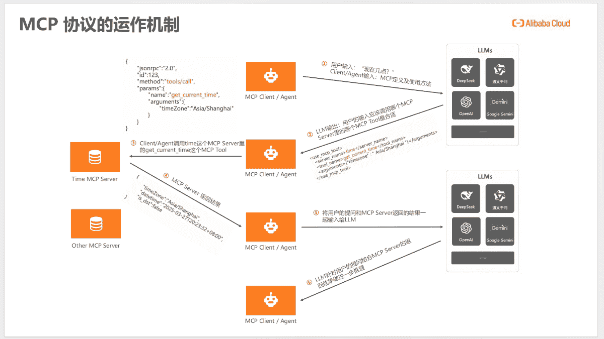

## AI网关代理MCP服务最佳实践

+   **AI网关–MCP功能架构**：介绍了AI网关的MCP功能架构，包括内置MCP Server、三方服务、企业服务等。

+   传统业务0代码改造转换为MCP Server–场景一：通过AI网关将传统业务0代码改造为MCP Server，实现快速协议转换。

+   **解决客户痛点**：解决了客户在开发AI应用或进行现存业务AI增强时面临的痛点。

+   **快速实现协议转换**：通过网关将Nacos中注册的传统服务转换为MCP服务，支持多种语言和服务。

+   MCP Registry定义及特性：介绍了MCP Registry的定义和特性，包括RESTful API、健康检查、环境配置支持等。

+   MSE Nacos作为MCP Registry的增量价值：MSE Nacos提供了额外功能，如安全管理、多种发布方式、多版本管理等。

+   传统业务0代码改造转换为MCP Server–场景二：通过MSE Nacos动态发现和注册服务，实现传统业务的0代码改造。

+   将SSE转换为Streamable HTTP：将MCP范式的SSE协议转换为更灵活的Streamable HTTP协议。

+   MCP模式下的身份认证和权限管控：通过插件机制提供多种认证方式，灵活管理和控制Client的身份认证和MCP服务使用权限。

+   插件机制灵活设置MCP服务代理策略：通过插件机制支持灵活设置MCP服务代理策略，如并发控制、流量控制等。

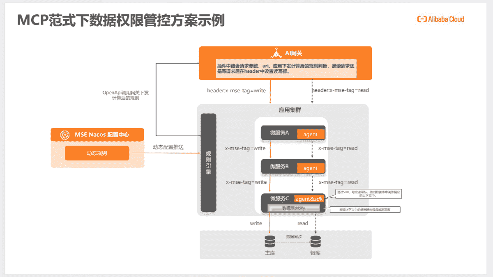

### MSE Nacos MCP Registry最佳实践

+   **Nacos开源社区发展情况**：Nacos自2018年开源以来，收获大量关注和使用，成为国内首选的服务注册与配置中心，广泛应用于众多头部企业。

+   **MSE Nacos适用场景**：MSE Nacos适用于服务管理、流量调度、白名单、应用容灾等多种场景，支持微服务、高可用、前端生态、数据库领域及AI领域中的MCP Server统一管控。

+   AI配置实践（Nacos：动态更新提示词数据）：通过MSE Nacos实现AI应用中的提示词数据动态更新，支持多种AI框架和语言，满足不同业务需求。

+   MSE Nacos 3.0 – MCP Register：MSE Nacos 3.0提供企业级MCP Registry，支持服务注册、发现、健康检查、安全管控等功能，结合云原生API网关实现MCP协议转换。

+   MSE Nacos 3.0构建企业级MCP Registry：MSE Nacos 3.0作为官方MCP Registry的超集，提供私有化部署、高级检索、安全管控等增强功能，解决多MCP服务检索和token消耗问题。

+   **MCP：安全性保障（规划中）**：规划中将提供MCP市场代理、MCP交互、MCP Server安全性保障，确保MCP生态安全。

+   **MCP效果验证体系–规划中**：规划中将构建MCP Server效果验证体系，实现Agent对MCP工具的精准触发验证，提供效果展示视图和动态调整建议。

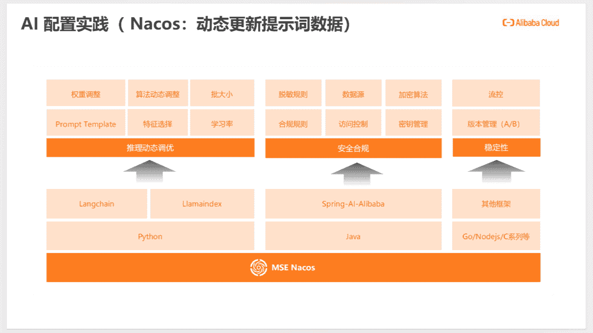

### 基于函数计算FC构建Agent的最佳实践

+   MCP Server on FC复用高性能能力：函数计算复用了云原生API网关的高性能能力，支持高并发和低延迟。

+   MCP Server on FC可观测体系：通过链路追踪、日志服务等实现函数计算的可观测性。

+   Alibaba Agent最佳实践–百炼集成：展示了如何将百炼集成到函数计算中，实现模型调用和任务执行。

+   Alibaba Agent最佳实践–库存盘点智能体：介绍了库存盘点智能体的架构和工作流程。

+   Alibaba Agent最佳实践–视频内容识别及问答智能体：展示了视频内容识别及问答智能体的架构和功能。

+   **AWS Agent最佳实践**

+   **A**WS Bedrock Agent将复杂任务拆解为子任务，并使用Lambda作为Function Calling外部工具分步解决问题：AWS Bedrock Agent通过Lambda实现复杂任务的分步解决。

+   **A**WS通过Bedrock + Lambda实现Agent租户隔离，Lambda作为Agent的BFF和Function Calling：AWS通过Bedrock和Lambda实现Agent的租户隔离和后端服务功能。

+   **Azure Agent最佳实践**

+   **A**zure通过OpenAI + Functions提供LLM Application Function Calling的最佳实践：Azure通过OpenAI和Functions实现LLM Application的Function Calling。

+   **Azure通过Durable Functions编排实现Multi-Agent**，基于Functions构建Agent/Function Calling最佳实践：Azure通过Durable Functions实现Multi-Agent编排和Agent构建。

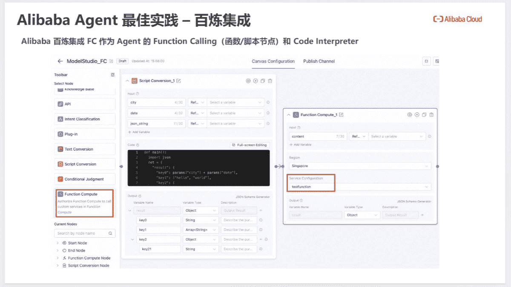

### AI应用可观测体系

+   **AI应用的挑战**：AI应用面临基础资源、模型推理和成本等方面的挑战。

+   一个典型的AI原生应用架构及可观测诉求：介绍了AI原生应用架构及各层的可观测诉求。

+   **AI全栈统一监控**：通过Prometheus构建AI全栈监控大盘，实现模型性能、Token成本和GPU资源的监控。

+   **模型调用全链路诊断**：基于OpenTelemetry Trace实现模型调用的全链路追踪。

+   **模型生成结果评估**：构建统一日志分析平台，对模型调用日志进行二次评估分析。

+   Tracing:模型调用全链路诊断：通过Trace记录模型调用的详细信息，实现端到端全链路追踪。

+   面向LLM应用的领域化Trace语义：定义领域化的操作语义，标准化存储和可视化关键内容。

+   LLM应用可观测需要关注哪些指标?：列举了需要关注的指标，如空响应次数、超时次数、TTFT等。

+   基于OpenTelemetry的高质量数据采集：通过OpenTelemetry Python Agent实现高质量数据采集。

+   拥抱开源，面向大模型应用量身打造：通过开源工具和自研探针实现大模型应用的可观测性。

+   Python探针无侵入埋点的实现原理：介绍了Python探针无侵入埋点的实现原理。

+   面向流式场景的LLM Span分段采集与合并：针对流式数据实现分段采集和合并，平衡性能和数据分析需求。

+   **Dify可观测最佳实践**：提供了Dify生产实践的建议和可观测性对比。

+   vLLM/SGLang推理性能可观测实战：通过Trace和指标关联排查推理性能问题。

+   基于LLM实现模型生成结果自动化评估：通过LLM对模型生成结果进行自动化评估。

+   **模型生成结果评估**：通过新的模型对原有模型的Prompt/Response进行二次评估，提升生成效果。

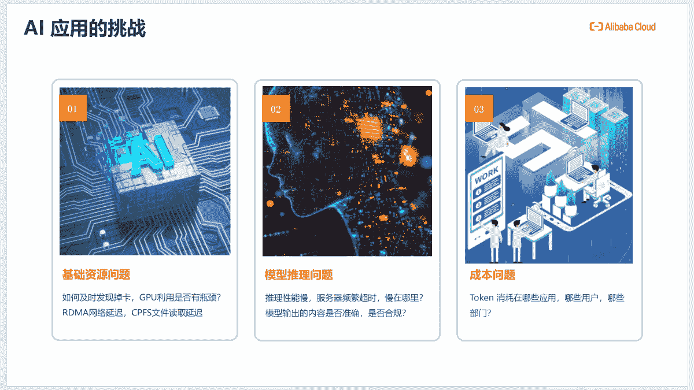

### AI应用开发新范式对企业的影响

+   高德业务投放平台Serverless实践(API First架构)：展示高德业务投放平台的Serverless实践和API First架构的优势。

+   MCP Server First：介绍了MCP Server First的架构和低代码模式构建业务流程的方法。

### 云原生API网关底座核心优势附录

+   **云原生API网关–高性能**：云原生API网关在性能上优于Nginx Ingress，支持硬件加速和深度调优。

+   云原生API网关–高可用(SLA:99.999%)：云原生API网关在研发、运行和变更阶段提供高可用保障。

+   **云原生API网关–安全能力**：云原生API网关提供消费者鉴权、mTLS双向认证、登录认证和流量防护等安全功能。

+   云原生API网关–插件机制(灵活扩展)：通过插件机制实现灵活扩展，支持多语言和在线IDE。

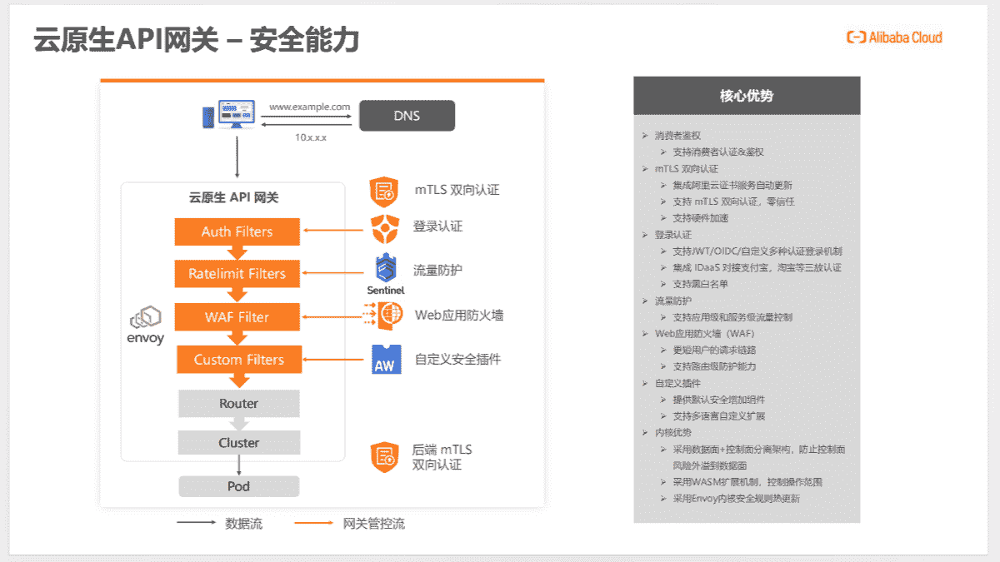

### 流量网关最佳实践附录

+   **统一接入层**：统一接入层解决了网络不通、业务边缘部署、协议不同等问题。

+   **K8s Ingress**：云原生API网关支持K8s Ingress，实现服务自动同步和多集群复用。

+   **全链路灰度**：通过云原生API网关实现全链路灰度发布。

+   **同城多活**：同城多活方案通过DNS和MSE治理实现多可用区部署和故障转移。