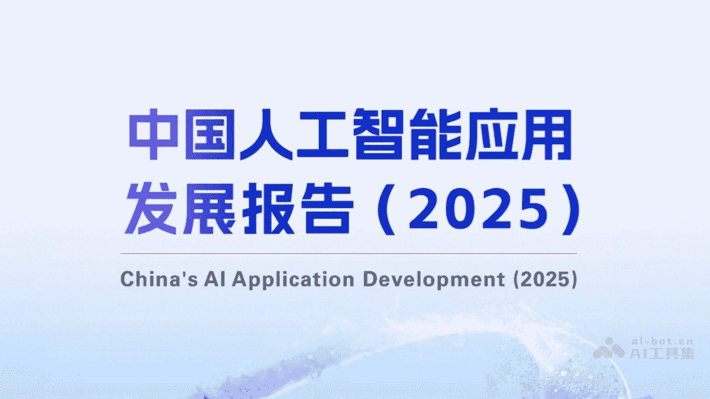
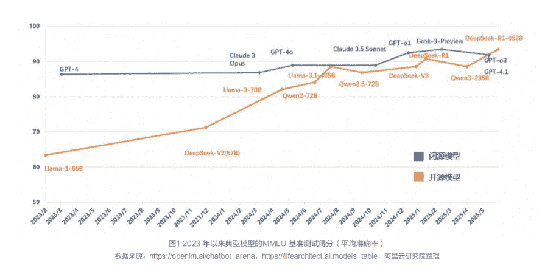
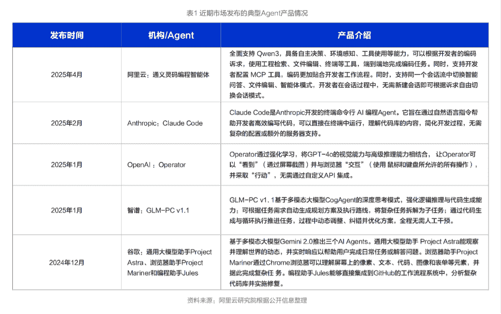
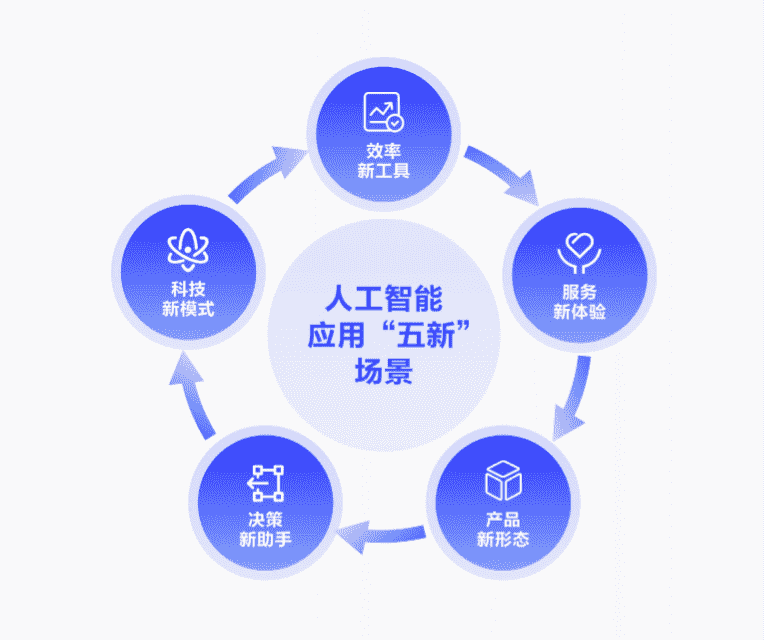
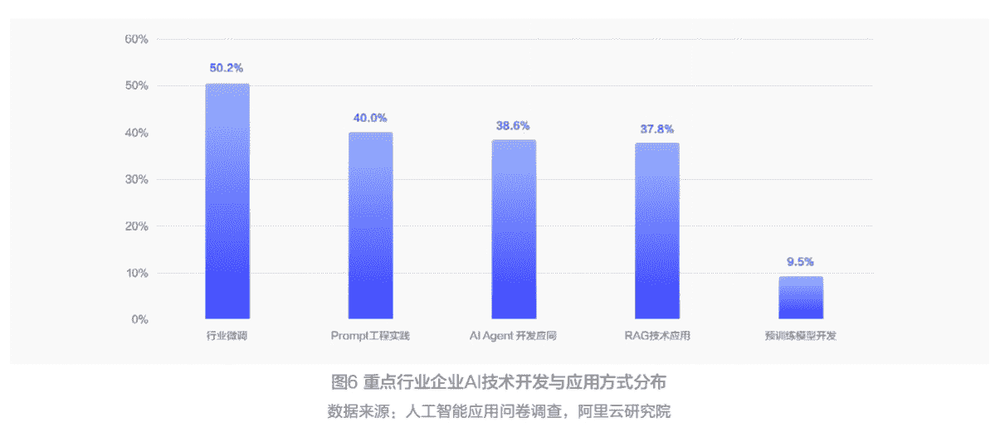

# 阿里云《中国人工智能应用发展报告（2025）》

> 来源：[https://gotoaiworld.feishu.cn/docx/EsTPdUNYhovxoZxOZwKcfNr4n3r](https://gotoaiworld.feishu.cn/docx/EsTPdUNYhovxoZxOZwKcfNr4n3r)

《中国人工智能应用发展报告（2025）》全面总结中国人工智能技术的发展现状、技术创新趋势、应用落地场景以及产业智能化进程。报告提出人工智能的“654”体系，包括六大技术创新趋势（强化学习、多模态融合、云边端协同、AI Agent、具身智能、基础设施精进）、五新应用落地场景（智能增效、智享服务、智创产品、智优决策、智能助研）和产业智能化四力分析模型（技术创新力、资金吸引力、市场渗透力、业务价值力）。报告对未来发展提出人才教育、技术创新、政策监管、财税金融和产业生态方面的展望与建议。

## 人工智能：新质生产力的强劲引擎

+   人工智能作为通用目的技术，正开启全新的智能时代

+   人工智能展现出跨领域泛化能力、基于基础模型的能力可塑性、慢思考推理过程以及人机交互革命等特性，推动技术经济范式系统性跃迁，成为新质生产力的关键支撑。

+   人工智能正加速“技术创新 – 产业转化 – 行业应用”的迭代过程

+   人工智能技术已跨越第一个拐点，进入高速成长期，呈现出技术创新、产业转化和行业应用的加速迭代特征，推动了人工智能生态的快速扩展。

+   政策和市场双向驱动，人工智能助力新质生产力发展

+   中国政府高度重视人工智能发展，出台多项政策支持人工智能技术创新和产业应用，各省市也结合自身产业特色制定相关政策，推动人工智能与实体经济深度融合。

## 人工智能技术创新六大趋势

+   强化学习驱动认知深化，模型推理能力持续提升

+   预训练阶段的规模定律逐渐向后训练及推理阶段延伸，强化学习等技术推动模型从被动应答转向主动求解，提升解决复杂问题的能力。

+   多模态融合加快推进，拓展智能交互边界

+   多模态大模型能够整合多种信息源，提供更全面的知识表示，未来将进一步提升通用性与泛化能力，使交互方式更加智能自然。

+   云边端深度协同，推动智能应用纵深发展

+   大模型应用向端侧普及，通过模型压缩技术解决端侧硬件能力限制，云、边、端三者的融合将成为趋势，提升智能应用的实时响应和隐私保护能力。

+   AI Agent迅速发展，以目标驱动替代指令响应

+   基于大模型的智能体（Agent）能够自主分解任务、调用工具并执行复杂任务，未来将提升基于不确定目标的推演能力和多Agent协作能力。

+   具身智能迈向深度情境理解与自主交互

+   具身智能将AI融入物理实体，赋予其自主感知、学习与交互能力，未来将在深度情境理解、运动控制等领域取得更大进展。

+   AI基础设施持续精进，构筑高效能AI发展底座

+   面对飞速增长的算力需求，计算、存储、网络需协同发展，同时通过工程优化充分释放现有硬件设备的计算能力，为AI发展提供坚实底座。

## 人工智能应用落地“五新”场景

+   **智能增效：催生效率提升新工具**

+   AI智能助手和自动化工具推动企业办公及开发方式革新，提升工作效能

+   AI能够智能识别、理解并处理复杂的办公场景，从文档撰写、会议纪要到数据分析，均可实现自动化处理，提升工作效率。

+   AI内容生成多样化拓展创作边界，提升产品设计及创意型行业的创作效率

+   大模型能生成富有创造性、风格多样的内容，拓展内容创作的边界，提升了创意型行业的创作效率。

+   通过AI优化企业生产流程与业务环节，有效提升生产经营效率

+   AI广泛应用于经营流程中，从单点的生产效率提升到全链路的业务流程重塑，大幅提升生产经营效率。

+   **智享服务：开启用户体验新旅程**

+   智能客服助力客户服务质量升级，有效提升用户满意度

+   大模型在客服领域大幅提升服务范围和质量精准度，提供更为贴切的解决方案，提升用户满意度。

+   基于智能算法的精准推荐，增强用户粘性并提升活跃度

+   大模型通过对用户行为和偏好的深度学习，实现更精准的个性化推荐，提高用户使用体验和平台粘性。

+   综合多维信息数据，提供更精准的个性化方案

+   大模型能实现产品服务的定制化，为用户打造独特的专属体验，提升用户满意度。

+   **智创产品：引领产业发展新业态**

+   生成式能力创新产品形态，催生AI原生应用软件产品发展

+   大模型直接推动生成式内容软件产品出现，如AI绘画工具、AI写作平台等，为创意产业带来了新的创作方式和产品形态。

+   大模型叠加硬件实现产品升级，AI终端和硬件实现智能交互

+   大模型技术和硬件功能的集成创新，助力产品形态的变革和发展，如AI耳机、AR眼镜等，提升产品的交互体验。

+   AI创新产业发展业态和模式，推动智能辅助驾驶、具身智能等未来产业发展

+   智能辅助驾驶、具身智能等未来产业与AI紧密相连，推动了产业的发展和创新。

+   **智优决策：打造决策优化新助手**

+   通过精准数据分析优化业务决策，数据驱动显著增强企业竞争力

+   大模型深入挖掘海量数据中的价值信息，提供更准确的趋势预测和行为分析，帮助企业制定更精准的决策。

+   多领域专业知识融合，助力产线优化排程策略

+   大模型利用海量数据的分析和预测能力，显著助力智能排程和精准生产，提升生产效率和产品质量。

+   数智驱动供应链全链路，实现多环节协同优化

+   大模型能实时整合和分析供应链各环节的信息，优化供应链管理，提升供应链效率。

+   **智能助研：开拓科技研发新模式**

+   通过海量数据处理与挖掘模式创新，助力科研新发现

+   AI技术大幅提升海量多模态数据的挖掘与理解能力，帮助科研人员实现更快速和准确的决策。

+   利用高精度模拟与智能化预测，为决策提供科学依据

+   大模型技术显著提升研发过程中的模拟精度与智能化预测能力，加速创新过程，减少实验成本。

+   智能技术助力实验设计与优化，显著提升研发效率

+   大模型能预测实验结果、识别最佳实验条件，并提供优化建议，提高科研效率。

## 产业智能化“四力”观察

+   技术创新力：AI技术深度融入各行各业，推动应用创新与产业升级

+   AI技术在各行业的渗透不断加深，专利数量显著增长，行业微调、Prompt工程实践等成为主流应用方式，推动了应用创新与产业升级。

+   资金吸引力：算法模型层投资保持稳定，逐步向行业应用层为主导推进

+   2024年AI领域投资逆势上扬，投资重点逐渐向行业应用层转移，智能汽车、机器人、医疗健康等领域受到重点关注。

+   市场渗透力：数字原生、创意导向及技术强耦合型行业成为AI应用的先行者

+   不同行业的AI应用呈现出结构性和阶段化特征，数字原生型、创意导向型和技术强耦合型行业对AI的适配度更高，应用更成熟。

+   业务价值力：AI应用效果达到市场预期，复杂任务处理能力仍待提升

+   当前AI应用在降本增效、经营创新和服务体验优化等方面展现出业务价值，但对于复杂任务处理和高精度要求的领域仍存在瓶颈。

## 展望与建议

+   人才教育：构建全周期培养体系，夯实创新人才根基

+   推动教育体系从“知识传授”向“能力 – 素养”双维培育转型，构建贯穿基础教育到职业发展的全周期人才培养体系，加强“产学研用”协同机制。

+   技术创新：强化AI基础设施，激活开源创新

+   构建自主可控、高效协同的AI基础设施体系，鼓励开源开放策略，激发创新动力，培育多元化技术创新主体。

+   政策监管：完善治理框架，筑牢安全底线

+   探索“软性引导 + 硬性规范”的治理路径，建立分层治理体系，完善数据安全与隐私保护制度，积极参与人工智能全球治理。

+   财税金融：创新多元化投入机制，优化资本配置

+   构建“政府引导、资本协同”的多元化资金支持体系，设立专项基金，提供税收优惠和补贴，创新金融产品和服务模式。

+   产业生态：深化协同创新，培育开放生态

+   以产业链协同创新为抓手，打造核心技术自主可控、应用场景全球领先、生态体系开放繁荣的产业生态格局，促进技术创新与市场需求的有效对接。